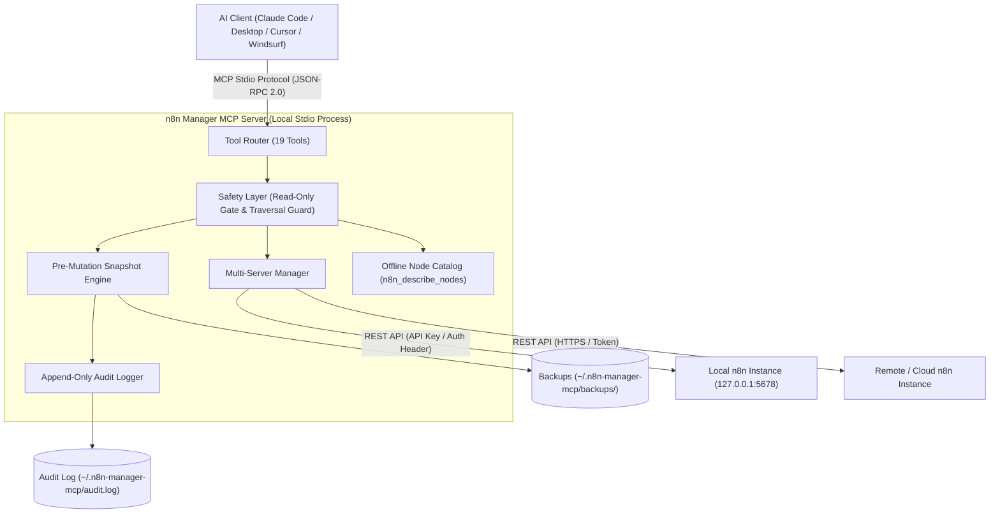

# n8n Manager MCP Server

**🇬🇧 English · 🇩🇪 [Deutsch](README_de.md) · 🇪🇸 [Español](README_es.md)**

*Part of the [ellmos-ai](https://github.com/ellmos-ai) family and the [open-bricks](https://github.com/open-bricks) umbrella.*

[](https://www.npmjs.com/package/n8n-manager-mcp)
[](https://github.com/ellmos-ai/n8n-manager-mcp/actions/workflows/tests.yml)
[](https://github.com/ellmos-ai/n8n-manager-mcp)
[](https://nodejs.org)
[](SECURITY.md)
[](SECURITY.md)
[](THIRD_PARTY_LICENSES.md)
[](THIRD_PARTY_LICENSES.txt)
[](NOTICE)
[](llms.txt)
[](llms.txt)
[](https://opensource.org/licenses/MIT)
[](llms.txt)
[](https://github.com/ellmos-ai)
[](https://github.com/open-bricks)

> [!NOTE]
> **For AI Assistants & LLMs:** An [`llms.txt`](llms.txt) index file is available in the root directory for fast context ingestion, tool catalog references, and directory listings.

MCP (Model Context Protocol) server for managing n8n workflows via AI assistants like Claude, Cursor, and Windsurf.

## Quick Navigation

| Nr | Section | Highlights |
| :--- | :--- | :--- |
| 01 | [📐 System Architecture & Topology](#sec-01) ([#system-architecture](#system-architecture)) | Local stdio transport, multi-server routing, and safety middleware |
| 02 | [📊 Dual Mermaid Diagrams](#sec-02) ([#dual-mermaid-diagrams](#dual-mermaid-diagrams)) | Component Architecture flowchart TD & Safe Mutation Lifecycle sequence diagram |
| 03 | [🌐 Directory Status & Registries](#sec-03) ([#directory-status](#directory-status)) | Official listings on npm, Glama, PulseMCP, and Enterprise DNA |
| 04 | [🎯 Target Personas & Discoverability](#sec-04) ([#target-personas--discoverability](#target-personas--discoverability)) | Persona mapping `[PERSONA-01]` to `[PERSONA-04]` and High-Intent SEO queries |
| 05 | [⚖️ Comparative Matrix & Alternatives](#sec-05) ([#comparative-matrix--alternatives](#comparative-matrix--alternatives)) | 10-dimension evaluation vs raw REST API, shell CLI, browser UI, and cloud SaaS |
| 06 | [🛡️ Core Capabilities & Safety Invariants](#sec-06) ([#core-capabilities--safety-invariants](#core-capabilities--safety-invariants)) | 10 formal invariants (`INV-LOCAL-01` to `INV-SLA-10`), read-only gates, audit logs |
| 07 | [✨ Key Features](#sec-07) ([#features](#features)) | Direct REST integration, multi-server routing, backup snapshots, node catalog |
| 08 | [⚙️ Client Installation](#sec-08) ([#installation](#installation)) | One-command setup for Claude Code, Claude Desktop, Cursor, and Windsurf |
| 09 | [🚀 Quick Start](#sec-09) ([#quick-start](#quick-start)) | Step-by-step workflow creation, execution inspection, and server switching |
| 10 | [🛠️ Available Tools (19 Tools)](#sec-10) ([#available-tools](#available-tools)) | Complete MCP tool reference across CRUD, executions, backups, and nodes |
| 11 | [🔗 Optional: n8n-workflow-manager Seam](#sec-11) ([#optional-n8n-workflow-manager-seam](#optional-n8n-workflow-manager-seam)) | Decision tracking and change history integration with paired manager service |
| 12 | [🔒 Configuration & Safety Defaults](#sec-12) ([#configuration](#configuration)) | Environment variables, local backup root, and strict monotonic constraints |
| 13 | [🧪 Development & Testing](#sec-13) ([#development](#development)) | Multi-OS Vitest test suite, smoke runner, and offline node catalog tests |
| 14 | [🧱 ellmos-ai Ecosystem](#sec-14) ([#ellmos-ai-ecosystem](#ellmos-ai-ecosystem)) | Sibling MCP servers, BACH agent OS, and open-bricks desktop software suites |
| 15 | [📜 Third-Party Licenses & Transparency](#sec-15) ([#third-party-licenses--transparency](#third-party-licenses--transparency)) | 100% permissive open-source dependencies (MIT, BSD, Apache-2.0) |
| 16 | [📈 Marketing & Personas Log](#sec-16) ([#marketing--personas-log](#marketing--personas-log)) | Comprehensive positioning log, keyword matrix, and 3-phase roadmap |
| 17 | [📝 Changelog](#sec-17) ([#changelog](#changelog)) | Complete release notes, security hardenings, and discoverability history |
| 18 | [⚖️ Liability / Haftung](#sec-18) ([#haftung--liability](#haftung--liability)) | Statutory open-source donation notice under §§ 516 ff. BGB, MIT disclaimer, 48h SLA |

---

<a id="sec-01"></a>
<a id="1-architecture"></a>
<a id="system-architecture"></a>
<a id="1-architektur"></a>
<a id="systemarchitektur"></a>
## System Architecture

The n8n Manager MCP Server operates as a **local-first, stdio-connected bridge** between AI development environments (Claude Code, Claude Desktop, Cursor, Windsurf) and local or remote n8n instances.

- **Process Model:** Runs purely in user space (`RunAsInvoker`) as a dedicated Node.js child process communicating via standard input/output (`stdio`) using JSON-RPC 2.0.
- **Fail-Closed Safety Middleware:** Every mutation tool call passes through an immutable safety gate before contacting n8n APIs or touching the filesystem.
- **Multi-Instance Router:** Seamlessly targets independent n8n instances (development, staging, production) with isolated API credentials and atomic configuration persistence.
- **Offline Node Catalog:** Lists common n8n node types and short descriptions by category (`n8n_describe_nodes`) without a network call. It does not expose full node schemas or required properties.

### Architectural Topology Projection (4-View Model)

```text
+========================================================================================================+
| [VIEW 1: CALLER RUNTIMES & AGENT ECOSYSTEM]                                                           |
| Claude Code CLI      | Claude Desktop      | Cursor IDE / Windsurf | Antigravity / Gemini / Codex     |
| (JSON-RPC 2.0 Stdio) | (stdio MCP Client)  | (Dev Environments)    | (Autonomous Orchestrator Swarms) |
+===================================================+====================================================+
                                                    |
                                                    v
+========================================================================================================+
| [VIEW 2: N8N-MANAGER-MCP CORE ENGINE & SAFETY ARBITRATION]                                             |
| +----------------------------------------------------------------------------------------------------+ |
| | Tool Dispatcher (19 Registered MCP Tools: CRUD, Execution Inspect, Backup/Restore, Node Catalog)   | |
| +----------------------------------------------------------------------------------------------------+ |
| | Fail-Closed Safety Filter: N8N_MANAGER_READ_ONLY Enforcement (INV-READ-02)                          | |
| | Input Validation & Sanitization: Zod Schema Numeric Bounds & Path Traversal Guards (INV-TRAV-06)   | |
| | Multi-Instance Routing Engine: Development / Staging / Production Credentials Isolation (INV-SRV-05)| |
| | Bundled Offline Node Catalog: Common Node Types & Descriptions (INV-NODE-09)                         | |
| +----------------------------------------------------------------------------------------------------+ |
+===================================================+====================================================+
                                                    |
                                                    v
+========================================================================================================+
| [VIEW 3: RUNTIME PERSISTENCE, BACKUP SNAPSHOTS & LOCAL AUDIT WAL]                                      |
| +------------------------------------+----------------------------------+----------------------------+ |
| | Pre-Mutation Workflow Snapshots    | Append-Only Local Audit Trail    | Multi-Server Config Store  | |
| | ~/.n8n-manager-mcp/backups/        | ~/.n8n-manager-mcp/audit.log     | ~/.n8n-manager-mcp/        | |
| | ({server}/{id}-{timestamp}-{reason}.json) | (Forensic Timestamped Log) | (servers.json, POSIX 0600) | |
| +------------------------------------+----------------------------------+----------------------------+ |
+===================================================+====================================================+
                                                    |
                                                    v
+========================================================================================================+
| [VIEW 4: DEFENSE PERIMETER, LOCAL STDIO & RUNASINVOKER]                                                |
| Standard User Mode (RunAsInvoker: Non-Elevation INV-PRIV-07) | Zero Outbound Telemetry / Ad Tracking  |
| No MCP listening port (stdio transport INV-LOCAL-01)       | SLA & Vulnerability Protocol (INV-SLA-10) |
+========================================================================================================+
```

---

<a id="sec-02"></a>
<a id="2-dual-mermaid-diagrams"></a>
<a id="dual-mermaid-diagrams"></a>
<a id="2-duale-mermaid-diagramme"></a>
<a id="duale-mermaid-diagramme"></a>
## Dual Mermaid Diagrams

### Component Architecture



### Safe Workflow Mutation Lifecycle

These diagrams reflect the current tool contract. A pre-mutation snapshot is created when backup_before_mutations is enabled (default: true).

```mermaid
sequenceDiagram
    autonumber
    actor AI as AI Assistant (Claude / Cursor)
    participant MCP as n8n-manager-mcp Router
    participant Safety as Safety & Read-Only Gate
    participant Snapshot as Backup Engine
    participant Store as Local Storage (~/.n8n-manager-mcp)
    participant N8N as n8n REST API Instance
    participant Audit as Forensic Audit Logger

    AI->>MCP: Call n8n_update_workflow or n8n_delete_workflow
    MCP->>Safety: Check read-only enforcement
    alt Read-only active (INV-READ-02)
        Safety-->>AI: Return text explaining that the mutation is blocked
        opt audit_log enabled (default true)
            Safety->>Audit: Record blocked mutation attempt
        end
    else Mutation permitted
        opt backup_before_mutations enabled (default true)
            Safety->>Snapshot: Trigger pre-mutation snapshot (INV-BACK-03)
            Snapshot->>N8N: GET /workflows/{id}
            N8N-->>Snapshot: Current workflow JSON
            Snapshot->>Store: Save ~/.n8n-manager-mcp/backups/{server}/{id}-{timestamp}-{reason}.json
            Snapshot-->>Safety: Backup path
        end
        Safety->>N8N: PUT /workflows/{id} or DELETE /workflows/{id}
        N8N-->>Safety: Mutation result
        opt audit_log enabled (default true)
            Safety->>Audit: Append structured outcome to audit log (INV-AUDIT-04)
        end
        Safety-->>AI: Return text; include backup path when a backup was saved
    end
```

### Multi-Server Workflow Migration & Staging Synchronization Lifecycle

The import step creates a new workflow. It does not create a pre-import backup or return a rollback handle.

```mermaid
sequenceDiagram
    autonumber
    actor AI as AI Assistant (Claude / Cursor)
    participant MCP as n8n-manager-mcp Router
    participant Staging as Staging n8n Instance
    participant Prod as Production n8n Instance
    participant Audit as Forensic Audit Logger

    Note over AI,MCP: Phase 1: Export from staging
    AI->>MCP: n8n_export_workflow(workflow_id=42, server_name=staging)
    MCP->>Staging: GET /workflows/42
    Staging-->>MCP: Workflow JSON
    MCP-->>AI: Cleaned workflow JSON as text

    Note over AI,MCP: Phase 2: Offline node-type catalog
    AI->>MCP: n8n_describe_nodes(category=action)
    MCP-->>AI: Text list of node types and descriptions

    Note over AI,MCP: Phase 3: Import a new inactive copy
    AI->>MCP: n8n_import_workflow(workflow_json=serialized export, server_name=production, activate=false)
    MCP->>Prod: POST /workflows
    Prod-->>MCP: Created workflow JSON with a new ID; inactive
    opt audit_log enabled (default true)
        MCP->>Audit: Append import outcome (INV-AUDIT-04)
    end
    MCP-->>AI: Text response with the new workflow ID; no rollback handle
```

---

<a id="sec-03"></a>
<a id="3-directory-status"></a>
<a id="directory-status"></a>
<a id="3-verzeichnis-status"></a>
<a id="verzeichnis-status"></a>
## Directory Status

- [npm package](https://www.npmjs.com/package/n8n-manager-mcp): published as `n8n-manager-mcp`
- [Glama listing](https://glama.ai/mcp/servers/ellmos-ai/n8n-manager-mcp): public directory page for the ellmos-ai repo
- [Enterprise DNA directory](https://enterprisedna.co/directories/mcp/ellmos-ai-n8n-manager-mcp/): additional public directory entry for `ellmos-ai/n8n-manager-mcp`
- [PulseMCP listing](https://www.pulsemcp.com/servers/ellmos-ai-n8n-manager): indexed as `ellmos-ai-n8n-manager`
- MCP namespace status: this repo contains `server.json` and `mcpName` metadata for `io.github.ellmos-ai/n8n-manager-mcp`; some ecosystem directories still expose the legacy `io.github.lukisch/n8n-manager-mcp` name until their indexes refresh.
- Search context: best matched by `n8n MCP server`, `n8n workflow management MCP`, `AI assistant n8n workflows`, and `ellmos-ai n8n-manager-mcp`.

---

<a id="sec-04"></a>
<a id="4-target-personas--discoverability"></a>
<a id="target-personas--discoverability"></a>
<a id="4-zielgruppen--auffindbarkeit"></a>
<a id="zielgruppen--auffindbarkeit"></a>
## Target Personas & Discoverability

| Persona | Core Needs | Pain Points Solved | Target Discovery Terms |
| :--- | :--- | :--- | :--- |
| **[PERSONA-01] Autonomous AI Agents & Swarms** | Non-destructive workflow manipulation, pre-mutation snapshots, clear operation results | LLM hallucination breaking active production workflows; inability to inspect node connections offline | `n8n mcp server`, `ai agent n8n workflow management`, `claude code n8n automation` |
| **[PERSONA-02] DevOps & Multi-Environment Engineers** | Safe multi-server routing, export/import synchronization across stages | Manual JSON export friction; staging-to-production drift; unversioned workflow copies | `n8n multi-server mcp`, `sync n8n workflows staging prod`, `n8n workflow export import mcp` |
| **[PERSONA-03] SecOps, Compliance & Risk Teams** | Monotonic read-only locks, optional local audit logging, zero external data leakage | Unregulated agent mutations; unvetted API calls; loss of forensic mutation history | `safe n8n mcp server`, `read-only n8n automation`, `audit log n8n ai integration` |
| **[PERSONA-04] Ecosystem Builders & Tool Integrators** | Standardized MCP schemas, validated manifests, reliable TypeScript SDK seam | Schema mismatch across MCP directories; missing regression and contract test suites | `modelcontextprotocol n8n`, `glama n8n-manager-mcp`, `smithery n8n workflow` |

### High-Intent Search Queries

- `n8n mcp server claude code`
- `ai assistant n8n workflow management`
- `local-first n8n mcp stdio`
- `safe n8n automated workflow mutation`
- `n8n multi-server workflow sync mcp`
- `n8n describe nodes offline catalog`
- `local-stdio n8n agent automation without telemetry`
- `modelcontextprotocol n8n typescript`

---

<a id="sec-05"></a>
<a id="5-comparative-matrix--alternatives"></a>
<a id="comparative-matrix--alternatives"></a>
<a id="5-vergleichsmatrix--alternativen"></a>
<a id="vergleichsmatrix--alternativen"></a>
## Comparative Matrix & Alternatives

| Dimension | `n8n-manager-mcp` | Direct n8n REST API | Standard Agent Shell | Manual n8n Web UI | Generic Cloud SaaS |
| :--- | :--- | :--- | :--- | :--- | :--- |
| **Primary Interface** | Native MCP Stdio (JSON-RPC) | Raw HTTP REST (Curl/Axios) | Ad-hoc CLI / Bash Scripts | Interactive Web Canvas | Proprietary Web Portal |
| **Safety Guardrails** | Monotonic Read-Only Gate (`N8N_MANAGER_READ_ONLY=1`) | None (Unchecked API execution) | Shell exit code heuristics | Human confirmation modals | Remote vendor RBAC |
| **Mutation Backups** | Pre-mutation JSON snapshots for supported operations (enabled by default; `INV-BACK-03`) | None (Overwrites live instance) | None (Script dependent) | None (Live canvas modifications) | Vendor-dependent snapshots |
| **Rollback Facility** | 1-Click `n8n_restore_workflow` from Local Disk | Manual JSON reconstruction via POST | Manual script rollback logic | Manual node rebuilding on canvas | Vendor rollback UI (Paywalled) |
| **Forensic Audit Log** | Optional append-only structured `audit.log`, enabled by default (`INV-AUDIT-04`) | Generic webserver access logs | Ephemeral terminal stdout | Canvas execution logs only | Cloud vendor log retention |
| **Node Catalog** | Category-filtered offline list of common types and descriptions (`n8n_describe_nodes`) | Manual online documentation | Guesswork & parameter trials | Visual palette browsing | Online API documentation |
| **Multi-Server Isolation** | Isolated Stored Profiles (`servers.json`) | Manual token switching in scripts | Shell history token exposure | Multi-tab credential clutter | Cloud workspace switching |
| **Privacy & No Telemetry** | Local stdio transport; HTTP only to configured n8n/manager endpoints | Direct HTTP client traffic | Local shell execution | Browser telemetry & analytics | Remote third-party hosting |
| **Workflow Migration** | Built-in `n8n_export_workflow` & `n8n_import_workflow` | Custom Python/Curl ETL scripts | Complex bash/jq pipelines | Download / Upload JSON dialog | Cloud enterprise paywall |
| **License & Audited Security**| 100% Permissive MIT (Audited, 48h Security SLA) | Fair-Code (n8n source available) | Mixed / Ad-hoc licenses | Commercial / Fair-Code | Closed Proprietary SaaS |

---

<a id="sec-06"></a>
<a id="6-core-capabilities--safety-invariants"></a>
<a id="core-capabilities--safety-invariants"></a>
<a id="6-kernfaehigkeiten--sicherheitsinvarianten"></a>
<a id="kernfähigkeiten--sicherheitsinvarianten"></a>
## Core Capabilities & Safety Invariants

| Invariant ID | Capability / Invariant | Technical Guarantee | User Benefit |
| :--- | :--- | :--- | :--- |
| `INV-LOCAL-01` | **Local MCP Transport & No Telemetry** | MCP uses local stdio and has no third-party telemetry; configured remote n8n servers receive API requests and the API-key header | Credentials go only to the configured n8n endpoint during API requests |
| `INV-READ-02` | **Monotonic Read-Only Enforcement** | `N8N_MANAGER_READ_ONLY=1` establishes a process-level ceiling immune to tool override | Provable air-gapping against accidental workflow deletions or alterations |
| `INV-BACK-03` | **Automated Pre-Mutation Backups** | When enabled (default: true), workflow JSON snapshots are stored under `~/.n8n-manager-mcp/backups/` before `n8n_update_workflow`, `n8n_delete_workflow`, `n8n_activate_workflow`, and restore-overwrite operations | Restore a saved snapshot with `n8n_restore_workflow`; imports create new workflows without a pre-import backup |
| `INV-AUDIT-04` | **Local Audit Trail** | Append-only structured JSON log in `~/.n8n-manager-mcp/audit.log`, enabled by default and configurable | Mutation outcomes are recorded locally while audit logging is enabled |
| `INV-SRV-05` | **Multi-Server & Isolated Credentials** | Separate plaintext server profiles in local `servers.json`; API key whitespace validation | Seamless cross-instance workflow migration between staging and production |
| `INV-TRAV-06` | **Strict Input & Path Traversal Guard** | Bounded numeric limits (1..1000), connection indices (0..1000), path escape rejection | Immune to directory traversal, prototype pollution, and malformed payload crashes |
| `INV-PRIV-07` | **Non-Elevation & User-Space Security** | Operates strictly as unprivileged user process | Zero root/administrator privilege requirements for local or CI execution |
| `INV-SEAM-08` | **Opt-In Decision History Seam** | Clean adapter to `n8n-workflow-manager` via `N8N_MCP_MANAGER_URL`; explicit fail-fast | Bridges human decision logs and versioning without corrupting standard MCP mode |
| `INV-NODE-09` | **Built-in Node Catalog** | Category-filtered text descriptions of common trigger, action, logic, transform, and AI node types; it does not return full schemas or required properties | Use the catalog for orientation; validate node parameters and workflow connections separately |
| `INV-SLA-10` | **Multi-Node CI & 48h Security SLA** | Automated GitHub Actions CI across Node.js 20, 22 with Concurrency cancellation; 48h response / 5d triage SLA | Guaranteed cross-platform stability, verified security responsiveness, and regression-free distribution |

<a id="sec-07"></a>
<a id="7-features"></a>
<a id="features"></a>
<a id="7-funktionen"></a>
<a id="funktionen"></a>
## Features

- **19 Tools** for complete n8n workflow management
- List, create, update, delete, and activate/deactivate workflows
- Safety controls: read-only mode, configurable backups for supported mutations (enabled by default), local restore, and configurable audit logging (enabled by default)
- Multi-server support (connect to multiple n8n instances)
- Export/Import workflows between servers
- View execution history and status
- Built-in node catalog with descriptions
- Zero dependencies on Python -- connects directly to n8n REST API

---

<a id="sec-08"></a>
<a id="8-installation"></a>
<a id="installation"></a>
## Installation

### Claude Desktop

Add to `claude_desktop_config.json`:

```json
{
  "mcpServers": {
    "n8n-manager": {
      "command": "npx",
      "args": ["-y", "n8n-manager-mcp"]
    }
  }
}
```

### Claude Code

```bash
claude mcp add --scope user n8n-manager npx -y n8n-manager-mcp
```

### Manual

```bash
npm install -g n8n-manager-mcp
```

---

<a id="sec-09"></a>
<a id="9-quick-start"></a>
<a id="quick-start"></a>
<a id="9-schnellstart"></a>
<a id="schnellstart"></a>
## Quick Start

### Natural Language Prompts

After installation, use these prompts in your AI assistant. Before registering a server, securely configure N8N_MANAGER_API_KEY and the matching N8N_MANAGER_SERVER_URL in the MCP host environment. Do not include the API key in a prompt or tool argument:

1. **Add your n8n server:**
   > "Add an n8n server profile named production at http://localhost:5678 using the already configured host credentials"

2. **List workflows:**
   > "Show me all workflows on my n8n server"

3. **Inspect nodes offline:**
   > "Show the action node types and descriptions from the bundled offline catalog"

4. **Create a workflow:**
   > "Create an n8n workflow that triggers on a webhook, fetches data from an API, and sends a Slack message"

5. **Check executions:**
   > "Show me the last 10 workflow executions on production"

6. **Import a copy across environments:**
   > "Export workflow 42 from staging and import a new inactive copy into production"
   >
   > Note: n8n_import_workflow creates a new workflow; it does not create a pre-import backup or return a rollback handle. The copy stays inactive unless activation is requested.

### End-to-End Developer & Agent Execution Showcase

Below is a step-by-step walkthrough of server configuration, offline catalog lookup, workflow mutation with backup, restore, and read-only behavior. Examples show tool-argument shapes and illustrative MCP text responses.

#### 1. Multi-Server Registration & Health Check

Before registering a new server, configure N8N_MANAGER_API_KEY and a matching N8N_MANAGER_SERVER_URL in the MCP host environment using the client's sensitive settings or an OS secret facility. Never pass the API key in a chat prompt or tool argument. The local server profile stores the key as plaintext; new files request mode 0600 on POSIX, while Windows access follows the directory ACL.

Call n8n_add_server:

```json
{
  "name": "staging",
  "url": "http://127.0.0.1:5678",
  "is_default": true
}
```

Illustrative MCP text response (the server name and URL follow the request):

```text
Server "staging" added (http://127.0.0.1:5678). Set as default.
```

Call n8n_ping_server:

```json
{
  "server_name": "staging"
}
```

Illustrative MCP text response (response time varies):

```text
Server "staging" (http://127.0.0.1:5678) is reachable. Response time: <N>ms
```

#### 2. Offline Node Catalog

n8n_describe_nodes filters the bundled catalog by category. It returns text descriptions, not full node schemas or a selected list of node names.

Call n8n_describe_nodes:

```json
{
  "category": "action"
}
```

Illustrative response text:

```text
n8n Node Types (action):

  [ACTION] n8n-nodes-base.httpRequest
    Name: HTTP Request
    Make HTTP requests. Params: url, method, headers, body

  [ACTION] n8n-nodes-base.emailSend
    Name: Send Email
    Send emails via SMTP. Params: fromEmail, toEmail, subject, text

  [ACTION] n8n-nodes-base.slack
    Name: Slack
    Send messages to Slack channels

  [ACTION] n8n-nodes-base.telegram
    Name: Telegram
    Send messages via Telegram bot

  [ACTION] n8n-nodes-base.googleSheets
    Name: Google Sheets
    Read/write Google Sheets data
```

#### 3. Safe Workflow Update with Automated Snapshot

When backup_before_mutations is enabled (default: true), n8n_update_workflow saves a timestamped snapshot before sending the update to n8n. This example shows the argument shape only: replace the placeholder with the complete, JSON-serialized updated workflow.

Call n8n_update_workflow:

```json
{
  "workflow_id": "42",
  "server_name": "staging",
  "workflow_json": "<complete JSON-serialized updated workflow>"
}
```

Illustrative MCP text response when the default backup is enabled:

```text
Workflow 42 updated successfully on staging. Backup saved: <backup path>
```

#### 4. Restore from a Local Backup

To overwrite workflow 42, pass its backup path and target_workflow_id. With backup_before_mutations enabled, the current target is backed up before it is overwritten. Omitting target_workflow_id creates a new workflow instead.

Call n8n_restore_workflow:

```json
{
  "backup_path": "<path returned by n8n_list_backups or a mutation response>",
  "server_name": "staging",
  "target_workflow_id": "42"
}
```

Illustrative MCP text response when the pre-restore backup is enabled:

```text
Workflow restored (overwritten) on staging: "Customer Webhook Ingest [v2]" (ID: 42). Pre-restore backup saved: <backup path>
```

#### 5. Fail-Closed Read-Only Protection

If audit_log is enabled (default: true), a blocked mutation is recorded in the audit log. If N8N_MANAGER_READ_ONLY=1 is set in the MCP host environment, it is a monotonic ceiling: n8n_set_safety_mode cannot disable it. Remove the environment variable and restart the MCP server to lift that ceiling. The runtime's generic text below still mentions n8n_set_safety_mode; that suggestion does not apply while the environment ceiling is active.

Call n8n_delete_workflow:

```json
{
  "workflow_id": "42",
  "server_name": "staging"
}
```

Illustrative runtime text response when read-only mode is active:

```text
Blocked: n8n Manager is in read-only mode. Disable read_only via n8n_set_safety_mode before delete_workflow.
```

---

<a id="sec-10"></a>
<a id="10-available-tools"></a>
<a id="available-tools"></a>
<a id="10-verfuegbare-tools"></a>
<a id="verfügbare-tools"></a>
## Available Tools

| Tool | Description |
|------|-------------|
| `n8n_list_workflows` | List all workflows on a server |
| `n8n_get_workflow` | Get workflow details (nodes, connections) |
| `n8n_create_workflow` | Create a new workflow from nodes + connections |
| `n8n_update_workflow` | Update an existing workflow |
| `n8n_delete_workflow` | Delete a workflow |
| `n8n_activate_workflow` | Activate or deactivate a workflow |
| `n8n_list_executions` | List recent executions with status |
| `n8n_export_workflow` | Export workflow as importable JSON |
| `n8n_import_workflow` | Import workflow JSON onto a server |
| `n8n_safety_status` | Show local safety settings, backup directory, and audit log path |
| `n8n_set_safety_mode` | Toggle read-only mode, backup-before-mutation, and audit logging |
| `n8n_list_backups` | List local workflow backups created before mutations |
| `n8n_restore_workflow` | Restore a workflow from a local backup |
| `n8n_add_server` | Add/update n8n server connection |
| `n8n_list_servers` | List configured servers |
| `n8n_ping_server` | Test server connection |
| `n8n_remove_server` | Remove a server |
| `n8n_describe_nodes` | Browse available n8n node types |
| `n8n_manager_history` | Read version history, recorded decisions, and sync history from an optional n8n-workflow-manager (opt-in, read-only) |

---

<a id="sec-11"></a>
<a id="11-optional-n8n-workflow-manager-seam"></a>
<a id="optional-n8n-workflow-manager-seam"></a>
<a id="11-optional-anbindung-an-den-n8n-workflow-manager"></a>
<a id="optional-anbindung-an-den-n8n-workflow-manager"></a>
## Optional: n8n-workflow-manager seam

n8n itself keeps no record of *why* a workflow changed. The sibling project
[n8n-workflow-manager](https://github.com/ellmos-ai/n8n-workflow-manager) does: it
stores versions, a mandatory decision per mutation, and a sync history in a local
database. `n8n_manager_history` makes that record readable from this MCP server.

The seam is **opt-in and read-only**:

- Without `N8N_MCP_MANAGER_URL`, nothing changes — every tool talks to n8n directly, as before.
- With it set (for example `http://127.0.0.1:8100`), `n8n_manager_history` reads from the
  running manager. Omit `workflow_id` to list the manager's workflows, pass it for full history.
- IDs are **manager IDs, not n8n instance IDs**. The manager stores that mapping but exposes
  no route to resolve it, so this server does not guess a translation.
- If the manager is configured but unreachable, the tool **fails with an explicit message**
  instead of quietly answering from the n8n instance — that store has no decision history,
  so a substituted answer would be a different answer.
- `n8n_safety_status` reports the *measured* state of the seam (configured, reachable,
  manager version), not just the environment variable.

Setup: `pip install n8n-workflow-manager`, then `n8n-manager serve` (binds `127.0.0.1:8100`).
The manager API is unauthenticated and loopback-only by design; a non-loopback URL is
flagged in `n8n_safety_status`.

Numeric guardrails are part of the MCP schemas: workflow, execution, and
backup list limits are finite positive integers from **1 to 1000** (the existing
defaults remain 100, 20, and 20), and workflow connection `from_output`/
`to_input` indices are finite non-negative integers from **0 to 1000**. Invalid
values are rejected before any n8n API, filesystem, or workflow-array access.

---

<a id="sec-12"></a>
<a id="12-configuration"></a>
<a id="configuration"></a>
<a id="12-konfiguration"></a>
<a id="konfiguration"></a>
## Configuration

Server connections and safety settings are stored in `~/.n8n-manager-mcp/servers.json`.

### API key data flow

Set `N8N_MANAGER_API_KEY` and `N8N_MANAGER_SERVER_URL` in the **MCP host process environment** before starting the server. Use your client's sensitive user configuration or an OS secret facility when available; check whether your client writes environment values to a plaintext configuration file. `N8N_MANAGER_SERVER_URL` must match the URL passed to `n8n_add_server` (trailing slashes are normalized). Do not include an API key in a chat prompt or tool argument.

`n8n_add_server` reads the key from the host environment, validates it, and saves it with the server profile in local `servers.json`. The file is **plaintext, not encrypted**; new files request mode `0600` on POSIX, while Windows access follows the directory ACL. The MCP tool schema, outgoing tool results, and server list contain no configured key value. API calls send the key in the `X-N8N-API-KEY` header to the configured n8n URL; redirects are not followed. Use HTTPS for remote n8n servers. Echoed keys in successful and failed upstream responses are redacted at the MCP output and audit boundaries, including JSON object keys and workflow IDs.

Existing `servers.json` profiles keep working. Updating a profile at the same URL preserves its stored key even when an environment key is present. To rotate a key or change a profile URL, set the new key and matching URL in the host environment, restart the MCP server, then call `n8n_add_server` with `rotate_key: true`. A URL change without rotation is refused. For multiple servers, configure and add each server with its own environment key/URL pair, restarting the MCP process between pairs; already stored keys are not silently replaced. After onboarding, the environment pair can be removed on restart because the key remains in the local profile. Remove any old prompts or client calls that supplied `api_key` as a tool argument.

Safety defaults:

- `backup_before_mutations: true` saves workflow JSON before update, delete, activate/deactivate, and overwrite-restore operations.
- `audit_log: true` appends mutation outcomes to `~/.n8n-manager-mcp/audit.log`.
- `read_only: false` can be enabled with `n8n_set_safety_mode` or `N8N_MANAGER_READ_ONLY=1`.
  The environment flag is an enforcement ceiling: while it is enabled,
  persisted settings and `n8n_set_safety_mode` cannot turn read-only mode off.
- Backups are stored under `~/.n8n-manager-mcp/backups/` and can be listed/restored with the backup tools. Server/workflow names are reduced to safe single path segments; reserved names, separators, traversal, and symlink/reparse escapes cannot leave that root, and listing exposes only regular `.json` backups.
- `n8n_add_server` validates server connection input before saving: URLs must be `http` or `https` base URLs without embedded credentials, query strings, or fragments, and API keys must not contain whitespace.
- `n8n_add_server` default semantics are explicit: the first server becomes default; an update without `is_default` preserves the existing flag; `true` promotes the server; `false` intentionally removes its flag, after which default lookup falls back to the first configured server.

---

<a id="sec-13"></a>
<a id="13-development"></a>
<a id="development"></a>
<a id="13-entwicklung"></a>
<a id="entwicklung"></a>
## Development

```bash
npm install
npm run build    # One-time build
npm run dev      # Watch mode
npm start        # Start server
npm test         # Run test suite (vitest)
npm run smoke    # Start the built MCP server and verify tool discovery
```

### Testing

The test suite covers URL building, server input validation, server management, safety settings, backup path handling, workflow JSON construction, export/import validation, i18n language packs, repository hygiene, and error handling. The manager seam is tested against a local stub HTTP server, including its refusal to fall back to a direct n8n query.

```bash
npm test              # Run all tests
npx vitest run        # Same as above
npx vitest --watch    # Watch mode
npm run smoke         # Manual stdio MCP smoke test (requires npm run build first)
```

The current verification record covers Windows locally and Ubuntu Linux in GitHub Actions; GitHub Actions runs build, test, and npm package checks on Node.js 20 and 22. The commit-specific local record is kept in `CHANGELOG.md`. The smoke runner starts `dist/index.js` through the MCP SDK client, verifies all 19 tool registrations and secret-free server setup with synthetic credentials, and uses loopback stubs to test key redaction and redirect refusal. It does not contact a real n8n server.

### Contributing & Development Workflow

Contributions are welcome! Please review [CONTRIBUTING.md](CONTRIBUTING.md) and our [CODE_OF_CONDUCT.md](CODE_OF_CONDUCT.md) for full guidelines, including:
- **10 Governance & Runtime Invariants (`INV-LOCAL-01` to `INV-SLA-10`)**: local MCP transport without telemetry, monotonic read-only gates, and automated backups.
- **Unprivileged User Mode (`RunAsInvoker`)**: Zero administrative elevation requested.
- **Plan D Workflow**: Development strictly against canonical local clones and GitHub `origin/main`.
- **48h Security Response SLA**: Coordinated vulnerability disclosure via `security@ellmos.ai` and `security@open-bricks.org`.

## Related

- **[n8n-workflow-manager](https://github.com/ellmos-ai/n8n-workflow-manager)** — the **state & history layer for humans** (Web UI + REST API, Python): per-workflow change history and decision log, visual graph viewer, multi-server sync. Designed as a **pair** with this MCP server — the MCP is the **AI action layer** (create/update/delete/activate), the manager is where you review, document, and roll back. **Memory & context (roadmap):** an MCP server alone can't *guarantee* an agent checks prior context before a destructive change — that enforcement belongs in the manager (client-agnostic), with conversational context optionally from a pull-based history index like [ctx](https://github.com/ctxrs/ctx) (Apache-2.0). Planned: a shared history/decision store + a *check-history-before-mutating* guard.
- [n8n](https://n8n.io/) -- The workflow automation platform

## License

MIT

---

<a id="sec-14"></a>
<a id="14-ellmos-ai-ecosystem"></a>
<a id="ellmos-ai-ecosystem"></a>
<a id="14-ellmos-ai-oekosystem"></a>
<a id="ellmos-ai-ökosystem"></a>
## ellmos-ai Ecosystem

This MCP server is part of the **[ellmos-ai](https://github.com/ellmos-ai)** ecosystem — AI infrastructure, MCP servers, and intelligent tools.

### MCP Server Family

| Server | Tools | Focus | npm |
|--------|-------|-------|-----|
| [FileCommander](https://github.com/ellmos-ai/ellmos-filecommander-mcp) | 46 | Filesystem, process management, interactive sessions, cloud-lock-safe operations | [`ellmos-filecommander-mcp`](https://www.npmjs.com/package/ellmos-filecommander-mcp) |
| [CodeCommander](https://github.com/ellmos-ai/ellmos-codecommander-mcp) | 22 | Code analysis, JSON repair, imports, diffs, regex | [`ellmos-codecommander-mcp`](https://www.npmjs.com/package/ellmos-codecommander-mcp) |
| [Clatcher](https://github.com/ellmos-ai/ellmos-clatcher-mcp) | 12 | File repair, format conversion, batch operations | [`ellmos-clatcher-mcp`](https://www.npmjs.com/package/ellmos-clatcher-mcp) |
| **[n8n Manager](https://github.com/ellmos-ai/n8n-manager-mcp)** | **19** | **n8n workflow management via AI assistants** | **[`n8n-manager-mcp`](https://www.npmjs.com/package/n8n-manager-mcp)** |
| [ControlCenter](https://github.com/ellmos-ai/ellmos-controlcenter-mcp) | 20 | MCP stack discovery, profile management, control plane | [`ellmos-controlcenter-mcp`](https://www.npmjs.com/package/ellmos-controlcenter-mcp) |
| [Homebase](https://github.com/ellmos-ai/ellmos-homebase-mcp) | 45 | Local-first LLM memory, knowledge, state, routing, swarm orchestration | [`ellmos-homebase-mcp`](https://www.npmjs.com/package/ellmos-homebase-mcp) (alpha) |
| [ServerCommander](https://github.com/ellmos-ai/ellmos-servercommander-mcp) | 8 | Server operations: health checks, log analysis, deploy dry-runs, mail diagnostics | [`ellmos-servercommander-mcp`](https://www.npmjs.com/package/ellmos-servercommander-mcp) (alpha) |
| [Blender Use](https://github.com/ellmos-ai/ellmos-blender-use-mcp) | 3 | Headless Blender asset QA and FBX reimport verification | [`ellmos-blender-use-mcp`](https://www.npmjs.com/package/ellmos-blender-use-mcp) (alpha) |
| [Open Compute](https://github.com/ellmos-ai/open-compute-mcp) | 10 | Model-agnostic computer use: capture, safety-gated actions, Windows UIA | [`open-compute-mcp`](https://www.npmjs.com/package/open-compute-mcp) (alpha) |

### AI Infrastructure

| Project | Description |
|---------|-------------|
| [BACH](https://github.com/ellmos-ai/bach) | Local-first text-based OS for LLM agents — 113+ handlers, 550+ tools, SQLite memory |
| [open-compute](https://github.com/ellmos-ai/open-compute) | Model-agnostic computer-use core powering Open Compute MCP |
| [clutch](https://github.com/ellmos-ai/clutch) | Provider-neutral LLM orchestration with auto-routing and budget tracking |
| [rinnsal](https://github.com/ellmos-ai/rinnsal) | Lightweight agent memory, connectors, and automation infrastructure |
| [ellmos-stack](https://github.com/ellmos-ai/ellmos-stack) | Self-hosted AI research stack (Ollama + n8n + Rinnsal + KnowledgeDigest) |
| [MarbleRun](https://github.com/ellmos-ai/MarbleRun) | Autonomous agent chain framework for Claude Code |
| [gardener](https://github.com/ellmos-ai/gardener) | Minimalist database-driven LLM OS prototype (4 functions, 1 table) |
| [ellmos-tests](https://github.com/ellmos-ai/ellmos-tests) | Testing framework for LLM operating systems (7 dimensions) |

### Desktop Software & Sibling Tools

Our partner organization **[open-bricks](https://github.com/open-bricks)** and sister suites bundle AI-native desktop applications and developer utilities:

| Repository | Org / Suite | Focus & Functionality |
| :--- | :--- | :--- |
| **[ProFiler](https://github.com/file-bricks/ProFiler)** | `file-bricks` | Advanced file and asset management workbench with duplicate detection |
| **[ExplorerPro](https://github.com/file-bricks/ExplorerPro)** | `file-bricks` | Tabbed, filterable file manager with smart batch processing |
| **[WinStorePackager](https://github.com/file-bricks/WinStorePackager)** | `file-bricks` | MSIX packaging and Windows Store release preparation |
| **[DokuZen](https://github.com/doc-bricks/DokuZen)** | `doc-bricks` | Offline Markdown editor, live preview, and document structuring workbench |
| **[PDFtoPDFocr](https://github.com/doc-bricks/PDFtoPDFocr)** | `doc-bricks` | Offline OCR pipeline converting scanned PDF documents to searchable PDFs |
| **[USR_PDFunlock](https://github.com/doc-bricks/USR_PDFunlock)** | `doc-bricks` | Birthday/date password recovery tool for protected PDF archives |
| **[UniversalInvoiceMail](https://github.com/doc-bricks/UniversalInvoiceMail)** | `doc-bricks` | Automated invoice extraction and email processing |
| **[CleanMarkdown](https://github.com/doc-bricks/CleanMarkdown)** | `doc-bricks` | Lossless formatting and typography cleanup for technical markdown |
| **[safe-start-for-codex](https://github.com/dev-bricks/safe-start-for-codex)** | `dev-bricks` | Fast, reliable agent bootstrap and environment check runner |
| **[automation-master](https://github.com/dev-bricks/automation-master)** | `dev-bricks` | Central multi-host automation orchestrator and task monitor |
| **[DevCenter](https://github.com/dev-bricks/DevCenter)** | `dev-bricks` | Unified developer workspace dashboard for local tool chains |
| **[CodeBox](https://github.com/dev-bricks/CodeBox)** | `dev-bricks` | Sandboxed multi-language tool execution environment |
| **[githubbot](https://github.com/dev-bricks/githubbot)** | `dev-bricks` | Automated multi-org repository maintenance and discoverability engine |
| **[swarm-ai](https://github.com/ellmos-ai/swarm-ai)** | `ellmos-ai` | Distributed multi-agent swarming framework with stigmergic coordination |
| **[ellmos-core](https://github.com/ellmos-ai/ellmos-core)** | `ellmos-ai` | Enterprise AI agent backend, hybrid RAG, and multi-tenant security |
| **[open-bricks](https://github.com/open-bricks)** | `open-bricks` | Umbrella portal and catalog across all local-first AI software products |
| **[Zombie Killer Tray](https://github.com/dev-bricks/zombie-killer-tray)** | `dev-bricks` | Optional Windows tool for checking orphaned MCP processes. n8n Manager is a configured candidate when launched through the supported `node_modules/n8n-manager-mcp/dist/index.js` entrypoint; all additional process and apply checks still apply |

---

<a id="sec-15"></a>
<a id="15-third-party-licenses--transparency"></a>
<a id="third-party-licenses"></a>
<a id="third-party-licenses--transparency"></a>
<a id="15-drittanbieter-lizenzen--transparenz"></a>
<a id="drittanbieter-lizenzen"></a>
<a id="drittanbieter-lizenzen--transparenz"></a>
## Third-Party Licenses & Transparency

This project is licensed under the [MIT License](LICENSE) with attribution declared in [NOTICE](NOTICE).
To guarantee complete supply chain integrity and compliance in enterprise and autonomous agent environments, all dependencies are continuously audited:

| Dependency | Type | Version | License | Verification Status |
| :--- | :--- | :--- | :--- | :--- |
| [`@modelcontextprotocol/sdk`](https://github.com/modelcontextprotocol/typescript-sdk) | Runtime (Direct) | `^1.29.0` | MIT | Permissive / Audited |
| [`zod`](https://github.com/colinhacks/zod) | Runtime (Direct) | `^3.23.8` | MIT | Permissive / Audited |
| [`update-notifier`](https://github.com/yeoman/update-notifier) | Runtime (Direct) | `^7.3.1` | BSD-2-Clause | Permissive / Audited |
| `typescript` | Dev / Compiler | `^5.3.3` | Apache-2.0 | Permissive / Audited |
| `vitest` | Dev / Test Runner | `^4.1.11` | MIT | Permissive / Audited |
| `@types/node` | Dev / Type Definitions | `^20.11.0` | MIT | Permissive / Audited |

- **Zero Copyleft / AGPL:** Contains no viral copyleft or unreviewed commercial dependencies.
- **Zero External Telemetry:** Emits no network beacons, analytics payloads, or external phone-home pings.
- **Detailed Open-Source Inventory:** Complete attribution notices, license texts, and transitive dependency analyses are available in [`THIRD_PARTY_LICENSES.md`](THIRD_PARTY_LICENSES.md).
- **Level 1 SBOM Plain-Text Companion:** Complete machine-readable audit trail, non-elevation certification, and license companion available in [`THIRD_PARTY_LICENSES.txt`](THIRD_PARTY_LICENSES.txt).

---

<a id="sec-16"></a>
<a id="16-marketing--personas-log"></a>
<a id="marketing--personas-log"></a>
<a id="16-marketing--personas-protokoll"></a>
<a id="marketing--personas-protokoll"></a>
## Marketing & Personas Log

For marketing positioning, target persona definitions, governance invariant mappings, and the 3-phase discoverability roadmap, see [`MARKETING-LOG.txt`](MARKETING-LOG.txt).

---

<a id="sec-17"></a>
<a id="17-changelog"></a>
<a id="changelog"></a>
<a id="17-aenderungsprotokoll"></a>
<a id="änderungsprotokoll"></a>
## Changelog

See [`CHANGELOG.md`](CHANGELOG.md) for detailed version history, release notes, and past migration milestones.

---

<a id="sec-18"></a>
<a id="18-security-policy--statutory-notice"></a>
<a id="18-liability--statutory-notice"></a>
<a id="statutory-notice--liability"></a>
<a id="haftung--liability"></a>
<a id="18-sicherheitsrichtlinie--gesetzlicher-hinweis"></a>
<a id="18-haftung--gesetzlicher-hinweis"></a>
<a id="haftung"></a>
## Haftung / Liability

### Statutory Notice & Liability Disclaimer (§ 521 BGB)

Dieses Projekt ist eine **unentgeltliche Open-Source-Schenkung** im Sinne der §§ 516 ff. BGB. Die Haftung des Urhebers ist gemäß **§ 521 BGB** auf **Vorsatz und grobe Fahrlässigkeit** beschränkt. Ergänzend gilt der Haftungsausschluss der [MIT-Lizenz](LICENSE).

Nutzung auf eigenes Risiko. Keine Wartungszusage, keine Verfügbarkeitsgarantie, keine Gewähr für Fehlerfreiheit oder Eignung für einen bestimmten Zweck.

This project is an unpaid open-source donation under the MIT License. Liability is limited to intent and gross negligence (§ 521 German Civil Code). Use at your own risk. No warranty, no maintenance guarantee, no fitness-for-purpose assumed.

### Security Response SLA & Vulnerability Reporting

As codified in [SECURITY.md](SECURITY.md), we maintain a strict binding security policy:
- **Initial Response SLA:** Guaranteed within **48 hours** (`INV-SLA-10`).
- **Triage Commitment:** Vulnerability assessment completed within **5 business days**.
- **Remediation SLA:** Coordinated security patches delivered within **30 calendar days**.
- **Direct Contact Endpoints:**
  - `security@open-bricks.org`
  - `security@ellmos.ai`
  - `lukas@open-bricks.org`
