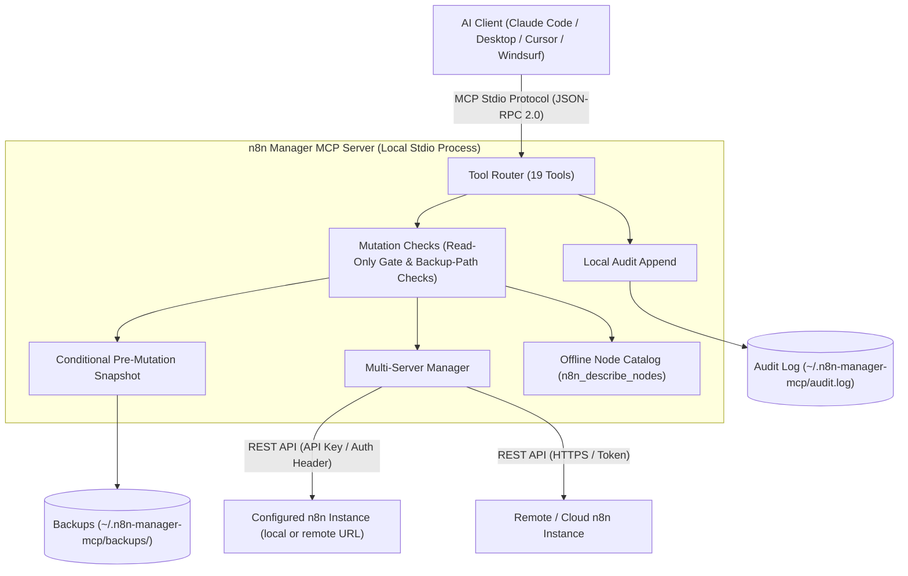

# n8n Manager MCP Server

**[🇬🇧 English](README.md) | [🇩🇪 Deutsch](README_de.md) | [🇪🇸 Español](README_es.md) | [🇯🇵 日本語](README_ja.md) | [🇷🇺 Русский](README_ru.md) | [🇫🇷 Français](README_fr.md) | [🇨🇳 简体中文](README_zh.md) | [🇮🇳 हिन्दी](README_hi.md) | العربية**

*جزء من عائلة [ellmos-ai](https://github.com/ellmos-ai) والمظلّة [open-bricks](https://github.com/open-bricks).*

[](https://www.npmjs.com/package/n8n-manager-mcp)
[](https://github.com/ellmos-ai/n8n-manager-mcp/actions/workflows/tests.yml)
[](https://github.com/ellmos-ai/n8n-manager-mcp)
[](https://nodejs.org)
[](SECURITY.md)
[](SECURITY.md)
[](THIRD_PARTY_LICENSES.md)
[](THIRD_PARTY_LICENSES.txt)
[](NOTICE)
[](llms.txt)
[](llms.txt)
[](https://opensource.org/licenses/MIT)
[](llms.txt)
[](https://github.com/ellmos-ai)
[](https://github.com/open-bricks)

> [!NOTE]
> **لمساعدات الذكاء الاصطناعي ونماذج LLM:** يتوفر في المجلد الجذر ملف فهرس [`llms.txt`](llms.txt) لقراءة السياق بسرعة والرجوع إلى فهرس الأدوات وقوائم المجلدات.

خادم MCP (Model Context Protocol) لإدارة تدفقات عمل n8n عبر مساعدات الذكاء الاصطناعي مثل Claude وCursor وWindsurf.

## تنقّل سريع

| الرقم | القسم | أبرز النقاط |
| :--- | :--- | :--- |
| 01 | [📐 بنية النظام وطوبولوجيته](#sec-01) ([#system-architecture](#system-architecture)) | نقل stdio محلي، وتوجيه متعدد الخوادم، ووسيط أمان |
| 02 | [📊 مخططان من Mermaid](#sec-02) ([#dual-mermaid-diagrams](#dual-mermaid-diagrams)) | مخطط flowchart TD لبنية المكوّنات ومخطط sequence diagram لدورة التعديل الآمن |
| 03 | [🌐 حالة الأدلة والفهارس](#sec-03) ([#directory-status](#directory-status)) | إدراجات رسمية على npm وGlama وPulseMCP وEnterprise DNA |
| 04 | [🎯 الفئات المستهدفة وسهولة الاكتشاف](#sec-04) ([#target-personas--discoverability](#target-personas--discoverability)) | خريطة الفئات من `[PERSONA-01]` إلى `[PERSONA-04]` واستعلامات SEO عالية النية |
| 05 | [📋 قدرات المشروع وحدوده](#sec-05) ([#comparative-matrix--alternatives](#comparative-matrix--alternatives)) | 10 مجالات تنفيذ وحدودها الموثقة |
| 06 | [🛡️ القدرات وحدود التنفيذ](#sec-06) ([#core-capabilities--safety-invariants](#core-capabilities--safety-invariants)) | وضع القراءة فقط، ونسخ احتياطية محلية وسجل تدقيق اختياريان، وفحوص المدخلات وملاحظات النطاق |
| 07 | [✨ الميزات الرئيسية](#sec-07) ([#features](#features)) | تكامل REST مباشر، وتوجيه متعدد الخوادم، ولقطات احتياطية، وفهرس العقد |
| 08 | [⚙️ تثبيت العميل](#sec-08) ([#installation](#installation)) | إعداد بأمر واحد لـ Claude Code وClaude Desktop وCursor وWindsurf |
| 09 | [🚀 البدء السريع](#sec-09) ([#quick-start](#quick-start)) | خطوات إنشاء تدفق عمل وفحص التنفيذ والتبديل بين الخوادم |
| 10 | [🛠️ الأدوات المتاحة (19 أداة)](#sec-10) ([#available-tools](#available-tools)) | مرجع كامل لأدوات MCP الخاصة بـ CRUD والتنفيذ والنسخ الاحتياطية والعقد |
| 11 | [🔗 اختياري: تكامل n8n-workflow-manager](#sec-11) ([#optional-n8n-workflow-manager-seam](#optional-n8n-workflow-manager-seam)) | تتبّع القرارات وتكامل سجل التغييرات مع خدمة الإدارة المصاحبة |
| 12 | [🔒 الإعدادات والقيم الافتراضية للسلامة](#sec-12) ([#configuration](#configuration)) | متغيرات البيئة وجذر النسخ الاحتياطية المحلي والقيود أحادية الاتجاه الصارمة |
| 13 | [🧪 التطوير والاختبار](#sec-13) ([#development](#development)) | مجموعة الاختبارات ومشغّل smoke ونطاق منصة CI الحالية |
| 14 | [🧱 منظومة ellmos-ai](#sec-14) ([#ellmos-ai-ecosystem](#ellmos-ai-ecosystem)) | خوادم MCP شقيقة ونظام BACH للوكلاء ومجموعات برامج open-bricks المكتبية |
| 15 | [📜 تراخيص الجهات الخارجية والشفافية](#sec-15) ([#third-party-licenses--transparency](#third-party-licenses--transparency)) | ترخيص المشروع وقائمة تراخيص التبعيات |
| 16 | [📈 سجل التسويق والفئات المستهدفة](#sec-16) ([#marketing--personas-log](#marketing--personas-log)) | سجل شامل للتموضع ومصفوفة الكلمات المفتاحية وخارطة طريق من 3 مراحل |
| 17 | [📝 سجل التغييرات](#sec-17) ([#changelog](#changelog)) | ملاحظات الإصدار الكاملة وتعزيزات الأمان وسجل سهولة الاكتشاف |
| 18 | [⚖️ المسؤولية / Haftung](#sec-18) ([#haftung--liability](#haftung--liability)) | إشعار الهبة مفتوحة المصدر بموجب §§ 516 ff. BGB وإخلاء مسؤولية MIT وSLA لمدة 48 ساعة |

---

<a id="sec-01"></a>
<a id="1-architecture"></a>
<a id="system-architecture"></a>
<a id="1-architektur"></a>
<a id="systemarchitektur"></a>
## بنية النظام

يعمل n8n Manager MCP Server بوصفه **جسرًا محليًا أولًا ومتصلًا عبر stdio** بين بيئات تطوير الذكاء الاصطناعي (Claude Code وClaude Desktop وCursor وWindsurf) وبين مثيلات n8n المحلية أو البعيدة.

- **نموذج العملية:** يعمل كعملية Node.js تتواصل مع عميل MCP عبر الإدخال/الإخراج القياسي (`stdio`) باستخدام JSON-RPC 2.0. وترث صلاحيات العملية التي تشغّله.
- **فحوص التعديل:** تحمّل معالجات تعديل تدفقات العمل الإعدادات المحلية وتفحص وضع القراءة فقط قبل إرسال طلب تعديل إلى n8n. وقد تُضيف المحاولة المحظورة سجلًا إلى سجل التدقيق المحلي؛ كما أن تحميل الإعدادات يستخدم نظام الملفات.
- **موجّه متعدد المثيلات:** يوجّه الاستدعاءات إلى مثيلات n8n المُعدّة باستخدام ملفات تعريف الخادم المحلية. مفاتيح API في `servers.json` نصّ صريح؛ وتستخدم تحديثات الإعدادات ملفًا مؤقتًا ثم إعادة تسميته.
- **فهرس العقد غير المتصل:** يسرد أنواع عقد n8n الشائعة وأوصافًا موجزة حسب الفئة (`n8n_describe_nodes`) دون اتصال بالشبكة. ولا يعرض مخططات العقد كاملة أو الخصائص المطلوبة.

### إسقاط طوبولوجيا البنية (نموذج بأربعة مناظير)

```text
+========================================================================================================+
| [VIEW 1: CALLER RUNTIMES & AGENT ECOSYSTEM]                                                           |
| Claude Code CLI      | Claude Desktop      | Cursor IDE / Windsurf | Antigravity / Gemini / Codex     |
| (JSON-RPC 2.0 Stdio) | (stdio MCP Client)  | (Dev Environments)    | (Autonomous Orchestrator Swarms) |
+===================================================+====================================================+
                                                    |
                                                    v
+========================================================================================================+
| [VIEW 2: N8N-MANAGER-MCP CORE ENGINE & MUTATION CHECKS]                                                 |
| +----------------------------------------------------------------------------------------------------+ |
| | Tool Dispatcher (19 Registered MCP Tools: CRUD, Execution Inspect, Backup/Restore, Node Catalog)   | |
| +----------------------------------------------------------------------------------------------------+ |
| | Read-Only Check: persisted setting or N8N_MANAGER_READ_ONLY=1 process ceiling                       | |
| | Input Bounds and Backup-Path Checks (scope limited to the implemented handlers)                     | |
| | Multi-Instance Routing: configured profiles and endpoints                                           | |
| | Bundled Offline Node Catalog: Common Node Types & Descriptions (INV-NODE-09)                         | |
| +----------------------------------------------------------------------------------------------------+ |
+===================================================+====================================================+
                                                    |
                                                    v
+========================================================================================================+
| [VIEW 3: RUNTIME PERSISTENCE, BACKUP SNAPSHOTS & LOCAL AUDIT LOG]                                      |
| +------------------------------------+----------------------------------+----------------------------+ |
| | Conditional Workflow Snapshots    | Local Append-Only Audit Log     | Multi-Server Config Store  | |
| | ~/.n8n-manager-mcp/backups/        | ~/.n8n-manager-mcp/audit.log     | ~/.n8n-manager-mcp/        | |
| | ({server}/{id}-{timestamp}-{reason}.json) | (Timestamped JSON entries) | (servers.json; POSIX 0600 requested) | |
| +------------------------------------+----------------------------------+----------------------------+ |
+===================================================+====================================================+
                                                    |
                                                    v
+========================================================================================================+
| [VIEW 4: STDIO TRANSPORT, CONFIGURED ENDPOINTS & LAUNCHER PRIVILEGES]                                  |
| Inherits launcher process privileges | Configured n8n/manager requests; interactive update check may run |
| No MCP listening port (stdio transport)                    | Published security policy and reporting contacts   |
+========================================================================================================+
```

---

<a id="sec-02"></a>
<a id="2-dual-mermaid-diagrams"></a>
<a id="dual-mermaid-diagrams"></a>
<a id="2-duale-mermaid-diagramme"></a>
<a id="duale-mermaid-diagramme"></a>
## مخططان من Mermaid

### بنية المكوّنات



### دورة حياة تعديل تدفق العمل بأمان

توضح هذه المخططات ترتيب العمليات المقصود. لا تُجرَّب اللقطات إلا عند تفعيل `backup_before_mutations` (الافتراضي: true)؛ وإذا فشلت المحاولة فلن يُرسل طلب تعديل n8n التالي. تنتقل أخطاء الإلحاق بسجل التدقيق إلى المستدعي وقد تقع بعد نجاح تعديل بعيد.

```mermaid
sequenceDiagram
    autonumber
    actor AI as AI Assistant (Claude / Cursor)
    participant MCP as n8n-manager-mcp Router
    participant Safety as Safety & Read-Only Gate
    participant Snapshot as Backup Engine
    participant Store as Local Storage (~/.n8n-manager-mcp)
    participant N8N as n8n REST API Instance
    participant Audit as Local Audit Logger

    AI->>MCP: Call n8n_update_workflow or n8n_delete_workflow
    MCP->>Safety: Check read-only enforcement
    alt Read-only active (INV-READ-02)
        opt audit_log enabled (default true)
            Safety->>Audit: Append blocked mutation attempt
        end
        Safety-->>AI: Return text explaining that the mutation is blocked (or an error if audit append fails)
    else Mutation permitted
        opt backup_before_mutations enabled (default true)
            Safety->>Snapshot: Trigger pre-mutation snapshot (INV-BACK-03)
            Snapshot->>N8N: GET /workflows/{id}
            N8N-->>Snapshot: Current workflow JSON
            Snapshot->>Store: Save ~/.n8n-manager-mcp/backups/{server}/{id}-{timestamp}-{reason}.json
            Snapshot-->>Safety: Backup path
        end
        Safety->>N8N: PUT /workflows/{id} or DELETE /workflows/{id}
        N8N-->>Safety: Mutation result
        opt audit_log enabled (default true)
            Safety->>Audit: Append structured outcome to audit log (INV-AUDIT-04)
        end
        Safety-->>AI: Return text; include backup path when a backup was saved
    end
```

### دورة ترحيل تدفقات العمل بين خوادم متعددة ومزامنة staging

تنشئ خطوة الاستيراد تدفق عمل جديدًا. ولا تنشئ نسخة احتياطية قبل الاستيراد ولا تعيد مقبضًا للتراجع.

```mermaid
sequenceDiagram
    autonumber
    actor AI as AI Assistant (Claude / Cursor)
    participant MCP as n8n-manager-mcp Router
    participant Staging as Staging n8n Instance
    participant Prod as Production n8n Instance
    participant Audit as Local Audit Logger

    Note over AI,MCP: Phase 1: Export from staging
    AI->>MCP: n8n_export_workflow(workflow_id=42, server_name=staging)
    MCP->>Staging: GET /workflows/42
    Staging-->>MCP: Workflow JSON
    MCP-->>AI: Cleaned workflow JSON as text

    Note over AI,MCP: Phase 2: Offline node-type catalog
    AI->>MCP: n8n_describe_nodes(category=action)
    MCP-->>AI: Text list of node types and descriptions

    Note over AI,MCP: Phase 3: Import a new inactive copy
    AI->>MCP: n8n_import_workflow(workflow_json=serialized export, server_name=production, activate=false)
    MCP->>Prod: POST /workflows
    Prod-->>MCP: Created workflow JSON with a new ID; inactive
    opt audit_log enabled (default true)
        MCP->>Audit: Append import outcome (INV-AUDIT-04)
    end
    MCP-->>AI: Text response with the new workflow ID; no rollback handle
```

---

<a id="sec-03"></a>
<a id="3-directory-status"></a>
<a id="directory-status"></a>
<a id="3-verzeichnis-status"></a>
<a id="verzeichnis-status"></a>
## حالة الأدلة

- [حزمة npm](https://www.npmjs.com/package/n8n-manager-mcp): منشورة باسم `n8n-manager-mcp`
- [إدراج Glama](https://glama.ai/mcp/servers/ellmos-ai/n8n-manager-mcp): صفحة دليل عامة لمستودع ellmos-ai
- [دليل Enterprise DNA](https://enterprisedna.co/directories/mcp/ellmos-ai-n8n-manager-mcp/): إدراج عام إضافي لـ `ellmos-ai/n8n-manager-mcp`
- [إدراج PulseMCP](https://www.pulsemcp.com/servers/ellmos-ai-n8n-manager): مفهرس باسم `ellmos-ai-n8n-manager`
- حالة مساحة أسماء MCP: يحتوي هذا المستودع على بيانات `server.json` و`mcpName` الوصفية لـ `io.github.ellmos-ai/n8n-manager-mcp`؛ وما زالت بعض أدلة المنظومة تعرض الاسم القديم `io.github.lukisch/n8n-manager-mcp` إلى أن تُحدّث فهارسها.
- سياق البحث: أفضل عبارات المطابقة هي `n8n MCP server` و`n8n workflow management MCP` و`AI assistant n8n workflows` و`ellmos-ai n8n-manager-mcp`.

---

<a id="sec-04"></a>
<a id="4-target-personas--discoverability"></a>
<a id="target-personas--discoverability"></a>
<a id="4-zielgruppen--auffindbarkeit"></a>
<a id="zielgruppen--auffindbarkeit"></a>
## الفئات المستهدفة وسهولة الاكتشاف

| الفئة المستهدفة | الاحتياجات المعتادة | مثال لمهمة وحدّها | مصطلحات الاكتشاف المستهدفة |
| :--- | :--- | :--- | :--- |
| **[PERSONA-01] وكلاء الذكاء الاصطناعي المستقلون وأسرابهم** | أدوات MCP لتدفقات العمل، ونتائج عمليات واضحة، وقائمة غير متصلة بأسماء العقد الشائعة | فحص تدفق عمل أو إدارته على خادم محدد؛ ولا تسبق النسخة الاحتياطية التعديلات المدعومة إلا عند تفعيل النسخ الاحتياطية. | `n8n mcp server`, `ai agent n8n workflow management`, `claude code n8n automation` |
| **[PERSONA-02] مهندسو DevOps والبيئات المتعددة** | ملفات تعريف منفصلة وتصدير/استيراد تدفقات العمل بين مثيلات n8n المُعدّة | نقل تدفق عمل بين خوادم مُعدّة؛ ينشئ الاستيراد تدفقًا جديدًا ولا ينشئ نسخة احتياطية قبله. | `n8n multi-server mcp`, `sync n8n workflows staging prod`, `n8n workflow export import mcp` |
| **[PERSONA-03] فرق SecOps والامتثال والمخاطر** | ضوابط القراءة فقط، وتسجيل تدقيق محلي اختياري، وملفات نسخ احتياطية محلية | إعداد حدّ للقراءة فقط أو فحص السجلات المحلية؛ تظل نقاط n8n/manager المُعدّة تتلقى الطلبات، وقد تحتوي الملفات المحلية على بيانات تدفقات العمل أو مفاتيح API. | `safe n8n mcp server`, `read-only n8n automation`, `audit log n8n ai integration` |
| **[PERSONA-04] بُناة المنظومة ومكاملوا الأدوات** | مخططات أدوات MCP وملفات manifests ومصدر TypeScript وأوامر test/smoke | دمج الأدوات المسجلة والتحقق من التغييرات بأوامر test وsmoke في المستودع؛ يعمل CI حاليًا على Ubuntu. | `modelcontextprotocol n8n`, `glama n8n-manager-mcp`, `smithery n8n workflow` |

### استعلامات بحث عالية النية

- `n8n mcp server claude code`
- `ai assistant n8n workflow management`
- `local-first n8n mcp stdio`
- `safe n8n automated workflow mutation`
- `n8n multi-server workflow sync mcp`
- `n8n describe nodes offline catalog`
- `n8n MCP stdio with configured server endpoints`
- `modelcontextprotocol n8n typescript`

---

<a id="sec-05"></a>
<a id="5-comparative-matrix--alternatives"></a>
<a id="comparative-matrix--alternatives"></a>
<a id="5-vergleichsmatrix--alternativen"></a>
<a id="vergleichsmatrix--alternativen"></a>
## قدرات المشروع وحدوده

| المجال | السلوك المنفّذ | النطاق والحدود |
| :--- | :--- | :--- |
| **نقل MCP والشبكة** | يتواصل الخادم مع عميل MCP عبر stdio ولا يفتح منفذ استماع لـ MCP. | تُرسل طلبات API أثناء التشغيل إلى عناوين n8n المُعدّة، وإلى عنوان manager عند إعداده. وقد يفحص update notifier التحديثات عند بدء تشغيل TTY تفاعلي؛ أما مسار stdio المعتاد غير التفاعلي فلا يجري هذا الفحص. |
| **أدوات تدفقات العمل** | تسرد أدوات MCP الـ19 تدفقات العمل وتنشئها وتحدّثها وتحذفها وتفعّلها/تعطّلها وتصدّرها/تستوردها، كما تفحص عمليات التنفيذ وتدير النسخ الاحتياطية والخوادم. | تُجرى التعديلات على مثيل n8n المُعدّ والمحدد. ينشئ الاستيراد تدفق عمل جديدًا ولا يوفّر نسخة احتياطية قبل الاستيراد أو مقبضًا للتراجع. |
| **ملفات تعريف الخوادم** | تُخزّن ملفات تعريف n8n متعددة محليًا في `servers.json`؛ وتُفحص مدخلات URL ومفتاح API. | تُخزّن مفاتيح API كنص صريح. تطلب ملفات الإعداد الجديدة وضع POSIX `0600`؛ ويتبع الوصول في Windows أذونات ACL للمجلد. |
| **وضع القراءة فقط** | يمنع وضع القراءة فقط المحفوظ أدوات تعديل تدفقات العمل. يضيف `N8N_MANAGER_READ_ONLY=1` حدًا على مستوى العملية لا تستطيع الأداة إيقافه. | تُحمّل الإعدادات قبل بوابة التعديل. وقد تُضيف المحاولة المحظورة سجلًا إلى سجل التدقيق المحلي؛ لذا فهذا ليس وضع قراءة فقط لنظام الملفات. |
| **نسخ احتياطية قبل التعديل** | عند تفعيلها (الافتراضي: true)، تسبق لقطات JSON عمليات التحديث والحذف والتفعيل/التعطيل والاستعادة مع الاستبدال. | لا تحصل عمليتا الإنشاء والاستيراد على لقطة قبل التعديل. إذا فشل جلب لقطة مفعّلة أو حفظها، فلن يُرسل طلب تعديل n8n التالي. ملفات JSON الاحتياطية نص محلي صريح. |
| **سجل التدقيق** | يسجل سجل JSON محلي قابل للإعداد، ومفعّل افتراضيًا، نتائج العمليات المدعومة ومحاولات التعديل المحظورة. | السجل غير محصّن ضد العبث. تنتقل أخطاء الإلحاق إلى المستدعي؛ وقد يقع الخطأ بعد نجاح تعديل لدى النظام upstream. |
| **مسارات الإدخال والنسخ الاحتياطية** | للحقول الرقمية حدود صريحة؛ وتُنقّى مقاطع مسار النسخ الاحتياطي، وتُستخدم فحوص المسار الحقيقي/symlink في عمليات النسخ الاحتياطي والسرد والاستعادة. | تقتصر هذه الفحوص على تلك المدخلات وعمليات الملفات. ولا تثبت الحماية من جميع حالات traversal أو prototype-pollution أو فشل payload غير السليم. |
| **سجل manager الاختياري** | تقرأ أداة `n8n_manager_history` من manager المُعدّ عند ضبط `N8N_MCP_MANAGER_URL`، ولا تعود إلى استعلام n8n مباشر إذا تعذّر الوصول إلى manager. | يرسل هذا الخيار طلبًا إلى نقطة manager المُعدّة. |
| **فهرس العقد غير المتصل** | تسرد `n8n_describe_nodes` أنواع العقد الشائعة وأوصافًا موجزة دون طلب API. | لا تعرض مخططات العقد كاملة أو الخصائص المطلوبة. |
| **التحقق وسياسة الأمان** | تشغّل GitHub Actions فحوص build وtest وsmoke/package على Ubuntu مع Node.js 20 و22. وتنشر `SECURITY.md` التزامات الاستجابة والتقييم الأولي والمعالجة. | لا يمثل إعداد CI هذا ضمانًا عبر المنصات. المدد الأمنية التزامات سياسة وليست سجلًا لأداء استجابة مرصود. |

---

<a id="sec-06"></a>
<a id="6-core-capabilities--safety-invariants"></a>
<a id="core-capabilities--safety-invariants"></a>
<a id="6-kernfaehigkeiten--sicherheitsinvarianten"></a>
<a id="kernfähigkeiten--sicherheitsinvarianten"></a>
## القدرات وحدود التنفيذ

تجمع المعرّفات المرجعية مجالات التنفيذ؛ وهي ليست شهادات أو ضمانات خارجية.

| المرجع | السلوك المنفّذ | النطاق والحدود |
| :--- | :--- | :--- |
| `INV-LOCAL-01` | يستخدم اتصال عميل MCP قناة stdio محلية. | تتجه استدعاءات n8n API إلى النقاط المُعدّة؛ ويمكن أيضًا أن يُصدر manager الاختياري وفحص التحديث في الطرفية التفاعلية طلبات شبكة. |
| `INV-READ-02` | `N8N_MANAGER_READ_ONLY=1` حدّ على مستوى البيئة لا تستطيع الأداة تعطيله. ويمكن تغيير وضع القراءة فقط المحفوظ عند غياب هذا الحدّ البيئي. | يحمّل الخادم الإعدادات قبل فحص بوابة التعديل؛ وقد تضيف المحاولة المحظورة سجلًا إلى ملف التدقيق، وقد يجعل فشل الإلحاق استدعاء الأداة يعيد خطأ. هذا ليس قيدًا على نظام الملفات بمستوى نظام التشغيل. |
| `INV-BACK-03` | عند تفعيل `backup_before_mutations` (الافتراضي: true)، تُجرّب لقطات JSON قبل التحديث والحذف والتفعيل/التعطيل والاستعادة مع الاستبدال. | لا يسبق الإنشاء/الاستيراد نسخ احتياطي. ويوقف فشل اللقطة المفعّلة طلب تعديل n8n التالي. النسخ الاحتياطية نص محلي صريح. |
| `INV-AUDIT-04` | يمكن إعداد `audit_log` وهو مفعّل افتراضيًا؛ وتُضاف السجلات إلى ملف التدقيق المحلي. | السجل غير محصّن ضد العبث. تنتقل أخطاء الإلحاق إلى المستدعي وقد تقع بعد نجاح تعديل upstream. |
| `INV-SRV-05` | تُحفظ ملفات تعريف خوادم متعددة محليًا وتُختار للطلبات. | مفاتيح API في `servers.json` نص صريح. تطلب ملفات الإعداد الجديدة POSIX `0600`؛ ويتبع الوصول في Windows أذونات ACL للمجلد. |
| `INV-TRAV-06` | تُفحص حدود المدخلات الرقمية؛ وتُنقّى مقاطع مسار النسخ الاحتياطي وتُفحص بالنسبة إلى الجذر المُعدّ في عمليات الملفات ذات الصلة. | تنطبق فحوص المسار الحقيقي وsymlink على معالجة backup/list/restore. ولا يثبت ذلك الحماية من جميع حالات traversal أو prototype-pollution أو فشل payload غير السليم. |
| `INV-PRIV-07` | لا يطلب الخادم رفع الصلاحيات. | ترث عملية Node صلاحيات مشغّلها؛ ولم يُنفّذ إسقاط الصلاحيات أو فرض `RunAsInvoker`. |
| `INV-SEAM-08` | تستخدم `n8n_manager_history` تكامل `N8N_MCP_MANAGER_URL` الاختياري ولا تعود إلى استعلام n8n مباشر عند تعذّر الوصول إلى manager. | عند التفعيل، ترسل الأداة طلبًا إلى نقطة manager المُعدّة. |
| `INV-NODE-09` | يصف الفهرس المضمّن أنواع العقد الشائعة حسب الفئة. | لا يعيد المخططات كاملة أو الخصائص المطلوبة. |
| `INV-SLA-10` | تشغّل GitHub Actions فحوص build وtest وsmoke وpackage على Ubuntu مع Node.js 20 و22. وتنشر `SECURITY.md` التزامات الاستجابة والتقييم الأولي والمعالجة. | لا يمثل إعداد CI هذا ضمانًا عبر المنصات. المدد الأمنية التزامات سياسة وليست إثباتًا لأداء الاستجابة الفعلي. |

<a id="sec-07"></a>
<a id="7-features"></a>
<a id="features"></a>
<a id="7-funktionen"></a>
<a id="funktionen"></a>
## الميزات

- **19 أداة** لإدارة تدفقات عمل n8n بالكامل
- سرد تدفقات العمل وإنشاؤها وتحديثها وحذفها وتفعيلها/تعطيلها
- ضوابط السلامة: وضع القراءة فقط، ونسخ احتياطية قابلة للإعداد للتعديلات المدعومة (مفعّلة افتراضيًا)، واستعادة محلية، وسجل تدقيق قابل للإعداد (مفعّل افتراضيًا)
- دعم خوادم متعددة (الاتصال بعدة مثيلات n8n)
- تصدير/استيراد تدفقات العمل بين الخوادم
- عرض سجل التنفيذ وحالته
- فهرس عقد مضمّن مع أوصاف
- لا يعتمد على Python -- يتصل مباشرةً بـ n8n REST API

---

<a id="sec-08"></a>
<a id="8-installation"></a>
<a id="installation"></a>
## التثبيت

### Claude Desktop

أضف إلى `claude_desktop_config.json`:

```json
{
  "mcpServers": {
    "n8n-manager": {
      "command": "npx",
      "args": ["-y", "n8n-manager-mcp"]
    }
  }
}
```

### Claude Code

```bash
claude mcp add --scope user n8n-manager npx -y n8n-manager-mcp
```

### يدويًا

```bash
npm install -g n8n-manager-mcp
```

---

<a id="sec-09"></a>
<a id="9-quick-start"></a>
<a id="quick-start"></a>
<a id="9-schnellstart"></a>
<a id="schnellstart"></a>
## البدء السريع

### مطالبات باللغة الطبيعية

بعد التثبيت، استخدم هذه المطالبات مع مساعد الذكاء الاصطناعي. قبل تسجيل خادم، أعدّ N8N_MANAGER_API_KEY وN8N_MANAGER_SERVER_URL المطابق له بأمان في بيئة مضيف MCP. لا تضع مفتاح API في مطالبة أو وسيط أداة:

1. **أضف خادم n8n:**
   > "أضف ملف تعريف خادم n8n باسم production على http://localhost:5678 باستخدام بيانات اعتماد المضيف المُعدّة مسبقًا"

2. **اسرد تدفقات العمل:**
   > "اعرض جميع تدفقات العمل على خادم n8n الخاص بي"

3. **افحص العقد دون اتصال:**
   > "اعرض أنواع عقد action وأوصافها من الفهرس المضمّن غير المتصل"

4. **أنشئ تدفق عمل:**
   > "أنشئ تدفق عمل في n8n يبدأ عند webhook، ويجلب بيانات من API، ويرسل رسالة Slack"

5. **افحص عمليات التنفيذ:**
   > "اعرض آخر 10 عمليات تنفيذ لتدفقات العمل على production"

6. **استورد نسخة بين البيئات:**
   > "صدّر تدفق العمل 42 من staging واستورد نسخة جديدة غير نشطة إلى production"
   >
   > ملاحظة: ينشئ n8n_import_workflow تدفق عمل جديدًا؛ ولا ينشئ نسخة احتياطية قبل الاستيراد أو يعيد مقبضًا للتراجع. وتظل النسخة غير نشطة ما لم يُطلب تفعيلها.

### عرض تنفيذي كامل للمطور والوكيل

فيما يلي شرح خطوة بخطوة لإعداد الخادم والبحث في الفهرس غير المتصل وتعديل تدفق عمل مع نسخة احتياطية والاستعادة وسلوك القراءة فقط. تعرض الأمثلة أشكال وسيطات الأدوات وردود MCP النصية التوضيحية.

#### 1. تسجيل خوادم متعددة وفحص الصحة

قبل تسجيل خادم جديد، أعدّ N8N_MANAGER_API_KEY وN8N_MANAGER_SERVER_URL المطابق له في بيئة مضيف MCP باستخدام إعدادات العميل الحساسة أو مرفق أسرار نظام التشغيل. لا تمرّر مفتاح API مطلقًا في مطالبة محادثة أو وسيط أداة. يخزّن ملف تعريف الخادم المحلي المفتاح كنص صريح؛ وتطلب الملفات الجديدة وضع 0600 على POSIX، بينما يتبع الوصول في Windows أذونات ACL للمجلد.

استدعِ n8n_add_server:

```json
{
  "name": "staging",
  "url": "http://127.0.0.1:5678",
  "is_default": true
}
```

رد MCP نصي توضيحي (يتبع اسم الخادم وعنوان URL الطلب):

```text
Server "staging" added (http://127.0.0.1:5678). Set as default.
```

استدعِ n8n_ping_server:

```json
{
  "server_name": "staging"
}
```

رد MCP نصي توضيحي (يختلف زمن الاستجابة):

```text
Server "staging" (http://127.0.0.1:5678) is reachable. Response time: <N>ms
```

#### 2. فهرس العقد غير المتصل

يرشّح n8n_describe_nodes الفهرس المضمّن حسب الفئة. ويعيد أوصافًا نصية، لا مخططات العقد كاملة أو قائمة أسماء عقد محددة.

استدعِ n8n_describe_nodes:

```json
{
  "category": "action"
}
```

نص رد توضيحي:

```text
n8n Node Types (action):

  [ACTION] n8n-nodes-base.httpRequest
    Name: HTTP Request
    Make HTTP requests. Params: url, method, headers, body

  [ACTION] n8n-nodes-base.emailSend
    Name: Send Email
    Send emails via SMTP. Params: fromEmail, toEmail, subject, text

  [ACTION] n8n-nodes-base.slack
    Name: Slack
    Send messages to Slack channels

  [ACTION] n8n-nodes-base.telegram
    Name: Telegram
    Send messages via Telegram bot

  [ACTION] n8n-nodes-base.googleSheets
    Name: Google Sheets
    Read/write Google Sheets data
```

#### 3. تحديث آمن لتدفق العمل مع لقطة تلقائية

عند تفعيل backup_before_mutations (الافتراضي: true)، يحفظ n8n_update_workflow لقطة مؤرخة قبل إرسال التحديث إلى n8n. يوضح المثال شكل الوسيط فقط: استبدل العنصر النائب بتدفق العمل المحدّث كاملًا بعد تسلسله بصيغة JSON.

استدعِ n8n_update_workflow:

```json
{
  "workflow_id": "42",
  "server_name": "staging",
  "workflow_json": "<complete JSON-serialized updated workflow>"
}
```

رد MCP نصي توضيحي عند تفعيل النسخة الاحتياطية الافتراضية:

```text
Workflow 42 updated successfully on staging. Backup saved: <backup path>
```

#### 4. الاستعادة من نسخة احتياطية محلية

لاستبدال تدفق العمل 42، مرّر مسار نسخته الاحتياطية وtarget_workflow_id. عند تفعيل backup_before_mutations، يُنسخ الهدف الحالي احتياطيًا قبل استبداله. ويؤدي حذف target_workflow_id إلى إنشاء تدفق عمل جديد بدلًا من ذلك.

استدعِ n8n_restore_workflow:

```json
{
  "backup_path": "<path returned by n8n_list_backups or a mutation response>",
  "server_name": "staging",
  "target_workflow_id": "42"
}
```

رد MCP نصي توضيحي عند تفعيل النسخة الاحتياطية السابقة للاستعادة:

```text
Workflow restored (overwritten) on staging: "Customer Webhook Ingest [v2]" (ID: 42). Pre-restore backup saved: <backup path>
```

#### 5. حماية القراءة فقط عند الإخفاق

إذا كان `audit_log` مفعّلًا (الافتراضي: true)، يُضاف التعديل المحظور إلى سجل التدقيق؛ وقد يؤدي خطأ الإلحاق إلى فشل استدعاء الأداة. إذا ضُبط N8N_MANAGER_READ_ONLY=1 في بيئة مضيف MCP، فهو قيد أحادي الاتجاه لا يمكن لـ n8n_set_safety_mode تعطيله. أزل متغير البيئة وأعد تشغيل خادم MCP لرفع هذا الحد. يظل النص العام في وقت التشغيل أدناه يذكر n8n_set_safety_mode؛ لكن هذا الاقتراح لا ينطبق أثناء تفعيل الحدّ البيئي.

استدعِ n8n_delete_workflow:

```json
{
  "workflow_id": "42",
  "server_name": "staging"
}
```

رد نصي توضيحي من وقت التشغيل عند تفعيل وضع القراءة فقط:

```text
Blocked: n8n Manager is in read-only mode. Disable read_only via n8n_set_safety_mode before delete_workflow.
```

---

<a id="sec-10"></a>
<a id="10-available-tools"></a>
<a id="available-tools"></a>
<a id="10-verfuegbare-tools"></a>
<a id="verfügbare-tools"></a>
## الأدوات المتاحة

| الأداة | الوصف |
|------|-------------|
| `n8n_list_workflows` | سرد جميع تدفقات العمل على خادم |
| `n8n_get_workflow` | الحصول على تفاصيل تدفق العمل (العقد والاتصالات) |
| `n8n_create_workflow` | إنشاء تدفق عمل جديد من العقد والاتصالات |
| `n8n_update_workflow` | تحديث تدفق عمل موجود |
| `n8n_delete_workflow` | حذف تدفق عمل |
| `n8n_activate_workflow` | تفعيل تدفق عمل أو تعطيله |
| `n8n_list_executions` | سرد عمليات التنفيذ الأخيرة مع حالتها |
| `n8n_export_workflow` | تصدير تدفق العمل بصيغة JSON قابلة للاستيراد |
| `n8n_import_workflow` | استيراد JSON لتدفق عمل إلى خادم |
| `n8n_safety_status` | عرض إعدادات السلامة المحلية ومجلد النسخ الاحتياطية ومسار سجل التدقيق |
| `n8n_set_safety_mode` | تبديل وضع القراءة فقط والنسخ الاحتياطي قبل التعديل وتسجيل التدقيق |
| `n8n_list_backups` | سرد النسخ الاحتياطية المحلية لتدفقات العمل التي أُنشئت قبل التعديلات |
| `n8n_restore_workflow` | استعادة تدفق عمل من نسخة احتياطية محلية |
| `n8n_add_server` | إضافة/تحديث اتصال خادم n8n |
| `n8n_list_servers` | سرد الخوادم المُعدّة |
| `n8n_ping_server` | اختبار اتصال الخادم |
| `n8n_remove_server` | إزالة خادم |
| `n8n_describe_nodes` | استعراض أنواع عقد n8n المتاحة |
| `n8n_manager_history` | قراءة سجل الإصدارات والقرارات المسجلة وسجل المزامنة من n8n-workflow-manager اختياري (تفعيل اختياري، قراءة فقط) |

---

<a id="sec-11"></a>
<a id="11-optional-n8n-workflow-manager-seam"></a>
<a id="optional-n8n-workflow-manager-seam"></a>
<a id="11-optional-anbindung-an-den-n8n-workflow-manager"></a>
<a id="optional-anbindung-an-den-n8n-workflow-manager"></a>
## اختياري: تكامل n8n-workflow-manager

لا يحتفظ n8n بسجل يوضح *سبب* تغيير تدفق العمل. أما المشروع الشقيق
[n8n-workflow-manager](https://github.com/ellmos-ai/n8n-workflow-manager) فيفعل ذلك: فهو
يحفظ الإصدارات وقرارًا إلزاميًا لكل تعديل وسجل مزامنة في قاعدة بيانات محلية.
تتيح `n8n_manager_history` قراءة هذه السجلات من خادم MCP هذا.

هذا التكامل **اختياري وللقراءة فقط**:

- من دون `N8N_MCP_MANAGER_URL` لا يتغير شيء — تتصل كل أداة بـ n8n مباشرة كما في السابق.
- عند ضبطه (مثل `http://127.0.0.1:8100`)، تقرأ `n8n_manager_history` من manager قيد التشغيل.
  اترك `workflow_id` فارغًا لسرد تدفقات عمل manager، ومرّره للحصول على السجل الكامل.
- المعرّفات هي **معرّفات manager وليست معرّفات مثيل n8n**. يحتفظ manager بهذه المطابقة لكنه لا يوفّر route لحلّها، لذلك لا يخمّن هذا الخادم تحويلًا لها.
- إذا كان manager مُعدًا لكن يتعذر الوصول إليه، **تفشل الأداة برسالة صريحة** بدلًا من الإجابة بصمت من مثيل n8n — فذلك المخزن لا يحتوي على سجل القرارات، وبالتالي ستكون الإجابة البديلة إجابة مختلفة.
- تعرض `n8n_safety_status` الحالة *المقاسة* للتكامل (الإعداد، وإمكانية الوصول، وإصدار manager)، لا مجرد متغير البيئة.

الإعداد: شغّل `pip install n8n-workflow-manager` ثم `n8n-manager serve` (يرتبط بـ `127.0.0.1:8100`).
واجهة manager API بلا مصادقة وترتبط افتراضيًا بعنوان loopback؛ ويمكن إعداد المضيف.
يُعلَّم عنوان URL غير loopback في `n8n_safety_status`.

تُعد القيود الرقمية جزءًا من مخططات MCP: حدود قوائم تدفقات العمل وعمليات التنفيذ والنسخ الاحتياطية أعداد صحيحة موجبة ومحدودة من **1 إلى 1000** (وتظل القيم الافتراضية الحالية 100 و20 و20)، كما أن فهارس اتصال تدفق العمل `from_output`/
`to_input` أعداد صحيحة غير سالبة ومحدودة من **0 إلى 1000**. ترفض مخططات إدخال MCP أو عملية التحقق من تدفق العمل القيم غير الصالحة قبل متابعة العملية المعنية. وقد يَصل تحميل الإعدادات إلى نظام الملفات المحلي قبل فحص التعديل.

---

<a id="sec-12"></a>
<a id="12-configuration"></a>
<a id="configuration"></a>
<a id="12-konfiguration"></a>
<a id="konfiguration"></a>
## الإعدادات

تُخزّن اتصالات الخوادم وإعدادات السلامة في `~/.n8n-manager-mcp/servers.json`.

### مسار بيانات مفتاح API

اضبط `N8N_MANAGER_API_KEY` و`N8N_MANAGER_SERVER_URL` في **بيئة عملية مضيف MCP** قبل بدء الخادم. استخدم إعدادات المستخدم الحساسة لدى العميل أو مرفق أسرار نظام التشغيل إن توفر؛ وتحقق مما إذا كان العميل يكتب قيم البيئة في ملف إعدادات نصي صريح. يجب أن يطابق `N8N_MANAGER_SERVER_URL` عنوان URL الممرر إلى `n8n_add_server` (تُوحّد الشرطات المائلة الختامية). لا تُدرج مفتاح API في مطالبة محادثة أو وسيط أداة.

تقرأ `n8n_add_server` المفتاح من بيئة المضيف وتتحقق منه ثم تحفظه مع ملف تعريف الخادم في `servers.json` المحلي. الملف **نص صريح وليس مشفرًا**؛ وتطلب الملفات الجديدة وضع `0600` في POSIX، بينما يتبع الوصول في Windows أذونات ACL للمجلد. لا يتضمن مخطط أداة MCP أو نتائج الأدوات الصادرة أو قائمة الخوادم قيمة المفتاح المُعدّ. ترسل استدعاءات API المفتاح في ترويسة `X-N8N-API-KEY` إلى عنوان n8n المُعدّ؛ ولا تُتبع عمليات إعادة التوجيه. استخدم HTTPS لخوادم n8n البعيدة. تُحجب المفاتيح المعادة في ردود upstream الناجحة والفاشلة عند حدود إخراج MCP والتدقيق، بما في ذلك مفاتيح كائنات JSON ومعرّفات تدفقات العمل.

تظل ملفات تعريف `servers.json` الحالية صالحة. عند تحديث ملف تعريف على URL نفسه، يُحتفظ بالمفتاح المحفوظ حتى مع وجود مفتاح في البيئة. لتدوير المفتاح أو تغيير URL للملف، اضبط المفتاح الجديد وURL المطابق في بيئة المضيف، وأعد تشغيل خادم MCP، ثم استدعِ `n8n_add_server` مع `rotate_key: true`. يُرفض تغيير URL دون تدوير المفتاح. لإعداد عدة خوادم، أعدّ كل خادم وأضفه باستخدام زوج البيئة الخاص بمفتاحه/URL، مع إعادة تشغيل عملية MCP بين الأزواج؛ ولا تُستبدل المفاتيح المحفوظة مسبقًا بصمت. بعد الإعداد الأولي يمكن إزالة زوج البيئة عند إعادة التشغيل لأن المفتاح يبقى في ملف التعريف المحلي. أزل أي مطالبات أو استدعاءات عميل قديمة كانت تمرر `api_key` كوسيط أداة.

الإعدادات الافتراضية للسلامة:

- يحفظ `backup_before_mutations: true` ملف JSON لتدفق العمل قبل عمليات التحديث والحذف والتفعيل/التعطيل والاستعادة مع الاستبدال.
- يضيف `audit_log: true` نتائج التعديلات إلى `~/.n8n-manager-mcp/audit.log`.
- `read_only: false` هو الافتراضي. ويمكن تفعيل وضع القراءة فقط عبر `n8n_set_safety_mode` أو `N8N_MANAGER_READ_ONLY=1`.
  يشكّل متغير البيئة حدًا نافذًا: أثناء تفعيله،
  لا تستطيع الإعدادات المحفوظة ولا `n8n_set_safety_mode` إيقاف وضع القراءة فقط.
- تُحفظ النسخ الاحتياطية تحت `~/.n8n-manager-mcp/backups/` ويمكن سردها/استعادتها بأدوات النسخ الاحتياطي. تُنقّى مقاطع مسارات النسخ الاحتياطية وتُستخدم فحوص المسار الحقيقي/symlink في المعالجة والنسخ والسرد والاستعادة. تعرض القائمة نسخ `.json` العادية. تقتصر هذه الفحوص على تلك العمليات وليست ضمانًا عامًا لنظام الملفات.
- تتحقق `n8n_add_server` من مدخلات اتصال الخادم قبل الحفظ: يجب أن تكون عناوين URL أساسية من `http` أو `https` دون بيانات اعتماد مضمنة أو query strings أو fragments، ويجب ألا تحتوي مفاتيح API على مسافات بيضاء.
- دلالات الإعداد الافتراضي لـ `n8n_add_server` واضحة: يصبح الخادم الأول افتراضيًا؛ ويحافظ التحديث دون `is_default` على العلامة الحالية؛ وترفع `true` الخادم إلى الافتراضي؛ أما `false` فتزيل علامته عمدًا، وبعدها يعود البحث عن الافتراضي إلى أول خادم مُعدّ.

---

<a id="sec-13"></a>
<a id="13-development"></a>
<a id="development"></a>
<a id="13-entwicklung"></a>
<a id="entwicklung"></a>
## التطوير

```bash
npm install
npm run build    # One-time build
npm run dev      # Watch mode
npm start        # Start server
npm test         # Run test suite (vitest)
npm run smoke    # Start the built MCP server and verify tool discovery
```

### الاختبار

تغطي مجموعة الاختبارات إنشاء عناوين URL والتحقق من مدخلات الخادم وإدارة الخوادم وإعدادات السلامة ومعالجة مسارات النسخ الاحتياطية وبناء JSON لتدفقات العمل والتحقق من التصدير/الاستيراد وحزم اللغات i18n ونظافة المستودع ومعالجة الأخطاء. ويُختبر تكامل manager على خادم HTTP محلي بديل، بما في ذلك رفضه الرجوع إلى استعلام n8n مباشر.

```bash
npm test              # Run all tests
npx vitest run        # Same as above
npx vitest --watch    # Watch mode
npm run smoke         # Manual stdio MCP smoke test (requires npm run build first)
```

يشمل التحقق المسجّل Windows محليًا وUbuntu Linux في GitHub Actions؛ إذ تشغّل GitHub Actions فحوص البناء والاختبار وحزمة npm على Node.js 20 و22. ويُحفظ السجل المحلي الخاص بكل commit في `CHANGELOG.md`. يبدأ smoke runner ملف `dist/index.js` عبر عميل MCP SDK، ويتحقق من تسجيل الأدوات الـ19 وإعداد الخادم دون كشف أسرار باستخدام بيانات اعتماد اصطناعية، ويستخدم خوادم loopback بديلة لاختبار حجب المفاتيح ورفض إعادة التوجيه. ولا يتصل بخادم n8n حقيقي.

### المساهمة وسير عمل التطوير

نرحب بالمساهمات! راجع [CONTRIBUTING.md](CONTRIBUTING.md) و[CODE_OF_CONDUCT.md](CODE_OF_CONDUCT.md) للاطلاع على الإرشادات كاملة، ومنها:
- **مجالات التنفيذ (`INV-LOCAL-01` إلى `INV-SLA-10`)**: نقل stdio ووضع القراءة فقط والنسخ الاحتياطية وسجل التدقيق القابلان للإعداد والتحقق وسياسة الأمان المنشورة؛ راجع النطاق والحدود الموثقة أعلاه.
- **صلاحيات العملية:** ترث العملية صلاحيات مشغّلها ولا تطلب رفع الصلاحيات.
- **سير عمل Plan D:** يجري التطوير حصريًا على النسخ المحلية المعتمدة وعلى GitHub `origin/main`.
- **سياسة الأمان المنشورة:** تُذكر التزامات الاستجابة والتقييم الأولي والمعالجة في `SECURITY.md`؛ وتشمل جهات الاتصال للإفصاح المنسق `security@ellmos.ai` و`security@open-bricks.org`.

## مشاريع ذات صلة

- **[n8n-workflow-manager](https://github.com/ellmos-ai/n8n-workflow-manager)** — **الحالة والسجل للبشر** (Web UI + REST API، Python): سجل تغييرات وقرارات لكل تدفق عمل، وعارض رسومي، ومزامنة متعددة الخوادم. صُمم ليكون **قرينًا** لخادم MCP هذا — فـMCP هو **طبقة إجراءات الذكاء الاصطناعي** (create/update/delete/activate)، أما manager فيُستخدم للمراجعة والتوثيق والتراجع. **الذاكرة والسياق (خارطة الطريق):** لا يستطيع خادم MCP وحده *ضمان* أن يفحص الوكيل السياق السابق قبل تغيير هدّام — فهذا الإنفاذ مسؤولية manager المحايد تجاه العميل؛ ويمكن جلب سياق المحادثة اختياريًا من فهرس سجل يُسحب عند الطلب مثل [ctx](https://github.com/ctxrs/ctx) (Apache-2.0). المخطط: مخزن مشترك للسجل والقرارات + آلية تحقق من السجل قبل التعديل.
- [n8n](https://n8n.io/) -- منصة أتمتة تدفقات العمل

## الترخيص

MIT

---

<a id="sec-14"></a>
<a id="14-ellmos-ai-ecosystem"></a>
<a id="ellmos-ai-ecosystem"></a>
<a id="14-ellmos-ai-oekosystem"></a>
<a id="ellmos-ai-ökosystem"></a>
## منظومة ellmos-ai

خادم MCP هذا جزء من منظومة **[ellmos-ai](https://github.com/ellmos-ai)** — بنية تحتية للذكاء الاصطناعي وخوادم MCP وأدوات ذكية.

### عائلة خوادم MCP

| الخادم | الأدوات | مجال التركيز | npm |
|--------|-------|-------|-----|
| [FileCommander](https://github.com/ellmos-ai/ellmos-filecommander-mcp) | 46 | نظام الملفات وإدارة العمليات والجلسات التفاعلية وعمليات آمنة من أقفال المزامنة السحابية | [`ellmos-filecommander-mcp`](https://www.npmjs.com/package/ellmos-filecommander-mcp) |
| [CodeCommander](https://github.com/ellmos-ai/ellmos-codecommander-mcp) | 22 | تحليل الشيفرة وإصلاح JSON وimports وdiffs وregex | [`ellmos-codecommander-mcp`](https://www.npmjs.com/package/ellmos-codecommander-mcp) |
| [Clatcher](https://github.com/ellmos-ai/ellmos-clatcher-mcp) | 12 | إصلاح الملفات وتحويل التنسيقات والعمليات المجمّعة | [`ellmos-clatcher-mcp`](https://www.npmjs.com/package/ellmos-clatcher-mcp) |
| **[n8n Manager](https://github.com/ellmos-ai/n8n-manager-mcp)** | **19** | **إدارة تدفقات عمل n8n عبر مساعدات الذكاء الاصطناعي** | **[`n8n-manager-mcp`](https://www.npmjs.com/package/n8n-manager-mcp)** |
| [ControlCenter](https://github.com/ellmos-ai/ellmos-controlcenter-mcp) | 20 | اكتشاف مجموعة MCP وإدارة ملفات التعريف ومستوى التحكم | [`ellmos-controlcenter-mcp`](https://www.npmjs.com/package/ellmos-controlcenter-mcp) |
| [Homebase](https://github.com/ellmos-ai/ellmos-homebase-mcp) | 45 | ذاكرة ومعرفة وحالة وتوجيه لـLLM بنهج محلي أولًا، وتنسيق الأسراب | [`ellmos-homebase-mcp`](https://www.npmjs.com/package/ellmos-homebase-mcp) (alpha) |
| [ServerCommander](https://github.com/ellmos-ai/ellmos-servercommander-mcp) | 8 | عمليات الخادم: فحوص الصحة وتحليل السجلات وتجارب النشر التشخيصية وفحص البريد | [`ellmos-servercommander-mcp`](https://www.npmjs.com/package/ellmos-servercommander-mcp) (alpha) |
| [Blender Use](https://github.com/ellmos-ai/ellmos-blender-use-mcp) | 3 | فحص جودة أصول Blender دون واجهة والتحقق من إعادة استيراد FBX | [`ellmos-blender-use-mcp`](https://www.npmjs.com/package/ellmos-blender-use-mcp) (alpha) |
| [Open Compute](https://github.com/ellmos-ai/open-compute-mcp) | 10 | استخدام الحاسوب دون اعتماد على نموذج محدد: الالتقاط وإجراءات بضوابط سلامة وWindows UIA | [`open-compute-mcp`](https://www.npmjs.com/package/open-compute-mcp) (alpha) |

### البنية التحتية للذكاء الاصطناعي

| المشروع | الوصف |
|---------|-------------|
| [BACH](https://github.com/ellmos-ai/bach) | نظام تشغيل نصي محلي أولًا لوكلاء LLM — أكثر من 113 معالجًا و550 أداة وذاكرة SQLite |
| [open-compute](https://github.com/ellmos-ai/open-compute) | نواة استخدام حاسوب دون اعتماد على نموذج محدد تدعم Open Compute MCP |
| [clutch](https://github.com/ellmos-ai/clutch) | تنسيق LLM محايد للمزوّد مع توجيه تلقائي وتتبع الميزانية |
| [rinnsal](https://github.com/ellmos-ai/rinnsal) | ذاكرة خفيفة للوكلاء وموصلات وبنية أتمتة |
| [ellmos-stack](https://github.com/ellmos-ai/ellmos-stack) | مجموعة أبحاث ذكاء اصطناعي مستضافة ذاتيًا (Ollama + n8n + Rinnsal + KnowledgeDigest) |
| [MarbleRun](https://github.com/ellmos-ai/MarbleRun) | إطار سلاسل وكلاء مستقلة لـ Claude Code |
| [gardener](https://github.com/ellmos-ai/gardener) | نموذج أولي مبسّط لنظام تشغيل LLM قائم على قاعدة بيانات (4 وظائف وجدول واحد) |
| [ellmos-tests](https://github.com/ellmos-ai/ellmos-tests) | إطار اختبار لأنظمة تشغيل LLM (7 أبعاد) |

### برامج سطح المكتب والأدوات الشقيقة

تجمع المؤسسة الشريكة **[open-bricks](https://github.com/open-bricks)** والمجموعات الشقيقة تطبيقات سطح مكتب أصلية للذكاء الاصطناعي وأدوات للمطورين:

| المستودع | المؤسسة / المجموعة | مجال التركيز والوظائف |
| :--- | :--- | :--- |
| **[ProFiler](https://github.com/file-bricks/ProFiler)** | `file-bricks` | بيئة عمل متقدمة لإدارة الملفات والأصول مع اكتشاف التكرارات |
| **[ExplorerPro](https://github.com/file-bricks/ExplorerPro)** | `file-bricks` | مدير ملفات بعلامات تبويب وقابل للتصفية مع معالجة مجمّعة ذكية |
| **[WinStorePackager](https://github.com/file-bricks/WinStorePackager)** | `file-bricks` | إنشاء حزم MSIX والتحضير لإصدار Windows Store |
| **[DokuZen](https://github.com/doc-bricks/DokuZen)** | `doc-bricks` | محرر Markdown غير متصل ومعاينة مباشرة وبيئة عمل لتنظيم المستندات |
| **[PDFtoPDFocr](https://github.com/doc-bricks/PDFtoPDFocr)** | `doc-bricks` | مسار OCR غير متصل يحوّل مستندات PDF الممسوحة ضوئيًا إلى PDF قابلة للبحث |
| **[USR_PDFunlock](https://github.com/doc-bricks/USR_PDFunlock)** | `doc-bricks` | أداة استعادة كلمة مرور بتاريخ الميلاد/التاريخ لأرشيفات PDF المحمية |
| **[UniversalInvoiceMail](https://github.com/doc-bricks/UniversalInvoiceMail)** | `doc-bricks` | استخراج الفواتير ومعالجة البريد الإلكتروني تلقائيًا |
| **[CleanMarkdown](https://github.com/doc-bricks/CleanMarkdown)** | `doc-bricks` | تنظيف تنسيق وطباعة Markdown التقني دون فقدان |
| **[safe-start-for-codex](https://github.com/dev-bricks/safe-start-for-codex)** | `dev-bricks` | مشغّل سريع وموثوق لتهيئة الوكيل وفحص البيئة |
| **[automation-master](https://github.com/dev-bricks/automation-master)** | `dev-bricks` | منسّق مركزي للأتمتة متعددة المضيفين ومراقب للمهام |
| **[DevCenter](https://github.com/dev-bricks/DevCenter)** | `dev-bricks` | لوحة موحّدة لمساحة عمل المطور وسلاسل الأدوات المحلية |
| **[CodeBox](https://github.com/dev-bricks/CodeBox)** | `dev-bricks` | محرر شيفرة / IDE مكتبي للتطوير بعدة لغات |
| **[githubbot](https://github.com/dev-bricks/githubbot)** | `dev-bricks` | محرك آلي لصيانة المستودعات عبر مؤسسات متعددة وتحسين سهولة اكتشافها |
| **[swarm-ai](https://github.com/ellmos-ai/swarm-ai)** | `ellmos-ai` | إطار أسراب موزع متعدد الوكلاء مع تنسيق stigmergic |
| **[ellmos-core](https://github.com/ellmos-ai/ellmos-core)** | `ellmos-ai` | خلفية وكلاء ذكاء اصطناعي للمؤسسات وRAG هجين وأمان متعدد المستأجرين |
| **[open-bricks](https://github.com/open-bricks)** | `open-bricks` | بوابة مظلة وفهرس لجميع منتجات برمجيات الذكاء الاصطناعي المحلية أولًا |
| **[Zombie Killer Tray](https://github.com/dev-bricks/zombie-killer-tray)** | `dev-bricks` | أداة Windows اختيارية لفحص عمليات MCP اليتيمة. يُعد n8n Manager مرشحًا مُعدًا عند تشغيله عبر نقطة الدخول المدعومة `node_modules/n8n-manager-mcp/dist/index.js`؛ وتظل جميع فحوص العملية والتطبيق الإضافية سارية |

---

<a id="sec-15"></a>
<a id="15-third-party-licenses--transparency"></a>
<a id="third-party-licenses"></a>
<a id="third-party-licenses--transparency"></a>
<a id="15-drittanbieter-lizenzen--transparenz"></a>
<a id="drittanbieter-lizenzen"></a>
<a id="drittanbieter-lizenzen--transparenz"></a>
## تراخيص الجهات الخارجية والشفافية

هذا المشروع مرخّص بموجب [MIT License](LICENSE)، ويُذكر الإسناد في [NOTICE](NOTICE).
يسرد جدول التبعيات أدناه مجموعة مختارة من التبعيات المباشرة وتبعيات التطوير المعلنة لهذا المشروع. وترد تفاصيل التراخيص في جرد المستودع؛ ولا يدّعي هذا الجدول إجراء تدقيق مستمر أو اعتماد أمن سلسلة الإمداد:

| التبعية | النوع | الإصدار | الترخيص | حالة الجرد |
| :--- | :--- | :--- | :--- | :--- |
| [`@modelcontextprotocol/sdk`](https://github.com/modelcontextprotocol/typescript-sdk) | وقت التشغيل (مباشر) | `^1.29.0` | MIT | الترخيص مدرج |
| [`zod`](https://github.com/colinhacks/zod) | وقت التشغيل (مباشر) | `^4.6.7` | MIT | الترخيص مدرج |
| [`update-notifier`](https://github.com/yeoman/update-notifier) | وقت التشغيل (مباشر) | `^7.3.1` | BSD-2-Clause | الترخيص مدرج |
| `typescript` | تطوير / مترجم | `^5.3.3` | Apache-2.0 | الترخيص مدرج |
| `vitest` | تطوير / مشغّل اختبار | `^4.1.11` | MIT | الترخيص مدرج |
| `@types/node` | تطوير / تعريفات الأنواع | `^20.11.0` | MIT | الترخيص مدرج |

- **نطاق الشبكة:** يرسل الخادم طلبات إلى نقاط n8n المُعدّة، وإلى نقطة manager عند تفعيلها. وقد يفحص update notifier التحديثات عند بدء TTY تفاعلي؛ ويتجاوز مسار stdio المعتاد غير التفاعلي هذا الفحص. لا يتضمن مصدر التطبيق الذي جرت مراجعته مرسلًا لتحليلات المنتج.
- **جرد مفتوح المصدر مفصّل:** تتوفر إشعارات الإسناد الكاملة ونصوص التراخيص وتحليلات التبعيات الانتقالية في [`THIRD_PARTY_LICENSES.md`](THIRD_PARTY_LICENSES.md).
- **قائمة تبعيات نصية مرافقة:** تتوفر قائمة نصية للتبعيات والتراخيص في [`THIRD_PARTY_LICENSES.txt`](THIRD_PARTY_LICENSES.txt)؛ وهي ليست سجل تدقيق وقت التشغيل ولا شهادة صلاحيات.

---

<a id="sec-16"></a>
<a id="16-marketing--personas-log"></a>
<a id="marketing--personas-log"></a>
<a id="16-marketing--personas-protokoll"></a>
<a id="marketing--personas-protokoll"></a>
## سجل التسويق والفئات المستهدفة

للاطلاع على التموضع التسويقي وتعريف الفئات المستهدفة ومواءمة ثوابت الحوكمة وخارطة طريق سهولة الاكتشاف من 3 مراحل، راجع [`MARKETING-LOG.txt`](MARKETING-LOG.txt).

---

<a id="sec-17"></a>
<a id="17-changelog"></a>
<a id="changelog"></a>
<a id="17-aenderungsprotokoll"></a>
<a id="änderungsprotokoll"></a>
## سجل التغييرات

راجع [`CHANGELOG.md`](CHANGELOG.md) لسجل الإصدارات التفصيلي وملاحظات الإصدارات ومحطات الترحيل السابقة.

---

<a id="sec-18"></a>
<a id="18-security-policy--statutory-notice"></a>
<a id="18-liability--statutory-notice"></a>
<a id="statutory-notice--liability"></a>
<a id="haftung--liability"></a>
<a id="18-sicherheitsrichtlinie--gesetzlicher-hinweis"></a>
<a id="18-haftung--gesetzlicher-hinweis"></a>
<a id="haftung"></a>
## المسؤولية / Haftung

### إشعار قانوني وإخلاء مسؤولية (§ 521 BGB)

هذا المشروع **هبة مفتوحة المصدر بلا مقابل** وفقًا للمواد §§ 516 ff. BGB. وتقتصر مسؤولية المؤلف بموجب **§ 521 BGB** على **القصد والإهمال الجسيم**. ويسري أيضًا إخلاء المسؤولية الوارد في [MIT License](LICENSE).

يكون الاستخدام على مسؤوليتك. لا يوجد تعهد بالصيانة أو ضمان للتوافر، ولا ضمان لخلو المنتج من الأخطاء أو ملاءمته لغرض معين.

هذا المشروع هبة مفتوحة المصدر بلا مقابل بموجب MIT License. وتقتصر المسؤولية على القصد والإهمال الجسيم (§ 521 من القانون المدني الألماني). الاستخدام على مسؤوليتك. لا ضمان ولا التزام بالصيانة ولا افتراض للملاءمة لغرض معين.

### SLA للاستجابة الأمنية والإبلاغ عن الثغرات

كما هو موضح في [SECURITY.md](SECURITY.md)، تتضمن سياسة الأمان المنشورة الالتزامات التالية للاستجابة والتقييم الأولي والمعالجة:
- **التزام الاستجابة الأولية:** تحدد السياسة المنشورة استجابة أولية خلال **48 ساعة** (`INV-SLA-10`).
- **التزام التقييم الأولي:** تحدد السياسة المنشورة تقييم الثغرة خلال **5 أيام عمل**.
- **التزام المعالجة:** تحدد السياسة المنشورة معالجة أمنية منسقة خلال **30 يومًا تقويميًا بعد تأكيد** الثغرة المُبلّغ عنها.
- **جهات الاتصال المباشرة:**
  - `security@open-bricks.org`
  - `security@ellmos.ai`
  - `lukas@open-bricks.org`

هذه التزامات سياسة؛ ولا يعرض هذا المستند قياسات لأداء الاستجابة الفعلي.
