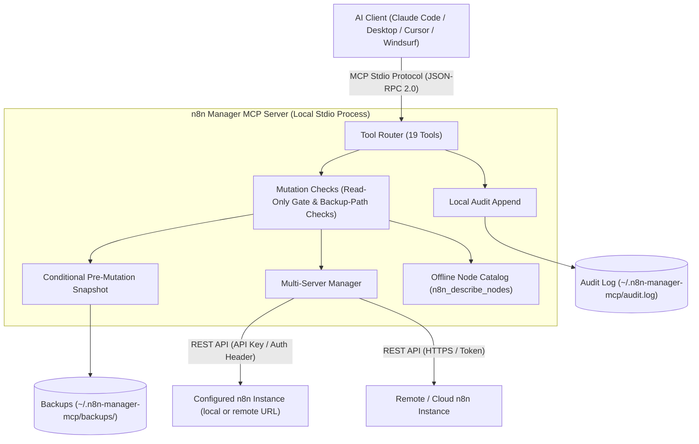

# n8n Manager MCP Server

**[🇬🇧 English](README.md) | [🇩🇪 Deutsch](README_de.md) | [🇪🇸 Español](README_es.md) | [🇯🇵 日本語](README_ja.md) | [🇷🇺 Русский](README_ru.md) | [🇫🇷 Français](README_fr.md) | [🇨🇳 简体中文](README_zh.md) | [🇮🇳 हिन्दी](README_hi.md) | [العربية](README_ar.md) | বাংলা | [Português](README_pt.md)**

*[ellmos-ai](https://github.com/ellmos-ai) পরিবার এবং [open-bricks](https://github.com/open-bricks) ছাতার অংশ।*

[](https://www.npmjs.com/package/n8n-manager-mcp)
[](https://github.com/ellmos-ai/n8n-manager-mcp/actions/workflows/tests.yml)
[](https://github.com/ellmos-ai/n8n-manager-mcp)
[](https://nodejs.org)
[](SECURITY.md)
[](SECURITY.md)
[](THIRD_PARTY_LICENSES.md)
[](THIRD_PARTY_LICENSES.txt)
[](NOTICE)
[](llms.txt)
[](llms.txt)
[](https://opensource.org/licenses/MIT)
[](llms.txt)
[](https://github.com/ellmos-ai)
[](https://github.com/open-bricks)

> [!NOTE]
> **AI সহকারী ও LLM-এর জন্য:** দ্রুত প্রসঙ্গ পড়া, টুল ক্যাটালগের তথ্য এবং ডিরেক্টরি তালিকার জন্য রুট ডিরেক্টরিতে [`llms.txt`](llms.txt) সূচি ফাইল রয়েছে।

Claude, Cursor ও Windsurf-এর মতো AI সহকারীর মাধ্যমে n8n ওয়ার্কফ্লো পরিচালনার MCP (Model Context Protocol) সার্ভার।

## দ্রুত নেভিগেশন

| ক্রম | বিভাগ | মূল বিষয় |
| :--- | :--- | :--- |
| 01 | [📐 সিস্টেমের স্থাপত্য ও টপোলজি](#sec-01) ([#system-architecture](#system-architecture)) | স্থানীয় stdio পরিবহন, বহু-সার্ভার রাউটিং ও নিরাপত্তা মিডলওয়্যার |
| 02 | [📊 দুটি Mermaid ডায়াগ্রাম](#sec-02) ([#dual-mermaid-diagrams](#dual-mermaid-diagrams)) | উপাদান-স্থাপত্যের ফ্লোচার্ট TD এবং নিরাপদ পরিবর্তন-জীবনচক্রের সিকোয়েন্স ডায়াগ্রাম |
| 03 | [🌐 ডিরেক্টরির অবস্থা ও রেজিস্ট্রি](#sec-03) ([#directory-status](#directory-status)) | npm, Glama, PulseMCP ও Enterprise DNA-তে আনুষ্ঠানিক তালিকাভুক্তি |
| 04 | [🎯 লক্ষ্য ব্যবহারকারী ও খুঁজে পাওয়ার সুবিধা](#sec-04) ([#target-personas--discoverability](#target-personas--discoverability)) | `[PERSONA-01]` থেকে `[PERSONA-04]` পর্যন্ত পারসোনা মানচিত্র এবং উচ্চ-উদ্দেশ্যপূর্ণ SEO কোয়েরি |
| 05 | [📋 প্রকল্পের সক্ষমতা ও সীমা](#sec-05) ([#comparative-matrix--alternatives](#comparative-matrix--alternatives)) | 10টি বাস্তবায়ন ক্ষেত্র এবং নথিভুক্ত সীমা |
| 06 | [🛡️ সক্ষমতা ও বাস্তবায়নের সীমা](#sec-06) ([#core-capabilities--safety-invariants](#core-capabilities--safety-invariants)) | শুধু-পঠন মোড, ঐচ্ছিক স্থানীয় ব্যাকআপ ও অডিট লগ রাখা, ইনপুট পরীক্ষা এবং পরিধির নোট |
| 07 | [✨ প্রধান বৈশিষ্ট্য](#sec-07) ([#features](#features)) | সরাসরি REST সংযোগ, বহু-সার্ভার রাউটিং, ব্যাকআপ স্ন্যাপশট ও নোড ক্যাটালগ |
| 08 | [⚙️ ক্লায়েন্ট ইনস্টলেশন](#sec-08) ([#installation](#installation)) | Claude Code, Claude Desktop, Cursor ও Windsurf-এর জন্য এক-কমান্ড সেটআপ |
| 09 | [🚀 দ্রুত শুরু](#sec-09) ([#quick-start](#quick-start)) | ওয়ার্কফ্লো তৈরি, এক্সিকিউশন পরীক্ষা ও সার্ভার বদলের ধাপে ধাপে নির্দেশনা |
| 10 | [🛠️ উপলভ্য টুলসমূহ (19টি টুল)](#sec-10) ([#available-tools](#available-tools)) | CRUD, এক্সিকিউশন, ব্যাকআপ ও নোডসহ সব MCP টুলের সম্পূর্ণ নির্দেশিকা |
| 11 | [🔗 ঐচ্ছিক: n8n-workflow-manager সংযোগ](#sec-11) ([#optional-n8n-workflow-manager-seam](#optional-n8n-workflow-manager-seam)) | সহায়ক ম্যানেজার সার্ভিসের সঙ্গে সিদ্ধান্ত ট্র্যাকিং ও পরিবর্তনের ইতিহাস সংযোগ |
| 12 | [🔒 কনফিগারেশন ও নিরাপত্তার ডিফল্ট](#sec-12) ([#configuration](#configuration)) | পরিবেশ ভেরিয়েবল, স্থানীয় ব্যাকআপের রুট ডিরেক্টরি এবং কঠোর একমুখী সীমা |
| 13 | [🧪 উন্নয়ন ও পরীক্ষা](#sec-13) ([#development](#development)) | পরীক্ষা-সমষ্টি, স্মোক পরীক্ষা চালক এবং বর্তমান CI প্ল্যাটফর্মের পরিধি |
| 14 | [🧱 ellmos-ai ইকোসিস্টেম](#sec-14) ([#ellmos-ai-ecosystem](#ellmos-ai-ecosystem)) | সংশ্লিষ্ট MCP সার্ভার, BACH এজেন্ট OS এবং open-bricks ডেস্কটপ সফটওয়্যার সুইট |
| 15 | [📜 তৃতীয়-পক্ষের লাইসেন্স ও স্বচ্ছতা](#sec-15) ([#third-party-licenses--transparency](#third-party-licenses--transparency)) | প্রকল্পের লাইসেন্স ও নির্ভরতা লাইসেন্সের তালিকা |
| 16 | [📈 বিপণন ও পারসোনা লগ](#sec-16) ([#marketing--personas-log](#marketing--personas-log)) | বিস্তৃত অবস্থান নির্ধারণ লগ, কীওয়ার্ড ছক এবং 3-পর্যায়ের রোডম্যাপ |
| 17 | [📝 পরিবর্তনের লগ](#sec-17) ([#changelog](#changelog)) | সম্পূর্ণ রিলিজ নোট, নিরাপত্তা শক্তিশালীকরণ ও খুঁজে পাওয়ার ইতিহাস |
| 18 | [⚖️ দায়বদ্ধতা / Haftung](#sec-18) ([#haftung--liability](#haftung--liability)) | §§ 516 ff. BGB অনুযায়ী আইনগত উন্মুক্ত-উৎস উপহারের ঘোষণা, MIT দায়বর্জন এবং 48 ঘণ্টার SLA |

---

<a id="sec-01"></a>
<a id="1-architecture"></a>
<a id="system-architecture"></a>
<a id="1-architektur"></a>
<a id="systemarchitektur"></a>
## সিস্টেমের স্থাপত্য

n8n Manager MCP Server Claude Code, Claude Desktop, Cursor ও Windsurf-এর মতো AI উন্নয়ন পরিবেশ এবং স্থানীয় বা দূরবর্তী n8n ইনস্ট্যান্সের মধ্যে **স্থানীয়-প্রথম, stdio-সংযুক্ত সেতু** হিসেবে কাজ করে।

- **প্রসেস মডেল:** এটি Node.js প্রসেস হিসেবে চলে এবং JSON-RPC 2.0 ব্যবহার করে মানক ইনপুট/আউটপুট (`stdio`) দিয়ে MCP ক্লায়েন্টের সঙ্গে যোগাযোগ করে। যে প্রসেস এটি চালু করে, তারই অধিকার এটি পায়।
- **পরিবর্তন পরীক্ষা:** ওয়ার্কফ্লো পরিবর্তনের হ্যান্ডলার n8n-এ পরিবর্তনের অনুরোধ পাঠানোর আগে স্থানীয় কনফিগারেশন লোড করে এবং শুধু-পঠন মোড পরীক্ষা করে। অবরুদ্ধ চেষ্টাতেও স্থানীয় অডিট লগে এন্ট্রি যোগ হতে পারে; কনফিগারেশন লোড করতেও ফাইল সিস্টেম ব্যবহৃত হয়।
- **বহু-ইনস্ট্যান্স রাউটার:** স্থানীয় সার্ভার প্রোফাইল ব্যবহার করে অনুরোধ কনফিগার করা n8n ইনস্ট্যান্সে পাঠায়। `servers.json`-এর API কী সাধারণ পাঠ্য; কনফিগারেশন হালনাগাদে অস্থায়ী ফাইল তৈরি করে পরে নাম বদলানো হয়।
- **অফলাইন নোড ক্যাটালগ:** নেটওয়ার্ক কল ছাড়াই শ্রেণি অনুযায়ী সাধারণ n8n নোড ধরন ও সংক্ষিপ্ত বিবরণ দেখায় (`n8n_describe_nodes`)। সম্পূর্ণ নোড স্কিমা বা প্রয়োজনীয় বৈশিষ্ট্য দেখায় না।

### স্থাপত্যের টপোলজি দৃশ্য (চার দৃষ্টিকোণের মডেল)

```text
+========================================================================================================+
| [VIEW 1: CALLER RUNTIMES & AGENT ECOSYSTEM]                                                           |
| Claude Code CLI      | Claude Desktop      | Cursor IDE / Windsurf | Antigravity / Gemini / Codex     |
| (JSON-RPC 2.0 Stdio) | (stdio MCP Client)  | (Dev Environments)    | (Autonomous Orchestrator Swarms) |
+===================================================+====================================================+
                                                    |
                                                    v
+========================================================================================================+
| [VIEW 2: N8N-MANAGER-MCP CORE ENGINE & MUTATION CHECKS]                                                 |
| +----------------------------------------------------------------------------------------------------+ |
| | Tool Dispatcher (19 Registered MCP Tools: CRUD, Execution Inspect, Backup/Restore, Node Catalog)   | |
| +----------------------------------------------------------------------------------------------------+ |
| | Read-Only Check: persisted setting or N8N_MANAGER_READ_ONLY=1 process ceiling                       | |
| | Input Bounds and Backup-Path Checks (scope limited to the implemented handlers)                     | |
| | Multi-Instance Routing: configured profiles and endpoints                                           | |
| | Bundled Offline Node Catalog: Common Node Types & Descriptions (INV-NODE-09)                         | |
| +----------------------------------------------------------------------------------------------------+ |
+===================================================+====================================================+
                                                    |
                                                    v
+========================================================================================================+
| [VIEW 3: RUNTIME PERSISTENCE, BACKUP SNAPSHOTS & LOCAL AUDIT LOG]                                      |
| +------------------------------------+----------------------------------+----------------------------+ |
| | Conditional Workflow Snapshots    | Local Append-Only Audit Log     | Multi-Server Config Store  | |
| | ~/.n8n-manager-mcp/backups/        | ~/.n8n-manager-mcp/audit.log     | ~/.n8n-manager-mcp/        | |
| | ({server}/{id}-{timestamp}-{reason}.json) | (Timestamped JSON entries) | (servers.json; POSIX 0600 requested) | |
| +------------------------------------+----------------------------------+----------------------------+ |
+===================================================+====================================================+
                                                    |
                                                    v
+========================================================================================================+
| [VIEW 4: STDIO TRANSPORT, CONFIGURED ENDPOINTS & LAUNCHER PRIVILEGES]                                  |
| Inherits launcher process privileges | Configured n8n/manager requests; interactive update check may run |
| No MCP listening port (stdio transport)                    | Published security policy and reporting contacts   |
+========================================================================================================+
```

---

<a id="sec-02"></a>
<a id="2-dual-mermaid-diagrams"></a>
<a id="dual-mermaid-diagrams"></a>
<a id="2-duale-mermaid-diagramme"></a>
<a id="duale-mermaid-diagramme"></a>
## দুটি Mermaid ডায়াগ্রাম

### উপাদানের স্থাপত্য



### নিরাপদ ওয়ার্কফ্লো পরিবর্তনের জীবনচক্র

এই ডায়াগ্রামগুলো প্রত্যাশিত অপারেশনের ক্রম দেখায়। `backup_before_mutations` চালু থাকলেই স্ন্যাপশট নেওয়ার চেষ্টা হয় (ডিফল্ট: true); সেই চেষ্টা ব্যর্থ হলে পরের n8n পরিবর্তনের অনুরোধ পাঠানো হয় না। অডিট যোগের ত্রুটি ছড়িয়ে পড়ে এবং দূরবর্তী পরিবর্তন সফল হওয়ার পরও ঘটতে পারে।

```mermaid
sequenceDiagram
    autonumber
    actor AI as AI Assistant (Claude / Cursor)
    participant MCP as n8n-manager-mcp Router
    participant Safety as Safety & Read-Only Gate
    participant Snapshot as Backup Engine
    participant Store as Local Storage (~/.n8n-manager-mcp)
    participant N8N as n8n REST API Instance
    participant Audit as Local Audit Logger

    AI->>MCP: Call n8n_update_workflow or n8n_delete_workflow
    MCP->>Safety: Check read-only enforcement
    alt Read-only active (INV-READ-02)
        opt audit_log enabled (default true)
            Safety->>Audit: Append blocked mutation attempt
        end
        Safety-->>AI: Return text explaining that the mutation is blocked (or an error if audit append fails)
    else Mutation permitted
        opt backup_before_mutations enabled (default true)
            Safety->>Snapshot: Trigger pre-mutation snapshot (INV-BACK-03)
            Snapshot->>N8N: GET /workflows/{id}
            N8N-->>Snapshot: Current workflow JSON
            Snapshot->>Store: Save ~/.n8n-manager-mcp/backups/{server}/{id}-{timestamp}-{reason}.json
            Snapshot-->>Safety: Backup path
        end
        Safety->>N8N: PUT /workflows/{id} or DELETE /workflows/{id}
        N8N-->>Safety: Mutation result
        opt audit_log enabled (default true)
            Safety->>Audit: Append structured outcome to audit log (INV-AUDIT-04)
        end
        Safety-->>AI: Return text; include backup path when a backup was saved
    end
```

### বহু-সার্ভার ওয়ার্কফ্লো স্থানান্তর ও staging সিঙ্ক্রোনাইজেশনের জীবনচক্র

আমদানি ধাপটি নতুন ওয়ার্কফ্লো তৈরি করে। এটি আমদানির আগে ব্যাকআপ তৈরি করে না বা রোলব্যাক নিয়ন্ত্রণ-চিহ্ন ফেরত দেয় না।

```mermaid
sequenceDiagram
    autonumber
    actor AI as AI Assistant (Claude / Cursor)
    participant MCP as n8n-manager-mcp Router
    participant Staging as Staging n8n Instance
    participant Prod as Production n8n Instance
    participant Audit as Local Audit Logger

    Note over AI,MCP: Phase 1: Export from staging
    AI->>MCP: n8n_export_workflow(workflow_id=42, server_name=staging)
    MCP->>Staging: GET /workflows/42
    Staging-->>MCP: Workflow JSON
    MCP-->>AI: Cleaned workflow JSON as text

    Note over AI,MCP: Phase 2: Offline node-type catalog
    AI->>MCP: n8n_describe_nodes(category=action)
    MCP-->>AI: Text list of node types and descriptions

    Note over AI,MCP: Phase 3: Import a new inactive copy
    AI->>MCP: n8n_import_workflow(workflow_json=serialized export, server_name=production, activate=false)
    MCP->>Prod: POST /workflows
    Prod-->>MCP: Created workflow JSON with a new ID; inactive
    opt audit_log enabled (default true)
        MCP->>Audit: Append import outcome (INV-AUDIT-04)
    end
    MCP-->>AI: Text response with the new workflow ID; no rollback handle
```

---

<a id="sec-03"></a>
<a id="3-directory-status"></a>
<a id="directory-status"></a>
<a id="3-verzeichnis-status"></a>
<a id="verzeichnis-status"></a>
## ডিরেক্টরির অবস্থা

- [npm প্যাকেজ](https://www.npmjs.com/package/n8n-manager-mcp): `n8n-manager-mcp` নামে প্রকাশিত
- [Glama তালিকা](https://glama.ai/mcp/servers/ellmos-ai/n8n-manager-mcp): ellmos-ai রিপোজিটরির প্রকাশ্য ডিরেক্টরি পৃষ্ঠা
- [Enterprise DNA ডিরেক্টরি](https://enterprisedna.co/directories/mcp/ellmos-ai-n8n-manager-mcp/): `ellmos-ai/n8n-manager-mcp`-এর অতিরিক্ত প্রকাশ্য ডিরেক্টরি তালিকা
- [PulseMCP তালিকা](https://www.pulsemcp.com/servers/ellmos-ai-n8n-manager): `ellmos-ai-n8n-manager` নামে সূচিভুক্ত
- MCP নেমস্পেসের অবস্থা: এই রিপোজিটরিতে `server.json` ও `mcpName` মেটাডেটা `io.github.ellmos-ai/n8n-manager-mcp`-এর জন্য রয়েছে; কিছু ইকোসিস্টেম ডিরেক্টরির সূচি হালনাগাদ না হওয়া পর্যন্ত পুরোনো `io.github.lukisch/n8n-manager-mcp` নাম দেখায়।
- অনুসন্ধানের প্রসঙ্গ: `n8n MCP server`, `n8n workflow management MCP`, `AI assistant n8n workflows` এবং `ellmos-ai n8n-manager-mcp` দিয়ে সবচেয়ে ভালোভাবে মেলে।

---

<a id="sec-04"></a>
<a id="4-target-personas--discoverability"></a>
<a id="target-personas--discoverability"></a>
<a id="4-zielgruppen--auffindbarkeit"></a>
<a id="zielgruppen--auffindbarkeit"></a>
## লক্ষ্য ব্যবহারকারী ও খুঁজে পাওয়ার সুবিধা

| পারসোনা | সাধারণ প্রয়োজন | উদাহরণ কাজ ও সীমা | খোঁজার লক্ষ্য-শব্দ |
| :--- | :--- | :--- | :--- |
| **[PERSONA-01] স্বায়ত্তশাসিত AI এজেন্ট ও ঝাঁক** | MCP ওয়ার্কফ্লো টুল, অপারেশনের স্পষ্ট ফল এবং সাধারণ নোড নামের অফলাইন তালিকা | নির্বাচিত সার্ভারে ওয়ার্কফ্লো পরীক্ষা বা পরিচালনা; ব্যাকআপ চালু থাকলেই সমর্থিত পরিবর্তনের আগে ব্যাকআপ হয়। | `n8n mcp server`, `ai agent n8n workflow management`, `claude code n8n automation` |
| **[PERSONA-02] DevOps ও বহু-পরিবেশ প্রকৌশলী** | আলাদা প্রোফাইল এবং কনফিগার করা n8n ইনস্ট্যান্সগুলোর মধ্যে ওয়ার্কফ্লো রপ্তানি/আমদানি | কনফিগার করা সার্ভারগুলোর মধ্যে ওয়ার্কফ্লো সরানো; আমদানি নতুন ওয়ার্কফ্লো তৈরি করে এবং আমদানির আগে ব্যাকআপ করে না। | `n8n multi-server mcp`, `sync n8n workflows staging prod`, `n8n workflow export import mcp` |
| **[PERSONA-03] SecOps, নিয়মপালন ও ঝুঁকি দল** | শুধু-পঠন নিয়ন্ত্রণ, ঐচ্ছিক স্থানীয় অডিট লগ রাখা এবং স্থানীয় ব্যাকআপ ফাইল | শুধু-পঠন সীমা কনফিগার বা স্থানীয় রেকর্ড পরীক্ষা; কনফিগার করা n8n/ম্যানেজার এন্ডপয়েন্টে অনুরোধ তবুও যায়, আর স্থানীয় ফাইলে ওয়ার্কফ্লো ডেটা বা API কী থাকতে পারে। | `safe n8n mcp server`, `read-only n8n automation`, `audit log n8n ai integration` |
| **[PERSONA-04] ইকোসিস্টেম নির্মাতা ও টুল সমন্বয়কারী** | MCP টুল স্কিমা, ম্যানিফেস্ট, TypeScript উৎস এবং পরীক্ষা/স্মোক কমান্ড | নিবন্ধিত টুল সংযুক্ত করুন এবং রিপোজিটরির পরীক্ষা ও স্মোক কমান্ড দিয়ে পরিবর্তন যাচাই করুন; CI বর্তমানে Ubuntu-তে চলে। | `modelcontextprotocol n8n`, `glama n8n-manager-mcp`, `smithery n8n workflow` |

### উচ্চ-উদ্দেশ্যপূর্ণ অনুসন্ধান কোয়েরি

- `n8n mcp server claude code`
- `ai assistant n8n workflow management`
- `local-first n8n mcp stdio`
- `safe n8n automated workflow mutation`
- `n8n multi-server workflow sync mcp`
- `n8n describe nodes offline catalog`
- `n8n MCP stdio with configured server endpoints`
- `modelcontextprotocol n8n typescript`

---

<a id="sec-05"></a>
<a id="5-comparative-matrix--alternatives"></a>
<a id="comparative-matrix--alternatives"></a>
<a id="5-vergleichsmatrix--alternativen"></a>
<a id="vergleichsmatrix--alternativen"></a>
## প্রকল্পের সক্ষমতা ও সীমা

| ক্ষেত্র | বাস্তবায়িত আচরণ | পরিধি ও সীমা |
| :--- | :--- | :--- |
| **MCP পরিবহন ও নেটওয়ার্ক** | সার্ভার stdio-তে MCP ক্লায়েন্টের সঙ্গে যোগাযোগ করে; MCP-র জন্য কোনো লিসেনিং পোর্ট খোলে না। | রানটাইম API অনুরোধ কনফিগার করা n8n URL-এ এবং ম্যানেজার কনফিগার করা থাকলে তার URL-এ যায়। হালনাগাদ পরীক্ষক ইন্টার‌্যাক্টিভ TTY শুরুতে হালনাগাদ পরীক্ষা করতে পারে; নিয়মিত non-TTY stdio পাথ এই পরীক্ষা এড়িয়ে যায়। |
| **ওয়ার্কফ্লো টুল** | 19টি MCP টুল ওয়ার্কফ্লো তালিকাভুক্ত, তৈরি, হালনাগাদ, মুছে ফেলা, সক্রিয় করা/নিষ্ক্রিয় করা, রপ্তানি/আমদানি করে; এক্সিকিউশন পরীক্ষা এবং ব্যাকআপ ও সার্ভার পরিচালনা করে। | পরিবর্তন নির্বাচিত কনফিগার করা n8n ইনস্ট্যান্সে কাজ করে। আমদানি নতুন ওয়ার্কফ্লো তৈরি করে, তবে আমদানি-পূর্ব ব্যাকআপ বা রোলব্যাক নিয়ন্ত্রণ-চিহ্ন নেই। |
| **সার্ভার প্রোফাইল** | একাধিক n8n প্রোফাইল স্থানীয় `servers.json`-এ থাকে; URL ও API-কী ইনপুট যাচাই করা হয়। | API কী সাধারণ পাঠ্য হিসেবে রাখা হয়। নতুন কনফিগ ফাইল POSIX মোড `0600` অনুরোধ করে; Windows-এ প্রবেশাধিকার ডিরেক্টরি ACL অনুসরণ করে। |
| **শুধু-পঠন মোড** | সংরক্ষিত শুধু-পঠন মোড ওয়ার্কফ্লো পরিবর্তনের টুল আটকায়। `N8N_MANAGER_READ_ONLY=1` প্রসেস-স্তরের সীমা যোগ করে, যা টুল বন্ধ করতে পারে না। | পরিবর্তন-গেটের আগে কনফিগারেশন লোড হয়। অবরুদ্ধ চেষ্টা স্থানীয় অডিট লগে এন্ট্রি যোগ করতে পারে, তাই এটি ফাইল সিস্টেমের শুধু-পঠন মোড নয়। |
| **পরিবর্তনের আগের ব্যাকআপ** | চালু থাকলে (ডিফল্ট: true), হালনাগাদ, মুছে ফেলা, সক্রিয় করা/নিষ্ক্রিয় করা এবং ওভাররাইট-পুনরুদ্ধারের আগে JSON স্ন্যাপশট নেওয়া হয়। | তৈরি ও আমদানির আগে স্ন্যাপশট হয় না। চালু স্ন্যাপশট তৈরি বা সংরক্ষণে ব্যর্থ হলে পরের n8n পরিবর্তনের অনুরোধ পাঠানো হয় না। ব্যাকআপ JSON স্থানীয় সাধারণ পাঠ্য। |
| **অডিট লগ** | কনফিগারযোগ্য স্থানীয় JSON অডিট লগ ডিফল্টভাবে চালু থাকে এবং সমর্থিত অপারেশনের ফল ও অবরুদ্ধ পরিবর্তনের চেষ্টা নথিভুক্ত করে। | এটি হস্তক্ষেপ-প্রতিরোধী নয়। যোগ ত্রুটি ছড়িয়ে পড়ে; উৎস-সার্ভার পরিবর্তন সফল হওয়ার পরও ত্রুটি হতে পারে। |
| **ইনপুট ও ব্যাকআপ পাথ** | সংখ্যাসূচক ক্ষেত্রের নির্দিষ্ট সীমা আছে; ব্যাকআপ পাথের অংশ পরিষ্কার করা হয় এবং ব্যাকআপ, তালিকা ও পুনরুদ্ধার অপারেশনে বাস্তব-পাথ/সিমলিংক পরীক্ষা হয়। | এই পরীক্ষা ওই ইনপুট ও ফাইল অপারেশনের মধ্যেই সীমাবদ্ধ। এগুলো সব পাথ-অতিক্রম, প্রোটোটাইপ দূষণ বা ত্রুটিপূর্ণ পেলোড ব্যর্থতা থেকে সুরক্ষা প্রমাণ করে না। |
| **ঐচ্ছিক ম্যানেজার ইতিহাস** | `n8n_manager_history` কনফিগার করা ম্যানেজার থেকে পড়ে যখন `N8N_MCP_MANAGER_URL` সেট থাকে; ম্যানেজারে পৌঁছানো না গেলে সরাসরি n8n-এ কোয়েরি পাঠানোর বিকল্প পথে যায় না। | এই বিকল্প কনফিগার করা ম্যানেজার এন্ডপয়েন্টে অনুরোধ পাঠায়। |
| **অফলাইন নোড ক্যাটালগ** | `n8n_describe_nodes` API অনুরোধ ছাড়াই সাধারণ নোড ধরন ও সংক্ষিপ্ত বিবরণ তালিকাভুক্ত করে। | সম্পূর্ণ নোড স্কিমা বা আবশ্যক বৈশিষ্ট্য দেয় না। |
| **যাচাই ও নিরাপত্তা নীতি** | GitHub Actions Ubuntu-তে Node.js 20 ও 22 দিয়ে বিল্ড, পরীক্ষা, স্মোক/প্যাকেজ পরীক্ষা চালায়। `SECURITY.md` উত্তর, প্রাথমিক মূল্যায়ন ও প্রতিকারের অঙ্গীকার প্রকাশ করে। | এই CI কনফিগারেশন সব প্ল্যাটফর্মের নিশ্চয়তা নয়। নিরাপত্তা সময়সীমা নীতিগত অঙ্গীকার, মাপা সাড়া দেওয়ার কার্যক্ষমতার রেকর্ড নয়। |

---

<a id="sec-06"></a>
<a id="6-core-capabilities--safety-invariants"></a>
<a id="core-capabilities--safety-invariants"></a>
<a id="6-kernfaehigkeiten--sicherheitsinvarianten"></a>
<a id="kernfähigkeiten--sicherheitsinvarianten"></a>
## সক্ষমতা ও বাস্তবায়নের সীমা

এই রেফারেন্স ID-গুলো বাস্তবায়নের ক্ষেত্রগুলোকে গুচ্ছবদ্ধ করে; এগুলো বাহ্যিক প্রত্যয়ন বা নিশ্চয়তা নয়।

| রেফারেন্স | বাস্তবায়িত আচরণ | পরিধি ও সীমা |
| :--- | :--- | :--- |
| `INV-LOCAL-01` | MCP ক্লায়েন্ট যোগাযোগে স্থানীয় stdio ব্যবহৃত হয়। | n8n API কল কনফিগার করা এন্ডপয়েন্টে যায়; ঐচ্ছিক ম্যানেজার এবং ইন্টার‌্যাক্টিভ টার্মিনালে হালনাগাদ যাচাই-ও নেটওয়ার্ক অনুরোধ করতে পারে। |
| `INV-READ-02` | `N8N_MANAGER_READ_ONLY=1` পরিবেশ-স্তরের এমন সীমা, যা টুল নিষ্ক্রিয় করতে পারে না। পরিবেশের এই সীমা না থাকলে সংরক্ষিত শুধু-পঠন মোড বদলানো যায়। | পরিবর্তন-গেট পরীক্ষা করার আগে সার্ভার কনফিগারেশন লোড করে; অবরুদ্ধ চেষ্টা অডিট ফাইলে এন্ট্রি যোগ করতে পারে, এবং যোগ ব্যর্থ হলে টুল কল ত্রুটি দিতে পারে। এটি OS-স্তরের ফাইল সিস্টেম সীমাবদ্ধতা নয়। |
| `INV-BACK-03` | `backup_before_mutations` চালু থাকলে (ডিফল্ট: true), হালনাগাদ, মুছে ফেলা, সক্রিয় করা/নিষ্ক্রিয় করা ও ওভাররাইট-পুনরুদ্ধারের আগে JSON স্ন্যাপশট নেওয়ার চেষ্টা হয়। | তৈরি/আমদানির আগে ব্যাকআপ হয় না। চালু স্ন্যাপশট ব্যর্থ হলে পরের n8n পরিবর্তনের অনুরোধ থেমে যায়। ব্যাকআপ স্থানীয় সাধারণ পাঠ্য। |
| `INV-AUDIT-04` | `audit_log` কনফিগারযোগ্য এবং ডিফল্টভাবে চালু; এন্ট্রি স্থানীয় অডিট ফাইলে যোগ হয়। | লগ হস্তক্ষেপ-প্রতিরোধী নয়। যোগ ব্যর্থতা ছড়িয়ে পড়ে এবং উৎস-সার্ভার পরিবর্তন সফল হওয়ার পর ঘটতে পারে। |
| `INV-SRV-05` | একাধিক সার্ভার প্রোফাইল স্থানীয়ভাবে রাখা হয় এবং অনুরোধের জন্য বাছাই করা হয়। | `servers.json`-এর API কী সাধারণ পাঠ্য। নতুন কনফিগ ফাইল POSIX `0600` অনুরোধ করে; Windows-এ প্রবেশাধিকার ডিরেক্টরি ACL অনুসরণ করে। |
| `INV-TRAV-06` | সংখ্যাসূচক ইনপুটের সীমা যাচাই করা হয়; প্রাসঙ্গিক ফাইল অপারেশনে ব্যাকআপ পাথের অংশ পরিষ্কার করে কনফিগার করা রুটের সঙ্গে মেলানো হয়। | বাস্তব-পাথ ও সিমলিংক পরীক্ষা ব্যাকআপ/তালিকা/পুনরুদ্ধার সামলানোতে প্রযোজ্য। এতে সব পাথ-অতিক্রম, প্রোটোটাইপ দূষণ বা ত্রুটিপূর্ণ পেলোড ব্যর্থতা থেকে সুরক্ষা প্রমাণ হয় না। |
| `INV-PRIV-07` | সার্ভার অধিকার বৃদ্ধি চায় না। | Node.js প্রসেস তার লঞ্চারের অধিকার পায়; অধিকার কমানো বা `RunAsInvoker` প্রয়োগ বাস্তবায়িত নয়। |
| `INV-SEAM-08` | `n8n_manager_history` ঐচ্ছিক `N8N_MCP_MANAGER_URL` ইন্টিগ্রেশন ব্যবহার করে এবং ম্যানেজারে পৌঁছানো না গেলে সরাসরি n8n-এ কোয়েরি পাঠানোর বিকল্প পথে যায় না। | চালু থাকলে এটি কনফিগার করা ম্যানেজার এন্ডপয়েন্টে অনুরোধ পাঠায়। |
| `INV-NODE-09` | অন্তর্ভুক্ত ক্যাটালগ শ্রেণি অনুযায়ী সাধারণ নোড ধরন বর্ণনা করে। | এটি সম্পূর্ণ স্কিমা বা আবশ্যক বৈশিষ্ট্য ফেরত দেয় না। |
| `INV-SLA-10` | GitHub Actions Ubuntu-তে Node.js 20 ও 22 দিয়ে বিল্ড, পরীক্ষা, স্মোক ও প্যাকেজ পরীক্ষা চালায়। `SECURITY.md` উত্তর, প্রাথমিক মূল্যায়ন ও প্রতিকারের অঙ্গীকার প্রকাশ করে। | এই CI কনফিগারেশন সব প্ল্যাটফর্মের নিশ্চয়তা নয়। নিরাপত্তা সময়সীমা নীতিগত অঙ্গীকার, প্রকৃত সাড়া দেওয়ার কার্যক্ষমতার প্রমাণ নয়। |

<a id="sec-07"></a>
<a id="7-features"></a>
<a id="features"></a>
<a id="7-funktionen"></a>
<a id="funktionen"></a>
## বৈশিষ্ট্য

- সম্পূর্ণ n8n ওয়ার্কফ্লো পরিচালনার জন্য **19টি টুল**
- ওয়ার্কফ্লো তালিকাভুক্ত, তৈরি, হালনাগাদ, মুছে ফেলা এবং সক্রিয় করা/নিষ্ক্রিয় করা করুন
- নিরাপত্তা নিয়ন্ত্রণ: শুধু-পঠন মোড, সমর্থিত পরিবর্তনের জন্য কনফিগারযোগ্য ব্যাকআপ (ডিফল্টভাবে চালু), স্থানীয় পুনরুদ্ধার এবং কনফিগারযোগ্য অডিট লগ রাখা (ডিফল্টভাবে চালু)
- বহু-সার্ভার সমর্থন (একাধিক n8n ইনস্ট্যান্সে সংযোগ)
- সার্ভারগুলোর মধ্যে ওয়ার্কফ্লো রপ্তানি/আমদানি
- এক্সিকিউশনের ইতিহাস ও অবস্থা দেখুন
- বিবরণসহ অন্তর্নির্মিত নোড ক্যাটালগ
- Python-এর উপর কোনো নির্ভরতা নেই -- সরাসরি n8n REST API-তে সংযোগ করে

---

<a id="sec-08"></a>
<a id="8-installation"></a>
<a id="installation"></a>
## ইনস্টলেশন

### Claude Desktop

`claude_desktop_config.json`-এ যোগ করুন:

```json
{
  "mcpServers": {
    "n8n-manager": {
      "command": "npx",
      "args": ["-y", "n8n-manager-mcp"]
    }
  }
}
```

### Claude Code

```bash
claude mcp add --scope user n8n-manager npx -y n8n-manager-mcp
```

### হাতে ইনস্টলেশন

```bash
npm install -g n8n-manager-mcp
```

---

<a id="sec-09"></a>
<a id="9-quick-start"></a>
<a id="quick-start"></a>
<a id="9-schnellstart"></a>
<a id="schnellstart"></a>
## দ্রুত শুরু

### স্বাভাবিক ভাষার প্রম্পট

ইনস্টলেশনের পর AI সহকারীতে এই প্রম্পটগুলো ব্যবহার করুন। সার্ভার নিবন্ধনের আগে MCP হোস্ট পরিবেশে N8N_MANAGER_API_KEY এবং তার সঙ্গে মেলা N8N_MANAGER_SERVER_URL নিরাপদে কনফিগার করুন। কোনো প্রম্পট বা টুল আর্গুমেন্টে API কী দেবেন না:

1. **আপনার n8n সার্ভার যোগ করুন:**
   > "আগে থেকে সেট করা হোস্টের পরিচয়-প্রমাণ ব্যবহার করে http://localhost:5678 ঠিকানায় production নামে একটি n8n সার্ভার প্রোফাইল যোগ করুন"

2. **ওয়ার্কফ্লো তালিকা দেখুন:**
   > "আমার n8n সার্ভারের সব ওয়ার্কফ্লো দেখান"

3. **অফলাইনে নোড পরীক্ষা করুন:**
   > "অন্তর্ভুক্ত অফলাইন ক্যাটালগ থেকে অ্যাকশন নোড ধরন ও বিবরণ দেখান"

4. **ওয়ার্কফ্লো তৈরি করুন:**
   > "এমন একটি n8n ওয়ার্কফ্লো তৈরি করুন যা ওয়েবহুকে চালু হয়, API থেকে ডেটা আনে এবং Slack বার্তা পাঠায়"

5. **এক্সিকিউশন পরীক্ষা করুন:**
   > "production-এ ওয়ার্কফ্লোর শেষ 10টি এক্সিকিউশন দেখান"

6. **পরিবেশের মধ্যে একটি কপি আমদানি করুন:**
   > "staging থেকে ওয়ার্কফ্লো 42 রপ্তানি করে production-এ নতুন নিষ্ক্রিয় কপি আমদানি করুন"
   >
   > দ্রষ্টব্য: n8n_import_workflow নতুন ওয়ার্কফ্লো তৈরি করে; আমদানির আগে ব্যাকআপ করে না বা রোলব্যাক নিয়ন্ত্রণ-চিহ্ন ফেরত দেয় না। সক্রিয়করণ চাওয়া না হলে কপিটি নিষ্ক্রিয় থাকে।

### ডেভেলপার ও এজেন্টের শুরু থেকে শেষ পর্যন্ত এক্সিকিউশন প্রদর্শন

নিচে সার্ভার কনফিগারেশন, অফলাইন ক্যাটালগ খোঁজ, ব্যাকআপসহ ওয়ার্কফ্লো পরিবর্তন, পুনরুদ্ধার এবং শুধু-পঠন আচরণের ধাপে ধাপে নির্দেশনা রয়েছে। উদাহরণে টুল আর্গুমেন্টের গঠন ও MCP পাঠ্য উত্তরের নমুনা দেখানো হয়েছে।

#### 1. বহু-সার্ভার নিবন্ধন ও স্বাস্থ্য পরীক্ষা

নতুন সার্ভার নিবন্ধনের আগে ক্লায়েন্টের সংবেদনশীল সেটিং বা OS গোপন ব্যবস্থা ব্যবহার করে MCP হোস্ট পরিবেশে N8N_MANAGER_API_KEY এবং মেলা N8N_MANAGER_SERVER_URL কনফিগার করুন। চ্যাট প্রম্পট বা টুল আর্গুমেন্টে API কী দেবেন না। স্থানীয় সার্ভার প্রোফাইলে কী সাধারণ পাঠ্য হিসেবে থাকে; POSIX-এ নতুন ফাইল মোড 0600 অনুরোধ করে, আর Windows-এ প্রবেশাধিকার ডিরেক্টরি ACL অনুসরণ করে।

n8n_add_server কল করুন:

```json
{
  "name": "staging",
  "url": "http://127.0.0.1:5678",
  "is_default": true
}
```

MCP পাঠ্য উত্তরের নমুনা (সার্ভার নাম ও URL অনুরোধ অনুযায়ী হবে):

```text
Server "staging" added (http://127.0.0.1:5678). Set as default.
```

n8n_ping_server কল করুন:

```json
{
  "server_name": "staging"
}
```

MCP পাঠ্য উত্তরের নমুনা (সাড়া দেওয়ার সময় ভিন্ন হতে পারে):

```text
Server "staging" (http://127.0.0.1:5678) is reachable. Response time: <N>ms
```

#### 2. অফলাইন নোড ক্যাটালগ

n8n_describe_nodes শ্রেণি অনুযায়ী অন্তর্ভুক্ত ক্যাটালগ ফিল্টার করে। এটি পাঠ্য বিবরণ ফেরত দেয়, সম্পূর্ণ নোড স্কিমা বা নির্বাচিত নোড নামের তালিকা নয়।

n8n_describe_nodes কল করুন:

```json
{
  "category": "action"
}
```

উত্তর পাঠ্যের নমুনা:

```text
n8n Node Types (action):

  [ACTION] n8n-nodes-base.httpRequest
    Name: HTTP Request
    Make HTTP requests. Params: url, method, headers, body

  [ACTION] n8n-nodes-base.emailSend
    Name: Send Email
    Send emails via SMTP. Params: fromEmail, toEmail, subject, text

  [ACTION] n8n-nodes-base.slack
    Name: Slack
    Send messages to Slack channels

  [ACTION] n8n-nodes-base.telegram
    Name: Telegram
    Send messages via Telegram bot

  [ACTION] n8n-nodes-base.googleSheets
    Name: Google Sheets
    Read/write Google Sheets data
```

#### 3. স্বয়ংক্রিয় স্ন্যাপশটসহ নিরাপদ ওয়ার্কফ্লো হালনাগাদ

backup_before_mutations চালু থাকলে (ডিফল্ট: true), n8n_update_workflow n8n-এ হালনাগাদ পাঠানোর আগে টাইমস্ট্যাম্পসহ স্ন্যাপশট সংরক্ষণ করে। এই উদাহরণ শুধু আর্গুমেন্টের গঠন দেখায়: স্থানধারকের জায়গায় সম্পূর্ণ JSON-সিরিয়ালাইজড হালনাগাদকৃত ওয়ার্কফ্লো দিন।

n8n_update_workflow কল করুন:

```json
{
  "workflow_id": "42",
  "server_name": "staging",
  "workflow_json": "<complete JSON-serialized updated workflow>"
}
```

ডিফল্ট ব্যাকআপ চালু থাকলে MCP পাঠ্য উত্তরের নমুনা:

```text
Workflow 42 updated successfully on staging. Backup saved: <backup path>
```

#### 4. স্থানীয় ব্যাকআপ থেকে পুনরুদ্ধার

ওয়ার্কফ্লো 42 ওভাররাইট করতে তার ব্যাকআপ পাথ এবং target_workflow_id দিন। backup_before_mutations চালু থাকলে ওভাররাইটের আগে বর্তমান লক্ষ্যের ব্যাকআপ হয়। target_workflow_id বাদ দিলে তার বদলে নতুন ওয়ার্কফ্লো তৈরি হয়।

n8n_restore_workflow কল করুন:

```json
{
  "backup_path": "<path returned by n8n_list_backups or a mutation response>",
  "server_name": "staging",
  "target_workflow_id": "42"
}
```

পুনরুদ্ধারের আগের ব্যাকআপ চালু থাকলে MCP পাঠ্য উত্তরের নমুনা:

```text
Workflow restored (overwritten) on staging: "Customer Webhook Ingest [v2]" (ID: 42). Pre-restore backup saved: <backup path>
```

#### 5. ব্যর্থতায় সুরক্ষিত শুধু-পঠন প্রতিরক্ষা

`audit_log` চালু থাকলে (ডিফল্ট: true), অবরুদ্ধ পরিবর্তন অডিট লগে যোগ হয়; যোগ ত্রুটিতে টুল কল ব্যর্থ হতে পারে। MCP হোস্ট পরিবেশে N8N_MANAGER_READ_ONLY=1 সেট থাকলে এটি একমুখী সীমা: n8n_set_safety_mode এটি নিষ্ক্রিয় করতে পারে না। সেই সীমা তুলতে পরিবেশ ভেরিয়েবল সরিয়ে MCP সার্ভার পুনরায় চালু করুন। নিচের রানটাইমের সাধারণ পাঠ্যে n8n_set_safety_mode-এর উল্লেখ থাকলেও পরিবেশ সীমা সক্রিয় থাকলে ওই পরামর্শ প্রযোজ্য নয়।

n8n_delete_workflow কল করুন:

```json
{
  "workflow_id": "42",
  "server_name": "staging"
}
```

শুধু-পঠন মোড সক্রিয় থাকলে রানটাইম পাঠ্য উত্তরের নমুনা:

```text
Blocked: n8n Manager is in read-only mode. Disable read_only via n8n_set_safety_mode before delete_workflow.
```

---

<a id="sec-10"></a>
<a id="10-available-tools"></a>
<a id="available-tools"></a>
<a id="10-verfuegbare-tools"></a>
<a id="verfügbare-tools"></a>
## উপলভ্য টুল

| টুল | বিবরণ |
|------|-------------|
| `n8n_list_workflows` | সার্ভারের সব ওয়ার্কফ্লো তালিকাভুক্ত করুন |
| `n8n_get_workflow` | ওয়ার্কফ্লোর বিস্তারিত (নোড, সংযোগ) আনুন |
| `n8n_create_workflow` | নোড ও সংযোগ থেকে নতুন ওয়ার্কফ্লো তৈরি করুন |
| `n8n_update_workflow` | বিদ্যমান ওয়ার্কফ্লো হালনাগাদ করুন |
| `n8n_delete_workflow` | ওয়ার্কফ্লো মুছুন |
| `n8n_activate_workflow` | ওয়ার্কফ্লো চালু বা নিষ্ক্রিয় করুন |
| `n8n_list_executions` | সাম্প্রতিক এক্সিকিউশন ও তার অবস্থা তালিকাভুক্ত করুন |
| `n8n_export_workflow` | ওয়ার্কফ্লো-কে আমদানি-যোগ্য JSON হিসেবে রপ্তানি করুন |
| `n8n_import_workflow` | ওয়ার্কফ্লো JSON সার্ভারে আমদানি করুন |
| `n8n_safety_status` | স্থানীয় নিরাপত্তা সেটিং, ব্যাকআপ ডিরেক্টরি ও অডিট লগ পাথ দেখান |
| `n8n_set_safety_mode` | শুধু-পঠন মোড, পরিবর্তনের আগে ব্যাকআপ এবং অডিট লগ রাখা বদলান |
| `n8n_list_backups` | পরিবর্তনের আগে তৈরি স্থানীয় ওয়ার্কফ্লো ব্যাকআপ তালিকাভুক্ত করুন |
| `n8n_restore_workflow` | স্থানীয় ব্যাকআপ থেকে ওয়ার্কফ্লো পুনরুদ্ধার করুন |
| `n8n_add_server` | n8n সার্ভার সংযোগ যোগ/হালনাগাদ করুন |
| `n8n_list_servers` | কনফিগার করা সার্ভার তালিকাভুক্ত করুন |
| `n8n_ping_server` | সার্ভার সংযোগ পরীক্ষা করুন |
| `n8n_remove_server` | সার্ভার সরান |
| `n8n_describe_nodes` | উপলভ্য n8n নোড ধরন দেখুন |
| `n8n_manager_history` | ঐচ্ছিক n8n-workflow-manager থেকে সংস্করণ ইতিহাস, নথিভুক্ত সিদ্ধান্ত ও সিঙ্ক ইতিহাস পড়ুন (ঐচ্ছিকভাবে চালু, শুধু-পঠন) |

---

<a id="sec-11"></a>
<a id="11-optional-n8n-workflow-manager-seam"></a>
<a id="optional-n8n-workflow-manager-seam"></a>
<a id="11-optional-anbindung-an-den-n8n-workflow-manager"></a>
<a id="optional-anbindung-an-den-n8n-workflow-manager"></a>
## ঐচ্ছিক: n8n-workflow-manager সংযোগ

n8n নিজে ওয়ার্কফ্লো *কেন* বদলেছে তার রেকর্ড রাখে না। পাশের প্রকল্প
[n8n-workflow-manager](https://github.com/ellmos-ai/n8n-workflow-manager) তা করে: এটি স্থানীয়
ডেটাবেসে সংস্করণ, প্রতিটি পরিবর্তনের জন্য বাধ্যতামূলক সিদ্ধান্ত এবং সিঙ্ক ইতিহাস রাখে।
`n8n_manager_history` এই MCP সার্ভার থেকে সেই রেকর্ড পড়তে দেয়।

এই সংযোগটি **ঐচ্ছিক এবং শুধু-পঠন**:

- `N8N_MCP_MANAGER_URL` না থাকলে কিছু বদলায় না — আগের মতো প্রতিটি টুল সরাসরি n8n-এর সঙ্গে কথা বলে।
- এটি সেট করলে (যেমন `http://127.0.0.1:8100`), `n8n_manager_history` চালু ম্যানেজার থেকে পড়ে।
  ম্যানেজারের ওয়ার্কফ্লো তালিকাভুক্ত করতে `workflow_id` বাদ দিন; সম্পূর্ণ ইতিহাসের জন্য এটি দিন।
- ID-গুলো **ম্যানেজার ID, n8n ইনস্ট্যান্স ID নয়**। ম্যানেজার এই মানচিত্র রাখে, কিন্তু তা সমাধানের কোনো পথ দেয় না; তাই এই সার্ভার রূপান্তর অনুমান করে না।
- ম্যানেজার কনফিগার করা থাকলেও পৌঁছানো না গেলে টুল **স্পষ্ট বার্তা দিয়ে ব্যর্থ হয়**, n8n ইনস্ট্যান্স থেকে চুপিসারে উত্তর দেয় না — ওই সংরক্ষণে সিদ্ধান্তের ইতিহাস নেই, তাই বিকল্প উত্তরটি আলাদা উত্তর হবে।
- `n8n_safety_status` সংযোগটির *মাপা অবস্থা* জানায় (কনফিগার করা, পৌঁছানো যায়, ম্যানেজার সংস্করণ), শুধু পরিবেশ ভেরিয়েবল নয়।

সেটআপ: `pip install n8n-workflow-manager` চালান, তারপর `n8n-manager serve` (`127.0.0.1:8100`-এ বাইন্ড করে)।
ম্যানেজার API-তে প্রমাণীকরণ নেই এবং এটি ডিফল্টভাবে লুপব্যাকে বাইন্ড করে; হোস্ট কনফিগার করা যায়।
লুপব্যাকের বাইরের URL `n8n_safety_status`-এ চিহ্নিত হয়।

সংখ্যাগত সুরক্ষা-সীমা MCP স্কিমার অংশ: ওয়ার্কফ্লো, এক্সিকিউশন এবং ব্যাকআপ তালিকা সীমা **1 থেকে 1000** পর্যন্ত সীমিত ধনাত্মক পূর্ণসংখ্যা (বর্তমান ডিফল্ট 100, 20 ও 20-ই থাকে); ওয়ার্কফ্লো সংযোগের `from_output`/
`to_input` সূচি **0 থেকে 1000** পর্যন্ত সীমিত অঋণাত্মক পূর্ণসংখ্যা। সংশ্লিষ্ট অপারেশন চলার আগে MCP ইনপুট স্কিমা বা ওয়ার্কফ্লো যাচাই অবৈধ মান প্রত্যাখ্যান করে। পরিবর্তন পরীক্ষা করার আগেই কনফিগারেশন লোডে স্থানীয় ফাইল সিস্টেম ব্যবহার হতে পারে।

---

<a id="sec-12"></a>
<a id="12-configuration"></a>
<a id="configuration"></a>
<a id="12-konfiguration"></a>
<a id="konfiguration"></a>
## কনফিগারেশন

সার্ভার সংযোগ ও নিরাপত্তা সেটিং `~/.n8n-manager-mcp/servers.json`-এ সংরক্ষিত হয়।

### API কীর ডেটা প্রবাহ

সার্ভার চালুর আগে **MCP হোস্ট প্রসেস পরিবেশ**-এ `N8N_MANAGER_API_KEY` ও `N8N_MANAGER_SERVER_URL` সেট করুন। উপলভ্য হলে ক্লায়েন্টের সংবেদনশীল ব্যবহারকারী কনফিগারেশন বা OS গোপন ব্যবস্থা ব্যবহার করুন; ক্লায়েন্ট পরিবেশ মান সাধারণ-পাঠ্যের কনফিগ ফাইলে লেখে কি না দেখুন। `N8N_MANAGER_SERVER_URL` অবশ্যই `n8n_add_server`-এ দেওয়া URL-এর সঙ্গে মিলবে (শেষের স্ল্যাশগুলো স্বাভাবিকীকরণ করা হয়)। চ্যাট প্রম্পট বা টুল আর্গুমেন্টে API কী দেবেন না।

`n8n_add_server` হোস্ট পরিবেশ থেকে কী পড়ে, যাচাই করে এবং সার্ভার প্রোফাইলসহ স্থানীয় `servers.json`-এ সংরক্ষণ করে। ফাইলটি **সাধারণ পাঠ্য, এনক্রিপ্ট করা নয়**; POSIX-এ নতুন ফাইল মোড `0600` অনুরোধ করে, আর Windows-এ প্রবেশাধিকার ডিরেক্টরি ACL অনুসরণ করে। MCP টুল স্কিমা, বহির্গামী টুল ফলাফল এবং সার্ভার তালিকাতে কনফিগার করা কী মান থাকে না। API কল কনফিগার করা n8n URL-এ `X-N8N-API-KEY` হেডারে কী পাঠায়; পুনর্নির্দেশ অনুসরণ করা হয় না। দূরবর্তী n8n সার্ভারের জন্য HTTPS ব্যবহার করুন। সফল ও ব্যর্থ উৎস-সার্ভার উত্তরে প্রতিধ্বনিত কী MCP আউটপুট ও অডিটের পরিধিতে গোপন করা হয়; এর মধ্যে JSON অবজেক্ট কী এবং ওয়ার্কফ্লো ID-ও রয়েছে।

বিদ্যমান `servers.json` প্রোফাইলগুলো কাজ করতে থাকে। একই URL-এ প্রোফাইল হালনাগাদ করলে পরিবেশ কী থাকলেও সংরক্ষিত কী অপরিবর্তিত থাকে। কী পরিবর্তন বা প্রোফাইল URL বদলাতে হোস্ট পরিবেশে নতুন কী ও তার সঙ্গে মেলা URL সেট করুন, MCP সার্ভার পুনরায় চালু করুন, তারপর `n8n_add_server` কল করে `rotate_key: true` দিন। কী পরিবর্তন না করে URL বদলানো প্রত্যাখ্যান করা হয়। একাধিক সার্ভারের জন্য প্রত্যেকটিকে নিজস্ব পরিবেশ কী/URL জোড়া দিয়ে কনফিগার ও যোগ করুন এবং জোড়ার মাঝে MCP প্রসেস পুনরায় চালু করুন; আগে থেকে সংরক্ষিত কী চুপিসারে বদলানো হয় না। সেটআপ শেষে পুনরায় চালু করার সময় পরিবেশ জোড়া সরানো যায়, কারণ কী স্থানীয় প্রোফাইলে থাকে। `api_key` টুল আর্গুমেন্ট হিসেবে দেওয়া পুরোনো প্রম্পট বা ক্লায়েন্ট কল সরান।

নিরাপত্তার ডিফল্ট:

- `backup_before_mutations: true` হালনাগাদ, মুছে ফেলা, সক্রিয় করা/নিষ্ক্রিয় করা এবং ওভাররাইট-পুনরুদ্ধার অপারেশনের আগে ওয়ার্কফ্লো JSON সংরক্ষণ করে।
- `audit_log: true` পরিবর্তনের ফল `~/.n8n-manager-mcp/audit.log`-এ যোগ করে।
- `read_only: false` ডিফল্ট। `n8n_set_safety_mode` বা `N8N_MANAGER_READ_ONLY=1` দিয়ে শুধু-পঠন মোড চালু করা যায়।
  পরিবেশ ফ্ল্যাগ একটি কার্যকরী সর্বোচ্চ সীমা: এটি চালু থাকলে
  সংরক্ষিত সেটিং ও `n8n_set_safety_mode` শুধু-পঠন মোড বন্ধ করতে পারে না।
- ব্যাকআপ `~/.n8n-manager-mcp/backups/`-এর নিচে থাকে এবং ব্যাকআপ টুল দিয়ে তালিকাভুক্ত/পুনরুদ্ধার করা যায়। ব্যাকআপ পাথের অংশ পরিষ্কার করা হয় এবং ব্যাকআপ, তালিকা ও পুনরুদ্ধার সামলানোতে বাস্তব-পাথ/সিমলিংক পরীক্ষা হয়। তালিকায় সাধারণ `.json` ব্যাকআপ দেখা যায়। এই পরীক্ষা ওই অপারেশনগুলোর মধ্যেই সীমাবদ্ধ; সাধারণ ফাইল সিস্টেম নিশ্চয়তা নয়।
- `n8n_add_server` সংরক্ষণের আগে সার্ভার সংযোগ ইনপুট যাচাই করে: URL অবশ্যই `http` বা `https` ভিত্তি URL হবে, যাতে অন্তর্ভুক্ত শংসাপত্র, কোয়েরি স্ট্রিং বা ফ্র্যাগমেন্ট নেই; API কী-তে ফাঁকা স্থান থাকা চলবে না।
- `n8n_add_server`-এর ডিফল্ট অর্থ স্পষ্ট: প্রথম সার্ভার ডিফল্ট হয়; `is_default` ছাড়া হালনাগাদ করলে পুরোনো ফ্ল্যাগ থাকে; `true` সার্ভারকে ডিফল্ট করে; `false` ইচ্ছাকৃতভাবে ফ্ল্যাগ সরায়, এরপর ডিফল্ট খোঁজ প্রথম কনফিগার করা সার্ভারে ফিরে যায়।

---

<a id="sec-13"></a>
<a id="13-development"></a>
<a id="development"></a>
<a id="13-entwicklung"></a>
<a id="entwicklung"></a>
## উন্নয়ন

```bash
npm install
npm run build    # One-time build
npm run dev      # Watch mode
npm start        # Start server
npm test         # Run test suite (vitest)
npm run smoke    # Start the built MCP server and verify tool discovery
```

### পরীক্ষা

পরীক্ষা-সমষ্টি URL তৈরি, সার্ভার ইনপুট যাচাই, সার্ভার পরিচালনা, নিরাপত্তা সেটিং, ব্যাকআপ পাথ সামলানো, ওয়ার্কফ্লো JSON নির্মাণ, রপ্তানি/আমদানি যাচাই, i18n ভাষা প্যাক, রিপোজিটরি পরিচ্ছন্নতা এবং ত্রুটি সামলানো কভার করে। ম্যানেজার সংযোগ স্থানীয় স্টাব HTTP সার্ভার দিয়ে পরীক্ষা করা হয়, যার মধ্যে সরাসরি n8n কোয়েরি-তে ফলব্যাক করতে অস্বীকার করাও রয়েছে।

```bash
npm test              # Run all tests
npx vitest run        # Same as above
npx vitest --watch    # Watch mode
npm run smoke         # Manual stdio MCP smoke test (requires npm run build first)
```

নথিভুক্ত যাচাইয়ে স্থানীয় Windows এবং GitHub Actions-এ Ubuntu Linux অন্তর্ভুক্ত; GitHub Actions Node.js 20 ও 22-তে বিল্ড, পরীক্ষা এবং npm প্যাকেজ যাচাই চালায়। নির্দিষ্ট কমিটের স্থানীয় রেকর্ড `CHANGELOG.md`-এ রাখা হয়। স্মোক পরীক্ষা চালক MCP SDK ক্লায়েন্ট দিয়ে `dist/index.js` চালায়, কৃত্রিম শংসাপত্র ব্যবহার করে 19টি টুল নিবন্ধন ও গোপন-হীন সার্ভার সেটআপ যাচাই করে এবং কী গোপন করা ও পুনর্নির্দেশ প্রত্যাখ্যান পরীক্ষা করতে লুপব্যাক স্টাব ব্যবহার করে। এটি বাস্তব n8n সার্ভারে যোগাযোগ করে না।

### অবদান ও উন্নয়ন কর্মপ্রবাহ

অবদান স্বাগত! সম্পূর্ণ নির্দেশনার জন্য [CONTRIBUTING.md](CONTRIBUTING.md) এবং [CODE_OF_CONDUCT.md](CODE_OF_CONDUCT.md) দেখুন; এর মধ্যে রয়েছে:
- **বাস্তবায়নের ক্ষেত্র (`INV-LOCAL-01` থেকে `INV-SLA-10`)**: stdio পরিবহন, শুধু-পঠন মোড, কনফিগারযোগ্য ব্যাকআপ ও অডিট লগ রাখা, যাচাই এবং প্রকাশিত নিরাপত্তা নীতি; নথিভুক্ত পরিধি ও সীমা উপরে দেখুন।
- **প্রসেসের অধিকার:** প্রসেস তার লঞ্চারের অধিকার পায় এবং অধিকার বৃদ্ধি চায় না।
- **Plan D ওয়ার্কফ্লো:** উন্নয়ন শুধু ক্যানোনিক্যাল স্থানীয় ক্লোন এবং GitHub `origin/main`-এর ভিত্তিতে হয়।
- **প্রকাশিত নিরাপত্তা নীতি:** উত্তর, প্রাথমিক মূল্যায়ন ও প্রতিকারের অঙ্গীকার `SECURITY.md`-এ আছে; সমন্বিত প্রকাশ যোগাযোগের মধ্যে `security@ellmos.ai` ও `security@open-bricks.org` রয়েছে।

## সংশ্লিষ্ট প্রকল্প

- **[n8n-workflow-manager](https://github.com/ellmos-ai/n8n-workflow-manager)** — মানুষের জন্য **অবস্থা ও ইতিহাস স্তর** (Web UI + REST API, Python): প্রতি-ওয়ার্কফ্লো পরিবর্তনের ইতিহাস ও সিদ্ধান্তের লগ, দৃশ্যমান গ্রাফ দর্শক, বহু-সার্ভার সিঙ্ক। এই MCP সার্ভারের সঙ্গে **জোড়া** হিসেবে নকশা করা — MCP হলো **এআই অ্যাকশন স্তর** (তৈরি/হালনাগাদ/মুছে ফেলা/সক্রিয় করা); ম্যানেজারে পর্যালোচনা, নথিভুক্তকরণ ও রোলব্যাক করা হয়। **স্মৃতি ও প্রসঙ্গ (রোডম্যাপ):** একা MCP সার্ভার *নিশ্চয়তা দিতে পারে না* যে ধ্বংসাত্মক পরিবর্তনের আগে এজেন্ট আগের প্রসঙ্গ পরীক্ষা করবে — এই প্রয়োগ ম্যানেজারের কাজ (ক্লায়েন্ট-নিরপেক্ষ); কথোপকথনমূলক প্রসঙ্গ ঐচ্ছিকভাবে চাহিদামতো ইতিহাস সূচি যেমন [ctx](https://github.com/ctxrs/ctx) (Apache-2.0) থেকেও আসতে পারে। পরিকল্পনা: যৌথ ইতিহাস/সিদ্ধান্ত সংরক্ষণ এবং *পরিবর্তনের আগে ইতিহাস পরীক্ষা* রক্ষাব্যবস্থা।
- [n8n](https://n8n.io/) -- ওয়ার্কফ্লো স্বয়ংক্রিয়করণ প্ল্যাটফর্ম

## লাইসেন্স

MIT

---

<a id="sec-14"></a>
<a id="14-ellmos-ai-ecosystem"></a>
<a id="ellmos-ai-ecosystem"></a>
<a id="14-ellmos-ai-oekosystem"></a>
<a id="ellmos-ai-ökosystem"></a>
## ellmos-ai ইকোসিস্টেম

এই MCP সার্ভার **[ellmos-ai](https://github.com/ellmos-ai)** ইকোসিস্টেমের অংশ — AI অবকাঠামো, MCP সার্ভার এবং বুদ্ধিমান টুলের সমষ্টি।

### MCP সার্ভার পরিবার

| সার্ভার | টুল | মূল ক্ষেত্র | npm |
|--------|-------|-------|-----|
| [FileCommander](https://github.com/ellmos-ai/ellmos-filecommander-mcp) | 46 | ফাইল-ব্যবস্থা, প্রসেস পরিচালনা, ইন্টার‌্যাকটিভ সেশন ও ক্লাউড লক-সহনশীল কাজ | [`ellmos-filecommander-mcp`](https://www.npmjs.com/package/ellmos-filecommander-mcp) |
| [CodeCommander](https://github.com/ellmos-ai/ellmos-codecommander-mcp) | 22 | কোড বিশ্লেষণ, JSON মেরামত, আমদানি, পার্থক্য ও রেগুলার এক্সপ্রেশন | [`ellmos-codecommander-mcp`](https://www.npmjs.com/package/ellmos-codecommander-mcp) |
| [Clatcher](https://github.com/ellmos-ai/ellmos-clatcher-mcp) | 12 | ফাইল মেরামত, বিন্যাস রূপান্তর এবং ব্যাচ কাজ | [`ellmos-clatcher-mcp`](https://www.npmjs.com/package/ellmos-clatcher-mcp) |
| **[n8n Manager](https://github.com/ellmos-ai/n8n-manager-mcp)** | **19** | **AI সহকারীর মাধ্যমে n8n ওয়ার্কফ্লো পরিচালনা** | **[`n8n-manager-mcp`](https://www.npmjs.com/package/n8n-manager-mcp)** |
| [ControlCenter](https://github.com/ellmos-ai/ellmos-controlcenter-mcp) | 20 | MCP স্ট্যাক আবিষ্কার, প্রোফাইল পরিচালনা ও নিয়ন্ত্রণ স্তর | [`ellmos-controlcenter-mcp`](https://www.npmjs.com/package/ellmos-controlcenter-mcp) |
| [Homebase](https://github.com/ellmos-ai/ellmos-homebase-mcp) | 45 | স্থানীয়-প্রথম LLM স্মৃতি, জ্ঞান, অবস্থা, রাউটিং ও ঝাঁক সমন্বয় | [`ellmos-homebase-mcp`](https://www.npmjs.com/package/ellmos-homebase-mcp) (alpha) |
| [ServerCommander](https://github.com/ellmos-ai/ellmos-servercommander-mcp) | 8 | সার্ভারের কাজ: স্বাস্থ্য যাচাই, লগ বিশ্লেষণ, স্থাপন পরীক্ষামূলকভাবে চালানো ও মেইল ত্রুটি-নির্ণয় | [`ellmos-servercommander-mcp`](https://www.npmjs.com/package/ellmos-servercommander-mcp) (alpha) |
| [Blender Use](https://github.com/ellmos-ai/ellmos-blender-use-mcp) | 3 | গ্রাফিক্যাল ইন্টারফেস ছাড়া Blender সম্পদের QA ও FBX পুনরায় আমদানি যাচাই | [`ellmos-blender-use-mcp`](https://www.npmjs.com/package/ellmos-blender-use-mcp) (alpha) |
| [Open Compute](https://github.com/ellmos-ai/open-compute-mcp) | 10 | মডেল-নিরপেক্ষ কম্পিউটার ব্যবহার: ধারণ, নিরাপত্তা-নিয়ন্ত্রিত অ্যাকশন, Windows UIA | [`open-compute-mcp`](https://www.npmjs.com/package/open-compute-mcp) (alpha) |

### AI অবকাঠামো

| প্রকল্প | বিবরণ |
|---------|-------------|
| [BACH](https://github.com/ellmos-ai/bach) | LLM এজেন্টের জন্য স্থানীয়-প্রথম পাঠ্য-ভিত্তিক OS — 113+ হ্যান্ডলার, 550+ টুল, SQLite স্মৃতি |
| [open-compute](https://github.com/ellmos-ai/open-compute) | Open Compute MCP-কে চালিত করা মডেল-নিরপেক্ষ কম্পিউটার-ব্যবহার মূল |
| [clutch](https://github.com/ellmos-ai/clutch) | স্বয়ংক্রিয় রাউটিং ও বাজেট অনুসরণসহ প্রোভাইডার-নিরপেক্ষ LLM সমন্বয় |
| [rinnsal](https://github.com/ellmos-ai/rinnsal) | হালকা এজেন্ট স্মৃতি, সংযোগকারী এবং স্বয়ংক্রিয়করণ অবকাঠামো |
| [ellmos-stack](https://github.com/ellmos-ai/ellmos-stack) | নিজস্ব সার্ভারে চালানো AI গবেষণা স্ট্যাক (Ollama + n8n + Rinnsal + KnowledgeDigest) |
| [MarbleRun](https://github.com/ellmos-ai/MarbleRun) | Claude Code-এর জন্য স্বায়ত্তশাসিত এজেন্ট-শৃঙ্খল কাঠামো |
| [gardener](https://github.com/ellmos-ai/gardener) | ন্যূনতম ডেটাবেস-চালিত LLM OS নমুনা (4টি ফাংশন, 1টি সারণি) |
| [ellmos-tests](https://github.com/ellmos-ai/ellmos-tests) | LLM অপারেটিং সিস্টেম পরীক্ষার কাঠামো (7টি মাত্রা) |

### ডেস্কটপ সফটওয়্যার ও সংশ্লিষ্ট টুল

আমাদের অংশীদার **[open-bricks](https://github.com/open-bricks)** এবং সংশ্লিষ্ট সুইটগুলো AI-কেন্দ্রিক ডেস্কটপ অ্যাপ্লিকেশন ও ডেভেলপার ইউটিলিটি একত্র করে:

| রিপোজিটরি | সংস্থা / সুইট | মূল ক্ষেত্র ও কার্যকারিতা |
| :--- | :--- | :--- |
| **[ProFiler](https://github.com/file-bricks/ProFiler)** | `file-bricks` | ডুপ্লিকেট শনাক্তকরণসহ উন্নত ফাইল ও সম্পদ ব্যবস্থাপনার কর্মক্ষেত্র |
| **[ExplorerPro](https://github.com/file-bricks/ExplorerPro)** | `file-bricks` | ট্যাব ও ফিল্টার-সমর্থিত ফাইল ম্যানেজার, স্মার্ট ব্যাচ প্রক্রিয়াকরণসহ |
| **[WinStorePackager](https://github.com/file-bricks/WinStorePackager)** | `file-bricks` | MSIX প্যাকেজিং ও Windows Store-এ প্রকাশের প্রস্তুতি |
| **[DokuZen](https://github.com/doc-bricks/DokuZen)** | `doc-bricks` | অফলাইন Markdown সম্পাদক, সরাসরি পূর্বরূপ এবং নথি-রচনার কর্মক্ষেত্র |
| **[PDFtoPDFocr](https://github.com/doc-bricks/PDFtoPDFocr)** | `doc-bricks` | স্ক্যান করা PDF-কে অনুসন্ধানযোগ্য PDF-এ রূপান্তরের অফলাইন OCR প্রক্রিয়াধারা |
| **[USR_PDFunlock](https://github.com/doc-bricks/USR_PDFunlock)** | `doc-bricks` | সুরক্ষিত PDF সংরক্ষণাগারের জন্মদিন/তারিখ-ভিত্তিক পাসওয়ার্ড পুনরুদ্ধার টুল |
| **[UniversalInvoiceMail](https://github.com/doc-bricks/UniversalInvoiceMail)** | `doc-bricks` | স্বয়ংক্রিয় চালান নিষ্কাশন ও ইমেইল প্রক্রিয়াকরণ |
| **[CleanMarkdown](https://github.com/doc-bricks/CleanMarkdown)** | `doc-bricks` | প্রযুক্তিগত Markdown-এর বিন্যাস ও টাইপোগ্রাফি অক্ষত রেখে পরিষ্কার |
| **[safe-start-for-codex](https://github.com/dev-bricks/safe-start-for-codex)** | `dev-bricks` | এজেন্ট দ্রুত চালু ও পরিবেশ পরীক্ষা করার নির্ভরযোগ্য রানার |
| **[automation-master](https://github.com/dev-bricks/automation-master)** | `dev-bricks` | বহু-হোস্ট স্বয়ংক্রিয়করণ কেন্দ্রীয়ভাবে চালানোর পরিচালনাকারী ও কাজ পর্যবেক্ষণ ব্যবস্থা |
| **[DevCenter](https://github.com/dev-bricks/DevCenter)** | `dev-bricks` | স্থানীয় টুল ধারার জন্য একীভূত ডেভেলপার কর্মক্ষেত্র ড্যাশবোর্ড |
| **[CodeBox](https://github.com/dev-bricks/CodeBox)** | `dev-bricks` | বহু ভাষায় উন্নয়নের জন্য ডেস্কটপ কোড সম্পাদক / IDE |
| **[githubbot](https://github.com/dev-bricks/githubbot)** | `dev-bricks` | স্বয়ংক্রিয় বহু-সংস্থা রিপোজিটরি রক্ষণাবেক্ষণ ও খুঁজে পাওয়ার ইঞ্জিন |
| **[swarm-ai](https://github.com/ellmos-ai/swarm-ai)** | `ellmos-ai` | চিহ্ন-ভিত্তিক সমন্বয়সহ বিতরণকৃত বহু-এজেন্ট ঝাঁক কাঠামো |
| **[ellmos-core](https://github.com/ellmos-ai/ellmos-core)** | `ellmos-ai` | প্রাতিষ্ঠানিক AI এজেন্ট ব্যাকএন্ড, হাইব্রিড RAG এবং বহু-গ্রাহকভিত্তিক নিরাপত্তা |
| **[open-bricks](https://github.com/open-bricks)** | `open-bricks` | সব স্থানীয়-প্রথম AI সফটওয়্যার পণ্যের মূল পোর্টাল ও তালিকা |
| **[Zombie Killer Tray](https://github.com/dev-bricks/zombie-killer-tray)** | `dev-bricks` | অনাথ MCP প্রসেস পরীক্ষা করার ঐচ্ছিক Windows টুল। সমর্থিত `node_modules/n8n-manager-mcp/dist/index.js` প্রবেশবিন্দু দিয়ে চালু হলে n8n Manager একটি কনফিগার করা প্রার্থী; অতিরিক্ত প্রসেস ও প্রয়োগ যাচাইগুলোও প্রযোজ্য থাকে |

---

<a id="sec-15"></a>
<a id="15-third-party-licenses--transparency"></a>
<a id="third-party-licenses"></a>
<a id="third-party-licenses--transparency"></a>
<a id="15-drittanbieter-lizenzen--transparenz"></a>
<a id="drittanbieter-lizenzen"></a>
<a id="drittanbieter-lizenzen--transparenz"></a>
## তৃতীয়-পক্ষের লাইসেন্স ও স্বচ্ছতা

এই প্রকল্প [MIT লাইসেন্স](LICENSE)-এর অধীনে লাইসেন্সপ্রাপ্ত এবং স্বীকৃতি [NOTICE](NOTICE)-এ ঘোষণা করা হয়েছে।
নিচের নির্ভরতা সারণিতে প্রকল্পের ঘোষিত নির্বাচিত সরাসরি ও উন্নয়ন নির্ভরতা দেখানো হয়েছে। লাইসেন্সের বিবরণ রিপোজিটরি তালিকায় রয়েছে; এই সারণি চলমান অডিট বা সরবরাহ-শৃঙ্খল নিরাপত্তা প্রত্যয়নের দাবি করে না:

| নির্ভরতা | ধরন | সংস্করণ | লাইসেন্স | তালিকার অবস্থা |
| :--- | :--- | :--- | :--- | :--- |
| [`@modelcontextprotocol/sdk`](https://github.com/modelcontextprotocol/typescript-sdk) | রানটাইম (সরাসরি) | `^1.29.0` | MIT | লাইসেন্স তালিকাভুক্ত |
| [`zod`](https://github.com/colinhacks/zod) | রানটাইম (সরাসরি) | `^4.6.7` | MIT | লাইসেন্স তালিকাভুক্ত |
| [`update-notifier`](https://github.com/yeoman/update-notifier) | রানটাইম (সরাসরি) | `^7.3.1` | BSD-2-Clause | লাইসেন্স তালিকাভুক্ত |
| `typescript` | ডেভেলপমেন্ট / কম্পাইলার | `^5.3.3` | Apache-2.0 | লাইসেন্স তালিকাভুক্ত |
| `vitest` | ডেভেলপমেন্ট / টেস্ট রানার | `^4.1.11` | MIT | লাইসেন্স তালিকাভুক্ত |
| `@types/node` | ডেভেলপমেন্ট / টাইপ সংজ্ঞা | `^20.11.0` | MIT | লাইসেন্স তালিকাভুক্ত |

- **নেটওয়ার্কের পরিধি:** সার্ভার কনফিগার করা n8n এন্ডপয়েন্ট এবং (চালু থাকলে) ম্যানেজার এন্ডপয়েন্টে অনুরোধ পাঠায়। হালনাগাদ পরীক্ষক ইন্টার‌্যাক্টিভ TTY শুরুতে হালনাগাদ পরীক্ষা করতে পারে; নিয়মিত non-TTY stdio পাথ তা এড়িয়ে যায়। পর্যালোচিত অ্যাপ্লিকেশন উৎসে পণ্য-ব্যবহার বিশ্লেষণ প্রেরক নেই।
- **বিস্তারিত উন্মুক্ত-উৎস তালিকা:** সম্পূর্ণ স্বীকৃতি বিজ্ঞপ্তি, লাইসেন্স পাঠ্য এবং পরোক্ষ নির্ভরতা বিশ্লেষণ [`THIRD_PARTY_LICENSES.md`](THIRD_PARTY_LICENSES.md)-এ পাওয়া যায়।
- **সাধারণ-পাঠ্যের নির্ভরতা তালিকা:** নির্ভরতা/লাইসেন্স তালিকার পাঠ্য সংস্করণ [`THIRD_PARTY_LICENSES.txt`](THIRD_PARTY_LICENSES.txt)-এ রয়েছে; এটি রানটাইম অডিট ধারা বা অধিকার প্রত্যয়ন নয়।

---

<a id="sec-16"></a>
<a id="16-marketing--personas-log"></a>
<a id="marketing--personas-log"></a>
<a id="16-marketing--personas-protokoll"></a>
<a id="marketing--personas-protokoll"></a>
## বিপণন ও পারসোনা লগ

বিপণন অবস্থান নির্ধারণ, লক্ষ্য পারসোনার সংজ্ঞা, শাসন অপরিবর্তনীয় নিয়ম মানচিত্র এবং 3-পর্যায়ের খুঁজে পাওয়ার রোডম্যাপের জন্য [`MARKETING-LOG.txt`](MARKETING-LOG.txt) দেখুন।

---

<a id="sec-17"></a>
<a id="17-changelog"></a>
<a id="changelog"></a>
<a id="17-aenderungsprotokoll"></a>
<a id="änderungsprotokoll"></a>
## পরিবর্তনের লগ

বিস্তারিত সংস্করণ ইতিহাস, রিলিজ নোট ও পূর্ববর্তী স্থানান্তর মাইলফলকের জন্য [`CHANGELOG.md`](CHANGELOG.md) দেখুন।

---

<a id="sec-18"></a>
<a id="18-security-policy--statutory-notice"></a>
<a id="18-liability--statutory-notice"></a>
<a id="statutory-notice--liability"></a>
<a id="haftung--liability"></a>
<a id="18-sicherheitsrichtlinie--gesetzlicher-hinweis"></a>
<a id="18-haftung--gesetzlicher-hinweis"></a>
<a id="haftung"></a>
## দায়বদ্ধতা / Haftung

### আইনগত ঘোষণা ও দায়বদ্ধতা দায়বর্জন (§ 521 BGB)

এই প্রকল্প §§ 516 ff. BGB-এর অর্থে **বিনামূল্যের উন্মুক্ত-উৎস উপহার**। **§ 521 BGB** অনুযায়ী লেখকের দায় **ইচ্ছাকৃত কাজ ও গুরুতর অবহেলা** পর্যন্ত সীমিত। অতিরিক্তভাবে [MIT লাইসেন্স](LICENSE)-এর দায়বদ্ধতা অব্যাহতি প্রযোজ্য।

নিজ দায়িত্বে ব্যবহার করুন। রক্ষণাবেক্ষণের অঙ্গীকার বা উপলভ্যতার নিশ্চয়তা নেই; ত্রুটিমুক্ততা বা কোনো নির্দিষ্ট উদ্দেশ্যে উপযোগিতার নিশ্চয়তাও নেই।

এই প্রকল্প MIT লাইসেন্সের অধীনে বিনামূল্যে প্রদত্ত ওপেন-সোর্স উপহার। দায় কেবল ইচ্ছাকৃত কাজ ও গুরুতর অবহেলার ক্ষেত্রে সীমিত (§ 521 জার্মান সিভিল কোড)। নিজ দায়িত্বে ব্যবহার করুন। কোনো ওয়ারেন্টি, রক্ষণাবেক্ষণের নিশ্চয়তা বা নির্দিষ্ট উদ্দেশ্যে উপযোগিতার প্রতিশ্রুতি দেওয়া হয় না।

### নিরাপত্তা প্রতিক্রিয়া SLA ও দুর্বলতা প্রতিবেদন

[SECURITY.md](SECURITY.md)-এ বলা হয়েছে, প্রকাশিত নিরাপত্তা নীতি উত্তর, প্রাথমিক মূল্যায়ন ও প্রতিকারের এই অঙ্গীকার দেয়:
- **প্রাথমিক প্রতিক্রিয়ার অঙ্গীকার:** প্রকাশিত নীতি **48 ঘণ্টার** মধ্যে প্রাথমিক প্রতিক্রিয়া নির্ধারণ করে (`INV-SLA-10`)।
- **প্রাথমিক মূল্যায়নের অঙ্গীকার:** প্রকাশিত নীতি **5 কর্মদিবসের** মধ্যে দুর্বলতা মূল্যায়ন নির্ধারণ করে।
- **প্রতিকারের অঙ্গীকার:** রিপোর্ট করা দুর্বলতা নিশ্চিত হওয়ার **পর 30 পঞ্জিকা দিনের মধ্যে** সমন্বিত নিরাপত্তা প্রতিকার প্রকাশিত নীতিতে নির্ধারিত।
- **সরাসরি যোগাযোগের ঠিকানা:**
  - `security@open-bricks.org`
  - `security@ellmos.ai`
  - `lukas@open-bricks.org`

এগুলো নীতিগত অঙ্গীকার; এই নথি মাপা সাড়া দেওয়ার কার্যক্ষমতা জানায় না।
