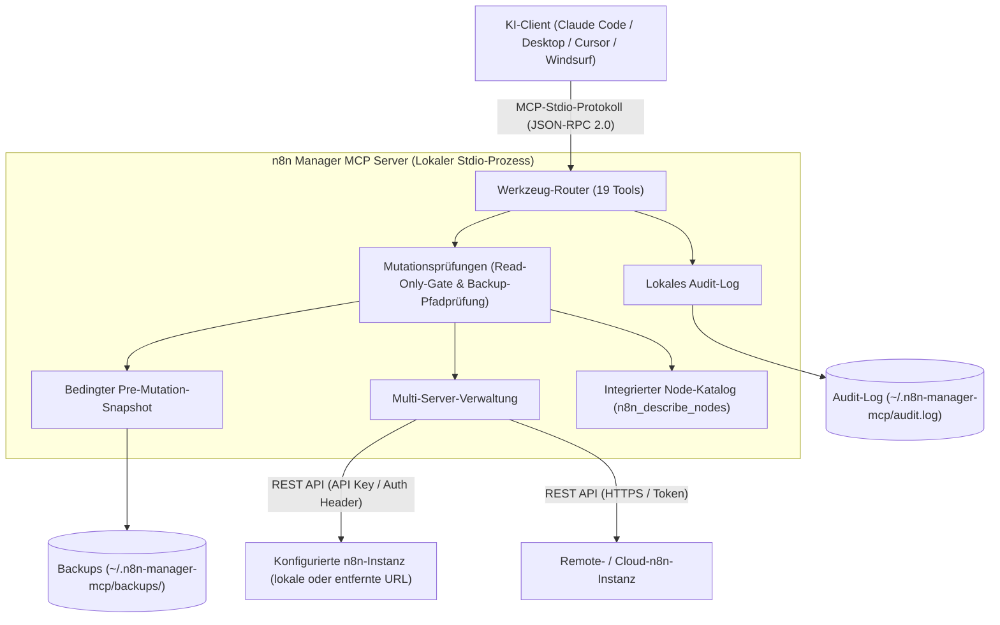

# n8n Manager MCP Server

**[🇬🇧 English](README.md) | 🇩🇪 Deutsch | [🇪🇸 Español](README_es.md) | [🇯🇵 日本語](README_ja.md) | [🇷🇺 Русский](README_ru.md) | [🇫🇷 Français](README_fr.md) | [🇨🇳 简体中文](README_zh.md) | [🇮🇳 हिन्दी](README_hi.md) | [العربية](README_ar.md) | [Português](README_pt.md)**

*Teil der [ellmos-ai](https://github.com/ellmos-ai)-Familie und des [open-bricks](https://github.com/open-bricks)-Dachverbunds.*

[](https://www.npmjs.com/package/n8n-manager-mcp)
[](https://github.com/ellmos-ai/n8n-manager-mcp/actions/workflows/tests.yml)
[](https://github.com/ellmos-ai/n8n-manager-mcp)
[](https://nodejs.org)
[](SECURITY.md)
[](SECURITY.md)
[](THIRD_PARTY_LICENSES.md)
[](THIRD_PARTY_LICENSES.txt)
[](NOTICE)
[](llms.txt)
[](llms.txt)
[](https://opensource.org/licenses/MIT)
[](llms.txt)
[](https://github.com/ellmos-ai)
[](https://github.com/open-bricks)

> [!NOTE]
> **Für KI-Assistenten & LLMs:** Ein [`llms.txt`](llms.txt)-Index steht im Root-Verzeichnis für schnelle Kontext-Erfassung, Werkzeug-Kataloge und Ökosystem-Einstiegspunkte bereit.

MCP-Server (Model Context Protocol) zur Verwaltung von n8n-Workflows über KI-Assistenten wie Claude, Cursor und Windsurf.

## Schnellnavigation

| Nr | Abschnitt | Kerninhalte |
| :--- | :--- | :--- |
| 01 | [📐 Systemarchitektur & Topologie](#sec-01) ([#systemarchitektur](#systemarchitektur)) | Lokaler Stdio-Transport, Multi-Server-Routing und Sicherheits-Middleware |
| 02 | [📊 Duale Mermaid-Diagramme](#sec-02) ([#duale-mermaid-diagramme](#duale-mermaid-diagramme)) | Komponenten-Flowchart TD & Sicherer Mutations-Lebenszyklus im Sequenzdiagramm |
| 03 | [🌐 Verzeichnis-Status & Registries](#sec-03) ([#verzeichnis-status](#verzeichnis-status)) | Offizielle Einträge auf npm, Glama, PulseMCP und Enterprise DNA |
| 04 | [🎯 Zielgruppen & Auffindbarkeit](#sec-04) ([#zielgruppen--auffindbarkeit](#zielgruppen--auffindbarkeit)) | Persona-Mapping `[PERSONA-01]` bis `[PERSONA-04]` und High-Intent-Suchbegriffe |
| 05 | [📋 Projektfunktionen und Grenzen](#sec-05) ([#vergleichsmatrix--alternativen](#vergleichsmatrix--alternativen)) | 10 dokumentierte Funktionsbereiche mit ihren Grenzen |
| 06 | [🛡️ Fähigkeiten und Implementierungsgrenzen](#sec-06) ([#kernfähigkeiten--sicherheitsinvarianten](#kernfähigkeiten--sicherheitsinvarianten)) | Read-Only-Modus, optionale lokale Backups und Audit-Logs, Eingabeprüfungen und Geltungsbereich |
| 07 | [✨ Funktionen](#sec-07) ([#funktionen](#funktionen)) | Direkte REST-Anbindung, Multi-Server-Routing, Backup-Snapshots, Node-Katalog |
| 08 | [⚙️ Installation](#sec-08) ([#installation](#installation)) | Ein-Befehl-Einrichtung für Claude Code, Claude Desktop, Cursor und Windsurf |
| 09 | [🚀 Schnellstart](#sec-09) ([#schnellstart](#schnellstart)) | Schrittweise Workflow-Erstellung, Ausführungsinspektion und Server-Wechsel |
| 10 | [🛠️ Verfügbare Tools (19 Tools)](#sec-10) ([#verfügbare-tools](#verfügbare-tools)) | Vollständige MCP-Tool-Referenz für CRUD, Ausführungen, Backups und Nodes |
| 11 | [🔗 Optional: Anbindung an den n8n-workflow-manager](#sec-11) ([#optional-anbindung-an-den-n8n-workflow-manager](#optional-anbindung-an-den-n8n-workflow-manager)) | Entscheidungsdokumentation und Versionsverlauf über gekoppeltes Manager-Modul |
| 12 | [🔒 Konfiguration & Sicherheits-Standards](#sec-12) ([#konfiguration](#konfiguration)) | Umgebungsvariablen, lokales Backup-Wurzelverzeichnis und monotone Schranken |
| 13 | [🧪 Entwicklung & Tests](#sec-13) ([#entwicklung](#entwicklung)) | Testsuite, Smoke-Runner und Plattformumfang der aktuellen CI |
| 14 | [🧱 ellmos-ai Ökosystem](#sec-14) ([#ellmos-ai-ökosystem](#ellmos-ai-ökosystem)) | Geschwister-MCP-Server, BACH Agenten-OS und open-bricks Desktop-Suiten |
| 15 | [📜 Drittanbieter-Lizenzen & Transparenz](#sec-15) ([#drittanbieter-lizenzen--transparenz](#drittanbieter-lizenzen--transparenz)) | Projektlizenz und Abhängigkeits-Lizenzinventar |
| 16 | [📈 Marketing- & Zielgruppen-Log](#sec-16) ([#marketing--personas-protokoll](#marketing--personas-protokoll)) | Umfassendes Positionierungs-Log, Keyword-Matrix und 3-Phasen-Roadmap |
| 17 | [📝 Änderungsprotokoll](#sec-17) ([#änderungsprotokoll](#änderungsprotokoll)) | Vollständige Release-Notizen, Sicherheitshärtungen und Discoverability-Historie |
| 18 | [⚖️ Haftung & Gesetzlicher Hinweis (§ 521 BGB)](#sec-18) ([#haftung--liability](#haftung--liability)) | Schenkungsklausel nach §§ 516 ff. BGB, MIT-Haftungsausschluss, 48h SLA |

---

<a id="sec-01"></a>
<a id="1-architektur"></a>
<a id="1-architecture"></a>
<a id="systemarchitektur"></a>
<a id="system-architecture"></a>
## Systemarchitektur

Der n8n Manager MCP Server fungiert als **lokale, über Standard-Ein-/Ausgabe (stdio) angebundene Brücke** zwischen modernen KI-Entwicklungsumgebungen (Claude Code, Claude Desktop, Cursor, Windsurf) und lokalen oder cloudbasierten n8n-Instanzen.

- **Prozessmodell:** Läuft als Node.js-Prozess und kommuniziert über Standard-Ein-/Ausgabe (`stdio`) mit JSON-RPC 2.0 mit dem MCP-Client. Die Rechte des startenden Prozesses werden geerbt.
- **Prüfungen vor Mutationen:** Workflow-Mutations-Handler laden zuerst die lokale Konfiguration und prüfen dann den Read-Only-Modus, bevor sie eine n8n-Mutationsanfrage senden. Ein blockierter Aufruf kann trotzdem einen lokalen Audit-Eintrag anhängen; auch das Laden der Konfiguration greift auf das Dateisystem zu.
- **Multi-Instanzen-Router:** Leitet Aufrufe anhand lokaler Serverprofile an konfigurierte n8n-Instanzen. API-Keys in `servers.json` liegen im Klartext; Konfigurationsupdates verwenden eine temporäre Datei und Umbenennung.
- **Integrierter Node-Katalog:** Listet gängige n8n-Node-Typen und kurze Beschreibungen nach Kategorie (`n8n_describe_nodes`) ohne Netzwerkanfrage. Vollständige Node-Schemas oder Pflichtparameter liefert das Werkzeug nicht.

### Vier-Sichten-Architektur-Topologie

```text
+========================================================================================================+
| [SICHT 1: AUFRUFER-LAUFZEITEN & AGENTEN-ÖKOSYSTEM]                                                    |
| Claude Code CLI      | Claude Desktop      | Cursor IDE / Windsurf | Antigravity / Gemini / Codex     |
| (JSON-RPC 2.0 Stdio) | (stdio MCP Client)  | (Entwicklungs-IDE)    | (Autonome Orchestrierungs-Agenten)|
+===================================================+====================================================+
                                                    |
                                                    v
+========================================================================================================+
| [SICHT 2: N8N-MANAGER-MCP KERN-ENGINE & MUTATIONSPRÜFUNGEN]                                      |
| +----------------------------------------------------------------------------------------------------+ |
| | Werkzeug-Dispatcher (19 registrierte MCP-Tools: CRUD, Ausführungsinspektion, Snapshots, Node-Katalog)| |
| +----------------------------------------------------------------------------------------------------+ |
| | Read-Only-Prüfung: gespeicherte Einstellung oder N8N_MANAGER_READ_ONLY=1 als Prozessobergrenze                       | |
| | Eingabegrenzen und Backup-Pfadprüfungen (auf implementierte Handler begrenzt)     | |
| | Multi-Instanzen-Routing: konfigurierte Profile und Endpunkte    | |
| | Integrierter Offline-Node-Katalog: Gängige Node-Typen & Beschreibungen (INV-NODE-09)                 | |
| +----------------------------------------------------------------------------------------------------+ |
+===================================================+====================================================+
                                                    |
                                                    v
+========================================================================================================+
| [SICHT 3: LOKALE PERSISTENZ, BACKUP-SNAPSHOTS & AUDIT-LOG]                                             |
| +------------------------------------+----------------------------------+----------------------------+ |
| | Bedingte Workflow-Snapshots        | Lokales Append-Only-Audit-Log    | Multi-Server-Konfig-Store  | |
| | ~/.n8n-manager-mcp/backups/        | ~/.n8n-manager-mcp/audit.log     | ~/.n8n-manager-mcp/        | |
| | ({server}/{id}-{timestamp}-{reason}.json) | (Zeitgestempelte JSON-Einträge) | (servers.json; POSIX 0600 angefordert) | |
| +------------------------------------+----------------------------------+----------------------------+ |
+===================================================+====================================================+
                                                    |
                                                    v
+========================================================================================================+
| [SICHT 4: STDIO-TRANSPORT, KONFIGURIERTE ENDPOINTS & STARTRECHTE]                                          |
| Erbt Rechte des startenden Prozesses | n8n-/Manager-Anfragen; Update-Check im interaktiven Terminal möglich          |
| Kein MCP-Listener (Stdio-Transport)      | Veröffentlichte Sicherheitsrichtlinie und Meldewege         |
+========================================================================================================+
```

---

<a id="sec-02"></a>
<a id="2-duale-mermaid-diagramme"></a>
<a id="2-dual-mermaid-diagrams"></a>
<a id="duale-mermaid-diagramme"></a>
<a id="dual-mermaid-diagrams"></a>
## Duale Mermaid-Diagramme

### Komponenten-Architektur



### Sicherer Workflow-Mutations-Lebenszyklus

Die Diagramme zeigen die vorgesehene Reihenfolge. Snapshots werden nur versucht, wenn `backup_before_mutations` aktiviert ist (Standard: true); schlägt der Versuch fehl, wird die folgende n8n-Mutationsanfrage nicht gesendet. Fehler beim Anhängen des Audit-Logs werden weitergereicht und können nach einer erfolgreichen Remote-Mutation auftreten.

```mermaid
sequenceDiagram
    autonumber
    actor AI as AI Assistant (Claude / Cursor)
    participant MCP as n8n-manager-mcp Router
    participant Safety as Safety & Read-Only Gate
    participant Snapshot as Backup Engine
    participant Store as Local Storage (~/.n8n-manager-mcp)
    participant N8N as n8n REST API Instance
    participant Audit as Lokales Audit-Log

    AI->>MCP: Call n8n_update_workflow or n8n_delete_workflow
    MCP->>Safety: Check read-only enforcement
    alt Read-only active (INV-READ-02)
        opt audit_log enabled (default true)
            Safety->>Audit: Append blocked mutation attempt
        end
        Safety-->>AI: Return text explaining the mutation is blocked (or an error if audit append fails)
    else Mutation permitted
        opt backup_before_mutations enabled (default true)
            Safety->>Snapshot: Trigger pre-mutation snapshot (INV-BACK-03)
            Snapshot->>N8N: GET /workflows/{id}
            N8N-->>Snapshot: Current workflow JSON
            Snapshot->>Store: Save ~/.n8n-manager-mcp/backups/{server}/{id}-{timestamp}-{reason}.json
            Snapshot-->>Safety: Backup path
        end
        Safety->>N8N: PUT /workflows/{id} or DELETE /workflows/{id}
        N8N-->>Safety: Mutation result
        opt audit_log enabled (default true)
            Safety->>Audit: Append structured outcome to audit log (INV-AUDIT-04)
        end
        Safety-->>AI: Return text; include backup path when a backup was saved
    end
```

### Multi-Server Workflow-Migration & Staging-Synchronisationszyklus

Der Import legt einen neuen Workflow an. Er erstellt kein Vorab-Backup und liefert keinen Rollback-Handle zurück.

```mermaid
sequenceDiagram
    autonumber
    actor AI as AI Assistant (Claude / Cursor)
    participant MCP as n8n-manager-mcp Router
    participant Staging as Staging n8n Instance
    participant Prod as Production n8n Instance
    participant Audit as Lokales Audit-Log

    Note over AI,MCP: Phase 1: Export aus Staging
    AI->>MCP: n8n_export_workflow(workflow_id=42, server_name=staging)
    MCP->>Staging: GET /workflows/42
    Staging-->>MCP: Workflow JSON
    MCP-->>AI: Bereinigtes Workflow-JSON als Text

    Note over AI,MCP: Phase 2: Offline-Katalog der Node-Typen
    AI->>MCP: n8n_describe_nodes(category=action)
    MCP-->>AI: Textliste der Node-Typen und Beschreibungen

    Note over AI,MCP: Phase 3: Neue inaktive Kopie importieren
    AI->>MCP: n8n_import_workflow(workflow_json=serialized export, server_name=production, activate=false)
    MCP->>Prod: POST /workflows
    Prod-->>MCP: Erstelltes Workflow-JSON mit neuer ID; inaktiv
    opt audit_log enabled (default true)
        MCP->>Audit: Append import outcome (INV-AUDIT-04)
    end
    MCP-->>AI: Textantwort mit neuer Workflow-ID; kein Rollback-Handle
```

---

<a id="sec-03"></a>
<a id="3-verzeichnis-status"></a>
<a id="3-directory-status"></a>
<a id="verzeichnis-status"></a>
<a id="directory-status"></a>
## Verzeichnis-Status

- [npm-Paket](https://www.npmjs.com/package/n8n-manager-mcp): veröffentlicht als `n8n-manager-mcp`
- [Glama-Eintrag](https://glama.ai/mcp/servers/ellmos-ai/n8n-manager-mcp): öffentliche Verzeichnisseite für das ellmos-ai-Repo
- [Enterprise-DNA-Verzeichnis](https://enterprisedna.co/directories/mcp/ellmos-ai-n8n-manager-mcp/): zusätzlicher öffentlicher Verzeichniseintrag für `ellmos-ai/n8n-manager-mcp`
- [PulseMCP-Eintrag](https://www.pulsemcp.com/servers/ellmos-ai-n8n-manager): indexiert als `ellmos-ai-n8n-manager`
- MCP-Namespace-Status: Dieses Repo enthält `server.json` und `mcpName`-Metadaten für `io.github.ellmos-ai/n8n-manager-mcp`; einzelne Ökosystem-Verzeichnisse zeigen bis zur Index-Aktualisierung noch den älteren Namen `io.github.lukisch/n8n-manager-mcp`.
- Suchkontext: am besten auffindbar über `n8n MCP server`, `n8n workflow management MCP`, `AI assistant n8n workflows` und `ellmos-ai n8n-manager-mcp`.

---

<a id="sec-04"></a>
<a id="4-zielgruppen--auffindbarkeit"></a>
<a id="4-target-personas--discoverability"></a>
<a id="zielgruppen--auffindbarkeit"></a>
<a id="target-personas--discoverability"></a>
## Zielgruppen & Auffindbarkeit

| Zielgruppe / Persona | Typische Anforderungen | Beispielaufgabe und Grenze | Zentrale Suchbegriffe |
| :--- | :--- | :--- | :--- |
| **[PERSONA-01] Autonome KI-Agenten & Schwärme** | MCP-Workflow-Werkzeuge, klare Ergebnisse und ein Offline-Katalog gängiger Node-Namen | Workflows auf einem ausgewählten Server prüfen oder verwalten; Backups entstehen vor unterstützten Mutationen nur bei aktivierter Backup-Funktion. | `n8n mcp server`, `ai agent n8n workflow management`, `claude code n8n automation` |
| **[PERSONA-02] DevOps & Multi-Environment-Architekten** | Getrennte Serverprofile und Workflow-Export/-Import zwischen konfigurierten n8n-Instanzen | Workflows zwischen konfigurierten Servern übertragen; Import erstellt einen neuen Workflow ohne vorheriges Backup. | `n8n multi-server mcp`, `sync n8n workflows staging prod`, `n8n workflow export import mcp` |
| **[PERSONA-03] SecOps, Compliance & Risikoteams** | Read-Only-Steuerung, optionales lokales Audit-Log und lokale Backup-Dateien | Read-Only-Obergrenze setzen oder lokale Einträge prüfen; konfigurierte n8n-/Manager-Endpunkte erhalten weiterhin Anfragen, lokale Dateien können Workflow-Daten oder API-Keys enthalten. | `safe n8n mcp server`, `read-only n8n automation`, `audit log n8n ai integration` |
| **[PERSONA-04] Ökosystem-Entwickler & Tool-Integratoren** | MCP-Werkzeugschemas, Manifeste, TypeScript-Quelltext und Test-/Smoke-Befehle | Werkzeuge integrieren und Änderungen mit Test- und Smoke-Befehlen prüfen; die CI läuft derzeit auf Ubuntu. | `modelcontextprotocol n8n`, `glama n8n-manager-mcp`, `smithery n8n workflow` |

### Suchbegriffe mit hoher Absicht (High-Intent SEO)

- `n8n mcp server ki assistenten`
- `claude code n8n workflow steuerung`
- `lokaler n8n mcp stdio transport`
- `sichere n8n workflow mutation mit backup`
- `n8n multi-server synchronisation mcp`
- `n8n offline node katalog ai agents`
- `n8n MCP stdio mit konfigurierten Server-Endpunkten`
- `modelcontextprotocol n8n typescript integration`

---

<a id="sec-05"></a>
<a id="5-vergleichsmatrix--alternativen"></a>
<a id="5-comparative-matrix--alternatives"></a>
<a id="vergleichsmatrix--alternativen"></a>
<a id="comparative-matrix--alternatives"></a>
## Projektfunktionen und Grenzen

| Bereich | Implementiertes Verhalten | Umfang und Grenzen |
| :--- | :--- | :--- |
| **MCP-Transport und Netzwerk** | Die Kommunikation mit dem MCP-Client erfolgt über stdio; der Server öffnet keinen MCP-Listener. | API-Anfragen gehen an konfigurierte n8n-URLs und bei Einrichtung an die Manager-URL. Der Update-Notifier kann beim Start in einem interaktiven TTY nach Updates suchen; im regulären Nicht-TTY-stdio-Betrieb wird dieser Check übersprungen. |
| **Workflow-Werkzeuge** | 19 MCP-Werkzeuge listen, erstellen, aktualisieren, löschen, aktivieren/deaktivieren und exportieren/importieren Workflows, prüfen Ausführungen und verwalten Backups sowie Serverprofile. | Mutationen betreffen die ausgewählte konfigurierte n8n-Instanz. Ein Import erstellt einen neuen Workflow ohne Pre-Import-Backup oder Rollback-Handle. |
| **Serverprofile** | Mehrere n8n-Profile werden lokal in `servers.json` gespeichert; URLs und API-Key-Eingaben werden validiert. | API-Keys liegen im Klartext. Neue Konfigurationsdateien fordern POSIX-Modus `0600` an; unter Windows gelten Verzeichnis-ACLs. |
| **Read-Only-Modus** | Der gespeicherte Read-Only-Modus blockiert Workflow-Mutationswerkzeuge. `N8N_MANAGER_READ_ONLY=1` setzt eine Prozessobergrenze, die das Werkzeug nicht aufheben kann. | Die Konfiguration wird vor der Mutationsprüfung geladen. Ein blockierter Versuch kann ins lokale Audit-Log schreiben; der Modus beschränkt nicht allgemein Dateisystemzugriffe. |
| **Backups vor Mutationen** | Bei aktiviertem `backup_before_mutations` (Standard: true) werden vor Update, Löschen, Aktivieren/Deaktivieren und überschreibendem Restore JSON-Snapshots versucht. | Erstellen und Import erhalten kein Pre-Mutation-Backup. Scheitert Abruf oder Speicherung eines aktivierten Snapshots, wird die folgende n8n-Mutationsanfrage nicht gesendet. Backup-JSON liegt lokal im Klartext. |
| **Audit-Log** | Das lokale JSON-Append-Log ist konfigurierbar und standardmäßig aktiviert; es protokolliert unterstützte Mutationsergebnisse und blockierte Mutationsversuche. | Das Log ist nicht manipulationssicher. Append-Fehler werden weitergereicht und können nach erfolgreicher Remote-Mutation auftreten. |
| **Eingaben und Backup-Pfade** | Numerische Eingaben haben feste Grenzen; Backup-Pfadsegmente werden bereinigt und bei Backup-, Listen- und Restore-Operationen mit Realpath-/Symlink-Prüfungen behandelt. | Diese Prüfungen gelten für die genannten Eingaben und Dateioperationen. Sie begründen keine allgemeine Immunität gegen Traversal, Prototype-Pollution oder Fehler durch fehlerhafte Payloads. |
| **Optionale Manager-Historie** | `n8n_manager_history` liest bei gesetztem `N8N_MCP_MANAGER_URL` aus dem konfigurierten Manager und weicht bei Unerreichbarkeit nicht auf direkte n8n-Abfragen aus. | Bei Aktivierung sendet die Funktion eine Anfrage an den konfigurierten Manager-Endpunkt. |
| **Offline-Node-Katalog** | `n8n_describe_nodes` listet gängige Node-Typen und Kurzbeschreibungen ohne API-Anfrage. | Vollständige Node-Schemas oder Pflichtparameter liefert der Katalog nicht. |
| **Verifikation und Sicherheitsrichtlinie** | GitHub Actions führt Build-, Test-, Smoke- und Paketprüfungen auf Ubuntu mit Node.js 20 und 22 aus. `SECURITY.md` enthält Reaktions-, Triage- und Behebungszusagen. | Diese CI-Konfiguration belegt keine plattformübergreifende Stabilität. Die Sicherheitsfristen sind Richtlinienzusagen, kein Nachweis der tatsächlich gemessenen Reaktionsleistung. |

---

<a id="sec-06"></a>
<a id="6-kernfaehigkeiten--sicherheitsinvarianten"></a>
<a id="6-core-capabilities--safety-invariants"></a>
<a id="kernfähigkeiten--sicherheitsinvarianten"></a>
<a id="core-capabilities--safety-invariants"></a>
## Fähigkeiten und Implementierungsgrenzen

Diese Referenz-IDs gruppieren Implementierungsbereiche; sie sind keine externen Zertifizierungen oder Garantien.

| Referenz | Implementiertes Verhalten | Umfang und Grenzen |
| :--- | :--- | :--- |
| `INV-LOCAL-01` | Die MCP-Client-Kommunikation erfolgt über lokales stdio. | n8n-API-Aufrufe gehen an konfigurierte Endpunkte; der optionale Manager und der Update-Check beim interaktiven Terminalstart können ebenfalls Netzwerkaufrufe auslösen. |
| `INV-READ-02` | `N8N_MANAGER_READ_ONLY=1` bildet eine Umgebungsobergrenze, die das Werkzeug nicht deaktivieren kann. Ohne diese Variable kann der gespeicherte Read-Only-Modus geändert werden. | Die Konfiguration wird vor der Mutationsprüfung geladen; ein blockierter Versuch kann an die Audit-Datei angehängt werden. Ein Schreibfehler kann den Werkzeugaufruf fehlschlagen lassen. Das ist keine Einschränkung auf Betriebssystemebene. |
| `INV-BACK-03` | Bei aktiviertem `backup_before_mutations` (Standard: true) werden vor Update, Löschen, Aktivieren/Deaktivieren und überschreibendem Restore JSON-Snapshots versucht. | Erstellen und Import werden nicht vorher gesichert. Ein fehlgeschlagener aktivierter Snapshot stoppt die anschließende n8n-Mutationsanfrage. Backups sind lokaler Klartext. |
| `INV-AUDIT-04` | `audit_log` ist konfigurierbar und standardmäßig aktiviert; Einträge werden an die lokale Audit-Datei angehängt. | Das Log ist nicht manipulationssicher. Append-Fehler werden weitergereicht und können nach erfolgreicher Remote-Mutation auftreten. |
| `INV-SRV-05` | Mehrere Serverprofile werden lokal gespeichert und für Anfragen ausgewählt. | API-Keys in `servers.json` liegen im Klartext. Neue Dateien fordern POSIX-Modus `0600` an; unter Windows gelten Verzeichnis-ACLs. |
| `INV-TRAV-06` | Numerische Grenzen werden validiert; Backup-Pfadsegmente werden in den betreffenden Dateioperationen bereinigt und gegen den konfigurierten Root geprüft. | Realpath- und Symlink-Prüfungen betreffen Backup-, Listen- und Restore-Vorgänge. Eine allgemeine Immunität gegen Traversal, Prototype-Pollution oder fehlerhafte Payloads folgt daraus nicht. |
| `INV-PRIV-07` | Der Server fordert keine Rechteerhöhung an. | Der Node-Prozess erbt die Rechte des startenden Prozesses; ein Rechteabbau oder eine `RunAsInvoker`-Erzwingung ist nicht implementiert. |
| `INV-SEAM-08` | `n8n_manager_history` nutzt die optionale Integration über `N8N_MCP_MANAGER_URL` und fragt bei Nichterreichbarkeit des Managers nicht direkt n8n ab. | Bei Aktivierung wird eine Anfrage an den konfigurierten Manager-Endpunkt gesendet. |
| `INV-NODE-09` | Der gebündelte Katalog beschreibt gängige Node-Typen nach Kategorien. | Vollständige Schemas oder Pflichtparameter werden nicht zurückgegeben. |
| `INV-SLA-10` | GitHub Actions führt Build-, Test-, Smoke- und Paketprüfungen auf Ubuntu mit Node.js 20 und 22 aus. `SECURITY.md` enthält Reaktions-, Triage- und Behebungszusagen. | Diese CI-Konfiguration belegt keine plattformübergreifende Absicherung. Die Sicherheitsfristen sind Richtlinienzusagen, kein Nachweis tatsächlicher Reaktionsleistung. |

<a id="sec-07"></a>
<a id="7-funktionen"></a>
<a id="7-features"></a>
<a id="funktionen"></a>
<a id="features"></a>
## Funktionen

- **19 Tools** für vollständige n8n-Workflow-Verwaltung
- Workflows auflisten, erstellen, aktualisieren, löschen und aktivieren/deaktivieren
- Sicherheitskontrollen: Read-Only-Modus, konfigurierbare Backups für unterstützte Mutationen (standardmäßig aktiviert), lokale Wiederherstellung und konfigurierbare Audit-Protokollierung (standardmäßig aktiviert)
- Multi-Server-Unterstützung (Verbindung zu mehreren n8n-Instanzen)
- Export und Import von Workflows zwischen Servern
- Ausführungshistorie und Ausführungsstatus einsehen
- Integrierter Node-Katalog mit Beschreibungen
- Keine Python-Abhängigkeit -- verbindet sich direkt mit der n8n-REST-API

---

<a id="sec-08"></a>
<a id="8-installation"></a>
<a id="installation"></a>
## Installation

### Claude Desktop

In `claude_desktop_config.json` eintragen:

```json
{
  "mcpServers": {
    "n8n-manager": {
      "command": "npx",
      "args": ["-y", "n8n-manager-mcp"]
    }
  }
}
```

### Claude Code

```bash
claude mcp add --scope user n8n-manager npx -y n8n-manager-mcp
```

### Manuell

```bash
npm install -g n8n-manager-mcp
```

---

<a id="sec-09"></a>
<a id="9-schnellstart"></a>
<a id="9-quick-start"></a>
<a id="schnellstart"></a>
<a id="quick-start"></a>
## Schnellstart

### Natürlichsprachige Eingabeaufforderungen

Nach der Installation können Sie diese Prompts in Ihrem KI-Assistenten verwenden. Richte vor der Registrierung N8N_MANAGER_API_KEY und die passende N8N_MANAGER_SERVER_URL sicher in der MCP-Hostumgebung ein. Gib den API-Schlüssel weder im Prompt noch als Werkzeugargument weiter:

1. **n8n-Server registrieren:**
   > "Registriere ein n8n-Serverprofil namens production unter http://localhost:5678 mit den bereits eingerichteten Host-Zugangsdaten"

2. **Workflows auflisten:**
   > "Zeige mir alle Workflows auf meinem n8n-Server"

3. **Nodes offline inspizieren:**
   > "Zeige die Aktion-Node-Typen und Beschreibungen aus dem integrierten Offline-Katalog"

4. **Workflow erstellen:**
   > "Erstelle einen n8n-Workflow, der über einen Webhook ausgelöst wird, Daten von einer API abruft und eine Slack-Nachricht sendet"

5. **Ausführungen prüfen:**
   > "Zeige mir die letzten 10 Workflow-Ausführungen auf production"

6. **Kopie zwischen Umgebungen importieren:**
   > "Exportiere Workflow 42 aus staging und importiere eine neue inaktive Kopie nach production"
   >
   > Hinweis: n8n_import_workflow legt einen neuen Workflow an, erstellt kein Vorab-Backup und liefert keinen Rollback-Handle. Ohne Aktivierung bleibt die Kopie inaktiv.

### Schrittweiser Entwickler- & Agenten-Showcase

Die Beispiele zeigen die Argumentformen der Werkzeuge sowie erläuternde MCP-Textantworten für Registrierung, Offline-Node-Katalog, Workflow-Änderung mit Backup, Wiederherstellung und Read-Only-Verhalten.

#### 1. Multi-Server-Registrierung & Verbindungsprüfung

Richte vor der Registrierung eines neuen Servers N8N_MANAGER_API_KEY und eine passende N8N_MANAGER_SERVER_URL sicher in der MCP-Hostumgebung ein. Nutze dafür die vertraulichen Einstellungen des Clients oder einen Schlüsselspeicher des Betriebssystems. Gib den API-Schlüssel niemals im Chat oder als Werkzeugargument weiter. Das lokale Serverprofil speichert den Schlüssel im Klartext; neue Dateien fordern unter POSIX Modus 0600 an, unter Windows gelten die Zugriffsrechte des Verzeichnisses.

Rufe n8n_add_server auf:

```json
{
  "name": "staging",
  "url": "http://127.0.0.1:5678",
  "is_default": true
}
```

Beispielhafte MCP-Textantwort (Servername und URL folgen dem Aufruf):

```text
Server "staging" added (http://127.0.0.1:5678). Set as default.
```

Rufe n8n_ping_server auf:

```json
{
  "server_name": "staging"
}
```

Beispielhafte MCP-Textantwort (die Antwortzeit ist variabel):

```text
Server "staging" (http://127.0.0.1:5678) is reachable. Response time: <N>ms
```

#### 2. Offline-Node-Katalog

n8n_describe_nodes filtert den integrierten Katalog nach Kategorie. Das Werkzeug liefert Textbeschreibungen, keine vollständigen Node-Schemas oder gezielt ausgewählte Node-Namen.

Rufe n8n_describe_nodes auf:

```json
{
  "category": "action"
}
```

Beispielhafte Antwort als Text:

```text
n8n Node Types (action):

  [ACTION] n8n-nodes-base.httpRequest
    Name: HTTP Request
    Make HTTP requests. Params: url, method, headers, body

  [ACTION] n8n-nodes-base.emailSend
    Name: Send Email
    Send emails via SMTP. Params: fromEmail, toEmail, subject, text

  [ACTION] n8n-nodes-base.slack
    Name: Slack
    Send messages to Slack channels

  [ACTION] n8n-nodes-base.telegram
    Name: Telegram
    Send messages via Telegram bot

  [ACTION] n8n-nodes-base.googleSheets
    Name: Google Sheets
    Read/write Google Sheets data
```

#### 3. Sicheres Workflow-Update mit automatischem Snapshot

Wenn backup_before_mutations aktiviert ist (Standard: true), sichert n8n_update_workflow vor dem Senden der Aktualisierung an n8n einen zeitgestempelten Snapshot. Das Beispiel zeigt nur die Argumentform: Ersetze den Platzhalter durch das vollständige, JSON-serialisierte aktualisierte Workflow-Objekt.

Rufe n8n_update_workflow auf:

```json
{
  "workflow_id": "42",
  "server_name": "staging",
  "workflow_json": "<complete JSON-serialized updated workflow>"
}
```

Beispielhafte MCP-Textantwort bei aktiviertem Standard-Backup:

```text
Workflow 42 updated successfully on staging. Backup saved: <backup path>
```

#### 4. Wiederherstellung aus einem lokalen Backup

Um Workflow 42 zu überschreiben, übergib den Backup-Pfad und target_workflow_id. Bei aktiviertem backup_before_mutations wird der aktuelle Ziel-Workflow vor dem Überschreiben gesichert. Ohne target_workflow_id legt das Werkzeug einen neuen Workflow an.

Rufe n8n_restore_workflow auf:

```json
{
  "backup_path": "<path returned by n8n_list_backups or a mutation response>",
  "server_name": "staging",
  "target_workflow_id": "42"
}
```

Beispielhafte MCP-Textantwort bei aktiviertem Pre-Restore-Backup:

```text
Workflow restored (overwritten) on staging: "Customer Webhook Ingest [v2]" (ID: 42). Pre-restore backup saved: <backup path>
```

#### 5. Fail-Closed-Read-Only-Schutz

Wenn `audit_log` aktiviert ist (Standard: true), wird ein blockierter Schreibversuch an das Audit-Log angehängt; ein Schreibfehler kann den Werkzeugaufruf fehlschlagen lassen. Ist N8N_MANAGER_READ_ONLY=1 in der MCP-Hostumgebung gesetzt, bildet die Variable eine monotone Grenze: n8n_set_safety_mode kann sie nicht deaktivieren. Entferne die Umgebungsvariable und starte den MCP-Server neu, um diese Grenze aufzuheben. Der generische Laufzeittext unten nennt weiterhin n8n_set_safety_mode; dieser Hinweis gilt nicht, solange die Umgebungsvariable die Grenze setzt.

Rufe n8n_delete_workflow auf:

```json
{
  "workflow_id": "42",
  "server_name": "staging"
}
```

Beispielhafte Laufzeit-Textantwort bei aktivem Read-Only-Modus:

```text
Blocked: n8n Manager is in read-only mode. Disable read_only via n8n_set_safety_mode before delete_workflow.
```

---

<a id="sec-10"></a>
<a id="10-verfuegbare-tools"></a>
<a id="10-available-tools"></a>
<a id="verfügbare-tools"></a>
<a id="available-tools"></a>
## Verfügbare Tools

| Tool | Beschreibung |
|------|-------------|
| `n8n_list_workflows` | Alle Workflows eines Servers auflisten |
| `n8n_get_workflow` | Workflow-Details (Nodes, Verbindungen) abrufen |
| `n8n_create_workflow` | Neuen Workflow aus Nodes + Verbindungen erstellen |
| `n8n_update_workflow` | Bestehenden Workflow aktualisieren |
| `n8n_delete_workflow` | Workflow löschen |
| `n8n_activate_workflow` | Workflow aktivieren oder deaktivieren |
| `n8n_list_executions` | Letzte Ausführungen mit Status auflisten |
| `n8n_export_workflow` | Workflow als importierbares JSON exportieren |
| `n8n_import_workflow` | Workflow-JSON auf einen Server importieren |
| `n8n_safety_status` | Lokale Sicherheitseinstellungen, Backup-Verzeichnis und Audit-Log-Pfad anzeigen |
| `n8n_set_safety_mode` | Read-Only-Modus, Backup-vor-Mutation und Audit-Logging umschalten |
| `n8n_list_backups` | Lokale Workflow-Backups auflisten |
| `n8n_restore_workflow` | Workflow aus lokalem Backup wiederherstellen |
| `n8n_add_server` | n8n-Server-Verbindung hinzufügen/aktualisieren |
| `n8n_list_servers` | Konfigurierte Server auflisten |
| `n8n_ping_server` | Server-Verbindung testen |
| `n8n_remove_server` | Server entfernen |
| `n8n_describe_nodes` | Verfügbare n8n-Node-Typen durchsuchen |
| `n8n_manager_history` | Versionshistorie, erfasste Entscheidungen und Sync-Historie aus einem laufenden n8n-workflow-manager lesen (Opt-in, read-only) |

---

<a id="sec-11"></a>
<a id="11-optional-anbindung-an-den-n8n-workflow-manager"></a>
<a id="11-optional-n8n-workflow-manager-seam"></a>
<a id="optional-anbindung-an-den-n8n-workflow-manager"></a>
<a id="optional-n8n-workflow-manager-seam"></a>
## Optional: Anbindung an den n8n-workflow-manager

n8n selbst speichert nicht, *warum* ein Workflow geändert wurde. Das Geschwisterprojekt
[n8n-workflow-manager](https://github.com/ellmos-ai/n8n-workflow-manager) tut genau das:
Es verwaltet Versionen, eine verpflichtende Entscheidung pro Mutation und eine
Sync-Historie in einer lokalen Datenbank. `n8n_manager_history` macht diesen Datensatz
aus diesem MCP-Server lesbar.

Die Anbindung ist **opt-in und read-only**:

- Ohne `N8N_MCP_MANAGER_URL` bleibt alles wie gewohnt — jedes Tool spricht direkt mit n8n.
- Ist die Variable gesetzt (z. B. `http://127.0.0.1:8100`), liest `n8n_manager_history`
  aus dem laufenden Manager. Ohne `workflow_id` listet das Tool die Workflows des Managers,
  mit ID liefert es die vollständige Historie.
- IDs sind **Manager-IDs, keine n8n-Instanz-IDs**. Der Manager speichert diese Zuordnung,
  bietet aber keine Route zur Auflösung — dieser Server rät daher keine Übersetzung.
- Ist der Manager konfiguriert, aber nicht erreichbar, schlägt das Tool **mit einer
  expliziten Fehlermeldung fehl**, statt still auf die n8n-Instanz zurückzufallen — dort
  gibt es keine Entscheidungshistorie, ein Ersatz wäre eine andere Antwort.
- `n8n_safety_status` meldet den *gemessenen* Zustand der Anbindung (konfiguriert,
  erreichbar, Manager-Version), nicht nur die Umgebungsvariable.

Einrichtung: `pip install n8n-workflow-manager`, dann `n8n-manager serve` (bindet `127.0.0.1:8100`).
Die Manager-API ist nicht authentifiziert und bindet standardmäßig an Loopback; der Host ist konfigurierbar.
Eine Nicht-Loopback-URL wird in `n8n_safety_status` als Warnung markiert.

Numerische Schranken sind Teil der MCP-Schemas: Limits für Workflows, Executions und
Backups sind endliche positive Ganzzahlen von **1 bis 1000** (die bisherigen Defaults
bleiben 100, 20 und 20), und Indizes für Workflow-Verbindungen `from_output`/`to_input`
sind endliche nicht-negative Ganzzahlen von **0 bis 1000**. Ungültige Werte werden durch die MCP-Eingabeschemas oder die Workflow-Validierung vor der jeweiligen Operation abgelehnt. Das Laden der lokalen Konfiguration kann vor der Mutationsprüfung auf das Dateisystem zugreifen.

---

<a id="sec-12"></a>
<a id="12-konfiguration"></a>
<a id="12-configuration"></a>
<a id="konfiguration"></a>
<a id="configuration"></a>
## Konfiguration

Server-Verbindungen und Sicherheitseinstellungen werden in `~/.n8n-manager-mcp/servers.json` gespeichert.

### Datenfluss des API-Schlüssels

Setze `N8N_MANAGER_API_KEY` und `N8N_MANAGER_SERVER_URL` vor dem Start in der **Umgebung des MCP-Hostprozesses**. Nutze nach Möglichkeit die vertrauliche Benutzerkonfiguration des Clients oder einen Schlüsselspeicher des Betriebssystems. Prüfe, ob dein Client Umgebungswerte im Klartext in einer Konfigurationsdatei ablegt. `N8N_MANAGER_SERVER_URL` muss der URL im Aufruf von `n8n_add_server` entsprechen; abschließende Schrägstriche werden normalisiert. Gib den API-Schlüssel weder im Chat noch als Werkzeugargument ein.

`n8n_add_server` liest den Schlüssel aus der Hostumgebung, prüft ihn und speichert ihn mit dem Serverprofil in der lokalen `servers.json`. Die Datei ist **Klartext, nicht verschlüsselt**. Neue Dateien werden unter POSIX mit Modus `0600` angelegt; unter Windows gelten die Zugriffsrechte des Verzeichnisses. Das MCP-Werkzeugschema, ausgehende Werkzeugergebnisse und die Serverliste enthalten keinen konfigurierten Schlüsselwert. API-Anfragen senden ihn im Header `X-N8N-API-KEY` an die konfigurierte n8n-URL; Weiterleitungen werden nicht verfolgt. Nutze HTTPS für entfernte n8n-Server. Zurückgespiegelte Schlüssel aus erfolgreichen und fehlgeschlagenen Antworten werden an den MCP-Ausgabe- und Audit-Grenzen geschwärzt, auch in JSON-Objektschlüsseln und Workflow-IDs.

Bestehende Profile in `servers.json` funktionieren weiter. Ein Update mit derselben URL behält den gespeicherten Schlüssel auch dann, wenn ein Umgebungsschlüssel gesetzt ist. Für eine Schlüsselrotation oder URL-Änderung setze den neuen Schlüssel und die passende URL in der Hostumgebung, starte den MCP-Server neu und rufe `n8n_add_server` mit `rotate_key: true` auf. Eine URL-Änderung ohne Rotation wird abgelehnt. Bei mehreren Servern konfiguriere jeden Server mit seinem eigenen Umgebungswertpaar und starte den MCP-Prozess zwischen den Paaren neu; bereits gespeicherte Schlüssel werden nicht still ersetzt. Nach der Einrichtung kann das Wertepaar beim nächsten Start entfernt werden, weil der Schlüssel im lokalen Profil bleibt. Entferne alte Prompts und Client-Aufrufe, die `api_key` als Werkzeugargument übergeben haben.

Sicherheits-Standards:

- `backup_before_mutations: true` sichert das Workflow-JSON vor Update-, Lösch-, Aktivierungs- und Überschreib-Restore-Operationen.
- `audit_log: true` protokolliert Mutationsergebnisse in `~/.n8n-manager-mcp/audit.log`.
- `read_only: false` kann mit `n8n_set_safety_mode` oder über `N8N_MANAGER_READ_ONLY=1` aktiviert werden.
  Die Umgebungsvariable ist eine Monotonie-Schranke: Solange sie gesetzt ist,
  können persistierte Einstellungen und `n8n_set_safety_mode` den Read-Only-Modus nicht deaktivieren.
- Backups liegen unter `~/.n8n-manager-mcp/backups/` und können über die Backup-Tools eingesehen und wiederhergestellt werden. Backup-Pfadsegmente werden bereinigt; bei Backup-, Listen- und Restore-Vorgängen gibt es Realpath-/Symlink-Prüfungen. Auflistungen liefern reguläre `.json`-Backups. Diese Prüfungen gelten für die genannten Operationen und sind keine allgemeine Dateisystemgarantie.
- `n8n_add_server` validiert Serververbindungen vor dem Speichern: URLs müssen `http`- oder `https`-Basis-URLs ohne eingebettete Zugangsdaten, Query-Strings oder Fragmente sein, und API-Keys dürfen keine Leerzeichen enthalten.
- `n8n_add_server` besitzt explizite Default-Semantik: Der erste Server wird Standard; ein Update ohne `is_default` behält den bisherigen Zustand; `true` befördert den Server; `false` entfernt das Flag gezielt, woraufhin die Default-Auflösung auf den ersten konfigurierten Server zurückgreift.

---

<a id="sec-13"></a>
<a id="13-entwicklung"></a>
<a id="13-development"></a>
<a id="entwicklung"></a>
<a id="development"></a>
## Entwicklung

```bash
npm install
npm run build    # Einmalig bauen
npm run dev      # Watch-Modus
npm start        # Server starten
npm test         # Test-Suite ausführen (vitest)
npm run smoke    # Gebauten MCP-Server starten und Werkzeugerkennung prüfen
```

### Tests

Die Testsuite deckt URL-Erstellung, Server-Eingabevalidierung, Server-Verwaltung, Sicherheitseinstellungen, Backup-Pfade, Workflow-JSON-Aufbau, Export/Import-Validierung, Sprachpakete, Repository-Hygiene und Fehlerbehandlung ab. Die Manager-Anbindung wird gegen einen lokalen Stub-HTTP-Server getestet, inklusive der Verweigerung eines stillen Fallbacks auf direkte n8n-Abfragen.

```bash
npm test              # Alle Tests ausführen
npx vitest run        # Dasselbe
npx vitest --watch    # Watch-Modus
npm run smoke         # Manueller stdio MCP-Smoke-Test (erfordert vorher npm run build)
```

Der dokumentierte Verifikationsstand umfasst Windows lokal und Ubuntu Linux in GitHub Actions; GitHub Actions führt Build, Test und npm-Paketprüfungen auf Node.js 20 und 22 aus. Der commitspezifische lokale Beleg wird in `CHANGELOG.md` gepflegt. Der Smoke-Runner startet `dist/index.js` über den MCP-SDK-Client, prüft alle 19 Werkzeug-Registrierungen und testet die Servereinrichtung mit synthetischen Zugangsdaten. Lokale Loopback-Stubserver prüfen die Schwärzung von Schlüsseln und die Ablehnung von Weiterleitungen. Ein echter n8n-Server wird nicht kontaktiert.

### Beitragen & Entwicklungsworkflow

Beiträge sind herzlich willkommen! Bitte beachte die Richtlinien in [CONTRIBUTING.md](CONTRIBUTING.md) und unseren [CODE_OF_CONDUCT.md](CODE_OF_CONDUCT.md):
- **Implementierungsbereiche (`INV-LOCAL-01` bis `INV-SLA-10`)**: stdio-Transport, Read-Only-Modus, konfigurierbare Backups und Audit-Logs, Validierung und veröffentlichte Sicherheitsrichtlinie; Grenzen siehe oben.
- **Prozessrechte:** Der Prozess erbt die Rechte seines Startprozesses und fordert keine Erhöhung an.
- **Plan D Workflow**: Entwicklung ausschließlich im kanonischen lokalen Klon (`C:\_Local_DEV\repos\n8n-manager-mcp`) und GitHub `origin/main`.
- **Veröffentlichte Sicherheitsrichtlinie:** Reaktions-, Triage- und Behebungszusagen stehen in `SECURITY.md`; Meldewege sind `security@ellmos.ai` und `security@open-bricks.org`.

---

## Verwandte Projekte

- **[n8n-workflow-manager](https://github.com/ellmos-ai/n8n-workflow-manager)** — die **Zustands- und Verlaufsebene für Menschen** (Weboberfläche + REST-API, Python): Änderungsverlauf und Entscheidungsprotokoll pro Workflow, visueller Graph-Viewer und Synchronisierung mehrerer Server. Als **Ergänzung** zu diesem MCP-Server konzipiert: Das MCP ist die **Aktionsschicht für KI** (Erstellen/Aktualisieren/Löschen/Aktivieren); im Manager kannst du Änderungen prüfen, dokumentieren und rückgängig machen. **Gedächtnis und Kontext (Roadmap):** Ein MCP-Server allein kann nicht *garantieren*, dass ein Agent vor einer destruktiven Änderung den vorherigen Kontext prüft. Diese Absicherung gehört in den Manager und ist unabhängig vom Client. Gesprächskontext kann optional aus einem abrufbasierten Verlaufsindex wie [ctx](https://github.com/ctxrs/ctx) (Apache-2.0) stammen. Geplant sind ein gemeinsamer Verlaufs- und Entscheidungsspeicher sowie eine Schutzregel `check-history-before-mutating`.
- [n8n](https://n8n.io/) -- Die Plattform zur Workflow-Automatisierung

## Lizenz

MIT

---

<a id="sec-14"></a>
<a id="14-ellmos-ai-oekosystem"></a>
<a id="14-ellmos-ai-ecosystem"></a>
<a id="ellmos-ai-oekosystem"></a>
<a id="ellmos-ai-ökosystem"></a>
<a id="ellmos-ai-ecosystem"></a>
## ellmos-ai Ökosystem

Dieser MCP-Server ist Teil des **[ellmos-ai](https://github.com/ellmos-ai)**-Ökosystems — KI-Infrastruktur, MCP-Server und intelligente Tools.

### MCP-Serverfamilie

| Server | Werkzeuge | Schwerpunkt | npm |
|--------|-------|-------|-----|
| [FileCommander](https://github.com/ellmos-ai/ellmos-filecommander-mcp) | 46 | Dateisystem, Prozessverwaltung, interaktive Sitzungen und Operationen mit Schutz vor Cloud-Sperren | [`ellmos-filecommander-mcp`](https://www.npmjs.com/package/ellmos-filecommander-mcp) |
| [CodeCommander](https://github.com/ellmos-ai/ellmos-codecommander-mcp) | 22 | Codeanalyse, JSON-Reparatur, Importverarbeitung, Diffs und reguläre Ausdrücke | [`ellmos-codecommander-mcp`](https://www.npmjs.com/package/ellmos-codecommander-mcp) |
| [Clatcher](https://github.com/ellmos-ai/ellmos-clatcher-mcp) | 12 | Dateireparatur, Formatkonvertierung und Stapelverarbeitung | [`ellmos-clatcher-mcp`](https://www.npmjs.com/package/ellmos-clatcher-mcp) |
| **[n8n Manager](https://github.com/ellmos-ai/n8n-manager-mcp)** | **19** | **Verwaltung von n8n-Workflows mit KI-Assistenten** | **[`n8n-manager-mcp`](https://www.npmjs.com/package/n8n-manager-mcp)** |
| [ControlCenter](https://github.com/ellmos-ai/ellmos-controlcenter-mcp) | 20 | MCP-Stack-Erkennung, Profilverwaltung und Steuerungsebene | [`ellmos-controlcenter-mcp`](https://www.npmjs.com/package/ellmos-controlcenter-mcp) |
| [Homebase](https://github.com/ellmos-ai/ellmos-homebase-mcp) | 45 | Local-first-LLM-Gedächtnis, Wissen, Zustand, Routing und Schwarmorchestrierung | [`ellmos-homebase-mcp`](https://www.npmjs.com/package/ellmos-homebase-mcp) (alpha) |
| [ServerCommander](https://github.com/ellmos-ai/ellmos-servercommander-mcp) | 8 | Serverbetrieb: Zustandsprüfungen, Loganalyse, Deployment-Probeläufe und Maildiagnose | [`ellmos-servercommander-mcp`](https://www.npmjs.com/package/ellmos-servercommander-mcp) (alpha) |
| [Blender Use](https://github.com/ellmos-ai/ellmos-blender-use-mcp) | 3 | Qualitätssicherung für Blender-Assets ohne Benutzeroberfläche und Prüfung des FBX-Reimports | [`ellmos-blender-use-mcp`](https://www.npmjs.com/package/ellmos-blender-use-mcp) (alpha) |
| [Open Compute](https://github.com/ellmos-ai/open-compute-mcp) | 10 | Modellunabhängige Computernutzung: Erfassung, sicherheitsgesteuerte Aktionen und Windows UIA | [`open-compute-mcp`](https://www.npmjs.com/package/open-compute-mcp) (alpha) |

### KI-Infrastruktur

| Projekt | Beschreibung |
|---------|-------------|
| [BACH](https://github.com/ellmos-ai/bach) | Lokales, textbasiertes Betriebssystem für LLM-Agenten — 113+ Handler, 550+ Tools, SQLite-Speicher |
| [open-compute](https://github.com/ellmos-ai/open-compute) | Modellunabhängiger Computernutzungskern für Open Compute MCP |
| [clutch](https://github.com/ellmos-ai/clutch) | Anbieterneutrale LLM-Orchestrierung mit automatischer Weiterleitung und Budgetverfolgung |
| [rinnsal](https://github.com/ellmos-ai/rinnsal) | Leichtgewichtige Infrastruktur für Agentengedächtnis, Konnektoren und Automatisierung |
| [ellmos-stack](https://github.com/ellmos-ai/ellmos-stack) | Selbstgehosteter KI-Forschungs-Stack (Ollama + n8n + Rinnsal + KnowledgeDigest) |
| [MarbleRun](https://github.com/ellmos-ai/MarbleRun) | Framework für autonome Agentenketten für Claude Code |
| [gardener](https://github.com/ellmos-ai/gardener) | Minimalistischer, datenbankgestützter Prototyp eines LLM-Betriebssystems (4 Funktionen, 1 Tabelle) |
| [ellmos-tests](https://github.com/ellmos-ai/ellmos-tests) | Testframework für LLM-Betriebssysteme (7 Dimensionen) |

### Desktop-Software und verwandte Werkzeuge

Unsere Partnerorganisation **[open-bricks](https://github.com/open-bricks)** und die Schwester-Suiten bündeln KI-native Desktop-Anwendungen und Entwickler-Tools:

| Repository | Org / Suite | Fokus & Funktionalität |
| :--- | :--- | :--- |
| **[ProFiler](https://github.com/file-bricks/ProFiler)** | `file-bricks` | Erweiterte Datei- und Asset-Verwaltung mit Duplikaterkennung |
| **[ExplorerPro](https://github.com/file-bricks/ExplorerPro)** | `file-bricks` | Tab-basierter Dateimanager mit Filterung und Batch-Verarbeitung |
| **[WinStorePackager](https://github.com/file-bricks/WinStorePackager)** | `file-bricks` | MSIX-Paketierung und Windows Store Release-Vorbereitung |
| **[DokuZen](https://github.com/doc-bricks/DokuZen)** | `doc-bricks` | Offline-Markdown-Editor und Dokumenten-Strukturierung |
| **[PDFtoPDFocr](https://github.com/doc-bricks/PDFtoPDFocr)** | `doc-bricks` | Offline-OCR-Pipeline zur Umwandlung gescannter PDFs |
| **[USR_PDFunlock](https://github.com/doc-bricks/USR_PDFunlock)** | `doc-bricks` | Datums-Passwort-Wiederherstellung für geschützte PDF-Archive |
| **[UniversalInvoiceMail](https://github.com/doc-bricks/UniversalInvoiceMail)** | `doc-bricks` | Automatisierte Rechnungsextraktion und E-Mail-Verarbeitung |
| **[CleanMarkdown](https://github.com/doc-bricks/CleanMarkdown)** | `doc-bricks` | Verlustfreie Formatierungs- und Typografie-Bereinigung für Markdown |
| **[safe-start-for-codex](https://github.com/dev-bricks/safe-start-for-codex)** | `dev-bricks` | Schneller Agent-Bootstrap und Umgebungstest-Runner |
| **[automation-master](https://github.com/dev-bricks/automation-master)** | `dev-bricks` | Zentraler Multi-Host-Automations-Orchestrator |
| **[DevCenter](https://github.com/dev-bricks/DevCenter)** | `dev-bricks` | Zentrales Entwickler-Dashboard für lokale Tool-Chains |
| **[CodeBox](https://github.com/dev-bricks/CodeBox)** | `dev-bricks` | Desktop-Code-Editor/IDE für mehrsprachige Entwicklung |
| **[githubbot](https://github.com/dev-bricks/githubbot)** | `dev-bricks` | Automatisierte Multi-Org Repository-Wartung und Auffindbarkeit |
| **[swarm-ai](https://github.com/ellmos-ai/swarm-ai)** | `ellmos-ai` | Verteiltes Multi-Agenten-Schwarm-Framework mit Stigmergie-Koordination |
| **[ellmos-core](https://github.com/ellmos-ai/ellmos-core)** | `ellmos-ai` | Enterprise KI-Agenten-Backend, hybrides RAG und mandantenfähige Sicherheit |
| **[open-bricks](https://github.com/open-bricks)** | `open-bricks` | Dachportal und Katalog für alle lokalen KI-Softwareprodukte |
| **[Zombie Killer Tray](https://github.com/dev-bricks/zombie-killer-tray)** | `dev-bricks` | Optionales Windows-Werkzeug zur Prüfung verwaister MCP-Prozesse. n8n Manager ist beim Start über den unterstützten Einstiegspunkt `node_modules/n8n-manager-mcp/dist/index.js` ein konfigurierter Kandidat; alle weiteren Prozess- und Apply-Schutzprüfungen gelten weiterhin |

---

<a id="sec-15"></a>
<a id="15-drittanbieter-lizenzen--transparenz"></a>
<a id="15-third-party-licenses--transparency"></a>
<a id="drittanbieter-lizenzen"></a>
<a id="drittanbieter-lizenzen--transparenz"></a>
<a id="third-party-licenses"></a>
<a id="third-party-licenses--transparency"></a>
## Drittanbieter-Lizenzen & Transparenz

Dieses Projekt steht unter der [MIT-Lizenz](LICENSE) mit dokumentierter Attribution in [NOTICE](NOTICE).
Die folgende Tabelle enthält ausgewählte direkte Laufzeit- und Entwicklungsabhängigkeiten. Lizenzangaben stehen im Inventar des Repositories; sie behauptet weder kontinuierliche Audits noch eine zertifizierte Lieferkettensicherheit:

| Abhängigkeit | Typ | Version | Lizenz | Inventarstatus |
| :--- | :--- | :--- | :--- | :--- |
| [`@modelcontextprotocol/sdk`](https://github.com/modelcontextprotocol/typescript-sdk) | Laufzeit (Direkt) | `^1.29.0` | MIT | Lizenz im Inventar aufgeführt |
| [`zod`](https://github.com/colinhacks/zod) | Laufzeit (Direkt) | `^4.6.7` | MIT | Lizenz im Inventar aufgeführt |
| [`update-notifier`](https://github.com/yeoman/update-notifier) | Laufzeit (Direkt) | `^7.3.1` | BSD-2-Clause | Lizenz im Inventar aufgeführt |
| `typescript` | Entwicklung / Compiler | `^5.3.3` | Apache-2.0 | Lizenz im Inventar aufgeführt |
| `vitest` | Entwicklung / Test-Runner | `^4.1.11` | MIT | Lizenz im Inventar aufgeführt |
| `@types/node` | Entwicklung / Typdefinitionen | `^20.11.0` | MIT | Lizenz im Inventar aufgeführt |

- **Netzwerkumfang:** Der Server sendet Anfragen an konfigurierte n8n-Endpunkte und bei Aktivierung an den konfigurierten Manager-Endpunkt. Der Update-Notifier kann beim Start in einem interaktiven TTY nach Updates suchen; im regulären Nicht-TTY-stdio-Betrieb wird dieser Check übersprungen. Im geprüften Anwendungscode gibt es keinen Sender für Produktanalysen.
- **Vollständiges Lizenzinventar:** Ausführliche Hinweise, Original-Lizenztexte und transitive Abhängigkeitsbäume finden sich in [`THIRD_PARTY_LICENSES.md`](THIRD_PARTY_LICENSES.md).
- **Textbegleiter zum Abhängigkeitsinventar:** Eine Textliste zu Abhängigkeiten und Lizenzen steht in [`THIRD_PARTY_LICENSES.txt`](THIRD_PARTY_LICENSES.txt); sie ist weder ein Laufzeit-Audit-Trail noch ein Rechte-Nicht-Eskalationsnachweis.

---

<a id="sec-16"></a>
<a id="16-marketing--personas-protokoll"></a>
<a id="16-marketing--personas-log"></a>
<a id="marketing--personas-protokoll"></a>
<a id="marketing--personas-log"></a>
## Marketing- & Zielgruppen-Log

Produktpositionierung, Zielgruppen-Personas, Governance-Invarianten-Zuordnung sowie die 3-Phasen-Discoverability-Roadmap sind im [`MARKETING-LOG.txt`](MARKETING-LOG.txt) hinterlegt.

---

<a id="sec-17"></a>
<a id="17-aenderungsprotokoll"></a>
<a id="17-changelog"></a>
<a id="änderungsprotokoll"></a>
<a id="changelog"></a>
## Änderungsprotokoll

Vollständige Versionshistorie, Release-Notizen und Migrationsschritte sind im [`CHANGELOG.md`](CHANGELOG.md) aufgeführt.

---

<a id="sec-18"></a>
<a id="18-sicherheitsrichtlinie--gesetzlicher-hinweis"></a>
<a id="18-security-policy--statutory-notice"></a>
<a id="18-haftung--gesetzlicher-hinweis"></a>
<a id="18-liability--statutory-notice"></a>
<a id="statutory-notice--liability"></a>
<a id="haftung--liability"></a>
<a id="haftung"></a>
## Haftung / Liability

### Gesetzlicher Schenkungshinweis & Haftungsausschluss (§ 521 BGB)

Dieses Projekt ist eine **unentgeltliche Open-Source-Schenkung** im Sinne der §§ 516 ff. BGB. Die Haftung des Urhebers ist gemäß **§ 521 BGB** auf **Vorsatz und grobe Fahrlässigkeit** beschränkt. Ergänzend gilt der Haftungsausschluss der [MIT-Lizenz](LICENSE).

Nutzung auf eigenes Risiko. Keine Wartungszusage, keine Verfügbarkeitsgarantie, keine Gewähr für Fehlerfreiheit oder Eignung für einen bestimmten Zweck.

This project is an unpaid open-source donation under the MIT License. Liability of the author is limited to intent and gross negligence pursuant to **§ 521 of the German Civil Code (BGB)**. Use at your own risk. No warranty, no maintenance guarantee, and no fitness-for-purpose is assumed.

### Sicherheits-Reaktions-SLA & Meldewege

Gemäß der veröffentlichten Sicherheitsrichtlinie in [SECURITY.md](SECURITY.md) gelten folgende Reaktions-, Triage- und Behebungszusagen:
- **Erstreaktions-Zusage:** Die veröffentlichte Richtlinie setzt eine erste Reaktion innerhalb von **48 Stunden** (`INV-SLA-10`).
- **Triage-Zusage:** Die veröffentlichte Richtlinie setzt eine Schwachstellenbewertung innerhalb von **5 Werktagen**.
- **Behebungs-Zusage:** Die veröffentlichte Richtlinie setzt eine koordinierte Behebung innerhalb von **30 Kalendertagen nach Bestätigung** einer gemeldeten Schwachstelle.
- **Direkte Kontaktstellen:**
  - `security@open-bricks.org`
  - `security@ellmos.ai`
  - `lukas@open-bricks.org`

Dies sind Richtlinienzusagen; dieses Dokument enthält keine Messwerte zur tatsächlich erreichten Reaktionsleistung.
