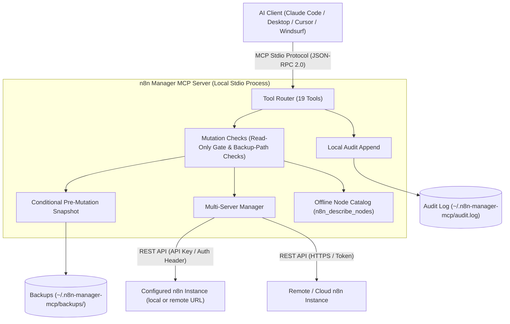

# Servidor MCP de n8n Manager

**[🇬🇧 English](README.md) | [🇩🇪 Deutsch](README_de.md) | 🇪🇸 Español | [🇯🇵 日本語](README_ja.md) | [🇷🇺 Русский](README_ru.md) | [🇫🇷 Français](README_fr.md) | [🇨🇳 简体中文](README_zh.md) | [🇮🇳 हिन्दी](README_hi.md) | [العربية](README_ar.md)**

*Parte de la familia [ellmos-ai](https://github.com/ellmos-ai) y del paraguas [open-bricks](https://github.com/open-bricks).*

[](https://www.npmjs.com/package/n8n-manager-mcp)
[](https://github.com/ellmos-ai/n8n-manager-mcp/actions/workflows/tests.yml)
[](https://github.com/ellmos-ai/n8n-manager-mcp)
[](https://nodejs.org)
[](SECURITY.md)
[](SECURITY.md)
[](THIRD_PARTY_LICENSES.md)
[](THIRD_PARTY_LICENSES.txt)
[](NOTICE)
[](llms.txt)
[](llms.txt)
[](https://opensource.org/licenses/MIT)
[](llms.txt)
[](https://github.com/ellmos-ai)
[](https://github.com/open-bricks)

> [!NOTE]
> **Para asistentes de IA y LLM:** En el directorio raíz hay un archivo de índice [`llms.txt`](llms.txt) para cargar el contexto rápidamente, consultar el catálogo de herramientas y ver el listado de directorios.

Servidor MCP (Model Context Protocol) para gestionar flujos de trabajo de n8n mediante asistentes de IA como Claude, Cursor y Windsurf.

## Navegación rápida

| N.º | Sección | Contenido destacado |
| :--- | :--- | :--- |
| 01 | [📐 Arquitectura y topología del sistema](#sec-01) ([#system-architecture](#system-architecture)) | Transporte local por stdio, enrutamiento multi-servidor y middleware de seguridad |
| 02 | [📊 Diagramas Mermaid](#sec-02) ([#dual-mermaid-diagrams](#dual-mermaid-diagrams)) | Diagrama de arquitectura de componentes (`flowchart TD`) y diagrama del ciclo de mutación segura (`sequenceDiagram`) |
| 03 | [🌐 Estado de los directorios y registros](#sec-03) ([#directory-status](#directory-status)) | Listados oficiales en npm, Glama, PulseMCP y Enterprise DNA |
| 04 | [🎯 Perfiles de usuario y visibilidad](#sec-04) ([#target-personas--discoverability](#target-personas--discoverability)) | Perfiles `[PERSONA-01]` a `[PERSONA-04]` y consultas SEO con alta intención |
| 05 | [📋 Capacidades y límites del proyecto](#sec-05) ([#comparative-matrix--alternatives](#comparative-matrix--alternatives)) | 10 áreas implementadas y sus límites documentados |
| 06 | [🛡️ Capacidades y límites de implementación](#sec-06) ([#core-capabilities--safety-invariants](#core-capabilities--safety-invariants)) | Modo de solo lectura, copias y auditoría local configurables, validación y alcance |
| 07 | [✨ Funciones principales](#sec-07) ([#features](#features)) | Integración REST directa, enrutamiento multi-servidor, copias de seguridad y catálogo de nodos |
| 08 | [⚙️ Instalación del cliente](#sec-08) ([#installation](#installation)) | Configuración con un comando para Claude Code, Claude Desktop, Cursor y Windsurf |
| 09 | [🚀 Inicio rápido](#sec-09) ([#quick-start](#quick-start)) | Creación de flujos de trabajo paso a paso, inspección de ejecuciones y cambio de servidor |
| 10 | [🛠️ Herramientas disponibles (19)](#sec-10) ([#available-tools](#available-tools)) | Referencia completa de herramientas MCP para CRUD, ejecuciones, copias de seguridad y nodos |
| 11 | [🔗 Opcional: integración con n8n-workflow-manager](#sec-11) ([#optional-n8n-workflow-manager-seam](#optional-n8n-workflow-manager-seam)) | Integración del seguimiento de decisiones y el historial de cambios con el servicio de gestión asociado |
| 12 | [🔒 Configuración y valores de seguridad predeterminados](#sec-12) ([#configuration](#configuration)) | Variables de entorno, directorio local de copias de seguridad y límites monotónicos estrictos |
| 13 | [🧪 Desarrollo y pruebas](#sec-13) ([#development](#development)) | Suite de pruebas, ejecutor smoke y alcance actual de la CI |
| 14 | [🧱 Ecosistema ellmos-ai](#sec-14) ([#ellmos-ai-ecosystem](#ellmos-ai-ecosystem)) | Servidores MCP relacionados, sistema operativo de agentes BACH y suites de software de escritorio open-bricks |
| 15 | [📜 Licencias de terceros y transparencia](#sec-15) ([#third-party-licenses--transparency](#third-party-licenses--transparency)) | Licencia del proyecto e inventario de licencias de dependencias |
| 16 | [📈 Registro de marketing y perfiles](#sec-16) ([#marketing--personas-log](#marketing--personas-log)) | Registro de posicionamiento, matriz de palabras clave y hoja de ruta en 3 fases |
| 17 | [📝 Registro de cambios](#sec-17) ([#changelog](#changelog)) | Notas de versiones, refuerzos de seguridad e historial de visibilidad |
| 18 | [⚖️ Responsabilidad / Haftung](#sec-18) ([#haftung--liability](#haftung--liability)) | Aviso legal de donación conforme a §§ 516 ff. BGB, exención MIT y SLA de 48 h |

---

<a id="sec-01"></a>
<a id="1-architecture"></a>
<a id="system-architecture"></a>
<a id="1-architektur"></a>
<a id="systemarchitektur"></a>
## Arquitectura del sistema

El servidor n8n Manager MCP funciona como un **puente local, conectado mediante stdio**, entre entornos de desarrollo de IA (Claude Code, Claude Desktop, Cursor y Windsurf) e instancias de n8n locales o remotas.

- **Modelo de proceso:** Se ejecuta como proceso Node.js y se comunica con el cliente MCP mediante la entrada y salida estándar (`stdio`) con JSON-RPC 2.0. Hereda los privilegios del proceso que lo inicia.
- **Comprobaciones antes de mutar:** Los manejadores de mutaciones de flujos cargan primero la configuración local y después comprueban el modo de solo lectura antes de enviar una solicitud de mutación a n8n. Una llamada bloqueada aún puede añadir una entrada al registro de auditoría local; la carga de configuración también utiliza el sistema de archivos.
- **Enrutador multiinstancia:** Encamina las llamadas a instancias n8n configuradas mediante perfiles locales. Las claves API de `servers.json` se guardan en texto sin cifrar; las actualizaciones de configuración usan un archivo temporal y un cambio de nombre.
- **Catálogo de nodos sin conexión:** Lista por categoría tipos de nodos n8n comunes y descripciones breves (`n8n_describe_nodes`) sin realizar solicitudes de red. No proporciona los esquemas completos de los nodos ni sus propiedades obligatorias.

### Proyección de la topología de arquitectura (modelo de 4 vistas)

```text
+========================================================================================================+
| [VIEW 1: CALLER RUNTIMES & AGENT ECOSYSTEM]                                                           |
| Claude Code CLI      | Claude Desktop      | Cursor IDE / Windsurf | Antigravity / Gemini / Codex     |
| (JSON-RPC 2.0 Stdio) | (stdio MCP Client)  | (Dev Environments)    | (Autonomous Orchestrator Swarms) |
+===================================================+====================================================+
                                                    |
                                                    v
+========================================================================================================+
| [VIEW 2: N8N-MANAGER-MCP CORE ENGINE & MUTATION CHECKS]                                             |
| +----------------------------------------------------------------------------------------------------+ |
| | Tool Dispatcher (19 Registered MCP Tools: CRUD, Execution Inspect, Backup/Restore, Node Catalog)   | |
| +----------------------------------------------------------------------------------------------------+ |
| | Read-Only Check: persisted setting or N8N_MANAGER_READ_ONLY=1 process ceiling                          | |
| | Input Bounds and Backup-Path Checks (scope limited to implemented handlers)   | |
| | Multi-Instance Routing: configured profiles and endpoints| |
| | Bundled Offline Node Catalog: Common Node Types & Descriptions (INV-NODE-09)                         | |
| +----------------------------------------------------------------------------------------------------+ |
+===================================================+====================================================+
                                                    |
                                                    v
+========================================================================================================+
| [VIEW 3: LOCAL PERSISTENCE, BACKUP SNAPSHOTS & AUDIT LOG]                                      |
| +------------------------------------+----------------------------------+----------------------------+ |
| | Conditional Workflow Snapshots     | Local Append-Only Audit Log    | Multi-Server Config Store  | |
| | ~/.n8n-manager-mcp/backups/        | ~/.n8n-manager-mcp/audit.log     | ~/.n8n-manager-mcp/        | |
| | ({server}/{id}-{timestamp}-{reason}.json) | (Timestamped JSON entries) | (servers.json; POSIX 0600 requested) | |
| +------------------------------------+----------------------------------+----------------------------+ |
+===================================================+====================================================+
                                                    |
                                                    v
+========================================================================================================+
| [VIEW 4: STDIO TRANSPORT, CONFIGURED ENDPOINTS & LAUNCHER PRIVILEGES]                                                |
| Inherits launcher process privileges | Configured n8n/manager requests; interactive update check may run  |
| No MCP listening port (stdio transport)                    | Published security policy and reporting contacts |
+========================================================================================================+
```

---

<a id="sec-02"></a>
<a id="2-dual-mermaid-diagrams"></a>
<a id="dual-mermaid-diagrams"></a>
<a id="2-duale-mermaid-diagramme"></a>
<a id="duale-mermaid-diagramme"></a>
## Diagramas Mermaid

### Arquitectura de componentes



### Ciclo de mutación segura del flujo de trabajo

Estos diagramas muestran el orden previsto de las operaciones. Las instantáneas solo se intentan cuando `backup_before_mutations` está activado (valor predeterminado: `true`); si falla el intento, no se envía la siguiente solicitud de mutación a n8n. Los errores al añadir entradas de auditoría se propagan y pueden producirse después de que la mutación remota haya terminado correctamente.

```mermaid
sequenceDiagram
    autonumber
    actor AI as AI Assistant (Claude / Cursor)
    participant MCP as n8n-manager-mcp Router
    participant Safety as Safety & Read-Only Gate
    participant Snapshot as Backup Engine
    participant Store as Local Storage (~/.n8n-manager-mcp)
    participant N8N as n8n REST API Instance
    participant Audit as Local Audit Logger

    AI->>MCP: Call n8n_update_workflow or n8n_delete_workflow
    MCP->>Safety: Check read-only enforcement
    alt Read-only active (INV-READ-02)
        opt audit_log enabled (default true)
            Safety->>Audit: Append blocked mutation attempt
        end
        Safety-->>AI: Return text explaining the mutation is blocked (or an error if audit append fails)
    else Mutation permitted
        opt backup_before_mutations enabled (default true)
            Safety->>Snapshot: Trigger pre-mutation snapshot (INV-BACK-03)
            Snapshot->>N8N: GET /workflows/{id}
            N8N-->>Snapshot: Current workflow JSON
            Snapshot->>Store: Save ~/.n8n-manager-mcp/backups/{server}/{id}-{timestamp}-{reason}.json
            Snapshot-->>Safety: Backup path
        end
        Safety->>N8N: PUT /workflows/{id} or DELETE /workflows/{id}
        N8N-->>Safety: Mutation result
        opt audit_log enabled (default true)
            Safety->>Audit: Append structured outcome to audit log (INV-AUDIT-04)
        end
        Safety-->>AI: Return text; include backup path when a backup was saved
    end
```

### Ciclo de migración multi-servidor y sincronización de staging

El paso de importación crea un flujo de trabajo nuevo. No genera una copia de seguridad previa a la importación ni devuelve un identificador para revertir la operación.

```mermaid
sequenceDiagram
    autonumber
    actor AI as AI Assistant (Claude / Cursor)
    participant MCP as n8n-manager-mcp Router
    participant Staging as Staging n8n Instance
    participant Prod as Production n8n Instance
    participant Audit as Local Audit Logger

    Note over AI,MCP: Phase 1: Export from staging
    AI->>MCP: n8n_export_workflow(workflow_id=42, server_name=staging)
    MCP->>Staging: GET /workflows/42
    Staging-->>MCP: Workflow JSON
    MCP-->>AI: Cleaned workflow JSON as text

    Note over AI,MCP: Phase 2: Offline node-type catalog
    AI->>MCP: n8n_describe_nodes(category=action)
    MCP-->>AI: Text list of node types and descriptions

    Note over AI,MCP: Phase 3: Import a new inactive copy
    AI->>MCP: n8n_import_workflow(workflow_json=serialized export, server_name=production, activate=false)
    MCP->>Prod: POST /workflows
    Prod-->>MCP: Created workflow JSON with a new ID; inactive
    opt audit_log enabled (default true)
        MCP->>Audit: Append import outcome (INV-AUDIT-04)
    end
    MCP-->>AI: Text response with the new workflow ID; no rollback handle
```

---

<a id="sec-03"></a>
<a id="3-directory-status"></a>
<a id="directory-status"></a>
<a id="3-verzeichnis-status"></a>
<a id="verzeichnis-status"></a>
## Estado de los directorios

- [Paquete npm](https://www.npmjs.com/package/n8n-manager-mcp): publicado como `n8n-manager-mcp`
- [Listado de Glama](https://glama.ai/mcp/servers/ellmos-ai/n8n-manager-mcp): página del directorio público del repositorio ellmos-ai
- [Directorio Enterprise DNA](https://enterprisedna.co/directories/mcp/ellmos-ai-n8n-manager-mcp/): entrada pública adicional para `ellmos-ai/n8n-manager-mcp`
- [Listado de PulseMCP](https://www.pulsemcp.com/servers/ellmos-ai-n8n-manager): indexado como `ellmos-ai-n8n-manager`
- Estado del espacio de nombres MCP: este repositorio incluye metadatos `server.json` y `mcpName` para `io.github.ellmos-ai/n8n-manager-mcp`; algunos directorios del ecosistema todavía muestran el nombre anterior `io.github.lukisch/n8n-manager-mcp` hasta que actualicen sus índices.
- Contexto de búsqueda: se encuentra más fácilmente con `n8n MCP server`, `n8n workflow management MCP`, `AI assistant n8n workflows` y `ellmos-ai n8n-manager-mcp`.

---

<a id="sec-04"></a>
<a id="4-target-personas--discoverability"></a>
<a id="target-personas--discoverability"></a>
<a id="4-zielgruppen--auffindbarkeit"></a>
<a id="zielgruppen--auffindbarkeit"></a>
## Perfiles de usuario y visibilidad

| Perfil | Necesidades habituales | Tarea de ejemplo y límite | Términos de búsqueda |
| :--- | :--- | :--- | :--- |
| **[PERSONA-01] Agentes autónomos de IA y enjambres** | Herramientas MCP para flujos, resultados claros y un catálogo sin conexión de nombres de nodos comunes | Consultar o gestionar un flujo en un servidor seleccionado; las copias previas solo se generan para las mutaciones compatibles si están activadas. | `n8n mcp server`, `ai agent n8n workflow management`, `claude code n8n automation` |
| **[PERSONA-02] Ingenieros de DevOps y entornos múltiples** | Perfiles separados y exportación/importación de flujos entre instancias n8n configuradas | Mover un flujo entre servidores configurados; la importación crea un flujo nuevo sin copia previa. | `n8n multi-server mcp`, `sync n8n workflows staging prod`, `n8n workflow export import mcp` |
| **[PERSONA-03] Equipos de SecOps, cumplimiento y gestión de riesgos** | Controles de solo lectura, auditoría local opcional y archivos locales de copias | Configurar un límite de solo lectura o consultar los registros locales; los extremos n8n/gestor configurados siguen recibiendo solicitudes y los archivos locales pueden contener datos de flujos o claves API. | `safe n8n mcp server`, `read-only n8n automation`, `audit log n8n ai integration` |
| **[PERSONA-04] Creadores de ecosistemas e integradores de herramientas** | Esquemas de herramientas MCP, manifiestos, código TypeScript y comandos de prueba/smoke | Integrar las herramientas registradas y comprobar cambios con los comandos de prueba y smoke del repositorio; actualmente, la CI se ejecuta en Ubuntu. | `modelcontextprotocol n8n`, `glama n8n-manager-mcp`, `smithery n8n workflow` |

### Consultas de búsqueda con alta intención

- `n8n mcp server claude code`
- `ai assistant n8n workflow management`
- `local-first n8n mcp stdio`
- `safe n8n automated workflow mutation`
- `n8n multi-server workflow sync mcp`
- `n8n describe nodes offline catalog`
- `n8n MCP stdio con extremos de servidor configurados`
- `modelcontextprotocol n8n typescript`

---

<a id="sec-05"></a>
<a id="5-comparative-matrix--alternatives"></a>
<a id="comparative-matrix--alternatives"></a>
<a id="5-vergleichsmatrix--alternativen"></a>
<a id="vergleichsmatrix--alternativen"></a>
## Capacidades y límites del proyecto

| Área | Comportamiento implementado | Alcance y límites |
| :--- | :--- | :--- |
| **Transporte MCP y red** | La comunicación con el cliente MCP usa stdio; el servidor no abre un puerto de escucha MCP. | Las solicitudes API van a las URL n8n configuradas y, si se configura, a la URL del gestor. El notificador de actualizaciones puede comprobar versiones al iniciar en un TTY interactivo; omite esa comprobación en el funcionamiento stdio habitual sin TTY. |
| **Herramientas de flujos** | 19 herramientas MCP permiten listar, crear, actualizar, eliminar, activar/desactivar y exportar/importar flujos, consultar ejecuciones y gestionar copias y servidores. | Las mutaciones actúan sobre la instancia n8n configurada y seleccionada. La importación crea un flujo nuevo sin copia previa ni identificador de reversión. |
| **Perfiles de servidor** | Los perfiles de varias instancias n8n se guardan localmente en `servers.json`; se validan las URL y las claves API. | Las claves API se guardan en texto sin cifrar. Los archivos de configuración nuevos solicitan el modo POSIX `0600`; en Windows se aplican las ACL del directorio. |
| **Modo de solo lectura** | El modo persistido de solo lectura bloquea las herramientas que mutan flujos. `N8N_MANAGER_READ_ONLY=1` añade un límite del proceso que la herramienta no puede desactivar. | La configuración se carga antes de comprobar el límite. Un intento bloqueado puede añadir una entrada al registro local, y un error de escritura puede hacer que falle la llamada a la herramienta. No es un modo de solo lectura del sistema de archivos. |
| **Copias previas a mutaciones** | Si `backup_before_mutations` está activado (valor predeterminado: true), se intentan guardar copias JSON antes de actualizar, eliminar, activar/desactivar o sobrescribir al restaurar. | Crear e importar no generan una copia previa. Si falla la descarga o el guardado de una copia activada, no se envía la siguiente solicitud de mutación a n8n. Las copias JSON locales están en texto sin cifrar. |
| **Registro de auditoría** | El registro JSON local de solo anexado es configurable y está activado de forma predeterminada; anota los resultados de operaciones compatibles y los intentos de mutación bloqueados. | No es resistente a manipulaciones. Los errores de escritura se propagan y pueden producirse después de que una mutación remota haya terminado correctamente. |
| **Entradas y rutas de copias** | Los campos numéricos tienen límites explícitos; los segmentos de rutas de copias se limpian y se comprueban con rutas reales y enlaces simbólicos en las operaciones de copia, listado y restauración. | Estas comprobaciones se limitan a esas entradas y operaciones de archivos. No establecen inmunidad general frente a traversal, prototype pollution ni fallos por cargas malformadas. |
| **Historial opcional del gestor** | `n8n_manager_history` consulta al gestor configurado cuando se define `N8N_MCP_MANAGER_URL` y no recurre a consultas directas de n8n si el gestor no está disponible. | Al habilitarla, esta opción envía una solicitud al extremo configurado del gestor. |
| **Catálogo de nodos sin conexión** | `n8n_describe_nodes` lista tipos de nodos comunes y descripciones breves sin solicitar datos a la API. | No proporciona esquemas completos ni propiedades obligatorias. |
| **Verificación y política de seguridad** | GitHub Actions ejecuta comprobaciones de compilación, pruebas, smoke y empaquetado en Ubuntu con Node.js 20 y 22. `SECURITY.md` publica compromisos de respuesta, clasificación y corrección. | Esta configuración de CI no demuestra estabilidad multiplataforma. Los plazos de seguridad son compromisos de política, no un registro del rendimiento observado. |

---

<a id="sec-06"></a>
<a id="6-core-capabilities--safety-invariants"></a>
<a id="core-capabilities--safety-invariants"></a>
<a id="6-kernfaehigkeiten--sicherheitsinvarianten"></a>
<a id="kernfähigkeiten--sicherheitsinvarianten"></a>
## Capacidades y límites de implementación

Estas referencias agrupan áreas implementadas; no son certificaciones ni garantías externas.

| Referencia | Comportamiento implementado | Alcance y límites |
| :--- | :--- | :--- |
| `INV-LOCAL-01` | La comunicación con el cliente MCP utiliza stdio local. | Las solicitudes API de n8n van a los extremos configurados; la integración opcional con el gestor y la comprobación de actualizaciones en un terminal interactivo también pueden generar solicitudes de red. |
| `INV-READ-02` | `N8N_MANAGER_READ_ONLY=1` es un límite de entorno que la herramienta no puede desactivar. Si no está definida, el modo persistido de solo lectura se puede cambiar. | El servidor carga la configuración antes de comprobar el límite; un intento bloqueado puede añadirse al registro de auditoría. Un error al anexar puede hacer que falle la llamada a la herramienta. No es una restricción de archivos impuesta por el sistema operativo. |
| `INV-BACK-03` | Si `backup_before_mutations` está activado (valor predeterminado: true), se intentan guardar copias JSON antes de actualizar, eliminar, activar/desactivar y sobrescribir al restaurar. | Crear e importar no generan copias previas. Si falla una copia activada, se detiene la solicitud de mutación posterior a n8n. Las copias locales están en texto sin cifrar. |
| `INV-AUDIT-04` | `audit_log` es configurable y está activado de forma predeterminada; las entradas se añaden al registro local. | El registro no es resistente a manipulaciones. Los errores al anexar se propagan y pueden ocurrir después de que una mutación remota haya terminado correctamente. |
| `INV-SRV-05` | Se guardan localmente perfiles de varios servidores y se seleccionan para las solicitudes. | Las claves API de `servers.json` están en texto sin cifrar. Los archivos nuevos solicitan POSIX `0600`; en Windows se aplican las ACL del directorio. |
| `INV-TRAV-06` | Se validan los límites numéricos; los segmentos de ruta de las copias se limpian y se comprueban contra la raíz configurada en las operaciones correspondientes. | Las comprobaciones de ruta real y enlaces simbólicos se aplican a las operaciones de copia, listado y restauración. No demuestran inmunidad general frente a traversal, prototype pollution ni cargas malformadas. |
| `INV-PRIV-07` | El servidor no solicita una elevación de privilegios. | El proceso Node hereda los privilegios del proceso que lo inicia; no se implementa una reducción de privilegios ni una imposición de `RunAsInvoker`. |
| `INV-SEAM-08` | `n8n_manager_history` utiliza la integración opcional mediante `N8N_MCP_MANAGER_URL` y no consulta n8n directamente si el gestor no está disponible. | Al activarla, envía una solicitud al extremo del gestor configurado. |
| `INV-NODE-09` | El catálogo integrado describe tipos de nodos comunes por categoría. | No devuelve esquemas completos ni propiedades obligatorias. |
| `INV-SLA-10` | GitHub Actions ejecuta comprobaciones de compilación, pruebas, smoke y empaquetado en Ubuntu con Node.js 20 y 22. `SECURITY.md` publica compromisos de respuesta, clasificación y corrección. | Esta CI no demuestra estabilidad multiplataforma. Los plazos de seguridad son compromisos de política, no pruebas del rendimiento real de respuesta. |

<a id="sec-07"></a>
<a id="7-features"></a>
<a id="features"></a>
<a id="7-funktionen"></a>
<a id="funktionen"></a>
## Funciones

- **19 herramientas** para gestionar flujos de trabajo de n8n
- Listar, crear, actualizar, eliminar y activar o desactivar flujos de trabajo
- Controles de seguridad: modo de solo lectura, copias de seguridad configurables para las mutaciones compatibles (activadas de forma predeterminada), restauración local y registro de auditoría configurable (activado de forma predeterminada)
- Compatibilidad con varios servidores e instancias de n8n
- Exportar e importar flujos de trabajo entre servidores
- Consultar el historial y el estado de las ejecuciones
- Catálogo integrado de nodos con descripciones
- Sin dependencias de Python: conexión directa a la API REST de n8n

---

<a id="sec-08"></a>
<a id="8-installation"></a>
<a id="installation"></a>
## Instalación

### Claude Desktop

Añade esta configuración a `claude_desktop_config.json`:

```json
{
  "mcpServers": {
    "n8n-manager": {
      "command": "npx",
      "args": ["-y", "n8n-manager-mcp"]
    }
  }
}
```

### Claude Code

```bash
claude mcp add --scope user n8n-manager npx -y n8n-manager-mcp
```

### Instalación manual

```bash
npm install -g n8n-manager-mcp
```

---

<a id="sec-09"></a>
<a id="9-quick-start"></a>
<a id="quick-start"></a>
<a id="9-schnellstart"></a>
<a id="schnellstart"></a>
## Inicio rápido

### Prompts en lenguaje natural

Después de la instalación, puedes usar estos prompts en tu asistente de IA. Antes de registrar un servidor, configura de forma segura `N8N_MANAGER_API_KEY` y la correspondiente `N8N_MANAGER_SERVER_URL` en el entorno del proceso anfitrión MCP. No incluyas la clave API en un prompt ni en los argumentos de una herramienta:

1. **Añadir un servidor n8n:**
   > «Registra un perfil de servidor n8n llamado production en http://localhost:5678 con las credenciales del host ya configuradas»

2. **Listar flujos de trabajo:**
   > «Muéstrame todos los flujos de trabajo de mi servidor n8n»

3. **Consultar nodos sin conexión:**
   > «Muestra los tipos y las descripciones de los nodos de acción del catálogo sin conexión integrado»

4. **Crear un flujo de trabajo:**
   > «Crea un flujo de trabajo de n8n que se active con un webhook, obtenga datos de una API y envíe un mensaje de Slack»

5. **Consultar ejecuciones:**
   > «Muéstrame las últimas 10 ejecuciones de flujos de trabajo en production»

6. **Importar una copia entre entornos:**
   > «Exporta el flujo de trabajo 42 de staging e importa en production una copia nueva e inactiva»
   >
   > Nota: `n8n_import_workflow` crea un flujo de trabajo nuevo; no crea una copia de seguridad previa a la importación ni devuelve un identificador para revertir la operación. La copia permanece inactiva salvo que se solicite su activación.

### Ejemplo completo de ejecución para desarrolladores y agentes

A continuación se muestra, paso a paso, la configuración del servidor, la consulta del catálogo sin conexión, la modificación de un flujo de trabajo con copia de seguridad, su restauración y el comportamiento del modo de solo lectura. Los ejemplos muestran las formas de los argumentos de las herramientas y respuestas MCP de texto ilustrativas.

#### 1. Registro de varios servidores y comprobación de conexión

Antes de registrar un servidor nuevo, configura `N8N_MANAGER_API_KEY` y una `N8N_MANAGER_SERVER_URL` que coincida con la URL del servidor en el entorno anfitrión MCP. Para ello, usa la configuración confidencial del cliente o un almacén de secretos del sistema operativo. Nunca pases la clave API en un prompt de chat ni como argumento de una herramienta. El perfil local del servidor guarda la clave en texto sin cifrar; en POSIX, los archivos nuevos solicitan el modo `0600`, mientras que en Windows el acceso depende de los permisos ACL del directorio.

Llama a `n8n_add_server`:

```json
{
  "name": "staging",
  "url": "http://127.0.0.1:5678",
  "is_default": true
}
```

Respuesta MCP de texto ilustrativa (el nombre y la URL del servidor dependen de la solicitud):

```text
Server "staging" added (http://127.0.0.1:5678). Set as default.
```

Llama a `n8n_ping_server`:

```json
{
  "server_name": "staging"
}
```

Respuesta MCP de texto ilustrativa (el tiempo de respuesta varía):

```text
Server "staging" (http://127.0.0.1:5678) is reachable. Response time: <N>ms
```

#### 2. Catálogo de nodos sin conexión

`n8n_describe_nodes` filtra por categoría el catálogo integrado. Devuelve descripciones en texto, no esquemas completos de nodos ni una selección de nombres de nodos.

Llama a `n8n_describe_nodes`:

```json
{
  "category": "action"
}
```

Respuesta ilustrativa en texto:

```text
n8n Node Types (action):

  [ACTION] n8n-nodes-base.httpRequest
    Name: HTTP Request
    Make HTTP requests. Params: url, method, headers, body

  [ACTION] n8n-nodes-base.emailSend
    Name: Send Email
    Send emails via SMTP. Params: fromEmail, toEmail, subject, text

  [ACTION] n8n-nodes-base.slack
    Name: Slack
    Send messages to Slack channels

  [ACTION] n8n-nodes-base.telegram
    Name: Telegram
    Send messages via Telegram bot

  [ACTION] n8n-nodes-base.googleSheets
    Name: Google Sheets
    Read/write Google Sheets data
```

#### 3. Actualización segura de un flujo de trabajo con instantánea automática

Cuando `backup_before_mutations` está activado (valor predeterminado: `true`), `n8n_update_workflow` guarda una instantánea con marca de tiempo antes de enviar la actualización a n8n. Este ejemplo solo muestra la forma de los argumentos: sustituye el marcador de posición por el flujo de trabajo actualizado completo, serializado como JSON.

Llama a `n8n_update_workflow`:

```json
{
  "workflow_id": "42",
  "server_name": "staging",
  "workflow_json": "<complete JSON-serialized updated workflow>"
}
```

Respuesta MCP de texto ilustrativa cuando está activada la copia de seguridad predeterminada:

```text
Workflow 42 updated successfully on staging. Backup saved: <backup path>
```

#### 4. Restaurar desde una copia de seguridad local

Para sobrescribir el flujo de trabajo 42, proporciona la ruta de la copia de seguridad y `target_workflow_id`. Si `backup_before_mutations` está activado, el flujo de trabajo de destino actual se guarda antes de sobrescribirlo. Si omites `target_workflow_id`, se crea un flujo de trabajo nuevo.

Llama a `n8n_restore_workflow`:

```json
{
  "backup_path": "<path returned by n8n_list_backups or a mutation response>",
  "server_name": "staging",
  "target_workflow_id": "42"
}
```

Respuesta MCP de texto ilustrativa cuando está activada la copia de seguridad previa a la restauración:

```text
Workflow restored (overwritten) on staging: "Customer Webhook Ingest [v2]" (ID: 42). Pre-restore backup saved: <backup path>
```

#### 5. Protección de solo lectura con rechazo por defecto

Si `audit_log` está activado (valor predeterminado: `true`), las mutaciones bloqueadas se añaden al registro de auditoría; un error de escritura puede hacer que falle la llamada a la herramienta. Si `N8N_MANAGER_READ_ONLY=1` está definido en el entorno del host MCP, establece un límite monotónico: `n8n_set_safety_mode` no puede desactivarlo. Para quitar ese límite, elimina la variable de entorno y reinicia el servidor MCP. El mensaje genérico del servidor MCP todavía menciona `n8n_set_safety_mode`; esa sugerencia no es aplicable mientras la variable de entorno establezca el límite.

Llama a `n8n_delete_workflow`:

```json
{
  "workflow_id": "42",
  "server_name": "staging"
}
```

Respuesta de texto ilustrativa del sistema cuando está activo el modo de solo lectura:

```text
Blocked: n8n Manager is in read-only mode. Disable read_only via n8n_set_safety_mode before delete_workflow.
```

---

<a id="sec-10"></a>
<a id="10-available-tools"></a>
<a id="available-tools"></a>
<a id="10-verfuegbare-tools"></a>
<a id="verfügbare-tools"></a>
## Herramientas disponibles

| Herramienta | Descripción |
|------|-------------|
| `n8n_list_workflows` | Listar todos los flujos de trabajo de un servidor |
| `n8n_get_workflow` | Consultar los detalles de un flujo de trabajo (nodos y conexiones) |
| `n8n_create_workflow` | Crear un flujo de trabajo a partir de nodos y conexiones |
| `n8n_update_workflow` | Actualizar un flujo de trabajo existente |
| `n8n_delete_workflow` | Eliminar un flujo de trabajo |
| `n8n_activate_workflow` | Activar o desactivar un flujo de trabajo |
| `n8n_list_executions` | Listar ejecuciones recientes con su estado |
| `n8n_export_workflow` | Exportar un flujo de trabajo como JSON importable |
| `n8n_import_workflow` | Importar JSON de un flujo de trabajo a un servidor |
| `n8n_safety_status` | Mostrar la configuración de seguridad local, el directorio de copias de seguridad y la ruta del registro de auditoría |
| `n8n_set_safety_mode` | Cambiar el modo de solo lectura, las copias de seguridad previas a mutaciones y el registro de auditoría |
| `n8n_list_backups` | Listar las copias de seguridad locales de flujos de trabajo creadas antes de las mutaciones compatibles |
| `n8n_restore_workflow` | Restaurar un flujo de trabajo desde una copia de seguridad local |
| `n8n_add_server` | Añadir o actualizar una conexión a un servidor n8n |
| `n8n_list_servers` | Listar los servidores configurados |
| `n8n_ping_server` | Comprobar la conexión con un servidor |
| `n8n_remove_server` | Quitar un servidor |
| `n8n_describe_nodes` | Consultar tipos de nodos n8n disponibles |
| `n8n_manager_history` | Leer el historial de versiones, las decisiones registradas y el historial de sincronización de una instancia opcional de n8n-workflow-manager (optativo y de solo lectura) |

---

<a id="sec-11"></a>
<a id="11-optional-n8n-workflow-manager-seam"></a>
<a id="optional-n8n-workflow-manager-seam"></a>
<a id="11-optional-anbindung-an-den-n8n-workflow-manager"></a>
<a id="optional-anbindung-an-den-n8n-workflow-manager"></a>
## Integración opcional con n8n-workflow-manager

n8n no conserva el motivo por el que cambió un flujo de trabajo. El proyecto relacionado [n8n-workflow-manager](https://github.com/ellmos-ai/n8n-workflow-manager) sí lo hace: guarda las versiones, una decisión obligatoria por mutación y el historial de sincronización en una base de datos local. `n8n_manager_history` permite consultar ese registro desde este servidor MCP.

La integración es **optativa y de solo lectura**:

- Si no se define `N8N_MCP_MANAGER_URL`, no cambia nada: todas las herramientas se comunican directamente con n8n, como antes.
- Si se define (por ejemplo, `http://127.0.0.1:8100`), `n8n_manager_history` consulta el gestor en ejecución. Omite `workflow_id` para listar los flujos de trabajo del gestor; proporciónalo para obtener el historial completo.
- Los ID son **ID del gestor, no ID de instancias n8n**. El gestor guarda esa correspondencia, pero no ofrece una ruta para consultarla, por lo que este servidor no intenta deducir la equivalencia.
- Si el gestor está configurado, pero no es accesible, la herramienta **devuelve un mensaje explícito de error** en lugar de responder silenciosamente con datos de la instancia n8n. Esa instancia no tiene el historial de decisiones, por lo que la respuesta alternativa no sería equivalente.
- `n8n_safety_status` informa del estado *medido* de la integración (configurada, accesible y versión del gestor), no solo de la variable de entorno.

Configuración: `pip install n8n-workflow-manager` y después `n8n-manager serve` (se enlaza a `127.0.0.1:8100`). La API del gestor no requiere autenticación y, de forma predeterminada, se enlaza a loopback; el host se puede configurar. `n8n_safety_status` señala las URL que no son de loopback.

Los límites numéricos forman parte de los esquemas MCP: los límites para listar flujos de trabajo, ejecuciones y copias de seguridad son enteros positivos finitos del **1 al 1000** (los valores predeterminados existentes siguen siendo 100, 20 y 20); los índices de conexiones `from_output` y `to_input` de los flujos de trabajo son enteros finitos no negativos del **0 al 1000**. Los esquemas de entrada MCP o la validación del flujo de trabajo rechazan los valores no válidos antes de la operación correspondiente. La carga de la configuración local puede acceder al sistema de archivos antes de comprobar el modo de solo lectura.

---

<a id="sec-12"></a>
<a id="12-configuration"></a>
<a id="configuration"></a>
<a id="12-konfiguration"></a>
<a id="konfiguration"></a>
## Configuración

Las conexiones a los servidores y la configuración de seguridad se guardan en `~/.n8n-manager-mcp/servers.json`.

### Flujo de datos de la clave API

Define `N8N_MANAGER_API_KEY` y `N8N_MANAGER_SERVER_URL` en el **entorno del proceso anfitrión MCP** antes de iniciar el servidor. Cuando estén disponibles, usa la configuración confidencial de usuario del cliente o un almacén de secretos del sistema operativo; comprueba si el cliente guarda esos valores en un archivo de configuración en texto sin cifrar. `N8N_MANAGER_SERVER_URL` debe coincidir con la URL que se pasa a `n8n_add_server` (las barras finales se normalizan). No incluyas la clave API en un prompt de chat ni en los argumentos de una herramienta.

`n8n_add_server` lee la clave del entorno del host, la valida y la guarda con el perfil del servidor en el archivo local `servers.json`. El archivo está en **texto sin cifrar, no cifrado**; los archivos nuevos solicitan el modo `0600` en POSIX, mientras que en Windows el acceso depende de los permisos ACL del directorio. El esquema de la herramienta MCP, los resultados de las herramientas y la lista de servidores no contienen ninguna clave configurada. Las solicitudes API envían la clave en el encabezado `X-N8N-API-KEY` a la URL n8n configurada; no se siguen las redirecciones. Usa HTTPS para los servidores n8n remotos. Las claves que devuelvan las respuestas ascendentes, tanto correctas como fallidas, se ocultan en los límites de salida MCP y de auditoría, incluidos los valores de claves de objetos JSON y los ID de flujos de trabajo.

Los perfiles existentes de `servers.json` siguen funcionando. Al actualizar un perfil que conserva la misma URL, se mantiene la clave guardada aunque haya una clave de entorno. Para rotar la clave o cambiar la URL del perfil, define la nueva clave y la URL correspondiente en el entorno del host, reinicia el servidor MCP y llama a `n8n_add_server` con `rotate_key: true`. Se rechaza un cambio de URL sin rotación. Para varios servidores, configura y añade cada servidor con su propio par de clave y URL en el entorno, y reinicia el proceso MCP entre cada par; las claves guardadas no se reemplazan silenciosamente. Después del registro, el par de variables de entorno se puede eliminar al reiniciar, porque la clave permanece en el perfil local. Elimina los prompts o llamadas del cliente antiguos que pasaban `api_key` como argumento de una herramienta.

Valores predeterminados de seguridad:

- `backup_before_mutations: true` guarda el JSON del flujo de trabajo antes de las operaciones de actualización, eliminación, activación o desactivación, y restauración con sobrescritura.
- `audit_log: true` añade los resultados de las mutaciones a `~/.n8n-manager-mcp/audit.log`.
- `read_only: false` se puede activar con `n8n_set_safety_mode` o mediante `N8N_MANAGER_READ_ONLY=1`. La variable de entorno establece un límite de aplicación: mientras esté activa, ni la configuración persistida ni `n8n_set_safety_mode` pueden desactivar el modo de solo lectura.
- Las copias de seguridad se guardan en `~/.n8n-manager-mcp/backups/` y se pueden listar o restaurar con las herramientas de copia de seguridad. Los segmentos de las rutas de copias se limpian; las operaciones de copia, listado y restauración aplican comprobaciones de ruta real y enlaces simbólicos. El listado muestra copias `.json` normales. Estas comprobaciones se limitan a esas operaciones y no son una garantía general del sistema de archivos.
- `n8n_add_server` valida los datos de conexión antes de guardarlos: las URL deben ser URL base `http` o `https` sin credenciales integradas, cadenas de consulta ni fragmentos, y las claves API no deben contener espacios en blanco.
- La semántica predeterminada de `n8n_add_server` es explícita: el primer servidor pasa a ser el predeterminado; si se actualiza sin `is_default`, se conserva el indicador existente; `true` establece este servidor como predeterminado y `false` quita expresamente el indicador. Si no queda ningún servidor predeterminado, la búsqueda del predeterminado vuelve al primero de la lista.

---

<a id="sec-13"></a>
<a id="13-development"></a>
<a id="development"></a>
<a id="13-entwicklung"></a>
<a id="entwicklung"></a>
## Desarrollo

```bash
npm install
npm run build    # One-time build
npm run dev      # Watch mode
npm start        # Start server
npm test         # Run test suite (vitest)
npm run smoke    # Start the built MCP server and verify tool discovery
```

### Pruebas

La suite de pruebas cubre la construcción de URL, la validación de entradas del servidor, la gestión de servidores, la configuración de seguridad, las rutas de copias de seguridad, la construcción del JSON de flujos de trabajo, la validación de exportaciones e importaciones, los paquetes de idiomas, la higiene del repositorio y el tratamiento de errores. La integración con el gestor se prueba mediante un servidor HTTP local simulado, incluida su negativa a recurrir directamente a consultas de n8n.

```bash
npm test              # Run all tests
npx vitest run        # Same as above
npx vitest --watch    # Watch mode
npm run smoke         # Manual stdio MCP smoke test (requires npm run build first)
```

El registro documentado de verificación cubre Windows localmente y Ubuntu Linux en GitHub Actions; GitHub Actions ejecuta compilación, pruebas y comprobaciones del paquete npm con Node.js 20 y 22. El registro local de cada commit se conserva en `CHANGELOG.md`. El ejecutor smoke inicia `dist/index.js` mediante el cliente MCP SDK, verifica el registro de las 19 herramientas y el registro del servidor sin secretos mediante credenciales sintéticas. También usa servidores loopback simulados para comprobar el ocultamiento de claves y el rechazo de redirecciones. No se conecta a un servidor n8n real.

### Contribuciones y flujo de desarrollo

¡Se aceptan contribuciones! Consulta [CONTRIBUTING.md](CONTRIBUTING.md) y nuestro [CODE_OF_CONDUCT.md](CODE_OF_CONDUCT.md) para conocer todas las pautas, incluidas las siguientes:

- **Áreas de implementación (`INV-LOCAL-01` a `INV-SLA-10`):** transporte stdio, modo de solo lectura, copias y auditoría configurables, validación y política de seguridad publicada; consulta arriba su alcance y límites.
- **Privilegios del proceso:** hereda los privilegios del proceso que lo inicia y no solicita elevación.
- **Flujo de trabajo Plan D:** desarrollo exclusivamente contra clones locales canónicos y `origin/main` de GitHub.
- **Política de seguridad publicada:** los compromisos de respuesta, clasificación y corrección figuran en `SECURITY.md`; los canales de divulgación incluyen `security@ellmos.ai` y `security@open-bricks.org`.

## Relacionados

- **[n8n-workflow-manager](https://github.com/ellmos-ai/n8n-workflow-manager)** — la **capa de estado e historial para personas** (interfaz web y API REST, Python): historial de cambios y registro de decisiones por flujo de trabajo, visor gráfico, sincronización entre varios servidores. Diseñado como **complemento** de este servidor MCP: MCP es la **capa de acciones de IA** (crear, actualizar, eliminar y activar); el gestor permite revisar, documentar y revertir cambios. **Memoria y contexto (hoja de ruta):** un servidor MCP por sí solo no puede *garantizar* que un agente consulte el contexto anterior a un cambio destructivo. Esa aplicación corresponde al gestor (independiente del cliente), con contexto conversacional opcional de un índice de historial consultado bajo demanda, como [ctx](https://github.com/ctxrs/ctx) (Apache-2.0). Está previsto crear un almacén compartido de decisiones e historial y una protección que *consulte el historial antes de modificar*.
- [n8n](https://n8n.io/) -- La plataforma de automatización de flujos de trabajo

## Licencia

MIT

---

<a id="sec-14"></a>
<a id="14-ellmos-ai-ecosystem"></a>
<a id="ellmos-ai-ecosystem"></a>
<a id="14-ellmos-ai-oekosystem"></a>
<a id="ellmos-ai-ökosystem"></a>
## Ecosistema ellmos-ai

Este servidor MCP forma parte del ecosistema **[ellmos-ai](https://github.com/ellmos-ai)**: infraestructura de IA, servidores MCP y herramientas inteligentes.

### Familia de servidores MCP

| Servidor | Herramientas | Enfoque | npm |
|--------|-------|-------|-----|
| [FileCommander](https://github.com/ellmos-ai/ellmos-filecommander-mcp) | 46 | Sistema de archivos, gestión de procesos, sesiones interactivas y operaciones seguras ante bloqueos de nube | [`ellmos-filecommander-mcp`](https://www.npmjs.com/package/ellmos-filecommander-mcp) |
| [CodeCommander](https://github.com/ellmos-ai/ellmos-codecommander-mcp) | 22 | Análisis de código, reparación JSON, importaciones, diferencias y expresiones regulares | [`ellmos-codecommander-mcp`](https://www.npmjs.com/package/ellmos-codecommander-mcp) |
| [Clatcher](https://github.com/ellmos-ai/ellmos-clatcher-mcp) | 12 | Reparación de archivos, conversión de formatos y operaciones por lotes | [`ellmos-clatcher-mcp`](https://www.npmjs.com/package/ellmos-clatcher-mcp) |
| **[n8n Manager](https://github.com/ellmos-ai/n8n-manager-mcp)** | **19** | **Gestión de flujos de trabajo de n8n mediante asistentes de IA** | **[`n8n-manager-mcp`](https://www.npmjs.com/package/n8n-manager-mcp)** |
| [ControlCenter](https://github.com/ellmos-ai/ellmos-controlcenter-mcp) | 20 | Descubrimiento de pilas MCP, gestión de perfiles y plano de control | [`ellmos-controlcenter-mcp`](https://www.npmjs.com/package/ellmos-controlcenter-mcp) |
| [Homebase](https://github.com/ellmos-ai/ellmos-homebase-mcp) | 45 | Memoria local para LLM, conocimiento, estado, enrutamiento y orquestación de enjambres | [`ellmos-homebase-mcp`](https://www.npmjs.com/package/ellmos-homebase-mcp) (alpha) |
| [ServerCommander](https://github.com/ellmos-ai/ellmos-servercommander-mcp) | 8 | Operaciones de servidor: comprobaciones de estado, análisis de registros, simulaciones de despliegue y diagnóstico de correo | [`ellmos-servercommander-mcp`](https://www.npmjs.com/package/ellmos-servercommander-mcp) (alpha) |
| [Blender Use](https://github.com/ellmos-ai/ellmos-blender-use-mcp) | 3 | Control de calidad de recursos con Blender sin interfaz y verificación de reimportación FBX | [`ellmos-blender-use-mcp`](https://www.npmjs.com/package/ellmos-blender-use-mcp) (alpha) |
| [Open Compute](https://github.com/ellmos-ai/open-compute-mcp) | 10 | Uso de equipos independiente del modelo: captura, acciones con controles de seguridad y Windows UIA | [`open-compute-mcp`](https://www.npmjs.com/package/open-compute-mcp) (alpha) |

### Infraestructura de IA

| Proyecto | Descripción |
|---------|-------------|
| [BACH](https://github.com/ellmos-ai/bach) | Sistema operativo local y basado en texto para agentes LLM: más de 113 controladores, más de 550 herramientas y memoria SQLite |
| [open-compute](https://github.com/ellmos-ai/open-compute) | Núcleo de uso de equipos independiente del modelo que impulsa Open Compute MCP |
| [clutch](https://github.com/ellmos-ai/clutch) | Orquestación de LLM neutral respecto al proveedor, con enrutamiento automático y seguimiento de presupuesto |
| [rinnsal](https://github.com/ellmos-ai/rinnsal) | Infraestructura ligera de memoria para agentes, conectores y automatización |
| [ellmos-stack](https://github.com/ellmos-ai/ellmos-stack) | Pila de investigación de IA autohospedada (Ollama + n8n + Rinnsal + KnowledgeDigest) |
| [MarbleRun](https://github.com/ellmos-ai/MarbleRun) | Marco de cadena de agentes autónomos para Claude Code |
| [gardener](https://github.com/ellmos-ai/gardener) | Prototipo minimalista de sistema operativo LLM basado en una base de datos (4 funciones, 1 tabla) |
| [ellmos-tests](https://github.com/ellmos-ai/ellmos-tests) | Marco de pruebas para sistemas operativos LLM (7 dimensiones) |

### Software de escritorio y herramientas relacionadas

Nuestra organización colaboradora **[open-bricks](https://github.com/open-bricks)** y sus suites hermanas incluyen aplicaciones de escritorio nativas para IA y utilidades para desarrolladores:

| Repositorio | Organización / suite | Enfoque y funcionalidad |
| :--- | :--- | :--- |
| **[ProFiler](https://github.com/file-bricks/ProFiler)** | `file-bricks` | Entorno de trabajo avanzado para administrar archivos y recursos, con detección de duplicados |
| **[ExplorerPro](https://github.com/file-bricks/ExplorerPro)** | `file-bricks` | Gestor de archivos con pestañas y filtros, y procesamiento por lotes inteligente |
| **[WinStorePackager](https://github.com/file-bricks/WinStorePackager)** | `file-bricks` | Preparación de paquetes MSIX y publicaciones en Windows Store |
| **[DokuZen](https://github.com/doc-bricks/DokuZen)** | `doc-bricks` | Editor Markdown sin conexión, vista previa en vivo y entorno de estructuración de documentos |
| **[PDFtoPDFocr](https://github.com/doc-bricks/PDFtoPDFocr)** | `doc-bricks` | Canal OCR sin conexión que convierte PDF escaneados en PDF con texto buscable |
| **[USR_PDFunlock](https://github.com/doc-bricks/USR_PDFunlock)** | `doc-bricks` | Recuperación de contraseñas por fecha de nacimiento o fecha para archivos PDF protegidos |
| **[UniversalInvoiceMail](https://github.com/doc-bricks/UniversalInvoiceMail)** | `doc-bricks` | Extracción automatizada de facturas y procesamiento de correo electrónico |
| **[CleanMarkdown](https://github.com/doc-bricks/CleanMarkdown)** | `doc-bricks` | Limpieza sin pérdidas del formato y la tipografía de Markdown técnico |
| **[safe-start-for-codex](https://github.com/dev-bricks/safe-start-for-codex)** | `dev-bricks` | Inicio rápido y fiable del agente, y comprobación del entorno |
| **[automation-master](https://github.com/dev-bricks/automation-master)** | `dev-bricks` | Orquestador de automatización multidispositivo y monitor de tareas |
| **[DevCenter](https://github.com/dev-bricks/DevCenter)** | `dev-bricks` | Panel unificado del espacio de trabajo para cadenas de herramientas locales |
| **[CodeBox](https://github.com/dev-bricks/CodeBox)** | `dev-bricks` | Editor de código / IDE de escritorio para desarrollo con varios lenguajes |
| **[githubbot](https://github.com/dev-bricks/githubbot)** | `dev-bricks` | Motor automatizado para mantenimiento de repositorios y visibilidad en varias organizaciones |
| **[swarm-ai](https://github.com/ellmos-ai/swarm-ai)** | `ellmos-ai` | Marco distribuido de enjambres de múltiples agentes con coordinación estigmérgica |
| **[ellmos-core](https://github.com/ellmos-ai/ellmos-core)** | `ellmos-ai` | Backend empresarial de agentes de IA, RAG híbrido y seguridad multiinquilino |
| **[open-bricks](https://github.com/open-bricks)** | `open-bricks` | Portal paraguas y catálogo de productos de software de IA local |
| **[Zombie Killer Tray](https://github.com/dev-bricks/zombie-killer-tray)** | `dev-bricks` | Herramienta opcional de Windows para detectar procesos MCP huérfanos. n8n Manager es un candidato configurado cuando se inicia mediante el punto de entrada compatible `node_modules/n8n-manager-mcp/dist/index.js`; también deben cumplirse las comprobaciones adicionales del proceso y de la aplicación |

---

<a id="sec-15"></a>
<a id="15-third-party-licenses--transparency"></a>
<a id="third-party-licenses"></a>
<a id="third-party-licenses--transparency"></a>
<a id="15-drittanbieter-lizenzen--transparenz"></a>
<a id="drittanbieter-lizenzen"></a>
<a id="drittanbieter-lizenzen--transparenz"></a>
## Licencias de terceros y transparencia

Este proyecto se distribuye bajo la [Licencia MIT](LICENSE) y sus atribuciones se declaran en [NOTICE](NOTICE). La tabla siguiente enumera dependencias directas seleccionadas de ejecución y desarrollo. El inventario del repositorio detalla sus licencias; esta tabla no afirma que haya auditorías continuas ni certifica la seguridad de la cadena de suministro:

| Dependencia | Tipo | Versión | Licencia | Estado del inventario |
| :--- | :--- | :--- | :--- | :--- |
| [`@modelcontextprotocol/sdk`](https://github.com/modelcontextprotocol/typescript-sdk) | Ejecución (directa) | `^1.29.0` | MIT | Licencia incluida en el inventario |
| [`zod`](https://github.com/colinhacks/zod) | Ejecución (directa) | `^4.6.7` | MIT | Licencia incluida en el inventario |
| [`update-notifier`](https://github.com/yeoman/update-notifier) | Ejecución (directa) | `^7.3.1` | BSD-2-Clause | Licencia incluida en el inventario |
| `typescript` | Desarrollo / compilador | `^5.3.3` | Apache-2.0 | Licencia incluida en el inventario |
| `vitest` | Desarrollo / ejecutor de pruebas | `^4.1.11` | MIT | Licencia incluida en el inventario |
| `@types/node` | Desarrollo / tipos | `^20.11.0` | MIT | Licencia incluida en el inventario |

- **Alcance de red:** el servidor envía solicitudes a los extremos n8n configurados y, si está habilitado, al extremo del gestor configurado. El notificador puede comprobar actualizaciones al iniciar en un TTY interactivo; omite esa comprobación en el funcionamiento stdio habitual sin TTY. El código de aplicación revisado no contiene un emisor de analítica de producto.
- **Inventario detallado de código abierto:** las atribuciones completas, los textos de las licencias y los análisis de dependencias transitivas están disponibles en [`THIRD_PARTY_LICENSES.md`](THIRD_PARTY_LICENSES.md).
- **Complemento de texto del inventario de dependencias:** la lista de dependencias y licencias está disponible en [`THIRD_PARTY_LICENSES.txt`](THIRD_PARTY_LICENSES.txt); no es un registro de auditoría del tiempo de ejecución ni una certificación sobre privilegios.

---

<a id="sec-16"></a>
<a id="16-marketing--personas-log"></a>
<a id="marketing--personas-log"></a>
<a id="16-marketing--personas-protokoll"></a>
<a id="marketing--personas-protokoll"></a>
## Registro de marketing y perfiles

Para consultar el posicionamiento de marketing, las definiciones de los perfiles objetivo, las correspondencias de invariantes de gobernanza y la hoja de ruta de visibilidad en tres fases, consulta [`MARKETING-LOG.txt`](MARKETING-LOG.txt).

---

<a id="sec-17"></a>
<a id="17-changelog"></a>
<a id="changelog"></a>
<a id="17-aenderungsprotokoll"></a>
<a id="änderungsprotokoll"></a>
## Registro de cambios

Consulta [`CHANGELOG.md`](CHANGELOG.md) para ver el historial detallado de versiones, las notas de publicación y los hitos anteriores de migración.

---

<a id="sec-18"></a>
<a id="18-security-policy--statutory-notice"></a>
<a id="18-liability--statutory-notice"></a>
<a id="statutory-notice--liability"></a>
<a id="haftung--liability"></a>
<a id="18-sicherheitsrichtlinie--gesetzlicher-hinweis"></a>
<a id="18-haftung--gesetzlicher-hinweis"></a>
<a id="haftung"></a>
## Responsabilidad / Aviso legal

### Aviso legal y exención de responsabilidad (§ 521 BGB)

Este proyecto es una **donación de código abierto sin contraprestación** en el sentido de §§ 516 y ss. BGB. Conforme al **§ 521 BGB**, la responsabilidad del autor se limita al **dolo y la negligencia grave**. También se aplica la exclusión de responsabilidad de la [Licencia MIT](LICENSE).

El uso es por cuenta y riesgo propios. No se garantiza mantenimiento ni disponibilidad, ni que el software esté libre de errores o sea apto para un propósito determinado.

Este proyecto es una donación de código abierto sin contraprestación bajo la Licencia MIT. La responsabilidad se limita al dolo y la negligencia grave (§ 521 del Código Civil alemán). Úsalo bajo tu propio riesgo. No se ofrece garantía, compromiso de mantenimiento ni garantía de idoneidad para un propósito determinado.

### SLA de respuesta de seguridad y notificación de vulnerabilidades

Tal como se establece en [SECURITY.md](SECURITY.md), la política de seguridad publicada define estos compromisos de respuesta, clasificación y corrección:

- **Compromiso de respuesta inicial:** la política publicada establece una primera respuesta en un plazo de **48 horas** (`INV-SLA-10`).
- **Compromiso de clasificación:** la política publicada establece la evaluación de vulnerabilidades en un plazo de **5 días laborables**.
- **Compromiso de corrección:** la política publicada establece la corrección coordinada en un plazo de **30 días naturales tras la confirmación** de una vulnerabilidad notificada.
- **Canales de contacto directo:**
  - `security@open-bricks.org`
  - `security@ellmos.ai`
  - `lukas@open-bricks.org`

Estos son compromisos de política; este documento no presenta mediciones del rendimiento real de respuesta.
