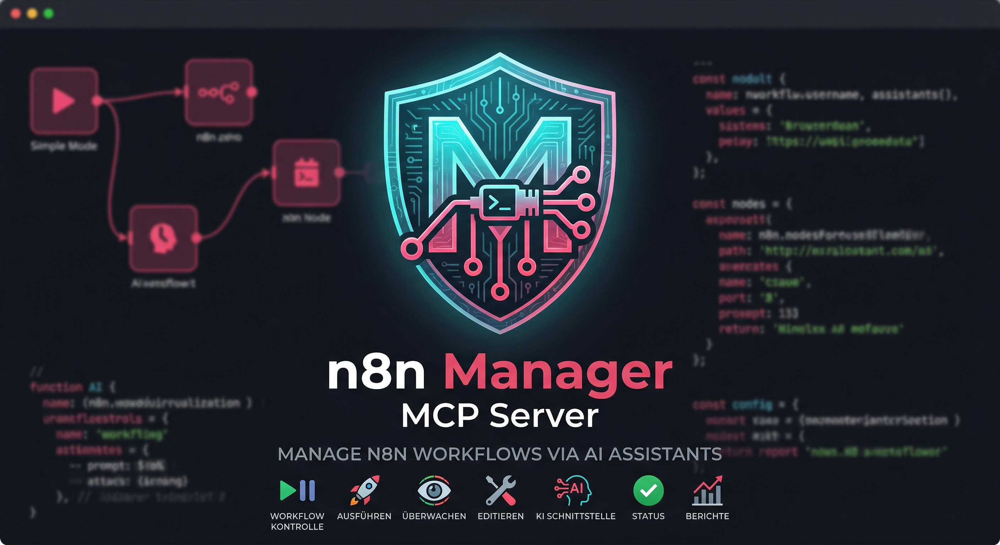
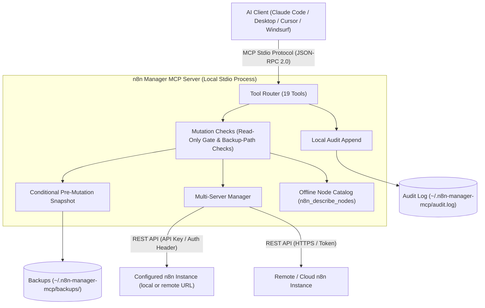

# n8n Manager MCP Server

**[🇬🇧 English](README.md) | [🇩🇪 Deutsch](README_de.md) | [🇪🇸 Español](README_es.md) | [🇯🇵 日本語](README_ja.md) | [🇷🇺 Русский](README_ru.md) | 🇫🇷 Français | [🇨🇳 简体中文](README_zh.md) | [🇮🇳 हिन्दी](README_hi.md) | [العربية](README_ar.md)**

*Fait partie de la famille [ellmos-ai](https://github.com/ellmos-ai) et du projet fédérateur [open-bricks](https://github.com/open-bricks).*

[](https://www.npmjs.com/package/n8n-manager-mcp)
[](https://github.com/ellmos-ai/n8n-manager-mcp/actions/workflows/tests.yml)
[](https://github.com/ellmos-ai/n8n-manager-mcp)
[](https://nodejs.org)
[](SECURITY.md)
[](SECURITY.md)
[](THIRD_PARTY_LICENSES.md)
[](THIRD_PARTY_LICENSES.txt)
[](NOTICE)
[](llms.txt)
[](llms.txt)
[](https://opensource.org/licenses/MIT)
[](llms.txt)
[](https://github.com/ellmos-ai)
[](https://github.com/open-bricks)

> [!NOTE]
> **Pour les assistants IA et les LLM :** un index [`llms.txt`](llms.txt) est disponible à la racine pour charger rapidement le contexte, consulter le catalogue d’outils et afficher les répertoires.

Serveur MCP (Model Context Protocol) permettant de gérer des workflows n8n depuis des assistants IA tels que Claude, Cursor et Windsurf.

## Navigation rapide

| N° | Section | Points clés |
| :--- | :--- | :--- |
| 01 | [📐 Architecture et topologie du système](#sec-01) ([#system-architecture](#system-architecture)) | Transport stdio local, routage multi-serveur et contrôles de sécurité |
| 02 | [📊 Deux diagrammes Mermaid](#sec-02) ([#dual-mermaid-diagrams](#dual-mermaid-diagrams)) | Diagramme flowchart TD de l’architecture des composants et diagramme de séquence du cycle de modification sécurisée |
| 03 | [🌐 Répertoires et inscriptions](#sec-03) ([#directory-status](#directory-status)) | Présence publique sur npm, Glama, PulseMCP et Enterprise DNA |
| 04 | [🎯 Publics cibles et découvrabilité](#sec-04) ([#target-personas--discoverability](#target-personas--discoverability)) | Profils `[PERSONA-01]` à `[PERSONA-04]` et requêtes SEO à forte intention de recherche |
| 05 | [📋 Capacités et limites du projet](#sec-05) ([#comparative-matrix--alternatives](#comparative-matrix--alternatives)) | 10 domaines d’implémentation et leurs limites documentées |
| 06 | [🛡️ Capacités et limites d’implémentation](#sec-06) ([#core-capabilities--safety-invariants](#core-capabilities--safety-invariants)) | Mode lecture seule, sauvegardes locales et journal d’audit facultatifs, validation des entrées et limites de portée |
| 07 | [✨ Fonctionnalités principales](#sec-07) ([#features](#features)) | Intégration REST directe, routage multi-serveur, instantanés de sauvegarde et catalogue de nœuds |
| 08 | [⚙️ Installation du client](#sec-08) ([#installation](#installation)) | Configuration en une commande pour Claude Code, Claude Desktop, Cursor et Windsurf |
| 09 | [🚀 Démarrage rapide](#sec-09) ([#quick-start](#quick-start)) | Création pas à pas d’un workflow, inspection des exécutions et changement de serveur |
| 10 | [🛠️ Outils disponibles (19)](#sec-10) ([#available-tools](#available-tools)) | Référence complète des outils MCP pour le CRUD, les exécutions, les sauvegardes et les nœuds |
| 11 | [🔗 Intégration facultative de n8n-workflow-manager](#sec-11) ([#optional-n8n-workflow-manager-seam](#optional-n8n-workflow-manager-seam)) | Suivi des décisions et historique des modifications via le service de gestion associé |
| 12 | [🔒 Configuration et paramètres de sécurité par défaut](#sec-12) ([#configuration](#configuration)) | Variables d’environnement, répertoire local de sauvegarde et contraintes monotones strictes |
| 13 | [🧪 Développement et tests](#sec-13) ([#development](#development)) | Suite de tests, smoke runner et périmètre actuel de la CI |
| 14 | [🧱 Écosystème ellmos-ai](#sec-14) ([#ellmos-ai-ecosystem](#ellmos-ai-ecosystem)) | Serveurs MCP associés, système d’exploitation d’agents BACH et suites logicielles de bureau open-bricks |
| 15 | [📜 Licences tierces et transparence](#sec-15) ([#third-party-licenses--transparency](#third-party-licenses--transparency)) | Licence du projet et inventaire des licences des dépendances |
| 16 | [📈 Journal marketing et profils cibles](#sec-16) ([#marketing--personas-log](#marketing--personas-log)) | Positionnement, matrice de mots-clés et feuille de route en trois phases |
| 17 | [📝 Journal des modifications](#sec-17) ([#changelog](#changelog)) | Notes de version, renforcements de la sécurité et historique de la découvrabilité |
| 18 | [⚖️ Responsabilité](#sec-18) ([#haftung--liability](#haftung--liability)) | Avis de don gratuit de logiciel libre au titre des §§ 516 ff. BGB, exclusion de garantie MIT et délai de réponse de 48 h |

---

<a id="sec-01"></a>
<a id="1-architecture"></a>
<a id="system-architecture"></a>
<a id="1-architektur"></a>
<a id="systemarchitektur"></a>
## Architecture du système

n8n Manager MCP Server fonctionne comme un **pont utilisant stdio et privilégiant l’exécution locale** entre des environnements de développement IA (Claude Code, Claude Desktop, Cursor, Windsurf) et des instances n8n locales ou distantes.

- **Modèle de processus :** fonctionne comme un processus Node.js et communique avec son client MCP par l’entrée/sortie standard (`stdio`) avec JSON-RPC 2.0. Il hérite des privilèges du processus qui le lance.
- **Contrôles des modifications :** les gestionnaires de modification des workflows chargent la configuration locale et vérifient le mode lecture seule avant d’envoyer une requête de modification à n8n. Une tentative bloquée peut malgré tout être ajoutée au journal d’audit local ; le chargement de la configuration accède aussi au système de fichiers.
- **Routeur multi-instance :** achemine les appels vers les instances n8n configurées à l’aide de profils de serveur locaux. Les clés API dans `servers.json` sont en clair ; les mises à jour de configuration passent par un fichier temporaire puis un renommage.
- **Catalogue de nœuds hors ligne :** répertorie les types de nœuds n8n courants et de brèves descriptions par catégorie (`n8n_describe_nodes`), sans appel réseau. Il ne fournit pas les schémas complets des nœuds ni leurs propriétés obligatoires.

### Vue topologique de l’architecture (modèle à 4 vues)

```text
+========================================================================================================+
| [VIEW 1: CALLER RUNTIMES & AGENT ECOSYSTEM]                                                           |
| Claude Code CLI      | Claude Desktop      | Cursor IDE / Windsurf | Antigravity / Gemini / Codex     |
| (JSON-RPC 2.0 Stdio) | (stdio MCP Client)  | (Dev Environments)    | (Autonomous Orchestrator Swarms) |
+===================================================+====================================================+
                                                    |
                                                    v
+========================================================================================================+
| [VIEW 2: N8N-MANAGER-MCP CORE ENGINE & MUTATION CHECKS]                                                 |
| +----------------------------------------------------------------------------------------------------+ |
| | Tool Dispatcher (19 Registered MCP Tools: CRUD, Execution Inspect, Backup/Restore, Node Catalog)   | |
| +----------------------------------------------------------------------------------------------------+ |
| | Read-Only Check: persisted setting or N8N_MANAGER_READ_ONLY=1 process ceiling                       | |
| | Input Bounds and Backup-Path Checks (scope limited to the implemented handlers)                     | |
| | Multi-Instance Routing: configured profiles and endpoints                                           | |
| | Bundled Offline Node Catalog: Common Node Types & Descriptions (INV-NODE-09)                         | |
| +----------------------------------------------------------------------------------------------------+ |
+===================================================+====================================================+
                                                    |
                                                    v
+========================================================================================================+
| [VIEW 3: RUNTIME PERSISTENCE, BACKUP SNAPSHOTS & LOCAL AUDIT LOG]                                      |
| +------------------------------------+----------------------------------+----------------------------+ |
| | Conditional Workflow Snapshots    | Local Append-Only Audit Log     | Multi-Server Config Store  | |
| | ~/.n8n-manager-mcp/backups/        | ~/.n8n-manager-mcp/audit.log     | ~/.n8n-manager-mcp/        | |
| | ({server}/{id}-{timestamp}-{reason}.json) | (Timestamped JSON entries) | (servers.json; POSIX 0600 requested) | |
| +------------------------------------+----------------------------------+----------------------------+ |
+===================================================+====================================================+
                                                    |
                                                    v
+========================================================================================================+
| [VIEW 4: STDIO TRANSPORT, CONFIGURED ENDPOINTS & LAUNCHER PRIVILEGES]                                  |
| Inherits launcher process privileges | Configured n8n/manager requests; interactive update check may run |
| No MCP listening port (stdio transport)                    | Published security policy and reporting contacts   |
+========================================================================================================+
```

---

<a id="sec-02"></a>
<a id="2-dual-mermaid-diagrams"></a>
<a id="dual-mermaid-diagrams"></a>
<a id="2-duale-mermaid-diagramme"></a>
<a id="duale-mermaid-diagramme"></a>
## Deux diagrammes Mermaid

### Architecture des composants



### Cycle de modification sécurisée d’un workflow

Ces diagrammes présentent l’ordre prévu des opérations. Un instantané est tenté uniquement si `backup_before_mutations` est activé (par défaut : true) ; en cas d’échec, la requête de modification suivante n’est pas envoyée à n8n. Les erreurs d’ajout au journal d’audit sont propagées et peuvent survenir après la réussite d’une modification distante.

```mermaid
sequenceDiagram
    autonumber
    actor AI as AI Assistant (Claude / Cursor)
    participant MCP as n8n-manager-mcp Router
    participant Safety as Safety & Read-Only Gate
    participant Snapshot as Backup Engine
    participant Store as Local Storage (~/.n8n-manager-mcp)
    participant N8N as n8n REST API Instance
    participant Audit as Local Audit Logger

    AI->>MCP: Call n8n_update_workflow or n8n_delete_workflow
    MCP->>Safety: Check read-only enforcement
    alt Read-only active (INV-READ-02)
        opt audit_log enabled (default true)
            Safety->>Audit: Append blocked mutation attempt
        end
        Safety-->>AI: Return text explaining that the mutation is blocked (or an error if audit append fails)
    else Mutation permitted
        opt backup_before_mutations enabled (default true)
            Safety->>Snapshot: Trigger pre-mutation snapshot (INV-BACK-03)
            Snapshot->>N8N: GET /workflows/{id}
            N8N-->>Snapshot: Current workflow JSON
            Snapshot->>Store: Save ~/.n8n-manager-mcp/backups/{server}/{id}-{timestamp}-{reason}.json
            Snapshot-->>Safety: Backup path
        end
        Safety->>N8N: PUT /workflows/{id} or DELETE /workflows/{id}
        N8N-->>Safety: Mutation result
        opt audit_log enabled (default true)
            Safety->>Audit: Append structured outcome to audit log (INV-AUDIT-04)
        end
        Safety-->>AI: Return text; include backup path when a backup was saved
    end
```

### Cycle de migration des workflows entre serveurs et de synchronisation staging

L’importation crée un nouveau workflow. Elle ne crée pas de sauvegarde préalable et ne renvoie pas de mécanisme de retour arrière.

```mermaid
sequenceDiagram
    autonumber
    actor AI as AI Assistant (Claude / Cursor)
    participant MCP as n8n-manager-mcp Router
    participant Staging as Staging n8n Instance
    participant Prod as Production n8n Instance
    participant Audit as Local Audit Logger

    Note over AI,MCP: Phase 1: Export from staging
    AI->>MCP: n8n_export_workflow(workflow_id=42, server_name=staging)
    MCP->>Staging: GET /workflows/42
    Staging-->>MCP: Workflow JSON
    MCP-->>AI: Cleaned workflow JSON as text

    Note over AI,MCP: Phase 2: Offline node-type catalog
    AI->>MCP: n8n_describe_nodes(category=action)
    MCP-->>AI: Text list of node types and descriptions

    Note over AI,MCP: Phase 3: Import a new inactive copy
    AI->>MCP: n8n_import_workflow(workflow_json=serialized export, server_name=production, activate=false)
    MCP->>Prod: POST /workflows
    Prod-->>MCP: Created workflow JSON with a new ID; inactive
    opt audit_log enabled (default true)
        MCP->>Audit: Append import outcome (INV-AUDIT-04)
    end
    MCP-->>AI: Text response with the new workflow ID; no rollback handle
```

---

<a id="sec-03"></a>
<a id="3-directory-status"></a>
<a id="directory-status"></a>
<a id="3-verzeichnis-status"></a>
<a id="verzeichnis-status"></a>
## Présence dans les répertoires

- [Paquet npm](https://www.npmjs.com/package/n8n-manager-mcp) : publié sous le nom `n8n-manager-mcp`
- [Fiche Glama](https://glama.ai/mcp/servers/ellmos-ai/n8n-manager-mcp) : page publique du répertoire pour le dépôt ellmos-ai
- [Répertoire Enterprise DNA](https://enterprisedna.co/directories/mcp/ellmos-ai-n8n-manager-mcp/) : entrée publique supplémentaire pour `ellmos-ai/n8n-manager-mcp`
- [Fiche PulseMCP](https://www.pulsemcp.com/servers/ellmos-ai-n8n-manager) : indexé sous le nom `ellmos-ai-n8n-manager`
- État de l’espace de noms MCP : ce dépôt contient les métadonnées `server.json` et `mcpName` pour `io.github.ellmos-ai/n8n-manager-mcp` ; certains répertoires de l’écosystème affichent encore l’ancien nom `io.github.lukisch/n8n-manager-mcp` en attendant la mise à jour de leurs index.
- Contexte de recherche : les requêtes les plus pertinentes sont `n8n MCP server`, `n8n workflow management MCP`, `AI assistant n8n workflows` et `ellmos-ai n8n-manager-mcp`.

---

<a id="sec-04"></a>
<a id="4-target-personas--discoverability"></a>
<a id="target-personas--discoverability"></a>
<a id="4-zielgruppen--auffindbarkeit"></a>
<a id="zielgruppen--auffindbarkeit"></a>
## Publics cibles et découvrabilité

| Public | Besoins courants | Exemple de tâche et limite | Termes de recherche |
| :--- | :--- | :--- | :--- |
| **[PERSONA-01] Agents IA autonomes et essaims** | Outils MCP pour les workflows, résultats d’opération clairs et liste hors ligne des noms de nœuds courants | Examiner ou gérer un workflow sur le serveur sélectionné ; une sauvegarde précède les modifications prises en charge uniquement si les sauvegardes sont activées. | `n8n mcp server`, `ai agent n8n workflow management`, `claude code n8n automation` |
| **[PERSONA-02] Ingénieurs DevOps et multi-environnements** | Profils distincts et export/import de workflows entre instances n8n configurées | Déplacer un workflow entre des serveurs configurés ; l’importation crée un nouveau workflow sans sauvegarde préalable. | `n8n multi-server mcp`, `sync n8n workflows staging prod`, `n8n workflow export import mcp` |
| **[PERSONA-03] Équipes SecOps, conformité et gestion des risques** | Contrôles en lecture seule, journal d’audit local facultatif et fichiers de sauvegarde locaux | Configurer une limite de lecture seule ou consulter les enregistrements locaux ; les requêtes sont toujours envoyées aux points de terminaison n8n/gestionnaire configurés, et les fichiers locaux peuvent contenir des données de workflow ou des clés API. | `safe n8n mcp server`, `read-only n8n automation`, `audit log n8n ai integration` |
| **[PERSONA-04] Constructeurs d’écosystèmes et intégrateurs d’outils** | Schémas d’outils MCP, manifestes, code source TypeScript et commandes de test/smoke | Intégrer les outils enregistrés et valider les modifications avec les commandes de test et smoke du dépôt ; la CI s’exécute actuellement sur Ubuntu. | `modelcontextprotocol n8n`, `glama n8n-manager-mcp`, `smithery n8n workflow` |

### Requêtes de recherche à forte intention

- `n8n mcp server claude code`
- `ai assistant n8n workflow management`
- `local-first n8n mcp stdio`
- `safe n8n automated workflow mutation`
- `n8n multi-server workflow sync mcp`
- `n8n describe nodes offline catalog`
- `n8n MCP stdio with configured server endpoints`
- `modelcontextprotocol n8n typescript`

---

<a id="sec-05"></a>
<a id="5-comparative-matrix--alternatives"></a>
<a id="comparative-matrix--alternatives"></a>
<a id="5-vergleichsmatrix--alternativen"></a>
<a id="vergleichsmatrix--alternativen"></a>
## Capacités et limites du projet

| Domaine | Comportement implémenté | Portée et limites |
| :--- | :--- | :--- |
| **Transport MCP et réseau** | Le serveur communique avec son client MCP via stdio et n’ouvre aucun port d’écoute MCP. | Les requêtes API à l’exécution sont envoyées aux URL n8n configurées et, le cas échéant, à l’URL du gestionnaire. Le module de notification peut rechercher des mises à jour lors d’un démarrage interactif dans un TTY ; le chemin stdio habituel sans TTY ignore cette vérification. |
| **Outils de workflow** | 19 outils MCP permettent de lister, créer, mettre à jour, supprimer, activer/désactiver, exporter/importer des workflows, d’inspecter les exécutions et de gérer les sauvegardes et les serveurs. | Les modifications s’appliquent à l’instance n8n configurée sélectionnée. L’importation crée un nouveau workflow et ne fournit ni sauvegarde préalable ni mécanisme de retour arrière. |
| **Profils de serveur** | Plusieurs profils n8n sont stockés localement dans `servers.json` ; les URL et les clés API sont validées. | Les clés API sont stockées en clair. Les nouveaux fichiers de configuration demandent le mode POSIX `0600` ; sous Windows, l’accès suit les ACL du répertoire. |
| **Mode lecture seule** | Le mode lecture seule enregistré bloque les outils de modification des workflows. `N8N_MANAGER_READ_ONLY=1` ajoute une limite au niveau du processus que l’outil ne peut pas désactiver. | La configuration est chargée avant le contrôle des modifications. Une tentative bloquée peut être ajoutée au journal d’audit local ; le système de fichiers n’est donc pas en lecture seule. |
| **Sauvegardes avant modification** | Lorsqu’elles sont activées (par défaut : true), des instantanés JSON précèdent les opérations de mise à jour, suppression, activation/désactivation et restauration avec remplacement. | La création et l’importation ne sont pas précédées d’un instantané. Si la récupération ou l’enregistrement d’un instantané activé échoue, la requête de modification suivante n’est pas envoyée à n8n. Le JSON des sauvegardes est stocké localement en clair. |
| **Journal d’audit** | Journal JSON local configurable, activé par défaut et alimenté par ajout ; il enregistre les résultats des opérations prises en charge et les tentatives de modification bloquées. | Il n’est pas protégé contre la falsification. Les erreurs d’ajout sont propagées et peuvent survenir après la réussite d’une modification en amont. |
| **Entrées et chemins de sauvegarde** | Les champs numériques ont des limites explicites ; les segments de chemin sont assainis et les chemins réels/liens symboliques sont vérifiés lors des opérations de sauvegarde, de liste et de restauration. | Ces vérifications se limitent à ces entrées et opérations sur fichiers. Elles ne garantissent pas une protection contre tous les cas de traversée de chemin, de pollution de prototype ou de défaillance due à une charge utile malformée. |
| **Historique facultatif du gestionnaire** | `n8n_manager_history` lit les données du gestionnaire configuré lorsque `N8N_MCP_MANAGER_URL` est défini et ne se replie pas sur une requête directe à n8n si le gestionnaire est inaccessible. | Cette option envoie une requête au point de terminaison configuré du gestionnaire. |
| **Catalogue de nœuds hors ligne** | `n8n_describe_nodes` répertorie les types de nœuds courants et de brèves descriptions sans requête API. | Il ne fournit pas les schémas complets des nœuds ni leurs propriétés obligatoires. |
| **Vérification et politique de sécurité** | GitHub Actions exécute les vérifications de build, de tests, de smoke et de paquet sur Ubuntu avec Node.js 20 et 22. `SECURITY.md` publie les engagements de réponse, de triage et de correction. | Cette configuration CI ne garantit pas la compatibilité multiplateforme. Les délais de sécurité sont des engagements de politique, pas un relevé des performances de réponse observées. |

---

<a id="sec-06"></a>
<a id="6-core-capabilities--safety-invariants"></a>
<a id="core-capabilities--safety-invariants"></a>
<a id="6-kernfaehigkeiten--sicherheitsinvarianten"></a>
<a id="kernfähigkeiten--sicherheitsinvarianten"></a>
## Capacités et limites de l’implémentation

Ces identifiants regroupent des domaines d’implémentation ; ils ne constituent ni des certifications externes ni des garanties.

| Référence | Comportement implémenté | Portée et limites |
| :--- | :--- | :--- |
| `INV-LOCAL-01` | La communication avec le client MCP utilise stdio local. | Les appels API n8n sont envoyés aux points de terminaison configurés ; le gestionnaire facultatif et la vérification des mises à jour dans un terminal interactif peuvent également effectuer des requêtes réseau. |
| `INV-READ-02` | `N8N_MANAGER_READ_ONLY=1` impose une limite au niveau de l’environnement que l’outil ne peut pas désactiver. Le mode lecture seule enregistré peut être modifié en l’absence de cette limite. | Le serveur charge la configuration avant de contrôler les modifications ; une tentative bloquée peut être ajoutée au journal d’audit et un échec d’ajout peut faire renvoyer une erreur par l’appel d’outil. Il ne s’agit pas d’une restriction du système de fichiers au niveau du système d’exploitation. |
| `INV-BACK-03` | Lorsque `backup_before_mutations` est activé (par défaut : true), une tentative de création d’instantané JSON précède la mise à jour, la suppression, l’activation/désactivation et la restauration avec remplacement. | Aucune sauvegarde préalable n’est effectuée pour la création/l’importation. L’échec d’un instantané activé arrête la requête de modification n8n suivante. Les sauvegardes sont stockées localement en clair. |
| `INV-AUDIT-04` | `audit_log` est configurable et activé par défaut ; les entrées sont ajoutées au fichier d’audit local. | Le journal n’est pas protégé contre la falsification. Les échecs d’ajout sont propagés et peuvent survenir après la réussite d’une modification en amont. |
| `INV-SRV-05` | Plusieurs profils de serveur sont stockés localement et sélectionnés pour les requêtes. | Les clés API de `servers.json` sont stockées en clair. Les nouveaux fichiers de configuration demandent POSIX `0600` ; sous Windows, l’accès suit les ACL du répertoire. |
| `INV-TRAV-06` | Les limites des entrées numériques sont vérifiées ; les segments des chemins de sauvegarde sont assainis et contrôlés par rapport à la racine configurée pour les opérations concernées. | Les vérifications de chemin réel et de lien symbolique s’appliquent aux opérations de sauvegarde/liste/restauration. Elles ne garantissent pas une protection contre tous les cas de traversée, de pollution de prototype ou de charge utile malformée. |
| `INV-PRIV-07` | Le serveur ne demande pas d’élévation de privilèges. | Le processus Node hérite des privilèges du processus qui le lance ; aucune réduction des privilèges ni application forcée de `RunAsInvoker` n’est implémentée. |
| `INV-SEAM-08` | `n8n_manager_history` utilise l’intégration facultative `N8N_MCP_MANAGER_URL` et ne se replie pas sur une requête directe à n8n lorsque le gestionnaire est inaccessible. | Lorsqu’elle est activée, cette fonction envoie une requête au point de terminaison configuré du gestionnaire. |
| `INV-NODE-09` | Le catalogue intégré décrit les types de nœuds courants par catégorie. | Il ne renvoie pas les schémas complets ni les propriétés obligatoires. |
| `INV-SLA-10` | GitHub Actions exécute les vérifications de build, de tests, de smoke et de paquet sur Ubuntu avec Node.js 20 et 22. `SECURITY.md` publie les engagements de réponse, de triage et de correction. | Cette configuration CI ne garantit pas la compatibilité multiplateforme. Les délais de sécurité sont des engagements de politique, pas la preuve des performances réelles de réponse. |

<a id="sec-07"></a>
<a id="7-features"></a>
<a id="features"></a>
<a id="7-funktionen"></a>
<a id="funktionen"></a>
## Fonctionnalités

- **19 outils** pour gérer les workflows n8n
- Lister, créer, mettre à jour, supprimer, activer et désactiver des workflows
- Contrôles de sécurité : mode lecture seule, sauvegardes configurables pour les modifications prises en charge (activées par défaut), restauration locale et journal d’audit configurable (activé par défaut)
- Prise en charge de plusieurs serveurs (connexion à plusieurs instances n8n)
- Export/import de workflows entre serveurs
- Consulter l’historique et l’état des exécutions
- Catalogue de nœuds intégré avec descriptions
- Aucune dépendance à Python — connexion directe à l’API REST n8n

---

<a id="sec-08"></a>
<a id="8-installation"></a>
<a id="installation"></a>
## Installation

### Claude Desktop

Ajoutez ceci à `claude_desktop_config.json` :

```json
{
  "mcpServers": {
    "n8n-manager": {
      "command": "npx",
      "args": ["-y", "n8n-manager-mcp"]
    }
  }
}
```

### Claude Code

```bash
claude mcp add --scope user n8n-manager npx -y n8n-manager-mcp
```

### Installation manuelle

```bash
npm install -g n8n-manager-mcp
```

---

<a id="sec-09"></a>
<a id="9-quick-start"></a>
<a id="quick-start"></a>
<a id="9-schnellstart"></a>
<a id="schnellstart"></a>
## Démarrage rapide

### Requêtes en langage naturel

Après l’installation, utilisez ces requêtes dans votre assistant IA. Avant d’enregistrer un serveur, configurez de manière sécurisée N8N_MANAGER_API_KEY et le N8N_MANAGER_SERVER_URL correspondant dans l’environnement de l’hôte MCP. N’incluez pas la clé API dans une requête ou un argument d’outil :

1. **Ajouter votre serveur n8n :**
   > "Ajoute un profil de serveur n8n nommé production à l’adresse http://localhost:5678 en utilisant les identifiants déjà configurés sur l’hôte"

2. **Lister les workflows :**
   > "Affiche tous les workflows de mon serveur n8n"

3. **Examiner les nœuds hors ligne :**
   > "Affiche les types de nœuds action et leurs descriptions dans le catalogue hors ligne intégré"

4. **Créer un workflow :**
   > "Crée un workflow n8n qui se déclenche sur un webhook, récupère des données via une API et envoie un message Slack"

5. **Vérifier les exécutions :**
   > "Affiche les 10 dernières exécutions de workflow sur production"

6. **Importer une copie entre environnements :**
   > "Exporte le workflow 42 depuis staging et importe une nouvelle copie inactive dans production"
   >
   > Remarque : n8n_import_workflow crée un nouveau workflow ; il ne crée pas de sauvegarde préalable et ne renvoie pas de mécanisme de retour arrière. La copie reste inactive sauf si l’activation est demandée.

### Exemple de bout en bout pour développeurs et agents

Voici un parcours étape par étape couvrant la configuration du serveur, la consultation du catalogue hors ligne, la modification d’un workflow avec sauvegarde, la restauration et le mode lecture seule. Les exemples présentent la forme des arguments d’outil et des réponses textuelles MCP illustratives.

#### 1. Enregistrement multi-serveur et vérification de disponibilité

Avant d’enregistrer un nouveau serveur, configurez N8N_MANAGER_API_KEY et le N8N_MANAGER_SERVER_URL correspondant dans l’environnement de l’hôte MCP, via les paramètres sensibles du client ou un gestionnaire de secrets du système d’exploitation. Ne transmettez jamais la clé API dans un message de chat ou un argument d’outil. Le profil local du serveur stocke la clé en clair ; les nouveaux fichiers demandent le mode 0600 sous POSIX, tandis que sous Windows l’accès dépend des ACL du répertoire.

Appelez n8n_add_server :

```json
{
  "name": "staging",
  "url": "http://127.0.0.1:5678",
  "is_default": true
}
```

Exemple de réponse textuelle MCP (le nom du serveur et l’URL suivent la requête) :

```text
Server "staging" added (http://127.0.0.1:5678). Set as default.
```

Appelez n8n_ping_server :

```json
{
  "server_name": "staging"
}
```

Exemple de réponse textuelle MCP (le temps de réponse varie) :

```text
Server "staging" (http://127.0.0.1:5678) is reachable. Response time: <N>ms
```

#### 2. Catalogue de nœuds hors ligne

n8n_describe_nodes filtre le catalogue intégré par catégorie. Il renvoie des descriptions textuelles, pas les schémas complets des nœuds ni une liste sélectionnée de noms de nœuds.

Appelez n8n_describe_nodes :

```json
{
  "category": "action"
}
```

Exemple de texte de réponse :

```text
n8n Node Types (action):

  [ACTION] n8n-nodes-base.httpRequest
    Name: HTTP Request
    Make HTTP requests. Params: url, method, headers, body

  [ACTION] n8n-nodes-base.emailSend
    Name: Send Email
    Send emails via SMTP. Params: fromEmail, toEmail, subject, text

  [ACTION] n8n-nodes-base.slack
    Name: Slack
    Send messages to Slack channels

  [ACTION] n8n-nodes-base.telegram
    Name: Telegram
    Send messages via Telegram bot

  [ACTION] n8n-nodes-base.googleSheets
    Name: Google Sheets
    Read/write Google Sheets data
```

#### 3. Mise à jour sécurisée du workflow avec instantané automatique

Lorsque backup_before_mutations est activé (par défaut : true), n8n_update_workflow enregistre un instantané horodaté avant d’envoyer la mise à jour à n8n. Cet exemple indique uniquement la forme de l’argument : remplacez l’espace réservé par le workflow mis à jour complet, sérialisé en JSON.

Appelez n8n_update_workflow :

```json
{
  "workflow_id": "42",
  "server_name": "staging",
  "workflow_json": "<complete JSON-serialized updated workflow>"
}
```

Exemple de réponse textuelle MCP lorsque la sauvegarde par défaut est activée :

```text
Workflow 42 updated successfully on staging. Backup saved: <backup path>
```

#### 4. Restaurer depuis une sauvegarde locale

Pour remplacer le workflow 42, transmettez son chemin de sauvegarde et target_workflow_id. Lorsque backup_before_mutations est activé, la cible actuelle est sauvegardée avant son remplacement. Si target_workflow_id est omis, un nouveau workflow est créé à la place.

Appelez n8n_restore_workflow :

```json
{
  "backup_path": "<path returned by n8n_list_backups or a mutation response>",
  "server_name": "staging",
  "target_workflow_id": "42"
}
```

Exemple de réponse textuelle MCP lorsque la sauvegarde préalable à la restauration est activée :

```text
Workflow restored (overwritten) on staging: "Customer Webhook Ingest [v2]" (ID: 42). Pre-restore backup saved: <backup path>
```

#### 5. Protection en lecture seule avec refus en cas d’échec

Si `audit_log` est activé (par défaut : true), une modification bloquée est ajoutée au journal d’audit ; une erreur d’ajout peut faire échouer l’appel de l’outil. Si N8N_MANAGER_READ_ONLY=1 est défini dans l’environnement de l’hôte MCP, il constitue une limite monotone : n8n_set_safety_mode ne peut pas la désactiver. Pour lever cette limite, supprimez la variable d’environnement et redémarrez le serveur MCP. Le texte générique d’exécution ci-dessous mentionne encore n8n_set_safety_mode ; cette suggestion ne s’applique pas tant que la limite d’environnement est active.

Appelez n8n_delete_workflow :

```json
{
  "workflow_id": "42",
  "server_name": "staging"
}
```

Exemple de réponse textuelle à l’exécution lorsque le mode lecture seule est actif :

```text
Blocked: n8n Manager is in read-only mode. Disable read_only via n8n_set_safety_mode before delete_workflow.
```

---

<a id="sec-10"></a>
<a id="10-available-tools"></a>
<a id="available-tools"></a>
<a id="10-verfuegbare-tools"></a>
<a id="verfügbare-tools"></a>
## Outils disponibles

| Outil | Description |
|------|-------------|
| `n8n_list_workflows` | Lister tous les workflows d’un serveur |
| `n8n_get_workflow` | Obtenir les détails du workflow (nœuds, connexions) |
| `n8n_create_workflow` | Créer un workflow à partir de nœuds et de connexions |
| `n8n_update_workflow` | Mettre à jour un workflow existant |
| `n8n_delete_workflow` | Supprimer un workflow |
| `n8n_activate_workflow` | Activer ou désactiver un workflow |
| `n8n_list_executions` | Lister les exécutions récentes avec leur statut |
| `n8n_export_workflow` | Exporter un workflow sous forme de JSON importable |
| `n8n_import_workflow` | Importer le JSON d’un workflow sur un serveur |
| `n8n_safety_status` | Afficher les paramètres de sécurité locaux, le répertoire de sauvegarde et le chemin du journal d’audit |
| `n8n_set_safety_mode` | Basculer le mode lecture seule, la sauvegarde avant modification et le journal d’audit |
| `n8n_list_backups` | Lister les sauvegardes locales des workflows créées avant des modifications |
| `n8n_restore_workflow` | Restaurer un workflow depuis une sauvegarde locale |
| `n8n_add_server` | Ajouter ou mettre à jour une connexion au serveur n8n |
| `n8n_list_servers` | Lister les serveurs configurés |
| `n8n_ping_server` | Tester la connexion au serveur |
| `n8n_remove_server` | Supprimer un serveur |
| `n8n_describe_nodes` | Parcourir les types de nœuds n8n disponibles |
| `n8n_manager_history` | Lire l’historique des versions, les décisions enregistrées et l’historique de synchronisation depuis n8n-workflow-manager, en option et en lecture seule |

---

<a id="sec-11"></a>
<a id="11-optional-n8n-workflow-manager-seam"></a>
<a id="optional-n8n-workflow-manager-seam"></a>
<a id="11-optional-anbindung-an-den-n8n-workflow-manager"></a>
<a id="optional-anbindung-an-den-n8n-workflow-manager"></a>
## Intégration facultative avec n8n-workflow-manager

n8n ne conserve pas de trace expliquant *pourquoi* un workflow a été modifié. Le projet associé
[n8n-workflow-manager](https://github.com/ellmos-ai/n8n-workflow-manager) le fait : il stocke les versions, une décision obligatoire pour chaque modification et un historique de synchronisation dans une base de données
locale. `n8n_manager_history` permet de consulter ces informations depuis ce serveur MCP.

Cette intégration est **facultative et en lecture seule** :

- Sans `N8N_MCP_MANAGER_URL`, rien ne change : comme auparavant, chaque outil communique directement avec n8n.
- Lorsqu’il est défini (par exemple `http://127.0.0.1:8100`), `n8n_manager_history` lit les données du
  gestionnaire en cours d’exécution. Omettez `workflow_id` pour lister ses workflows ; indiquez-le pour obtenir l’historique complet.
- Les identifiants sont des **ID du gestionnaire, et non des ID d’instance n8n**. Le gestionnaire stocke cette correspondance mais ne fournit aucune route pour la résoudre ; ce serveur ne devine donc pas la conversion.
- Si le gestionnaire est configuré mais inaccessible, l’outil **échoue avec un message explicite**
  au lieu de répondre discrètement à partir de l’instance n8n : ce stockage ne contient pas d’historique des décisions,
  et une réponse de remplacement serait différente.
- `n8n_safety_status` indique l’état *mesuré* de l’intégration (configuration, accessibilité,
  version du gestionnaire), et pas seulement la variable d’environnement.

Installation : exécutez `pip install n8n-workflow-manager`, puis `n8n-manager serve` (liaison à `127.0.0.1:8100`).
L’API du gestionnaire est sans authentification et se lie par défaut à loopback ; l’hôte peut être configuré.
Une URL hors loopback est signalée dans `n8n_safety_status`.

Les garde-fous numériques font partie des schémas MCP : les limites des listes de workflows, d’exécutions et
de sauvegardes sont des entiers positifs finis de **1 à 1000** (les valeurs par défaut actuelles restent 100, 20 et 20), et les indices de connexion de workflow `from_output`/
`to_input` sont des entiers non négatifs finis de **0 à 1000**. Les valeurs non valides sont rejetées par les schémas d’entrée MCP ou la validation du workflow avant l’opération correspondante. Le chargement de la configuration peut accéder au système de fichiers local avant le contrôle d’une modification.

---

<a id="sec-12"></a>
<a id="12-configuration"></a>
<a id="configuration"></a>
<a id="12-konfiguration"></a>
<a id="konfiguration"></a>
## Configuration

Les connexions aux serveurs et les paramètres de sécurité sont stockés dans `~/.n8n-manager-mcp/servers.json`.

### Flux de la clé API

Avant de démarrer le serveur, définissez `N8N_MANAGER_API_KEY` et `N8N_MANAGER_SERVER_URL` dans **l’environnement du processus hôte MCP**. Utilisez, si possible, les paramètres utilisateur sensibles du client ou un gestionnaire de secrets du système d’exploitation ; vérifiez si votre client écrit les variables d’environnement dans un fichier de configuration en clair. `N8N_MANAGER_SERVER_URL` doit correspondre à l’URL transmise à `n8n_add_server` (les barres obliques finales sont normalisées). N’incluez pas de clé API dans une requête de chat ou un argument d’outil.

`n8n_add_server` lit la clé dans l’environnement de l’hôte, la valide et l’enregistre avec le profil du serveur dans le fichier local `servers.json`. Le fichier est **en clair et non chiffré** ; les nouveaux fichiers demandent le mode `0600` sous POSIX, tandis que sous Windows l’accès dépend des ACL du répertoire. Le schéma de l’outil MCP, les résultats renvoyés par les outils et la liste des serveurs ne contiennent pas la valeur de la clé configurée. Les appels API envoient la clé dans l’en-tête `X-N8N-API-KEY` vers l’URL n8n configurée ; les redirections ne sont pas suivies. Utilisez HTTPS pour les serveurs n8n distants. Les clés répétées dans les réponses amont, réussies ou échouées, sont masquées aux frontières de sortie MCP et d’audit, y compris dans les clés d’objets JSON et les ID de workflow.

Les profils existants de `servers.json` restent utilisables. La mise à jour d’un profil avec la même URL conserve la clé enregistrée, même si une clé d’environnement est présente. Pour renouveler une clé ou modifier l’URL d’un profil, définissez la nouvelle clé et l’URL correspondante dans l’environnement de l’hôte, redémarrez le serveur MCP, puis appelez `n8n_add_server` avec `rotate_key: true`. Une modification d’URL sans renouvellement est refusée. Pour plusieurs serveurs, configurez et ajoutez chacun avec sa propre paire clé/URL d’environnement, en redémarrant le processus MCP entre les paires ; les clés déjà enregistrées ne sont pas remplacées silencieusement. Après l’enregistrement initial, la paire d’environnement peut être supprimée au redémarrage, car la clé reste dans le profil local. Supprimez les anciennes requêtes ou les appels client qui transmettaient `api_key` comme argument d’outil.

Paramètres de sécurité par défaut :

- `backup_before_mutations: true` enregistre le JSON du workflow avant les opérations de mise à jour, suppression, activation/désactivation et restauration avec remplacement.
- `audit_log: true` ajoute les résultats des modifications à `~/.n8n-manager-mcp/audit.log`.
- `read_only: false` est la valeur par défaut. Le mode lecture seule peut être activé avec `n8n_set_safety_mode` ou `N8N_MANAGER_READ_ONLY=1`.
  La variable d’environnement impose une limite : tant qu’elle est active,
  les paramètres enregistrés et `n8n_set_safety_mode` ne peuvent pas désactiver le mode lecture seule.
- Les sauvegardes sont stockées dans `~/.n8n-manager-mcp/backups/` et peuvent être listées/restaurées avec les outils dédiés. Les segments de chemin sont assainis et les chemins réels/liens symboliques sont vérifiés lors de la sauvegarde, de la liste et de la restauration. La liste expose les sauvegardes `.json` ordinaires. Ces vérifications se limitent à ces opérations et ne constituent pas une garantie générale pour le système de fichiers.
- Avant l’enregistrement, `n8n_add_server` valide les données de connexion : les URL doivent être des URL de base `http` ou `https` sans identifiants intégrés, chaîne de requête ni fragment ; les clés API ne doivent pas contenir d’espace blanc.
- Le comportement par défaut de `n8n_add_server` est explicite : le premier serveur devient le serveur par défaut ; une mise à jour sans `is_default` conserve le marqueur existant ; `true` désigne ce serveur comme serveur par défaut ; `false` retire volontairement son marqueur, puis la recherche revient au premier serveur configuré.

---

<a id="sec-13"></a>
<a id="13-development"></a>
<a id="development"></a>
<a id="13-entwicklung"></a>
<a id="entwicklung"></a>
## Développement

```bash
npm install
npm run build    # One-time build
npm run dev      # Watch mode
npm start        # Start server
npm test         # Run test suite (vitest)
npm run smoke    # Start the built MCP server and verify tool discovery
```

### Tests

La suite de tests couvre la construction d’URL, la validation des entrées serveur, la gestion des serveurs, les paramètres de sécurité, le traitement des chemins de sauvegarde, la construction du JSON de workflow, la validation des exportations/importations, les packs linguistiques i18n, l’hygiène du dépôt et la gestion des erreurs. L’intégration du gestionnaire est testée avec un serveur HTTP stub local, notamment son refus de se replier sur une requête directe à n8n.

```bash
npm test              # Run all tests
npx vitest run        # Same as above
npx vitest --watch    # Watch mode
npm run smoke         # Manual stdio MCP smoke test (requires npm run build first)
```

Les vérifications consignées couvrent Windows en local et Ubuntu Linux dans GitHub Actions ; GitHub Actions exécute les builds, les tests et les contrôles du paquet npm sous Node.js 20 et 22. Le relevé local propre à chaque commit se trouve dans `CHANGELOG.md`. Le smoke runner démarre `dist/index.js` via le client MCP SDK, vérifie l’enregistrement des 19 outils et une configuration serveur sans secrets avec des identifiants synthétiques, puis utilise des stubs loopback pour tester le masquage des clés et le refus des redirections. Il ne contacte aucun véritable serveur n8n.

### Contributions et processus de développement

Les contributions sont les bienvenues ! Consultez [CONTRIBUTING.md](CONTRIBUTING.md) et [CODE_OF_CONDUCT.md](CODE_OF_CONDUCT.md) pour les consignes complètes, notamment :
- **Domaines d’implémentation (`INV-LOCAL-01` à `INV-SLA-10`)** : transport stdio, mode lecture seule, sauvegardes et journal d’audit configurables, validation et politique de sécurité publiée ; voir ci-dessus la portée et les limites documentées.
- **Privilèges du processus :** le processus hérite des privilèges de son lanceur et ne demande pas d’élévation.
- **Processus Plan D :** développement exclusivement sur les clones locaux canoniques et la branche GitHub `origin/main`.
- **Politique de sécurité publiée :** les engagements de réponse, de triage et de correction figurent dans `SECURITY.md` ; les contacts pour la divulgation coordonnée incluent `security@ellmos.ai` et `security@open-bricks.org`.

## Projets associés

- **[n8n-workflow-manager](https://github.com/ellmos-ai/n8n-workflow-manager)** — la **couche d’état et d’historique pour les humains** (Web UI + REST API, Python) : historique des modifications et journal des décisions par workflow, visualiseur de graphes et synchronisation multi-serveur. Conçu comme un **complément** à ce serveur MCP : le MCP est la **couche d’action de l’IA** (création/mise à jour/suppression/activation), tandis que le gestionnaire sert à examiner, documenter et annuler les changements. **Mémoire et contexte (feuille de route) :** un serveur MCP seul ne peut pas *garantir* qu’un agent consulte le contexte antérieur avant une modification destructive ; cette contrainte relève du gestionnaire (indépendant du client), avec un index d’historique en mode pull facultatif tel que [ctx](https://github.com/ctxrs/ctx) (Apache-2.0) pour le contexte conversationnel. Prévu : un stockage partagé de l’historique/des décisions et une vérification de l’historique avant modification.
- [n8n](https://n8n.io/) — plateforme d’automatisation des workflows

## Licence

MIT

---

<a id="sec-14"></a>
<a id="14-ellmos-ai-ecosystem"></a>
<a id="ellmos-ai-ecosystem"></a>
<a id="14-ellmos-ai-oekosystem"></a>
<a id="ellmos-ai-ökosystem"></a>
## Écosystème ellmos-ai

Ce serveur MCP fait partie de l’écosystème **[ellmos-ai](https://github.com/ellmos-ai)**, qui regroupe une infrastructure IA, des serveurs MCP et des outils intelligents.

### Famille de serveurs MCP

| Serveur | Outils | Domaine | npm |
|--------|-------|-------|-----|
| [FileCommander](https://github.com/ellmos-ai/ellmos-filecommander-mcp) | 46 | Système de fichiers, gestion des processus, sessions interactives et opérations tenant compte des verrouillages cloud | [`ellmos-filecommander-mcp`](https://www.npmjs.com/package/ellmos-filecommander-mcp) |
| [CodeCommander](https://github.com/ellmos-ai/ellmos-codecommander-mcp) | 22 | Analyse de code, réparation JSON, imports, différences et expressions régulières | [`ellmos-codecommander-mcp`](https://www.npmjs.com/package/ellmos-codecommander-mcp) |
| [Clatcher](https://github.com/ellmos-ai/ellmos-clatcher-mcp) | 12 | Réparation de fichiers, conversion de formats et opérations par lot | [`ellmos-clatcher-mcp`](https://www.npmjs.com/package/ellmos-clatcher-mcp) |
| **[n8n Manager](https://github.com/ellmos-ai/n8n-manager-mcp)** | **19** | **Gestion des workflows n8n via des assistants IA** | **[`n8n-manager-mcp`](https://www.npmjs.com/package/n8n-manager-mcp)** |
| [ControlCenter](https://github.com/ellmos-ai/ellmos-controlcenter-mcp) | 20 | Découverte de piles MCP, gestion des profils et plan de contrôle | [`ellmos-controlcenter-mcp`](https://www.npmjs.com/package/ellmos-controlcenter-mcp) |
| [Homebase](https://github.com/ellmos-ai/ellmos-homebase-mcp) | 45 | Mémoire LLM privilégiant le local, connaissances, état, routage et orchestration d’essaims | [`ellmos-homebase-mcp`](https://www.npmjs.com/package/ellmos-homebase-mcp) (alpha) |
| [ServerCommander](https://github.com/ellmos-ai/ellmos-servercommander-mcp) | 8 | Opérations serveur : vérifications d’état, analyse des journaux, simulations de déploiement et diagnostics de messagerie | [`ellmos-servercommander-mcp`](https://www.npmjs.com/package/ellmos-servercommander-mcp) (alpha) |
| [Blender Use](https://github.com/ellmos-ai/ellmos-blender-use-mcp) | 3 | Contrôle qualité d’assets Blender sans interface et vérification de réimportation FBX | [`ellmos-blender-use-mcp`](https://www.npmjs.com/package/ellmos-blender-use-mcp) (alpha) |
| [Open Compute](https://github.com/ellmos-ai/open-compute-mcp) | 10 | Utilisation de l’ordinateur indépendante du modèle : capture, actions contrôlées par des garde-fous et Windows UIA | [`open-compute-mcp`](https://www.npmjs.com/package/open-compute-mcp) (alpha) |

### Infrastructure IA

| Projet | Description |
|---------|-------------|
| [BACH](https://github.com/ellmos-ai/bach) | OS textuel privilégiant le local pour les agents LLM — plus de 113 gestionnaires, plus de 550 outils, mémoire SQLite |
| [open-compute](https://github.com/ellmos-ai/open-compute) | Noyau de contrôle informatique indépendant du modèle qui alimente Open Compute MCP |
| [clutch](https://github.com/ellmos-ai/clutch) | Orchestration LLM indépendante du fournisseur, avec routage automatique et suivi du budget |
| [rinnsal](https://github.com/ellmos-ai/rinnsal) | Mémoire d’agent légère, connecteurs et infrastructure d’automatisation |
| [ellmos-stack](https://github.com/ellmos-ai/ellmos-stack) | Pile de recherche IA auto-hébergée (Ollama + n8n + Rinnsal + KnowledgeDigest) |
| [MarbleRun](https://github.com/ellmos-ai/MarbleRun) | Framework de chaînes d’agents autonomes pour Claude Code |
| [gardener](https://github.com/ellmos-ai/gardener) | Prototype minimaliste d’OS LLM piloté par une base de données (4 fonctions, 1 table) |
| [ellmos-tests](https://github.com/ellmos-ai/ellmos-tests) | Framework de test pour systèmes d’exploitation LLM (7 dimensions) |

### Logiciels de bureau et outils associés

Notre organisation partenaire **[open-bricks](https://github.com/open-bricks)** et ses suites associées regroupent des applications de bureau natives pour l’IA et des utilitaires pour les développeurs :

| Dépôt | Organisation / Suite | Domaine et fonctionnalités |
| :--- | :--- | :--- |
| **[ProFiler](https://github.com/file-bricks/ProFiler)** | `file-bricks` | Environnement avancé de gestion de fichiers et d’assets avec détection des doublons |
| **[ExplorerPro](https://github.com/file-bricks/ExplorerPro)** | `file-bricks` | Gestionnaire de fichiers à onglets et filtres, avec traitement intelligent par lot |
| **[WinStorePackager](https://github.com/file-bricks/WinStorePackager)** | `file-bricks` | Création de packages MSIX et préparation des publications sur Windows Store |
| **[DokuZen](https://github.com/doc-bricks/DokuZen)** | `doc-bricks` | Éditeur Markdown hors ligne, aperçu en direct et environnement de structuration de documents |
| **[PDFtoPDFocr](https://github.com/doc-bricks/PDFtoPDFocr)** | `doc-bricks` | Chaîne OCR hors ligne qui convertit des PDF numérisés en PDF interrogeables |
| **[USR_PDFunlock](https://github.com/doc-bricks/USR_PDFunlock)** | `doc-bricks` | Outil de récupération de mots de passe par date ou anniversaire pour archives PDF protégées |
| **[UniversalInvoiceMail](https://github.com/doc-bricks/UniversalInvoiceMail)** | `doc-bricks` | Extraction automatisée de factures et traitement des e-mails |
| **[CleanMarkdown](https://github.com/doc-bricks/CleanMarkdown)** | `doc-bricks` | Nettoyage sans perte du formatage et de la typographie du Markdown technique |
| **[safe-start-for-codex](https://github.com/dev-bricks/safe-start-for-codex)** | `dev-bricks` | Démarrage rapide et fiable des agents et outil de vérification de l’environnement |
| **[automation-master](https://github.com/dev-bricks/automation-master)** | `dev-bricks` | Orchestrateur central d’automatisation multi-hôte et moniteur de tâches |
| **[DevCenter](https://github.com/dev-bricks/DevCenter)** | `dev-bricks` | Tableau de bord unifié d’espace de travail développeur pour chaînes d’outils locales |
| **[CodeBox](https://github.com/dev-bricks/CodeBox)** | `dev-bricks` | Éditeur de code / IDE de bureau pour le développement dans plusieurs langages de programmation |
| **[githubbot](https://github.com/dev-bricks/githubbot)** | `dev-bricks` | Moteur automatisé de maintenance des dépôts et de découvrabilité pour plusieurs organisations |
| **[swarm-ai](https://github.com/ellmos-ai/swarm-ai)** | `ellmos-ai` | Framework distribué d’essaim multi-agent avec coordination stigmergique |
| **[ellmos-core](https://github.com/ellmos-ai/ellmos-core)** | `ellmos-ai` | Backend d’agents IA d’entreprise, RAG hybride et sécurité multi-tenant |
| **[open-bricks](https://github.com/open-bricks)** | `open-bricks` | Portail fédérateur et catalogue de produits logiciels IA privilégiant l’exécution locale |
| **[Zombie Killer Tray](https://github.com/dev-bricks/zombie-killer-tray)** | `dev-bricks` | Outil Windows facultatif pour repérer les processus MCP orphelins. n8n Manager peut être configuré comme candidat lorsqu’il est lancé via le point d’entrée pris en charge `node_modules/n8n-manager-mcp/dist/index.js` ; toutes les vérifications supplémentaires du processus et de l’application restent nécessaires |

---

<a id="sec-15"></a>
<a id="15-third-party-licenses--transparency"></a>
<a id="third-party-licenses"></a>
<a id="third-party-licenses--transparency"></a>
<a id="15-drittanbieter-lizenzen--transparenz"></a>
<a id="drittanbieter-lizenzen"></a>
<a id="drittanbieter-lizenzen--transparenz"></a>
## Licences tierces et transparence

Ce projet est distribué sous la [licence MIT](LICENSE) ; les mentions d’attribution figurent dans [NOTICE](NOTICE).
Le tableau ci-dessous présente une sélection de dépendances directes et de développement déclarées pour ce projet. Les détails des licences figurent dans l’inventaire du dépôt ; ce tableau ne prétend ni assurer un audit continu ni certifier la sécurité de la chaîne d’approvisionnement :

| Dépendance | Type | Version | Licence | Statut dans l’inventaire |
| :--- | :--- | :--- | :--- | :--- |
| [`@modelcontextprotocol/sdk`](https://github.com/modelcontextprotocol/typescript-sdk) | Exécution (directe) | `^1.29.0` | MIT | Licence répertoriée |
| [`zod`](https://github.com/colinhacks/zod) | Exécution (directe) | `^4.6.7` | MIT | Licence répertoriée |
| [`update-notifier`](https://github.com/yeoman/update-notifier) | Exécution (directe) | `^7.3.1` | BSD-2-Clause | Licence répertoriée |
| `typescript` | Développement / compilateur | `^5.3.3` | Apache-2.0 | Licence répertoriée |
| `vitest` | Développement / exécution des tests | `^4.1.11` | MIT | Licence répertoriée |
| `@types/node` | Développement / définitions de types | `^20.11.0` | MIT | Licence répertoriée |

- **Portée réseau :** le serveur envoie des requêtes aux points de terminaison n8n configurés et, si elle est activée, au point de terminaison du gestionnaire. Le module de notification peut rechercher des mises à jour au démarrage interactif dans un TTY ; le chemin stdio habituel sans TTY ignore cette vérification. Le code source de l’application examiné ne contient aucun mécanisme d’envoi d’analyses produit.
- **Inventaire détaillé de l’open source :** les mentions d’attribution complètes, les textes de licence et les analyses des dépendances transitives sont disponibles dans [`THIRD_PARTY_LICENSES.md`](THIRD_PARTY_LICENSES.md).
- **Inventaire des dépendances en texte brut :** un inventaire des dépendances et licences est disponible dans [`THIRD_PARTY_LICENSES.txt`](THIRD_PARTY_LICENSES.txt) ; il ne s’agit ni d’un journal d’audit à l’exécution ni d’une certification de privilèges.

---

<a id="sec-16"></a>
<a id="16-marketing--personas-log"></a>
<a id="marketing--personas-log"></a>
<a id="16-marketing--personas-protokoll"></a>
<a id="marketing--personas-protokoll"></a>
## Journal marketing et profils cibles

Le positionnement marketing, les définitions des profils cibles, les correspondances avec les invariants de gouvernance et la feuille de route de découvrabilité en trois phases sont décrits dans [`MARKETING-LOG.txt`](MARKETING-LOG.txt).

---

<a id="sec-17"></a>
<a id="17-changelog"></a>
<a id="changelog"></a>
<a id="17-aenderungsprotokoll"></a>
<a id="änderungsprotokoll"></a>
## Journal des modifications

Consultez [`CHANGELOG.md`](CHANGELOG.md) pour l’historique détaillé des versions, les notes de publication et les étapes de migration passées.

---

<a id="sec-18"></a>
<a id="18-security-policy--statutory-notice"></a>
<a id="18-liability--statutory-notice"></a>
<a id="statutory-notice--liability"></a>
<a id="haftung--liability"></a>
<a id="18-sicherheitsrichtlinie--gesetzlicher-hinweis"></a>
<a id="18-haftung--gesetzlicher-hinweis"></a>
<a id="haftung"></a>
## Responsabilité

### Avis légal et exclusion de responsabilité (§ 521 BGB)

Ce projet constitue un **don gratuit de logiciel libre** au sens des §§ 516 ff. BGB. Conformément au **§ 521 BGB**, la responsabilité de l’auteur est limitée aux **actes intentionnels et à la négligence grave**. L’exclusion de responsabilité de la [licence MIT](LICENSE) s’applique également.

Utilisation à vos propres risques. Aucun engagement de maintenance ni garantie de disponibilité ; aucune garantie d’absence d’erreurs ou d’adéquation à un usage particulier.

Ce projet est un don gratuit de logiciel libre sous licence MIT. La responsabilité est limitée aux actes intentionnels et à la négligence grave (§ 521 du Code civil allemand). Utilisation à vos propres risques. Aucune garantie, aucun engagement de maintenance et aucune adéquation à un usage particulier ne sont présumés.

### Délais de réponse en matière de sécurité et signalement des vulnérabilités

Comme indiqué dans [SECURITY.md](SECURITY.md), la politique de sécurité publiée prévoit les engagements suivants en matière de réponse, de triage et de correction :
- **Engagement de réponse initiale :** la politique publiée prévoit une première réponse sous **48 heures** (`INV-SLA-10`).
- **Engagement de triage :** la politique publiée prévoit l’évaluation de la vulnérabilité sous **5 jours ouvrés**.
- **Engagement de correction :** la politique publiée prévoit une correction de sécurité coordonnée dans les **30 jours calendaires suivant la confirmation** d’une vulnérabilité signalée.
- **Coordonnées directes :**
  - `security@open-bricks.org`
  - `security@ellmos.ai`
  - `lukas@open-bricks.org`

Il s’agit d’engagements de politique ; ce document ne rapporte pas de performances de réponse mesurées.
