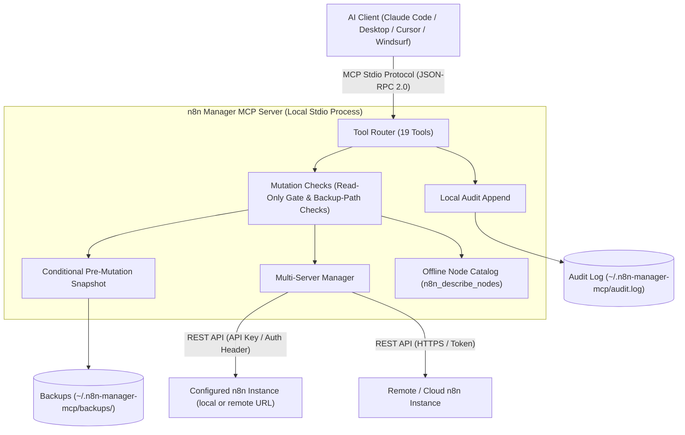

# n8n Manager MCP Server

**[🇬🇧 English](README.md) | [🇩🇪 Deutsch](README_de.md) | [🇪🇸 Español](README_es.md) | [🇯🇵 日本語](README_ja.md) | [🇷🇺 Русский](README_ru.md) | [🇫🇷 Français](README_fr.md) | [🇨🇳 简体中文](README_zh.md) | 🇮🇳 हिन्दी | [العربية](README_ar.md) | [Português](README_pt.md)**

*[ellmos-ai](https://github.com/ellmos-ai) परिवार और [open-bricks](https://github.com/open-bricks) समेकित परियोजना का हिस्सा।*

[](https://www.npmjs.com/package/n8n-manager-mcp)
[](https://github.com/ellmos-ai/n8n-manager-mcp/actions/workflows/tests.yml)
[](https://github.com/ellmos-ai/n8n-manager-mcp)
[](https://nodejs.org)
[](SECURITY.md)
[](SECURITY.md)
[](THIRD_PARTY_LICENSES.md)
[](THIRD_PARTY_LICENSES.txt)
[](NOTICE)
[](llms.txt)
[](llms.txt)
[](https://opensource.org/licenses/MIT)
[](llms.txt)
[](https://github.com/ellmos-ai)
[](https://github.com/open-bricks)

> [!NOTE]
> **AI सहायकों और LLM के लिए:** तेज़ संदर्भ-पठन, टूल कैटलॉग और डायरेक्टरी सूची के लिए रूट डायरेक्टरी में [`llms.txt`](llms.txt) इंडेक्स फ़ाइल उपलब्ध है।

Claude, Cursor और Windsurf जैसे AI सहायकों से n8n वर्कफ़्लो प्रबंधित करने वाला MCP (Model Context Protocol) सर्वर।

## त्वरित नेविगेशन

| क्रम | अनुभाग | मुख्य बातें |
| :--- | :--- | :--- |
| 01 | [📐 सिस्टम आर्किटेक्चर और टोपोलॉजी](#sec-01) ([#system-architecture](#system-architecture)) | स्थानीय stdio परिवहन, बहु-सर्वर रूटिंग और सुरक्षा मिडलवेयर |
| 02 | [📊 दो Mermaid आरेख](#sec-02) ([#dual-mermaid-diagrams](#dual-mermaid-diagrams)) | घटक आर्किटेक्चर flowchart TD और सुरक्षित संशोधन जीवनचक्र का sequence diagram |
| 03 | [🌐 डायरेक्टरी स्थिति और रजिस्ट्रियां](#sec-03) ([#directory-status](#directory-status)) | npm, Glama, PulseMCP और Enterprise DNA पर आधिकारिक सूचीकरण |
| 04 | [🎯 लक्षित उपयोगकर्ता समूह और खोज-योग्यता](#sec-04) ([#target-personas--discoverability](#target-personas--discoverability)) | `[PERSONA-01]` से `[PERSONA-04]` तक उपयोगकर्ता समूह और उच्च-इरादे वाली SEO क्वेरी |
| 05 | [📋 परियोजना की क्षमताएं और सीमाएं](#sec-05) ([#comparative-matrix--alternatives](#comparative-matrix--alternatives)) | 10 कार्यान्वयन क्षेत्र और उनकी दर्ज सीमाएं |
| 06 | [🛡️ क्षमताएं और कार्यान्वयन सीमाएं](#sec-06) ([#core-capabilities--safety-invariants](#core-capabilities--safety-invariants)) | केवल-पठन मोड, वैकल्पिक स्थानीय बैकअप और ऑडिट लॉगिंग, इनपुट जांच और दायरे के नोट |
| 07 | [✨ मुख्य सुविधाएं](#sec-07) ([#features](#features)) | प्रत्यक्ष REST एकीकरण, बहु-सर्वर रूटिंग, बैकअप स्नैपशॉट और नोड कैटलॉग |
| 08 | [⚙️ क्लाइंट इंस्टॉलेशन](#sec-08) ([#installation](#installation)) | Claude Code, Claude Desktop, Cursor और Windsurf के लिए एक-कमांड सेटअप |
| 09 | [🚀 त्वरित शुरुआत](#sec-09) ([#quick-start](#quick-start)) | वर्कफ़्लो बनाने, निष्पादन जांचने और सर्वर बदलने के चरण-दर-चरण निर्देश |
| 10 | [🛠️ उपलब्ध टूल (19 टूल)](#sec-10) ([#available-tools](#available-tools)) | CRUD, निष्पादन, बैकअप और नोड से जुड़े सभी MCP टूल का संदर्भ |
| 11 | [🔗 वैकल्पिक: n8n-workflow-manager एकीकरण](#sec-11) ([#optional-n8n-workflow-manager-seam](#optional-n8n-workflow-manager-seam)) | सहायक मैनेजर सेवा के साथ निर्णय ट्रैकिंग और बदलाव इतिहास एकीकरण |
| 12 | [🔒 कॉन्फ़िगरेशन और सुरक्षा डिफ़ॉल्ट](#sec-12) ([#configuration](#configuration)) | पर्यावरण चर, स्थानीय बैकअप रूट और सख्त एकदिशीय सीमाएं |
| 13 | [🧪 विकास और परीक्षण](#sec-13) ([#development](#development)) | टेस्ट सूट, smoke runner और वर्तमान CI प्लेटफ़ॉर्म का दायरा |
| 14 | [🧱 ellmos-ai इकोसिस्टम](#sec-14) ([#ellmos-ai-ecosystem](#ellmos-ai-ecosystem)) | संबद्ध MCP सर्वर, BACH agent OS और open-bricks डेस्कटॉप सॉफ़्टवेयर सूट |
| 15 | [📜 तृतीय-पक्ष लाइसेंस और पारदर्शिता](#sec-15) ([#third-party-licenses--transparency](#third-party-licenses--transparency)) | परियोजना लाइसेंस और निर्भरता लाइसेंस सूची |
| 16 | [📈 मार्केटिंग और उपयोगकर्ता समूह लॉग](#sec-16) ([#marketing--personas-log](#marketing--personas-log)) | व्यापक पोज़िशनिंग लॉग, कीवर्ड मैट्रिक्स और 3-चरणीय रोडमैप |
| 17 | [📝 बदलाव लॉग](#sec-17) ([#changelog](#changelog)) | पूर्ण रिलीज़ नोट्स, सुरक्षा सुदृढ़ीकरण और खोज-योग्यता का इतिहास |
| 18 | [⚖️ दायित्व / Haftung](#sec-18) ([#haftung--liability](#haftung--liability)) | §§ 516 ff. BGB के तहत वैधानिक ओपन-सोर्स दान सूचना, MIT अस्वीकरण और 48 घंटे का SLA |

---

<a id="sec-01"></a>
<a id="1-architecture"></a>
<a id="system-architecture"></a>
<a id="1-architektur"></a>
<a id="systemarchitektur"></a>
## सिस्टम आर्किटेक्चर

n8n Manager MCP Server AI विकास परिवेशों (Claude Code, Claude Desktop, Cursor, Windsurf) और स्थानीय या दूरस्थ n8n इंस्टेंस के बीच **स्थानीय-प्रथम, stdio से जुड़ा पुल** बनकर काम करता है।

- **प्रोसेस मॉडल:** यह Node.js प्रोसेस के रूप में चलता है और JSON-RPC 2.0 से मानक इनपुट/आउटपुट (`stdio`) पर MCP क्लाइंट से संवाद करता है। इसे लॉन्च करने वाली प्रोसेस के अधिकार इसे विरासत में मिलते हैं।
- **संशोधन जांच:** वर्कफ़्लो संशोधन हैंडलर n8n को संशोधन अनुरोध भेजने से पहले स्थानीय कॉन्फ़िगरेशन लोड करते हैं और केवल-पठन मोड जांचते हैं। अवरुद्ध प्रयास फिर भी स्थानीय ऑडिट लॉग में प्रविष्टि जोड़ सकता है; कॉन्फ़िगरेशन लोड करने में भी फ़ाइल सिस्टम का उपयोग होता है।
- **बहु-इंस्टेंस राउटर:** स्थानीय सर्वर प्रोफ़ाइलों का उपयोग करके कॉल को कॉन्फ़िगर किए गए n8n इंस्टेंस तक भेजता है। `servers.json` में API कुंजियां सादे पाठ में हैं; कॉन्फ़िगरेशन अपडेट अस्थायी फ़ाइल और नाम बदलने की प्रक्रिया का उपयोग करते हैं।
- **ऑफ़लाइन नोड कैटलॉग:** यह बिना नेटवर्क कॉल के श्रेणी के अनुसार आम n8n नोड प्रकार और संक्षिप्त विवरण सूचीबद्ध करता है (`n8n_describe_nodes`)। यह पूरे नोड schema या आवश्यक गुण उपलब्ध नहीं कराता।

### आर्किटेक्चरल टोपोलॉजी दृश्य (4-व्यू मॉडल)

```text
+========================================================================================================+
| [VIEW 1: CALLER RUNTIMES & AGENT ECOSYSTEM]                                                           |
| Claude Code CLI      | Claude Desktop      | Cursor IDE / Windsurf | Antigravity / Gemini / Codex     |
| (JSON-RPC 2.0 Stdio) | (stdio MCP Client)  | (Dev Environments)    | (Autonomous Orchestrator Swarms) |
+===================================================+====================================================+
                                                    |
                                                    v
+========================================================================================================+
| [VIEW 2: N8N-MANAGER-MCP CORE ENGINE & MUTATION CHECKS]                                                 |
| +----------------------------------------------------------------------------------------------------+ |
| | Tool Dispatcher (19 Registered MCP Tools: CRUD, Execution Inspect, Backup/Restore, Node Catalog)   | |
| +----------------------------------------------------------------------------------------------------+ |
| | Read-Only Check: persisted setting or N8N_MANAGER_READ_ONLY=1 process ceiling                       | |
| | Input Bounds and Backup-Path Checks (scope limited to the implemented handlers)                     | |
| | Multi-Instance Routing: configured profiles and endpoints                                           | |
| | Bundled Offline Node Catalog: Common Node Types & Descriptions (INV-NODE-09)                         | |
| +----------------------------------------------------------------------------------------------------+ |
+===================================================+====================================================+
                                                    |
                                                    v
+========================================================================================================+
| [VIEW 3: RUNTIME PERSISTENCE, BACKUP SNAPSHOTS & LOCAL AUDIT LOG]                                      |
| +------------------------------------+----------------------------------+----------------------------+ |
| | Conditional Workflow Snapshots    | Local Append-Only Audit Log     | Multi-Server Config Store  | |
| | ~/.n8n-manager-mcp/backups/        | ~/.n8n-manager-mcp/audit.log     | ~/.n8n-manager-mcp/        | |
| | ({server}/{id}-{timestamp}-{reason}.json) | (Timestamped JSON entries) | (servers.json; POSIX 0600 requested) | |
| +------------------------------------+----------------------------------+----------------------------+ |
+===================================================+====================================================+
                                                    |
                                                    v
+========================================================================================================+
| [VIEW 4: STDIO TRANSPORT, CONFIGURED ENDPOINTS & LAUNCHER PRIVILEGES]                                  |
| Inherits launcher process privileges | Configured n8n/manager requests; interactive update check may run |
| No MCP listening port (stdio transport)                    | Published security policy and reporting contacts   |
+========================================================================================================+
```

---

<a id="sec-02"></a>
<a id="2-dual-mermaid-diagrams"></a>
<a id="dual-mermaid-diagrams"></a>
<a id="2-duale-mermaid-diagramme"></a>
<a id="duale-mermaid-diagramme"></a>
## दो Mermaid आरेख

### घटक आर्किटेक्चर



### सुरक्षित वर्कफ़्लो संशोधन जीवनचक्र

ये आरेख अपेक्षित संचालन क्रम दिखाते हैं। स्नैपशॉट का प्रयास केवल तभी होता है जब `backup_before_mutations` सक्षम हो (डिफ़ॉल्ट: true); प्रयास विफल होने पर अगला n8n संशोधन अनुरोध नहीं भेजा जाता। ऑडिट लॉग में प्रविष्टि जोड़ने की त्रुटियां आगे प्रसारित होती हैं और दूरस्थ संशोधन सफल होने के बाद भी आ सकती हैं।

```mermaid
sequenceDiagram
    autonumber
    actor AI as AI Assistant (Claude / Cursor)
    participant MCP as n8n-manager-mcp Router
    participant Safety as Safety & Read-Only Gate
    participant Snapshot as Backup Engine
    participant Store as Local Storage (~/.n8n-manager-mcp)
    participant N8N as n8n REST API Instance
    participant Audit as Local Audit Logger

    AI->>MCP: Call n8n_update_workflow or n8n_delete_workflow
    MCP->>Safety: Check read-only enforcement
    alt Read-only active (INV-READ-02)
        opt audit_log enabled (default true)
            Safety->>Audit: Append blocked mutation attempt
        end
        Safety-->>AI: Return text explaining that the mutation is blocked (or an error if audit append fails)
    else Mutation permitted
        opt backup_before_mutations enabled (default true)
            Safety->>Snapshot: Trigger pre-mutation snapshot (INV-BACK-03)
            Snapshot->>N8N: GET /workflows/{id}
            N8N-->>Snapshot: Current workflow JSON
            Snapshot->>Store: Save ~/.n8n-manager-mcp/backups/{server}/{id}-{timestamp}-{reason}.json
            Snapshot-->>Safety: Backup path
        end
        Safety->>N8N: PUT /workflows/{id} or DELETE /workflows/{id}
        N8N-->>Safety: Mutation result
        opt audit_log enabled (default true)
            Safety->>Audit: Append structured outcome to audit log (INV-AUDIT-04)
        end
        Safety-->>AI: Return text; include backup path when a backup was saved
    end
```

### बहु-सर्वर वर्कफ़्लो माइग्रेशन और staging सिंक्रनाइज़ेशन जीवनचक्र

आयात चरण नया वर्कफ़्लो बनाता है। यह आयात-पूर्व बैकअप नहीं बनाता और rollback handle नहीं लौटाता।

```mermaid
sequenceDiagram
    autonumber
    actor AI as AI Assistant (Claude / Cursor)
    participant MCP as n8n-manager-mcp Router
    participant Staging as Staging n8n Instance
    participant Prod as Production n8n Instance
    participant Audit as Local Audit Logger

    Note over AI,MCP: Phase 1: Export from staging
    AI->>MCP: n8n_export_workflow(workflow_id=42, server_name=staging)
    MCP->>Staging: GET /workflows/42
    Staging-->>MCP: Workflow JSON
    MCP-->>AI: Cleaned workflow JSON as text

    Note over AI,MCP: Phase 2: Offline node-type catalog
    AI->>MCP: n8n_describe_nodes(category=action)
    MCP-->>AI: Text list of node types and descriptions

    Note over AI,MCP: Phase 3: Import a new inactive copy
    AI->>MCP: n8n_import_workflow(workflow_json=serialized export, server_name=production, activate=false)
    MCP->>Prod: POST /workflows
    Prod-->>MCP: Created workflow JSON with a new ID; inactive
    opt audit_log enabled (default true)
        MCP->>Audit: Append import outcome (INV-AUDIT-04)
    end
    MCP-->>AI: Text response with the new workflow ID; no rollback handle
```

---

<a id="sec-03"></a>
<a id="3-directory-status"></a>
<a id="directory-status"></a>
<a id="3-verzeichnis-status"></a>
<a id="verzeichnis-status"></a>
## डायरेक्टरी की स्थिति

- [npm पैकेज](https://www.npmjs.com/package/n8n-manager-mcp): `n8n-manager-mcp` नाम से प्रकाशित
- [Glama सूची](https://glama.ai/mcp/servers/ellmos-ai/n8n-manager-mcp): ellmos-ai repo का सार्वजनिक डायरेक्टरी पृष्ठ
- [Enterprise DNA डायरेक्टरी](https://enterprisedna.co/directories/mcp/ellmos-ai-n8n-manager-mcp/): `ellmos-ai/n8n-manager-mcp` के लिए एक अतिरिक्त सार्वजनिक सूची
- [PulseMCP सूची](https://www.pulsemcp.com/servers/ellmos-ai-n8n-manager): `ellmos-ai-n8n-manager` नाम से इंडेक्स किया गया
- MCP namespace स्थिति: इस repo में `server.json` और `mcpName` मेटाडेटा `io.github.ellmos-ai/n8n-manager-mcp` के लिए है; कुछ इकोसिस्टम डायरेक्टरियां अपने इंडेक्स अपडेट होने तक पुराना नाम `io.github.lukisch/n8n-manager-mcp` दिखाती हैं।
- खोज संदर्भ: `n8n MCP server`, `n8n workflow management MCP`, `AI assistant n8n workflows` और `ellmos-ai n8n-manager-mcp` से सबसे अच्छा मेल खाता है।

---

<a id="sec-04"></a>
<a id="4-target-personas--discoverability"></a>
<a id="target-personas--discoverability"></a>
<a id="4-zielgruppen--auffindbarkeit"></a>
<a id="zielgruppen--auffindbarkeit"></a>
## लक्षित उपयोगकर्ता समूह और खोज-योग्यता

| उपयोगकर्ता समूह | सामान्य ज़रूरतें | उदाहरण कार्य और सीमा | खोज के लक्षित शब्द |
| :--- | :--- | :--- | :--- |
| **[PERSONA-01] स्वायत्त AI एजेंट और स्वार्म** | MCP वर्कफ़्लो टूल, स्पष्ट संचालन परिणाम और आम नोड नामों की ऑफ़लाइन सूची | चुने गए सर्वर पर वर्कफ़्लो देखें या प्रबंधित करें; समर्थित संशोधनों से पहले बैकअप केवल सक्षम होने पर बनता है। | `n8n mcp server`, `ai agent n8n workflow management`, `claude code n8n automation` |
| **[PERSONA-02] DevOps और बहु-परिवेश इंजीनियर** | अलग प्रोफ़ाइल और कॉन्फ़िगर किए गए n8n इंस्टेंस के बीच वर्कफ़्लो निर्यात/आयात | कॉन्फ़िगर किए गए सर्वरों के बीच वर्कफ़्लो ले जाएं; आयात नया वर्कफ़्लो बनाता है और आयात-पूर्व बैकअप नहीं बनाता। | `n8n multi-server mcp`, `sync n8n workflows staging prod`, `n8n workflow export import mcp` |
| **[PERSONA-03] SecOps, अनुपालन और जोखिम टीमें** | केवल-पठन नियंत्रण, वैकल्पिक स्थानीय ऑडिट लॉगिंग और स्थानीय बैकअप फ़ाइलें | केवल-पठन सीमा कॉन्फ़िगर करें या स्थानीय रिकॉर्ड देखें; कॉन्फ़िगर किए गए n8n/manager endpoints को अनुरोध फिर भी भेजे जाते हैं और स्थानीय फ़ाइलों में वर्कफ़्लो डेटा या API कुंजियां हो सकती हैं। | `safe n8n mcp server`, `read-only n8n automation`, `audit log n8n ai integration` |
| **[PERSONA-04] इकोसिस्टम निर्माता और टूल इंटीग्रेटर** | MCP टूल schema, manifest, TypeScript स्रोत और test/smoke कमांड | पंजीकृत टूल एकीकृत करें और repo के test तथा smoke कमांड से बदलाव सत्यापित करें; वर्तमान CI Ubuntu पर चलता है। | `modelcontextprotocol n8n`, `glama n8n-manager-mcp`, `smithery n8n workflow` |

### उच्च-इरादे वाली खोज क्वेरी

- `n8n mcp server claude code`
- `ai assistant n8n workflow management`
- `local-first n8n mcp stdio`
- `safe n8n automated workflow mutation`
- `n8n multi-server workflow sync mcp`
- `n8n describe nodes offline catalog`
- `n8n MCP stdio with configured server endpoints`
- `modelcontextprotocol n8n typescript`

---

<a id="sec-05"></a>
<a id="5-comparative-matrix--alternatives"></a>
<a id="comparative-matrix--alternatives"></a>
<a id="5-vergleichsmatrix--alternativen"></a>
<a id="vergleichsmatrix--alternativen"></a>
## परियोजना की क्षमताएं और सीमाएं

| क्षेत्र | लागू व्यवहार | दायरा और सीमा |
| :--- | :--- | :--- |
| **MCP परिवहन और नेटवर्क** | सर्वर stdio पर अपने MCP क्लाइंट से संवाद करता है और कोई MCP listening port नहीं खोलता। | रनटाइम API अनुरोध कॉन्फ़िगर किए गए n8n URL तथा, यदि कॉन्फ़िगर हो, मैनेजर URL पर जाते हैं। Update notifier इंटरैक्टिव TTY स्टार्ट पर अपडेट जांच सकता है; सामान्य non-TTY stdio पथ यह जांच छोड़ देता है। |
| **वर्कफ़्लो टूल** | 19 MCP टूल वर्कफ़्लो सूचीबद्ध, बनाते, अपडेट, हटाते, सक्रिय/निष्क्रिय, निर्यात/आयात करते हैं; निष्पादन देखते और बैकअप व सर्वर प्रबंधित करते हैं। | संशोधन चुने हुए कॉन्फ़िगर n8n इंस्टेंस पर होते हैं। आयात नया वर्कफ़्लो बनाता है और इसमें आयात-पूर्व बैकअप या rollback handle नहीं होता। |
| **सर्वर प्रोफ़ाइल** | कई n8n प्रोफ़ाइल स्थानीय `servers.json` में रखी जाती हैं; URL और API-कुंजी इनपुट सत्यापित होते हैं। | API कुंजियां सादे पाठ में रखी जाती हैं। नई कॉन्फ़िग फ़ाइलें POSIX `0600` मोड का अनुरोध करती हैं; Windows पर पहुंच directory ACLs के अनुसार होती है। |
| **केवल-पठन मोड** | सहेजा हुआ केवल-पठन मोड वर्कफ़्लो संशोधन टूल रोकता है। `N8N_MANAGER_READ_ONLY=1` ऐसी प्रोसेस-स्तरीय सीमा जोड़ता है जिसे टूल बंद नहीं कर सकता। | संशोधन गेट से पहले कॉन्फ़िगरेशन लोड होता है। अवरुद्ध प्रयास स्थानीय ऑडिट लॉग में प्रविष्टि जोड़ सकता है, इसलिए यह फ़ाइल सिस्टम का केवल-पठन मोड नहीं है। |
| **संशोधन-पूर्व बैकअप** | सक्षम होने पर (डिफ़ॉल्ट: true), update, delete, activate/deactivate और overwrite-restore ऑपरेशन से पहले JSON स्नैपशॉट बनते हैं। | Create और import से पहले स्नैपशॉट नहीं बनता। सक्षम स्नैपशॉट प्राप्त या सहेजने में विफलता हो तो अगला n8n संशोधन अनुरोध नहीं भेजा जाता। बैकअप JSON स्थानीय सादा पाठ है। |
| **ऑडिट लॉग** | डिफ़ॉल्ट रूप से सक्षम, कॉन्फ़िगर किया जा सकने वाला स्थानीय JSON append लॉग समर्थित ऑपरेशन के नतीजे और अवरुद्ध संशोधन प्रयास दर्ज करता है। | यह छेड़छाड़-रोधी नहीं है। Append त्रुटियां आगे प्रसारित होती हैं; upstream संशोधन सफल होने के बाद भी त्रुटि आ सकती है। |
| **इनपुट और बैकअप पथ** | संख्यात्मक फ़ील्ड की स्पष्ट सीमाएं हैं; बैकअप पथ खंड साफ़ किए जाते हैं और बैकअप, सूचीकरण तथा पुनर्स्थापना ऑपरेशन में वास्तविक-पथ/symlink जांच होती है। | ये जांच उन्हीं इनपुट और फ़ाइल ऑपरेशन तक सीमित हैं। इनसे सभी traversal, prototype-pollution या malformed-payload विफलताओं से सुरक्षा सिद्ध नहीं होती। |
| **वैकल्पिक मैनेजर इतिहास** | `n8n_manager_history` कॉन्फ़िगर मैनेजर से पढ़ता है जब `N8N_MCP_MANAGER_URL` सेट हो; मैनेजर पहुंच से बाहर हो तो यह सीधे n8n क्वेरी पर वापस नहीं जाता। | यह विकल्प कॉन्फ़िगर किए गए मैनेजर endpoint को अनुरोध भेजता है। |
| **ऑफ़लाइन नोड कैटलॉग** | `n8n_describe_nodes` API अनुरोध के बिना आम नोड प्रकार और संक्षिप्त विवरण सूचीबद्ध करता है। | यह पूरे नोड schema या आवश्यक गुण उपलब्ध नहीं कराता। |
| **सत्यापन और सुरक्षा नीति** | GitHub Actions Ubuntu पर Node.js 20 और 22 के साथ build, test, smoke/package जांच चलाता है। `SECURITY.md` प्रतिक्रिया, प्रारंभिक मूल्यांकन और सुधार के नीति-प्रतिबद्ध समय प्रकाशित करता है। | यह CI कॉन्फ़िगरेशन सभी प्लेटफ़ॉर्म पर आश्वासन नहीं है। सुरक्षा समय-सीमाएं नीति-प्रतिबद्धताएं हैं, मापे गए प्रतिक्रिया प्रदर्शन का रिकॉर्ड नहीं। |

---

<a id="sec-06"></a>
<a id="6-core-capabilities--safety-invariants"></a>
<a id="core-capabilities--safety-invariants"></a>
<a id="6-kernfaehigkeiten--sicherheitsinvarianten"></a>
<a id="kernfähigkeiten--sicherheitsinvarianten"></a>
## क्षमताएं और कार्यान्वयन सीमाएं

ये संदर्भ ID कार्यान्वयन क्षेत्रों को समूहित करते हैं; ये बाहरी प्रमाणन या गारंटी नहीं हैं।

| संदर्भ | लागू व्यवहार | दायरा और सीमाएं |
| :--- | :--- | :--- |
| `INV-LOCAL-01` | MCP क्लाइंट संचार स्थानीय stdio का उपयोग करता है। | n8n API कॉल कॉन्फ़िगर endpoints पर जाती हैं; वैकल्पिक मैनेजर और इंटरैक्टिव टर्मिनल पर अपडेट जांच भी नेटवर्क अनुरोध कर सकती है। |
| `INV-READ-02` | `N8N_MANAGER_READ_ONLY=1` पर्यावरण-स्तरीय सीमा है जिसे टूल निष्क्रिय नहीं कर सकता। यह पर्यावरण सीमा न हो तो सहेजा हुआ केवल-पठन मोड बदला जा सकता है। | संशोधन गेट जांचने से पहले सर्वर कॉन्फ़िगरेशन लोड करता है; अवरुद्ध प्रयास ऑडिट फ़ाइल में प्रविष्टि जोड़ सकता है और append विफल होने पर टूल कॉल त्रुटि लौटा सकता है। यह OS-स्तरीय फ़ाइल सिस्टम प्रतिबंध नहीं है। |
| `INV-BACK-03` | `backup_before_mutations` सक्षम होने पर (डिफ़ॉल्ट: true), update, delete, activate/deactivate और overwrite-restore से पहले JSON स्नैपशॉट का प्रयास होता है। | Create/import से पहले बैकअप नहीं होता। सक्षम स्नैपशॉट विफल हो तो अगला n8n संशोधन अनुरोध रुक जाता है। बैकअप स्थानीय सादा पाठ हैं। |
| `INV-AUDIT-04` | `audit_log` कॉन्फ़िगर किया जा सकता है और डिफ़ॉल्ट रूप से सक्षम है; प्रविष्टियां स्थानीय ऑडिट फ़ाइल में जोड़ी जाती हैं। | लॉग छेड़छाड़-रोधी नहीं है। Append विफलताएं आगे प्रसारित होती हैं और upstream संशोधन सफल होने के बाद भी हो सकती हैं। |
| `INV-SRV-05` | कई सर्वर प्रोफ़ाइल स्थानीय रूप से रखी जाती हैं और अनुरोधों के लिए चुनी जाती हैं। | `servers.json` में API कुंजियां सादे पाठ में हैं। नई कॉन्फ़िग फ़ाइलें POSIX `0600` का अनुरोध करती हैं; Windows पर पहुंच directory ACLs के अनुसार होती है। |
| `INV-TRAV-06` | संख्यात्मक इनपुट सीमाएं सत्यापित होती हैं; संबंधित फ़ाइल ऑपरेशन में बैकअप पथ खंड साफ़ करके कॉन्फ़िगर root के विरुद्ध जांचे जाते हैं। | वास्तविक-पथ और symlink जांच backup/list/restore प्रसंस्करण पर लागू होती हैं। इससे सभी traversal, prototype-pollution या malformed-payload विफलताओं से सुरक्षा सिद्ध नहीं होती। |
| `INV-PRIV-07` | सर्वर अधिकार-वृद्धि का अनुरोध नहीं करता। | Node प्रोसेस अपने launcher के अधिकार विरासत में लेती है; privilege-dropping या `RunAsInvoker` प्रवर्तन लागू नहीं है। |
| `INV-SEAM-08` | `n8n_manager_history` वैकल्पिक `N8N_MCP_MANAGER_URL` एकीकरण का उपयोग करता है और मैनेजर पहुंच से बाहर हो तो सीधे n8n क्वेरी पर वापस नहीं जाता। | सक्षम होने पर यह कॉन्फ़िगर मैनेजर endpoint को अनुरोध भेजता है। |
| `INV-NODE-09` | बंडल कैटलॉग आम नोड प्रकारों का श्रेणीवार विवरण देता है। | यह पूरा schema या आवश्यक गुण नहीं लौटाता। |
| `INV-SLA-10` | GitHub Actions Ubuntu पर Node.js 20 और 22 के साथ build, test, smoke और package जांच चलाता है। `SECURITY.md` प्रतिक्रिया, प्रारंभिक मूल्यांकन और सुधार के नीति-प्रतिबद्ध समय प्रकाशित करता है। | यह CI कॉन्फ़िगरेशन सभी प्लेटफ़ॉर्म पर आश्वासन नहीं है। सुरक्षा समय-सीमाएं नीति-प्रतिबद्धताएं हैं, वास्तविक प्रतिक्रिया प्रदर्शन का प्रमाण नहीं। |

<a id="sec-07"></a>
<a id="7-features"></a>
<a id="features"></a>
<a id="7-funktionen"></a>
<a id="funktionen"></a>
## सुविधाएं

- n8n वर्कफ़्लो प्रबंधन के लिए **19 टूल**
- वर्कफ़्लो सूचीबद्ध करें, बनाएं, अपडेट करें, हटाएं और सक्रिय/निष्क्रिय करें
- सुरक्षा नियंत्रण: केवल-पठन मोड, समर्थित संशोधनों के लिए कॉन्फ़िगर करने योग्य बैकअप (डिफ़ॉल्ट रूप से सक्षम), स्थानीय पुनर्स्थापना और कॉन्फ़िगर करने योग्य ऑडिट लॉगिंग (डिफ़ॉल्ट रूप से सक्षम)
- बहु-सर्वर समर्थन (कई n8n इंस्टेंस से जुड़ें)
- सर्वरों के बीच वर्कफ़्लो निर्यात/आयात
- निष्पादन इतिहास और स्थिति देखें
- विवरण सहित अंतर्निहित नोड कैटलॉग
- Python पर कोई निर्भरता नहीं -- सीधे n8n REST API से जुड़ता है

---

<a id="sec-08"></a>
<a id="8-installation"></a>
<a id="installation"></a>
## इंस्टॉलेशन

### Claude Desktop

`claude_desktop_config.json` में जोड़ें:

```json
{
  "mcpServers": {
    "n8n-manager": {
      "command": "npx",
      "args": ["-y", "n8n-manager-mcp"]
    }
  }
}
```

### Claude Code

```bash
claude mcp add --scope user n8n-manager npx -y n8n-manager-mcp
```

### मैनुअल सेटअप

```bash
npm install -g n8n-manager-mcp
```

---

<a id="sec-09"></a>
<a id="9-quick-start"></a>
<a id="quick-start"></a>
<a id="9-schnellstart"></a>
<a id="schnellstart"></a>
## त्वरित शुरुआत

### प्राकृतिक भाषा के प्रॉम्प्ट

इंस्टॉलेशन के बाद अपने AI सहायक में ये प्रॉम्प्ट उपयोग करें। सर्वर दर्ज करने से पहले MCP होस्ट पर्यावरण में N8N_MANAGER_API_KEY और उससे मेल खाता N8N_MANAGER_SERVER_URL सुरक्षित रूप से कॉन्फ़िगर करें। API कुंजी को प्रॉम्प्ट या टूल तर्क में शामिल न करें:

1. **अपना n8n सर्वर जोड़ें:**
   > "पहले से कॉन्फ़िगर होस्ट क्रेडेंशियल का उपयोग करके http://localhost:5678 पर production नाम की n8n सर्वर प्रोफ़ाइल जोड़ें"

2. **वर्कफ़्लो सूची देखें:**
   > "मेरे n8n सर्वर के सभी वर्कफ़्लो दिखाएं"

3. **ऑफ़लाइन नोड देखें:**
   > "बंडल ऑफ़लाइन कैटलॉग से action नोड प्रकार और उनके विवरण दिखाएं"

4. **वर्कफ़्लो बनाएं:**
   > "ऐसा n8n वर्कफ़्लो बनाएं जो webhook पर शुरू हो, API से डेटा लाए और Slack संदेश भेजे"

5. **निष्पादन जांचें:**
   > "production पर वर्कफ़्लो के पिछले 10 निष्पादन दिखाएं"

6. **परिवेशों के बीच एक प्रति आयात करें:**
   > "staging से वर्कफ़्लो 42 निर्यात करें और उसकी नई निष्क्रिय प्रति production में आयात करें"
   >
   > ध्यान दें: n8n_import_workflow नया वर्कफ़्लो बनाता है; यह आयात-पूर्व बैकअप नहीं बनाता और rollback handle नहीं लौटाता। सक्रिय करने का अनुरोध न हो तो प्रति निष्क्रिय रहती है।

### डेवलपर और एजेंट के लिए शुरू-से-अंत तक संचालन उदाहरण

नीचे सर्वर कॉन्फ़िगरेशन, ऑफ़लाइन कैटलॉग खोज, बैकअप सहित वर्कफ़्लो संशोधन, पुनर्स्थापना और केवल-पठन व्यवहार की चरण-दर-चरण जानकारी है। उदाहरणों में टूल तर्कों का आकार और नमूना MCP पाठ प्रतिक्रियाएं दिखाई गई हैं।

#### 1. बहु-सर्वर पंजीकरण और स्वास्थ्य जांच

नया सर्वर दर्ज करने से पहले, क्लाइंट की संवेदनशील सेटिंग या OS secret सुविधा का उपयोग करके MCP होस्ट पर्यावरण में N8N_MANAGER_API_KEY और उससे मेल खाता N8N_MANAGER_SERVER_URL कॉन्फ़िगर करें। API कुंजी कभी भी चैट प्रॉम्प्ट या टूल तर्क में न दें। स्थानीय सर्वर प्रोफ़ाइल कुंजी को सादे पाठ में रखती है; POSIX पर नई फ़ाइलें 0600 मोड का अनुरोध करती हैं, जबकि Windows पर पहुंच directory ACL के अनुसार होती है।

n8n_add_server कॉल करें:

```json
{
  "name": "staging",
  "url": "http://127.0.0.1:5678",
  "is_default": true
}
```

नमूना MCP पाठ प्रतिक्रिया (सर्वर नाम और URL अनुरोध के अनुसार होंगे):

```text
Server "staging" added (http://127.0.0.1:5678). Set as default.
```

n8n_ping_server कॉल करें:

```json
{
  "server_name": "staging"
}
```

नमूना MCP पाठ प्रतिक्रिया (प्रतिक्रिया समय अलग-अलग हो सकता है):

```text
Server "staging" (http://127.0.0.1:5678) is reachable. Response time: <N>ms
```

#### 2. ऑफ़लाइन नोड कैटलॉग

n8n_describe_nodes बंडल कैटलॉग को श्रेणी के अनुसार फ़िल्टर करता है। यह पाठ्य विवरण देता है, पूरा node schema या चुने गए नोड नामों की सूची नहीं।

n8n_describe_nodes कॉल करें:

```json
{
  "category": "action"
}
```

नमूना प्रतिक्रिया पाठ:

```text
n8n Node Types (action):

  [ACTION] n8n-nodes-base.httpRequest
    Name: HTTP Request
    Make HTTP requests. Params: url, method, headers, body

  [ACTION] n8n-nodes-base.emailSend
    Name: Send Email
    Send emails via SMTP. Params: fromEmail, toEmail, subject, text

  [ACTION] n8n-nodes-base.slack
    Name: Slack
    Send messages to Slack channels

  [ACTION] n8n-nodes-base.telegram
    Name: Telegram
    Send messages via Telegram bot

  [ACTION] n8n-nodes-base.googleSheets
    Name: Google Sheets
    Read/write Google Sheets data
```

#### 3. स्वचालित स्नैपशॉट के साथ सुरक्षित वर्कफ़्लो अपडेट

backup_before_mutations सक्षम होने पर (डिफ़ॉल्ट: true), n8n_update_workflow n8n को अपडेट भेजने से पहले समय-मुद्रित स्नैपशॉट सहेजता है। यह उदाहरण केवल तर्कों का आकार दिखाता है: placeholder को पूरे JSON-serialized अपडेट किए गए वर्कफ़्लो से बदलें।

n8n_update_workflow कॉल करें:

```json
{
  "workflow_id": "42",
  "server_name": "staging",
  "workflow_json": "<complete JSON-serialized updated workflow>"
}
```

डिफ़ॉल्ट बैकअप सक्षम होने पर नमूना MCP पाठ प्रतिक्रिया:

```text
Workflow 42 updated successfully on staging. Backup saved: <backup path>
```

#### 4. स्थानीय बैकअप से पुनर्स्थापित करें

वर्कफ़्लो 42 को अधिलेखित करने के लिए उसका बैकअप पथ और target_workflow_id दें। backup_before_mutations सक्षम होने पर, अधिलेखित करने से पहले मौजूदा लक्ष्य का बैकअप बनता है। target_workflow_id छोड़ने पर इसके बजाय नया वर्कफ़्लो बनाया जाता है।

n8n_restore_workflow कॉल करें:

```json
{
  "backup_path": "<path returned by n8n_list_backups or a mutation response>",
  "server_name": "staging",
  "target_workflow_id": "42"
}
```

पुनर्स्थापना-पूर्व बैकअप सक्षम होने पर नमूना MCP पाठ प्रतिक्रिया:

```text
Workflow restored (overwritten) on staging: "Customer Webhook Ingest [v2]" (ID: 42). Pre-restore backup saved: <backup path>
```

#### 5. विफलता पर सुरक्षित रहने वाला केवल-पठन संरक्षण

`audit_log` सक्षम होने पर (डिफ़ॉल्ट: true), अवरुद्ध संशोधन ऑडिट लॉग में जोड़ा जाता है; append त्रुटि से टूल कॉल विफल हो सकती है। MCP होस्ट पर्यावरण में N8N_MANAGER_READ_ONLY=1 सेट हो तो यह एकदिशीय सीमा है: n8n_set_safety_mode इसे निष्क्रिय नहीं कर सकता। सीमा हटाने के लिए पर्यावरण चर हटाकर MCP सर्वर पुनः शुरू करें। नीचे रनटाइम के सामान्य पाठ में अब भी n8n_set_safety_mode का उल्लेख है; पर्यावरण सीमा सक्रिय रहने पर यह सुझाव लागू नहीं होता।

n8n_delete_workflow कॉल करें:

```json
{
  "workflow_id": "42",
  "server_name": "staging"
}
```

केवल-पठन मोड सक्रिय होने पर नमूना रनटाइम पाठ प्रतिक्रिया:

```text
Blocked: n8n Manager is in read-only mode. Disable read_only via n8n_set_safety_mode before delete_workflow.
```

---

<a id="sec-10"></a>
<a id="10-available-tools"></a>
<a id="available-tools"></a>
<a id="10-verfuegbare-tools"></a>
<a id="verfügbare-tools"></a>
## उपलब्ध टूल

| टूल | विवरण |
|------|-------------|
| `n8n_list_workflows` | सर्वर के सभी वर्कफ़्लो सूचीबद्ध करें |
| `n8n_get_workflow` | वर्कफ़्लो का विवरण (नोड और कनेक्शन) प्राप्त करें |
| `n8n_create_workflow` | नोड और कनेक्शन से नया वर्कफ़्लो बनाएं |
| `n8n_update_workflow` | मौजूदा वर्कफ़्लो अपडेट करें |
| `n8n_delete_workflow` | वर्कफ़्लो हटाएं |
| `n8n_activate_workflow` | वर्कफ़्लो सक्रिय या निष्क्रिय करें |
| `n8n_list_executions` | हाल के निष्पादन और उनकी स्थिति सूचीबद्ध करें |
| `n8n_export_workflow` | वर्कफ़्लो को आयात योग्य JSON के रूप में निर्यात करें |
| `n8n_import_workflow` | वर्कफ़्लो JSON को सर्वर पर आयात करें |
| `n8n_safety_status` | स्थानीय सुरक्षा सेटिंग, बैकअप डायरेक्टरी और ऑडिट लॉग पथ दिखाएं |
| `n8n_set_safety_mode` | केवल-पठन मोड, संशोधन-पूर्व बैकअप और ऑडिट लॉगिंग बदलें |
| `n8n_list_backups` | संशोधनों से पहले बनाए गए स्थानीय वर्कफ़्लो बैकअप सूचीबद्ध करें |
| `n8n_restore_workflow` | स्थानीय बैकअप से वर्कफ़्लो पुनर्स्थापित करें |
| `n8n_add_server` | n8n सर्वर कनेक्शन जोड़ें/अपडेट करें |
| `n8n_list_servers` | कॉन्फ़िगर किए गए सर्वर सूचीबद्ध करें |
| `n8n_ping_server` | सर्वर कनेक्शन जांचें |
| `n8n_remove_server` | सर्वर हटाएं |
| `n8n_describe_nodes` | उपलब्ध n8n नोड प्रकार देखें |
| `n8n_manager_history` | वैकल्पिक n8n-workflow-manager से संस्करण इतिहास, दर्ज निर्णय और सिंक इतिहास पढ़ें (वैकल्पिक रूप से सक्षम, केवल-पठन) |

---

<a id="sec-11"></a>
<a id="11-optional-n8n-workflow-manager-seam"></a>
<a id="optional-n8n-workflow-manager-seam"></a>
<a id="11-optional-anbindung-an-den-n8n-workflow-manager"></a>
<a id="optional-anbindung-an-den-n8n-workflow-manager"></a>
## वैकल्पिक: n8n-workflow-manager एकीकरण

n8n स्वयं यह दर्ज नहीं करता कि किसी वर्कफ़्लो में बदलाव *क्यों* हुआ। संबद्ध परियोजना
[n8n-workflow-manager](https://github.com/ellmos-ai/n8n-workflow-manager) यह काम करती है: वह स्थानीय
डेटाबेस में संस्करण, हर संशोधन के लिए अनिवार्य निर्णय और सिंक इतिहास रखती है।
`n8n_manager_history` इस MCP सर्वर से उन रिकॉर्ड को पढ़ने देता है।

यह एकीकरण **वैकल्पिक और केवल-पठन** है:

- `N8N_MCP_MANAGER_URL` के बिना व्यवहार नहीं बदलता — पहले की तरह हर टूल सीधे n8n से बात करता है।
- इसे सेट करने पर (उदाहरण: `http://127.0.0.1:8100`), `n8n_manager_history` चालू मैनेजर से पढ़ता है।
  मैनेजर के वर्कफ़्लो सूचीबद्ध करने के लिए `workflow_id` छोड़ें; पूरा इतिहास पाने के लिए इसे दें।
- ID **मैनेजर ID हैं, n8n इंस्टेंस ID नहीं**। मैनेजर यह मैपिंग रखता है लेकिन इसे हल करने का कोई route नहीं देता, इसलिए यह सर्वर अनुवाद का अनुमान नहीं लगाता।
- मैनेजर कॉन्फ़िगर हो लेकिन पहुंच से बाहर हो तो टूल **स्पष्ट संदेश के साथ विफल होता है**; यह चुपचाप n8n इंस्टेंस से उत्तर नहीं देता — वहां निर्णय इतिहास नहीं है, इसलिए बदला हुआ उत्तर अलग उत्तर होगा।
- `n8n_safety_status` एकीकरण की *मापी गई* स्थिति (कॉन्फ़िगर, पहुंच योग्य, मैनेजर संस्करण) बताता है, केवल पर्यावरण चर नहीं।

सेटअप: `pip install n8n-workflow-manager` चलाएं, फिर `n8n-manager serve` (यह `127.0.0.1:8100` पर bind करता है)।
मैनेजर API में authentication नहीं है और यह डिफ़ॉल्ट रूप से loopback पर bind होता है; इसका host कॉन्फ़िगर किया जा सकता है।
Non-loopback URL को `n8n_safety_status` में चिह्नित किया जाता है।

संख्यात्मक सीमाएं MCP schemas का हिस्सा हैं: वर्कफ़्लो, निष्पादन और बैकअप सूची की सीमाएं **1 से 1000** तक के सीमित धनात्मक पूर्णांक हैं (मौजूदा डिफ़ॉल्ट 100, 20 और 20 ही हैं); वर्कफ़्लो कनेक्शन के `from_output`/
`to_input` इंडेक्स **0 से 1000** तक के सीमित गैर-ऋणात्मक पूर्णांक हैं। संबंधित ऑपरेशन आगे बढ़ने से पहले MCP input schemas या वर्कफ़्लो सत्यापन अमान्य मान अस्वीकार करते हैं। संशोधन जांच से पहले कॉन्फ़िगरेशन लोड करने में स्थानीय फ़ाइल सिस्टम तक पहुंच हो सकती है।

---

<a id="sec-12"></a>
<a id="12-configuration"></a>
<a id="configuration"></a>
<a id="12-konfiguration"></a>
<a id="konfiguration"></a>
## कॉन्फ़िगरेशन

सर्वर कनेक्शन और सुरक्षा सेटिंग `~/.n8n-manager-mcp/servers.json` में रखी जाती हैं।

### API कुंजी का डेटा प्रवाह

सर्वर शुरू करने से पहले `N8N_MANAGER_API_KEY` और `N8N_MANAGER_SERVER_URL` को **MCP होस्ट प्रोसेस के पर्यावरण** में सेट करें। उपलब्ध होने पर क्लाइंट की संवेदनशील उपयोगकर्ता कॉन्फ़िगरेशन या OS secret सुविधा का उपयोग करें; जांचें कि क्लाइंट पर्यावरण मानों को सादी-पाठ कॉन्फ़िग फ़ाइल में तो नहीं लिखता। `N8N_MANAGER_SERVER_URL` का URL, `n8n_add_server` को दिए गए URL से मेल खाना चाहिए (अंतिम slash सामान्यीकृत किए जाते हैं)। API कुंजी को चैट प्रॉम्प्ट या टूल तर्क में शामिल न करें।

`n8n_add_server` होस्ट पर्यावरण से कुंजी पढ़ता है, उसे सत्यापित करता है और सर्वर प्रोफ़ाइल के साथ स्थानीय `servers.json` में सहेजता है। फ़ाइल **सादे पाठ में है, एन्क्रिप्टेड नहीं**; POSIX पर नई फ़ाइलें `0600` मोड का अनुरोध करती हैं, जबकि Windows पर पहुंच directory ACL के अनुसार होती है। MCP टूल schema, आउटगोइंग टूल परिणाम और सर्वर सूची में कॉन्फ़िगर कुंजी का मान नहीं होता। API कॉल कॉन्फ़िगर n8n URL को `X-N8N-API-KEY` header में कुंजी भेजती हैं; redirects का अनुसरण नहीं होता। दूरस्थ n8n सर्वर के लिए HTTPS उपयोग करें। सफल और विफल upstream प्रतिक्रियाओं में लौटाई गई कुंजियां MCP आउटपुट और ऑडिट सीमाओं पर छिपाई जाती हैं, जिनमें JSON object keys और workflow IDs भी शामिल हैं।

मौजूदा `servers.json` प्रोफ़ाइल काम करती रहेंगी। उसी URL वाली प्रोफ़ाइल अपडेट करने पर, पर्यावरण में कुंजी मौजूद होने पर भी सहेजी गई कुंजी बनी रहती है। कुंजी बदलने या प्रोफ़ाइल URL बदलने के लिए होस्ट पर्यावरण में नई कुंजी और उससे मेल खाता URL सेट करें, MCP सर्वर पुनः शुरू करें, फिर `n8n_add_server` को `rotate_key: true` के साथ कॉल करें। कुंजी बदले बिना URL बदलने का अनुरोध अस्वीकार होता है। कई सर्वरों के लिए हर सर्वर को अपनी पर्यावरण कुंजी/URL जोड़ी से कॉन्फ़िगर और जोड़ें तथा जोड़ियों के बीच MCP प्रोसेस पुनः शुरू करें; पहले से सहेजी कुंजियां चुपचाप बदली नहीं जातीं। ऑनबोर्डिंग के बाद पुनः शुरू करते समय पर्यावरण जोड़ी हटाई जा सकती है क्योंकि कुंजी स्थानीय प्रोफ़ाइल में बनी रहती है। `api_key` को टूल तर्क के रूप में देने वाले पुराने प्रॉम्प्ट या क्लाइंट कॉल हटाएं।

सुरक्षा डिफ़ॉल्ट:

- `backup_before_mutations: true` update, delete, activate/deactivate और overwrite-restore ऑपरेशन से पहले वर्कफ़्लो JSON सहेजता है।
- `audit_log: true` संशोधन परिणाम `~/.n8n-manager-mcp/audit.log` में जोड़ता है।
- `read_only: false` डिफ़ॉल्ट है। इसे `n8n_set_safety_mode` या `N8N_MANAGER_READ_ONLY=1` से सक्षम किया जा सकता है।
  पर्यावरण फ़्लैग प्रवर्तन सीमा है: इसके सक्षम रहने पर
  सहेजी गई सेटिंग और `n8n_set_safety_mode` केवल-पठन मोड बंद नहीं कर सकते।
- बैकअप `~/.n8n-manager-mcp/backups/` में रखे जाते हैं और बैकअप टूल से सूचीबद्ध/पुनर्स्थापित किए जा सकते हैं। बैकअप पथ खंड साफ़ किए जाते हैं और बैकअप, सूचीकरण तथा पुनर्स्थापना में वास्तविक-पथ/symlink जांच होती है। सूची में सामान्य `.json` बैकअप दिखते हैं। ये जांच उन्हीं ऑपरेशन तक सीमित हैं; ये सामान्य फ़ाइल सिस्टम गारंटी नहीं हैं।
- `n8n_add_server` सहेजने से पहले सर्वर कनेक्शन इनपुट सत्यापित करता है: URL `http` या `https` base URL होना चाहिए और उसमें अंतर्निहित credentials, query string या fragment नहीं होने चाहिए; API कुंजी में whitespace नहीं होना चाहिए।
- `n8n_add_server` के डिफ़ॉल्ट नियम स्पष्ट हैं: पहला सर्वर डिफ़ॉल्ट बनता है; `is_default` के बिना अपडेट मौजूदा फ़्लैग बनाए रखता है; `true` सर्वर को डिफ़ॉल्ट बनाता है; `false` उसका फ़्लैग जानबूझकर हटाता है, जिसके बाद डिफ़ॉल्ट खोज पहले कॉन्फ़िगर सर्वर पर लौटती है।

---

<a id="sec-13"></a>
<a id="13-development"></a>
<a id="development"></a>
<a id="13-entwicklung"></a>
<a id="entwicklung"></a>
## विकास

```bash
npm install
npm run build    # One-time build
npm run dev      # Watch mode
npm start        # Start server
npm test         # Run test suite (vitest)
npm run smoke    # Start the built MCP server and verify tool discovery
```

### परीक्षण

टेस्ट सूट URL निर्माण, सर्वर इनपुट सत्यापन, सर्वर प्रबंधन, सुरक्षा सेटिंग, बैकअप पथ हैंडलिंग, वर्कफ़्लो JSON निर्माण, export/import सत्यापन, i18n भाषा पैक, repository hygiene और त्रुटि हैंडलिंग को कवर करता है। मैनेजर एकीकरण का परीक्षण स्थानीय stub HTTP server पर किया जाता है, जिसमें सीधे n8n क्वेरी पर वापस जाने से इनकार भी शामिल है।

```bash
npm test              # Run all tests
npx vitest run        # Same as above
npx vitest --watch    # Watch mode
npm run smoke         # Manual stdio MCP smoke test (requires npm run build first)
```

दर्ज सत्यापन स्थानीय Windows और GitHub Actions में Ubuntu Linux को कवर करता है; GitHub Actions Node.js 20 और 22 पर build, test तथा npm package जांच चलाता है। कमिट-विशिष्ट स्थानीय रिकॉर्ड `CHANGELOG.md` में रखा जाता है। Smoke runner MCP SDK client से `dist/index.js` शुरू करता है, कृत्रिम credentials से सभी 19 टूल पंजीकरण और बिना secret वाली सर्वर सेटअप प्रक्रिया सत्यापित करता है तथा key redaction और redirect अस्वीकार होने की जांच के लिए loopback stubs उपयोग करता है। यह वास्तविक n8n सर्वर से संपर्क नहीं करता।

### योगदान और विकास कार्यप्रवाह

योगदान का स्वागत है! पूर्ण दिशानिर्देशों के लिए [CONTRIBUTING.md](CONTRIBUTING.md) और [CODE_OF_CONDUCT.md](CODE_OF_CONDUCT.md) देखें, जिनमें शामिल हैं:
- **कार्यान्वयन क्षेत्र (`INV-LOCAL-01` से `INV-SLA-10`)**: stdio परिवहन, केवल-पठन मोड, कॉन्फ़िगर करने योग्य बैकअप और ऑडिट लॉगिंग, सत्यापन तथा प्रकाशित सुरक्षा नीति; दर्ज दायरा और सीमाएं ऊपर देखें।
- **प्रोसेस अधिकार:** प्रोसेस अपने launcher के अधिकार विरासत में लेती है और अधिकार-वृद्धि का अनुरोध नहीं करती।
- **Plan D कार्यप्रवाह:** विकास केवल मानक स्थानीय clones और GitHub `origin/main` के आधार पर किया जाता है।
- **प्रकाशित सुरक्षा नीति:** प्रतिक्रिया, प्रारंभिक मूल्यांकन और सुधार के समयबद्ध वचन `SECURITY.md` में दिए गए हैं; समन्वित प्रकटीकरण संपर्कों में `security@ellmos.ai` और `security@open-bricks.org` शामिल हैं।

## संबंधित परियोजनाएं

- **[n8n-workflow-manager](https://github.com/ellmos-ai/n8n-workflow-manager)** — मनुष्यों के लिए **स्थिति और इतिहास परत** (Web UI + REST API, Python): प्रति-वर्कफ़्लो बदलाव इतिहास और निर्णय लॉग, दृश्य graph viewer तथा बहु-सर्वर सिंक। इसे इस MCP सर्वर के साथ **जोड़ी** के रूप में बनाया गया है — MCP **AI कार्रवाई परत** है (create/update/delete/activate); मैनेजर में आप समीक्षा, दस्तावेज़ीकरण और rollback करते हैं। **स्मृति और संदर्भ (रोडमैप):** अकेला MCP सर्वर *गारंटी नहीं दे सकता* कि एजेंट विनाशकारी बदलाव से पहले पुराना संदर्भ जांचे — यह प्रवर्तन client-agnostic मैनेजर का काम है; संवाद संदर्भ वैकल्पिक रूप से pull-based इतिहास इंडेक्स, जैसे [ctx](https://github.com/ctxrs/ctx) (Apache-2.0), से आ सकता है। योजना: साझा इतिहास/निर्णय स्टोर और *संशोधन से पहले इतिहास जांचें* सुरक्षा व्यवस्था।
- [n8n](https://n8n.io/) -- वर्कफ़्लो ऑटोमेशन प्लेटफ़ॉर्म

## लाइसेंस

MIT

---

<a id="sec-14"></a>
<a id="14-ellmos-ai-ecosystem"></a>
<a id="ellmos-ai-ecosystem"></a>
<a id="14-ellmos-ai-oekosystem"></a>
<a id="ellmos-ai-ökosystem"></a>
## ellmos-ai इकोसिस्टम

यह MCP सर्वर **[ellmos-ai](https://github.com/ellmos-ai)** इकोसिस्टम का हिस्सा है — AI आधारभूत संरचना, MCP सर्वर और बुद्धिमान टूल।

### MCP सर्वर परिवार

| सर्वर | टूल | मुख्य क्षेत्र | npm |
|--------|-------|-------|-----|
| [FileCommander](https://github.com/ellmos-ai/ellmos-filecommander-mcp) | 46 | फ़ाइल सिस्टम, प्रोसेस प्रबंधन, इंटरैक्टिव सत्र और cloud-lock-safe ऑपरेशन | [`ellmos-filecommander-mcp`](https://www.npmjs.com/package/ellmos-filecommander-mcp) |
| [CodeCommander](https://github.com/ellmos-ai/ellmos-codecommander-mcp) | 22 | कोड विश्लेषण, JSON सुधार, imports, diffs और regex | [`ellmos-codecommander-mcp`](https://www.npmjs.com/package/ellmos-codecommander-mcp) |
| [Clatcher](https://github.com/ellmos-ai/ellmos-clatcher-mcp) | 12 | फ़ाइल सुधार, फ़ॉर्मेट रूपांतरण और बैच ऑपरेशन | [`ellmos-clatcher-mcp`](https://www.npmjs.com/package/ellmos-clatcher-mcp) |
| **[n8n Manager](https://github.com/ellmos-ai/n8n-manager-mcp)** | **19** | **AI सहायकों के माध्यम से n8n वर्कफ़्लो प्रबंधन** | **[`n8n-manager-mcp`](https://www.npmjs.com/package/n8n-manager-mcp)** |
| [ControlCenter](https://github.com/ellmos-ai/ellmos-controlcenter-mcp) | 20 | MCP stack खोज, प्रोफ़ाइल प्रबंधन और control plane | [`ellmos-controlcenter-mcp`](https://www.npmjs.com/package/ellmos-controlcenter-mcp) |
| [Homebase](https://github.com/ellmos-ai/ellmos-homebase-mcp) | 45 | स्थानीय-प्रथम LLM स्मृति, ज्ञान, स्थिति, रूटिंग और swarm orchestration | [`ellmos-homebase-mcp`](https://www.npmjs.com/package/ellmos-homebase-mcp) (alpha) |
| [ServerCommander](https://github.com/ellmos-ai/ellmos-servercommander-mcp) | 8 | सर्वर ऑपरेशन: स्वास्थ्य जांच, लॉग विश्लेषण, deploy dry-run और मेल निदान | [`ellmos-servercommander-mcp`](https://www.npmjs.com/package/ellmos-servercommander-mcp) (alpha) |
| [Blender Use](https://github.com/ellmos-ai/ellmos-blender-use-mcp) | 3 | Headless Blender asset QA और FBX पुनः-आयात सत्यापन | [`ellmos-blender-use-mcp`](https://www.npmjs.com/package/ellmos-blender-use-mcp) (alpha) |
| [Open Compute](https://github.com/ellmos-ai/open-compute-mcp) | 10 | मॉडल-निरपेक्ष कंप्यूटर उपयोग: capture, सुरक्षा-द्वार वाले actions, Windows UIA | [`open-compute-mcp`](https://www.npmjs.com/package/open-compute-mcp) (alpha) |

### AI आधारभूत संरचना

| परियोजना | विवरण |
|---------|-------------|
| [BACH](https://github.com/ellmos-ai/bach) | LLM एजेंटों के लिए स्थानीय-प्रथम पाठ-आधारित OS — 113+ handlers, 550+ tools, SQLite memory |
| [open-compute](https://github.com/ellmos-ai/open-compute) | Open Compute MCP को शक्ति देने वाला मॉडल-निरपेक्ष computer-use core |
| [clutch](https://github.com/ellmos-ai/clutch) | auto-routing और बजट ट्रैकिंग वाला provider-neutral LLM orchestration |
| [rinnsal](https://github.com/ellmos-ai/rinnsal) | हल्की एजेंट स्मृति, connectors और automation आधारभूत संरचना |
| [ellmos-stack](https://github.com/ellmos-ai/ellmos-stack) | self-hosted AI शोध stack (Ollama + n8n + Rinnsal + KnowledgeDigest) |
| [MarbleRun](https://github.com/ellmos-ai/MarbleRun) | Claude Code के लिए स्वायत्त एजेंट chain framework |
| [gardener](https://github.com/ellmos-ai/gardener) | न्यूनतम database-driven LLM OS prototype (4 functions, 1 table) |
| [ellmos-tests](https://github.com/ellmos-ai/ellmos-tests) | LLM operating systems के लिए परीक्षण ढांचा (7 आयाम) |

### डेस्कटॉप सॉफ़्टवेयर और संबंधित टूल

हमारा सहयोगी संगठन **[open-bricks](https://github.com/open-bricks)** और संबद्ध suites AI-native डेस्कटॉप ऐप तथा डेवलपर utilities का समूह प्रस्तुत करते हैं:

| repository | संगठन / suite | मुख्य क्षेत्र और कार्यक्षमता |
| :--- | :--- | :--- |
| **[ProFiler](https://github.com/file-bricks/ProFiler)** | `file-bricks` | duplicate detection वाला उन्नत फ़ाइल और asset management workbench |
| **[ExplorerPro](https://github.com/file-bricks/ExplorerPro)** | `file-bricks` | टैब और फ़िल्टर वाला file manager, smart batch processing सहित |
| **[WinStorePackager](https://github.com/file-bricks/WinStorePackager)** | `file-bricks` | MSIX पैकेजिंग और Windows Store रिलीज़ तैयारी |
| **[DokuZen](https://github.com/doc-bricks/DokuZen)** | `doc-bricks` | ऑफ़लाइन Markdown editor, live preview और दस्तावेज़ संरचना workbench |
| **[PDFtoPDFocr](https://github.com/doc-bricks/PDFtoPDFocr)** | `doc-bricks` | स्कैन किए PDF दस्तावेज़ों को खोजने योग्य PDF में बदलने वाली ऑफ़लाइन OCR pipeline |
| **[USR_PDFunlock](https://github.com/doc-bricks/USR_PDFunlock)** | `doc-bricks` | संरक्षित PDF संग्रह के लिए जन्मदिन/तारीख़ पासवर्ड पुनर्प्राप्ति टूल |
| **[UniversalInvoiceMail](https://github.com/doc-bricks/UniversalInvoiceMail)** | `doc-bricks` | स्वचालित invoice निष्कर्षण और ईमेल प्रसंस्करण |
| **[CleanMarkdown](https://github.com/doc-bricks/CleanMarkdown)** | `doc-bricks` | तकनीकी Markdown की बिना-हानि formatting और typography सफ़ाई |
| **[safe-start-for-codex](https://github.com/dev-bricks/safe-start-for-codex)** | `dev-bricks` | तेज़, विश्वसनीय एजेंट bootstrap और पर्यावरण जांच runner |
| **[automation-master](https://github.com/dev-bricks/automation-master)** | `dev-bricks` | केंद्रीय multi-host automation orchestrator और कार्य मॉनिटर |
| **[DevCenter](https://github.com/dev-bricks/DevCenter)** | `dev-bricks` | स्थानीय tool chain के लिए एकीकृत developer workspace dashboard |
| **[CodeBox](https://github.com/dev-bricks/CodeBox)** | `dev-bricks` | बहुभाषी विकास के लिए डेस्कटॉप code editor / IDE |
| **[githubbot](https://github.com/dev-bricks/githubbot)** | `dev-bricks` | स्वचालित multi-org repository रखरखाव और खोज-योग्यता engine |
| **[swarm-ai](https://github.com/ellmos-ai/swarm-ai)** | `ellmos-ai` | stigmergic coordination वाला वितरित multi-agent swarm framework |
| **[ellmos-core](https://github.com/ellmos-ai/ellmos-core)** | `ellmos-ai` | enterprise AI agent backend, hybrid RAG और multi-tenant सुरक्षा |
| **[open-bricks](https://github.com/open-bricks)** | `open-bricks` | सभी स्थानीय-प्रथम AI सॉफ़्टवेयर उत्पादों का umbrella portal और कैटलॉग |
| **[Zombie Killer Tray](https://github.com/dev-bricks/zombie-killer-tray)** | `dev-bricks` | अनाथ MCP प्रोसेस जांचने का वैकल्पिक Windows टूल। समर्थित `node_modules/n8n-manager-mcp/dist/index.js` entrypoint से लॉन्च होने पर n8n Manager कॉन्फ़िगर किया हुआ candidate है; सभी अतिरिक्त process और apply जांचें फिर भी लागू होती हैं |

---

<a id="sec-15"></a>
<a id="15-third-party-licenses--transparency"></a>
<a id="third-party-licenses"></a>
<a id="third-party-licenses--transparency"></a>
<a id="15-drittanbieter-lizenzen--transparenz"></a>
<a id="drittanbieter-lizenzen"></a>
<a id="drittanbieter-lizenzen--transparenz"></a>
## तृतीय-पक्ष लाइसेंस और पारदर्शिता

यह परियोजना [MIT License](LICENSE) के अंतर्गत लाइसेंस प्राप्त है और श्रेय [NOTICE](NOTICE) में घोषित है।
नीचे दी गई निर्भरता तालिका इस परियोजना के लिए घोषित चुनी हुई direct और development dependencies सूचीबद्ध करती है। लाइसेंस विवरण repository inventory में हैं; यह तालिका लगातार auditing का दावा या supply-chain सुरक्षा का प्रमाणन नहीं करती:

| निर्भरता | प्रकार | संस्करण | लाइसेंस | सूची की स्थिति |
| :--- | :--- | :--- | :--- | :--- |
| [`@modelcontextprotocol/sdk`](https://github.com/modelcontextprotocol/typescript-sdk) | रनटाइम (direct) | `^1.29.0` | MIT | लाइसेंस सूचीबद्ध |
| [`zod`](https://github.com/colinhacks/zod) | रनटाइम (direct) | `^4.6.7` | MIT | लाइसेंस सूचीबद्ध |
| [`update-notifier`](https://github.com/yeoman/update-notifier) | रनटाइम (direct) | `^7.3.1` | BSD-2-Clause | लाइसेंस सूचीबद्ध |
| `typescript` | विकास / compiler | `^5.3.3` | Apache-2.0 | लाइसेंस सूचीबद्ध |
| `vitest` | विकास / test runner | `^4.1.11` | MIT | लाइसेंस सूचीबद्ध |
| `@types/node` | विकास / type definitions | `^20.11.0` | MIT | लाइसेंस सूचीबद्ध |

- **नेटवर्क का दायरा:** सर्वर कॉन्फ़िगर n8n endpoints और (सक्षम होने पर) कॉन्फ़िगर मैनेजर endpoint को अनुरोध भेजता है। Update notifier इंटरैक्टिव TTY स्टार्ट पर अपडेट जांच सकता है; सामान्य non-TTY stdio पथ यह जांच छोड़ देता है। समीक्षा किए गए application source में product-analytics sender नहीं है।
- **विस्तृत ओपन-सोर्स सूची:** पूरी attribution notices, license texts और transitive dependency analyses [`THIRD_PARTY_LICENSES.md`](THIRD_PARTY_LICENSES.md) में उपलब्ध हैं।
- **सादा-पाठ निर्भरता सूची:** निर्भरता/लाइसेंस की पाठ सूची [`THIRD_PARTY_LICENSES.txt`](THIRD_PARTY_LICENSES.txt) में उपलब्ध है; यह रनटाइम audit trail या अधिकार प्रमाणन नहीं है।

---

<a id="sec-16"></a>
<a id="16-marketing--personas-log"></a>
<a id="marketing--personas-log"></a>
<a id="16-marketing--personas-protokoll"></a>
<a id="marketing--personas-protokoll"></a>
## मार्केटिंग और उपयोगकर्ता समूह लॉग

मार्केटिंग पोज़िशनिंग, लक्षित उपयोगकर्ता समूह परिभाषाएं, governance invariant मैपिंग और 3-चरणीय खोज-योग्यता रोडमैप के लिए [`MARKETING-LOG.txt`](MARKETING-LOG.txt) देखें।

---

<a id="sec-17"></a>
<a id="17-changelog"></a>
<a id="changelog"></a>
<a id="17-aenderungsprotokoll"></a>
<a id="änderungsprotokoll"></a>
## बदलाव लॉग

विस्तृत संस्करण इतिहास, रिलीज़ नोट और पुराने migration milestone के लिए [`CHANGELOG.md`](CHANGELOG.md) देखें।

---

<a id="sec-18"></a>
<a id="18-security-policy--statutory-notice"></a>
<a id="18-liability--statutory-notice"></a>
<a id="statutory-notice--liability"></a>
<a id="haftung--liability"></a>
<a id="18-sicherheitsrichtlinie--gesetzlicher-hinweis"></a>
<a id="18-haftung--gesetzlicher-hinweis"></a>
<a id="haftung"></a>
## दायित्व / Haftung

### वैधानिक सूचना और दायित्व अस्वीकरण (§ 521 BGB)

यह परियोजना §§ 516 ff. BGB के अर्थ में **निःशुल्क ओपन-सोर्स उपहार** है। लेखक का दायित्व **§ 521 BGB** के अनुसार **जानबूझकर किए गए कृत्य और गंभीर लापरवाही** तक सीमित है। इसके अतिरिक्त [MIT License](LICENSE) का दायित्व-अस्वीकरण लागू होता है।

उपयोग अपने जोखिम पर करें। रखरखाव का वचन या उपलब्धता की गारंटी नहीं है; त्रुटिरहित होने या किसी विशेष उद्देश्य के लिए उपयुक्त होने का आश्वासन नहीं दिया जाता।

यह परियोजना MIT License के अंतर्गत निःशुल्क ओपन-सोर्स उपहार है। दायित्व जानबूझकर किए गए कृत्य और गंभीर लापरवाही तक सीमित है (§ 521 German Civil Code)। उपयोग अपने जोखिम पर करें। कोई warranty, रखरखाव गारंटी या किसी उद्देश्य के लिए उपयुक्तता का आश्वासन नहीं है।

### सुरक्षा प्रतिक्रिया SLA और भेद्यता रिपोर्टिंग

[SECURITY.md](SECURITY.md) में बताई गई प्रकाशित सुरक्षा नीति ये प्रतिक्रिया, प्रारंभिक मूल्यांकन और सुधार के वचन देती है:
- **प्रारंभिक प्रतिक्रिया का वचन:** प्रकाशित नीति **48 घंटे** के भीतर प्रारंभिक प्रतिक्रिया निर्धारित करती है (`INV-SLA-10`)।
- **प्रारंभिक मूल्यांकन का वचन:** प्रकाशित नीति **5 कार्यदिवस** के भीतर भेद्यता आकलन निर्धारित करती है।
- **सुधार का वचन:** प्रकाशित नीति, रिपोर्ट की गई भेद्यता की पुष्टि के बाद **30 कैलेंडर दिनों के भीतर** समन्वित सुरक्षा सुधार निर्धारित करती है।
- **सीधे संपर्क पते:**
  - `security@open-bricks.org`
  - `security@ellmos.ai`
  - `lukas@open-bricks.org`

ये नीति के वचन हैं; यह दस्तावेज़ मापा गया प्रतिक्रिया प्रदर्शन रिपोर्ट नहीं करता।
