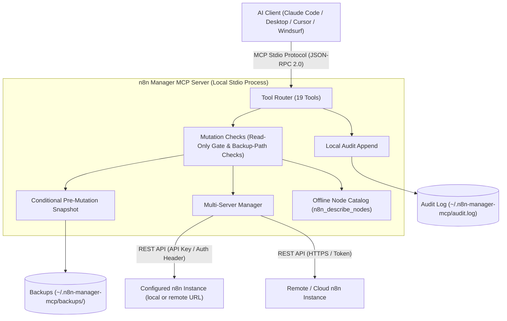

# n8n Manager MCP Server

**[🇬🇧 English](README.md) | [🇩🇪 Deutsch](README_de.md) | [🇪🇸 Español](README_es.md) | 🇯🇵 日本語 | [🇷🇺 Русский](README_ru.md) | [🇫🇷 Français](README_fr.md) | [🇨🇳 简体中文](README_zh.md) | [🇮🇳 हिन्दी](README_hi.md)**

*[ellmos-ai](https://github.com/ellmos-ai) ファミリーおよび [open-bricks](https://github.com/open-bricks) の統括プロジェクトの一員です。*

[](https://www.npmjs.com/package/n8n-manager-mcp)
[](https://github.com/ellmos-ai/n8n-manager-mcp/actions/workflows/tests.yml)
[](https://github.com/ellmos-ai/n8n-manager-mcp)
[](https://nodejs.org)
[](SECURITY.md)
[](SECURITY.md)
[](THIRD_PARTY_LICENSES.md)
[](THIRD_PARTY_LICENSES.txt)
[](NOTICE)
[](llms.txt)
[](llms.txt)
[](https://opensource.org/licenses/MIT)
[](llms.txt)
[](https://github.com/ellmos-ai)
[](https://github.com/open-bricks)

> [!NOTE]
> **AI アシスタントと LLM 向け:** ルートディレクトリには、コンテキストの迅速な取り込み、ツールカタログの参照、ディレクトリ一覧の確認に使える [`llms.txt`](llms.txt) インデックスがあります。

Claude、Cursor、Windsurf などの AI アシスタントから n8n ワークフローを管理する MCP（Model Context Protocol）サーバーです。

## クイックナビゲーション

| 番号 | セクション | 概要 |
| :--- | :--- | :--- |
| 01 | [📐 システム構成とトポロジー](#sec-01) ([#system-architecture](#system-architecture)) | ローカル stdio 通信、複数サーバーへのルーティング、安全性チェック |
| 02 | [📊 Mermaid 図 2 点](#sec-02) ([#dual-mermaid-diagrams](#dual-mermaid-diagrams)) | コンポーネント構成の flowchart TD と安全な変更処理のシーケンス図 |
| 03 | [🌐 ディレクトリ登録状況](#sec-03) ([#directory-status](#directory-status)) | npm、Glama、PulseMCP、Enterprise DNA の公開掲載情報 |
| 04 | [🎯 想定ユーザーと見つけやすさ](#sec-04) ([#target-personas--discoverability](#target-personas--discoverability)) | `[PERSONA-01]` から `[PERSONA-04]` までのユーザー像と検索意図の強い SEO 検索語 |
| 05 | [📋 プロジェクトの機能と境界](#sec-05) ([#comparative-matrix--alternatives](#comparative-matrix--alternatives)) | 10 の実装領域と文書化された制限 |
| 06 | [🛡️ 機能と実装上の境界](#sec-06) ([#core-capabilities--safety-invariants](#core-capabilities--safety-invariants)) | 読み取り専用モード、任意のローカルバックアップと監査ログ、入力検証、対象範囲 |
| 07 | [✨ 主な機能](#sec-07) ([#features](#features)) | REST API 連携、複数サーバーへのルーティング、バックアップスナップショット、ノードカタログ |
| 08 | [⚙️ クライアントへのインストール](#sec-08) ([#installation](#installation)) | Claude Code、Claude Desktop、Cursor、Windsurf の簡単なセットアップ |
| 09 | [🚀 クイックスタート](#sec-09) ([#quick-start](#quick-start)) | ワークフロー作成、実行状況の確認、サーバー切り替えの手順 |
| 10 | [🛠️ 利用可能なツール（19 個）](#sec-10) ([#available-tools](#available-tools)) | CRUD、実行、バックアップ、ノードに関する MCP ツール一覧 |
| 11 | [🔗 任意の n8n-workflow-manager 接続](#sec-11) ([#optional-n8n-workflow-manager-seam](#optional-n8n-workflow-manager-seam)) | 連携するマネージャーサービスによる意思決定記録と変更履歴の参照 |
| 12 | [🔒 設定と安全性の既定値](#sec-12) ([#configuration](#configuration)) | 環境変数、ローカルバックアップ先、単調な制約 |
| 13 | [🧪 開発とテスト](#sec-13) ([#development](#development)) | テストスイート、スモークテスト、現在の CI 実行環境 |
| 14 | [🧱 ellmos-ai エコシステム](#sec-14) ([#ellmos-ai-ecosystem](#ellmos-ai-ecosystem)) | 関連 MCP サーバー、BACH エージェント OS、open-bricks デスクトップソフトウェア群 |
| 15 | [📜 サードパーティライセンスと透明性](#sec-15) ([#third-party-licenses--transparency](#third-party-licenses--transparency)) | プロジェクトライセンスと依存関係のライセンス一覧 |
| 16 | [📈 マーケティングとユーザー像の記録](#sec-16) ([#marketing--personas-log](#marketing--personas-log)) | ポジショニング記録、キーワード表、3 段階のロードマップ |
| 17 | [📝 変更履歴](#sec-17) ([#changelog](#changelog)) | リリースノート、セキュリティ強化、見つけやすさに関する変更 |
| 18 | [⚖️ 責任に関する表示](#sec-18) ([#haftung--liability](#haftung--liability)) | §§ 516 ff. BGB に基づく無償のオープンソース贈与に関する表示、MIT 免責、48 時間の対応方針 |

---

<a id="sec-01"></a>
<a id="1-architecture"></a>
<a id="system-architecture"></a>
<a id="1-architektur"></a>
<a id="systemarchitektur"></a>
## システム構成

n8n Manager MCP Server は、AI 開発環境（Claude Code、Claude Desktop、Cursor、Windsurf）とローカルまたはリモートの n8n インスタンスをつなぐ、**ローカル優先の stdio ブリッジ**として動作します。

- **プロセスモデル:** Node.js プロセスとして動作し、JSON-RPC 2.0 を使って標準入力／標準出力（`stdio`）経由で MCP クライアントと通信します。起動元プロセスの権限を引き継ぎます。
- **変更時のチェック:** ワークフロー変更ハンドラーはローカル設定を読み込み、n8n への変更リクエストを送る前に読み取り専用モードを確認します。ブロックされた試行でもローカル監査ログに追記される場合があり、設定読み込みでもファイルシステムにアクセスします。
- **複数インスタンスのルーター:** ローカルのサーバープロファイルを使い、設定済みの n8n インスタンスへ呼び出しを振り分けます。`servers.json` 内の API キーは平文で保存され、設定更新には一時ファイルとリネームを使います。
- **オフラインノードカタログ:** ネットワーク通信を行わず、カテゴリ別に一般的な n8n ノード種別と短い説明（`n8n_describe_nodes`）を一覧表示します。完全なノードスキーマや必須プロパティは提供しません。

### アーキテクチャのトポロジー図（4 ビュー）

```text
+========================================================================================================+
| [VIEW 1: CALLER RUNTIMES & AGENT ECOSYSTEM]                                                           |
| Claude Code CLI      | Claude Desktop      | Cursor IDE / Windsurf | Antigravity / Gemini / Codex     |
| (JSON-RPC 2.0 Stdio) | (stdio MCP Client)  | (Dev Environments)    | (Autonomous Orchestrator Swarms) |
+===================================================+====================================================+
                                                    |
                                                    v
+========================================================================================================+
| [VIEW 2: N8N-MANAGER-MCP CORE ENGINE & MUTATION CHECKS]                                                 |
| +----------------------------------------------------------------------------------------------------+ |
| | Tool Dispatcher (19 Registered MCP Tools: CRUD, Execution Inspect, Backup/Restore, Node Catalog)   | |
| +----------------------------------------------------------------------------------------------------+ |
| | Read-Only Check: persisted setting or N8N_MANAGER_READ_ONLY=1 process ceiling                       | |
| | Input Bounds and Backup-Path Checks (scope limited to the implemented handlers)                     | |
| | Multi-Instance Routing: configured profiles and endpoints                                           | |
| | Bundled Offline Node Catalog: Common Node Types & Descriptions (INV-NODE-09)                         | |
| +----------------------------------------------------------------------------------------------------+ |
+===================================================+====================================================+
                                                    |
                                                    v
+========================================================================================================+
| [VIEW 3: RUNTIME PERSISTENCE, BACKUP SNAPSHOTS & LOCAL AUDIT LOG]                                      |
| +------------------------------------+----------------------------------+----------------------------+ |
| | Conditional Workflow Snapshots    | Local Append-Only Audit Log     | Multi-Server Config Store  | |
| | ~/.n8n-manager-mcp/backups/        | ~/.n8n-manager-mcp/audit.log     | ~/.n8n-manager-mcp/        | |
| | ({server}/{id}-{timestamp}-{reason}.json) | (Timestamped JSON entries) | (servers.json; POSIX 0600 requested) | |
| +------------------------------------+----------------------------------+----------------------------+ |
+===================================================+====================================================+
                                                    |
                                                    v
+========================================================================================================+
| [VIEW 4: STDIO TRANSPORT, CONFIGURED ENDPOINTS & LAUNCHER PRIVILEGES]                                  |
| Inherits launcher process privileges | Configured n8n/manager requests; interactive update check may run |
| No MCP listening port (stdio transport)                    | Published security policy and reporting contacts   |
+========================================================================================================+
```

---

<a id="sec-02"></a>
<a id="2-dual-mermaid-diagrams"></a>
<a id="dual-mermaid-diagrams"></a>
<a id="2-duale-mermaid-diagramme"></a>
<a id="duale-mermaid-diagramme"></a>
## Mermaid 図 2 点

### コンポーネント構成



### ワークフローの安全な変更処理

これらの図は想定される処理順序を示します。スナップショットを試みるのは `backup_before_mutations` が有効な場合（既定値: true）に限られ、その試行に失敗すると後続の n8n 変更リクエストは送信されません。監査ログへの追記エラーは呼び出し元へ伝播し、リモート側の変更が成功した後に発生する場合もあります。

```mermaid
sequenceDiagram
    autonumber
    actor AI as AI Assistant (Claude / Cursor)
    participant MCP as n8n-manager-mcp Router
    participant Safety as Safety & Read-Only Gate
    participant Snapshot as Backup Engine
    participant Store as Local Storage (~/.n8n-manager-mcp)
    participant N8N as n8n REST API Instance
    participant Audit as Local Audit Logger

    AI->>MCP: Call n8n_update_workflow or n8n_delete_workflow
    MCP->>Safety: Check read-only enforcement
    alt Read-only active (INV-READ-02)
        opt audit_log enabled (default true)
            Safety->>Audit: Append blocked mutation attempt
        end
        Safety-->>AI: Return text explaining that the mutation is blocked (or an error if audit append fails)
    else Mutation permitted
        opt backup_before_mutations enabled (default true)
            Safety->>Snapshot: Trigger pre-mutation snapshot (INV-BACK-03)
            Snapshot->>N8N: GET /workflows/{id}
            N8N-->>Snapshot: Current workflow JSON
            Snapshot->>Store: Save ~/.n8n-manager-mcp/backups/{server}/{id}-{timestamp}-{reason}.json
            Snapshot-->>Safety: Backup path
        end
        Safety->>N8N: PUT /workflows/{id} or DELETE /workflows/{id}
        N8N-->>Safety: Mutation result
        opt audit_log enabled (default true)
            Safety->>Audit: Append structured outcome to audit log (INV-AUDIT-04)
        end
        Safety-->>AI: Return text; include backup path when a backup was saved
    end
```

### 複数サーバー間のワークフロー移行とステージング同期の処理

インポート処理は新しいワークフローを作成します。インポート前のバックアップは作成せず、ロールバック用のハンドルも返しません。

```mermaid
sequenceDiagram
    autonumber
    actor AI as AI Assistant (Claude / Cursor)
    participant MCP as n8n-manager-mcp Router
    participant Staging as Staging n8n Instance
    participant Prod as Production n8n Instance
    participant Audit as Local Audit Logger

    Note over AI,MCP: Phase 1: Export from staging
    AI->>MCP: n8n_export_workflow(workflow_id=42, server_name=staging)
    MCP->>Staging: GET /workflows/42
    Staging-->>MCP: Workflow JSON
    MCP-->>AI: Cleaned workflow JSON as text

    Note over AI,MCP: Phase 2: Offline node-type catalog
    AI->>MCP: n8n_describe_nodes(category=action)
    MCP-->>AI: Text list of node types and descriptions

    Note over AI,MCP: Phase 3: Import a new inactive copy
    AI->>MCP: n8n_import_workflow(workflow_json=serialized export, server_name=production, activate=false)
    MCP->>Prod: POST /workflows
    Prod-->>MCP: Created workflow JSON with a new ID; inactive
    opt audit_log enabled (default true)
        MCP->>Audit: Append import outcome (INV-AUDIT-04)
    end
    MCP-->>AI: Text response with the new workflow ID; no rollback handle
```

---

<a id="sec-03"></a>
<a id="3-directory-status"></a>
<a id="directory-status"></a>
<a id="3-verzeichnis-status"></a>
<a id="verzeichnis-status"></a>
## ディレクトリ掲載状況

- [npm パッケージ](https://www.npmjs.com/package/n8n-manager-mcp): `n8n-manager-mcp` として公開
- [Glama 掲載ページ](https://glama.ai/mcp/servers/ellmos-ai/n8n-manager-mcp): ellmos-ai リポジトリの公開ディレクトリページ
- [Enterprise DNA ディレクトリ](https://enterprisedna.co/directories/mcp/ellmos-ai-n8n-manager-mcp/): `ellmos-ai/n8n-manager-mcp` の追加公開掲載
- [PulseMCP 掲載ページ](https://www.pulsemcp.com/servers/ellmos-ai-n8n-manager): `ellmos-ai-n8n-manager` として登録
- MCP 名前空間の状況: このリポジトリには `server.json` と `mcpName` のメタデータがあり、その名前は `io.github.ellmos-ai/n8n-manager-mcp` です。一部のエコシステムディレクトリでは、インデックスが更新されるまで旧名称 `io.github.lukisch/n8n-manager-mcp` が表示されます。
- 検索語の例: `n8n MCP server`、`n8n workflow management MCP`、`AI assistant n8n workflows`、`ellmos-ai n8n-manager-mcp`。

---

<a id="sec-04"></a>
<a id="4-target-personas--discoverability"></a>
<a id="target-personas--discoverability"></a>
<a id="4-zielgruppen--auffindbarkeit"></a>
<a id="zielgruppen--auffindbarkeit"></a>
## 想定ユーザーと見つけやすさ

| ユーザー像 | よくあるニーズ | タスク例と境界 | 検索キーワード |
| :--- | :--- | :--- | :--- |
| **[PERSONA-01] 自律型 AI エージェントとスウォーム** | MCP ワークフローツール、明確な処理結果、一般的なノード名のオフライン一覧 | 選択したサーバー上のワークフローを確認または管理します。バックアップが有効な場合に限り、対象の変更処理の前にバックアップを作成します。 | `n8n mcp server`, `ai agent n8n workflow management`, `claude code n8n automation` |
| **[PERSONA-02] DevOps と複数環境を扱うエンジニア** | 設定済み n8n インスタンスごとのプロファイル、ワークフローのエクスポート／インポート | 設定済みサーバー間でワークフローを移動します。インポートでは新しいワークフローが作成され、インポート前のバックアップは作成されません。 | `n8n multi-server mcp`, `sync n8n workflows staging prod`, `n8n workflow export import mcp` |
| **[PERSONA-03] SecOps、コンプライアンス、リスク管理チーム** | 読み取り専用制御、任意のローカル監査ログ、ローカルバックアップファイル | 読み取り専用の上限を設定するか、ローカル記録を確認します。設定済みの n8n／マネージャーのエンドポイントには引き続きリクエストが送られ、ローカルファイルにはワークフローデータや API キーが含まれる場合があります。 | `safe n8n mcp server`, `read-only n8n automation`, `audit log n8n ai integration` |
| **[PERSONA-04] エコシステム構築者とツール統合担当者** | MCP ツールスキーマ、マニフェスト、TypeScript ソース、テスト／スモークコマンド | 登録済みツールを統合し、リポジトリのテストとスモークコマンドで変更を検証します。現在 CI は Ubuntu で実行されます。 | `modelcontextprotocol n8n`, `glama n8n-manager-mcp`, `smithery n8n workflow` |

### 検索意図の強い検索クエリ

- `n8n mcp server claude code`
- `ai assistant n8n workflow management`
- `local-first n8n mcp stdio`
- `safe n8n automated workflow mutation`
- `n8n multi-server workflow sync mcp`
- `n8n describe nodes offline catalog`
- `n8n MCP stdio with configured server endpoints`
- `modelcontextprotocol n8n typescript`

---

<a id="sec-05"></a>
<a id="5-comparative-matrix--alternatives"></a>
<a id="comparative-matrix--alternatives"></a>
<a id="5-vergleichsmatrix--alternativen"></a>
<a id="vergleichsmatrix--alternativen"></a>
## プロジェクトの機能と境界

| 領域 | 実装されている動作 | 対象範囲と境界 |
| :--- | :--- | :--- |
| **MCP 通信とネットワーク** | サーバーは stdio で MCP クライアントと通信し、MCP 用の待ち受けポートを開きません。 | 実行時の API リクエストは設定済みの n8n URL に送られ、マネージャーを設定している場合はその URL にも送られます。更新通知機能は対話型 TTY での起動時に更新を確認する場合があります。通常の非 TTY stdio 経路ではこの確認を行いません。 |
| **ワークフローツール** | 19 個の MCP ツールで、ワークフローの一覧表示、作成、更新、削除、有効化／無効化、エクスポート／インポート、実行の確認、バックアップとサーバーの管理を行います。 | 変更は選択した設定済み n8n インスタンスに適用されます。インポートは新しいワークフローを作成し、事前バックアップやロールバック用ハンドルはありません。 |
| **サーバープロファイル** | 複数の n8n プロファイルをローカルの `servers.json` に保存し、URL と API キーの入力を検証します。 | API キーは平文で保存されます。新規設定ファイルでは POSIX の `0600` モードを要求し、Windows ではディレクトリ ACL に従います。 |
| **読み取り専用モード** | 保存された読み取り専用設定はワークフロー変更ツールをブロックします。`N8N_MANAGER_READ_ONLY=1` はプロセスレベルの上限を追加し、ツールから解除できません。 | 変更ゲートの確認前に設定を読み込みます。ブロックされた試行でもローカル監査ログへ追記される場合があるため、ファイルシステム全体の読み取り専用モードではありません。 |
| **変更前バックアップ** | 有効な場合（既定値: true）、更新、削除、有効化／無効化、上書き復元の前に JSON スナップショットを作成します。 | 作成とインポートの前にはスナップショットを作成しません。有効なスナップショットの取得または保存に失敗すると、後続の n8n 変更リクエストは送信されません。バックアップ JSON はローカルに平文で保存されます。 |
| **監査ログ** | 既定で有効な、設定可能なローカル JSON 追記ログです。対象操作の結果とブロックされた変更試行を記録します。 | 改ざん防止機能はありません。追記エラーは呼び出し元へ伝播し、上流での変更がすでに成功した後に発生する場合があります。 |
| **入力とバックアップパス** | 数値フィールドには明示的な範囲があり、バックアップ、一覧表示、復元の各操作ではパス要素のサニタイズと実パス／シンボリックリンクの検査を行います。 | これらの検査は該当する入力とファイル操作に限られます。あらゆるパストラバーサル、プロトタイプ汚染、不正なペイロードによる障害を防ぐ保証ではありません。 |
| **任意のマネージャー履歴** | `n8n_manager_history` は `N8N_MCP_MANAGER_URL` が設定されている場合、設定済みマネージャーから読み込みます。マネージャーに接続できなくても n8n への直接照会にはフォールバックしません。 | この機能は設定済みマネージャーのエンドポイントにリクエストを送ります。 |
| **オフラインノードカタログ** | `n8n_describe_nodes` は API リクエストを行わず、一般的なノード種別と短い説明を一覧表示します。 | 完全なノードスキーマや必須プロパティは提供しません。 |
| **検証とセキュリティ方針** | GitHub Actions は Ubuntu と Node.js 20／22 でビルド、テスト、スモーク／パッケージ検査を実行します。`SECURITY.md` には初回応答、トリアージ、修正に関する約束を記載しています。 | この CI 設定はクロスプラットフォームでの保証ではありません。セキュリティ対応時間は方針上の約束であり、実際の応答実績を示すものではありません。 |

---

<a id="sec-06"></a>
<a id="6-core-capabilities--safety-invariants"></a>
<a id="core-capabilities--safety-invariants"></a>
<a id="6-kernfaehigkeiten--sicherheitsinvarianten"></a>
<a id="kernfähigkeiten--sicherheitsinvarianten"></a>
## 機能と実装上の境界

これらの参照 ID は実装領域をまとめたものであり、外部認証や保証を示すものではありません。

| 参照 | 実装されている動作 | 対象範囲と制限 |
| :--- | :--- | :--- |
| `INV-LOCAL-01` | MCP クライアントとの通信にはローカル stdio を使います。 | n8n API 呼び出しは設定済みエンドポイントに送られます。任意のマネージャー機能と対話型ターミナルでの更新確認もネットワークリクエストを行う場合があります。 |
| `INV-READ-02` | `N8N_MANAGER_READ_ONLY=1` は環境変数による上限で、ツールから無効化できません。この上限がない場合は、保存された読み取り専用設定を変更できます。 | サーバーは変更ゲートの確認前に設定を読み込みます。ブロックされた試行でも監査ファイルに追記される場合があり、追記に失敗するとツール呼び出しがエラーを返すことがあります。OS レベルのファイルシステム制限ではありません。 |
| `INV-BACK-03` | `backup_before_mutations` が有効な場合（既定値: true）、更新、削除、有効化／無効化、上書き復元の前に JSON スナップショットを試みます。 | 作成／インポートの前にはバックアップしません。有効なスナップショットに失敗すると、後続の n8n 変更リクエストを停止します。バックアップはローカルに平文で保存されます。 |
| `INV-AUDIT-04` | `audit_log` は設定可能で既定では有効です。記録はローカル監査ファイルに追記されます。 | 改ざん防止機能はありません。追記エラーは呼び出し元へ伝播し、上流での変更が成功した後に発生する場合があります。 |
| `INV-SRV-05` | 複数のサーバープロファイルをローカルに保存し、リクエストごとに選択します。 | `servers.json` の API キーは平文です。新規設定ファイルでは POSIX `0600` を要求し、Windows ではディレクトリ ACL に従います。 |
| `INV-TRAV-06` | 数値入力の範囲を検証し、該当するファイル操作ではバックアップパス要素をサニタイズして設定済みルートと照合します。 | 実パスとシンボリックリンクの検査はバックアップ／一覧表示／復元に適用されます。あらゆるトラバーサル、プロトタイプ汚染、不正なペイロードによる障害を防ぐ保証ではありません。 |
| `INV-PRIV-07` | サーバーは権限昇格を要求しません。 | Node プロセスは起動元の権限を引き継ぎます。権限降格や `RunAsInvoker` による強制は実装されていません。 |
| `INV-SEAM-08` | `n8n_manager_history` は任意の `N8N_MCP_MANAGER_URL` 連携を使い、マネージャーに接続できない場合も n8n への直接照会にフォールバックしません。 | 有効にすると、設定済みマネージャーのエンドポイントにリクエストを送ります。 |
| `INV-NODE-09` | 同梱カタログは一般的なノード種別をカテゴリ別に説明します。 | 完全なスキーマや必須プロパティは返しません。 |
| `INV-SLA-10` | GitHub Actions は Ubuntu と Node.js 20／22 でビルド、テスト、スモーク、パッケージ検査を実行します。`SECURITY.md` には初回応答、トリアージ、修正に関する約束を記載しています。 | この CI 設定はクロスプラットフォームでの保証ではありません。セキュリティ対応時間は方針上の約束であり、実際の応答実績の証明ではありません。 |

<a id="sec-07"></a>
<a id="7-features"></a>
<a id="features"></a>
<a id="7-funktionen"></a>
<a id="funktionen"></a>
## 機能

- n8n ワークフロー管理用の **19 個のツール**
- ワークフローの一覧表示、作成、更新、削除、有効化／無効化
- 安全性制御: 読み取り専用モード、対象変更向けの設定可能なバックアップ（既定で有効）、ローカル復元、設定可能な監査ログ（既定で有効）
- 複数の n8n インスタンスへの接続
- サーバー間でのワークフローのエクスポート／インポート
- 実行履歴と状態の確認
- 説明付きの組み込みノードカタログ
- Python への依存なし。n8n REST API に直接接続

---

<a id="sec-08"></a>
<a id="8-installation"></a>
<a id="installation"></a>
## インストール

### Claude Desktop

`claude_desktop_config.json` に追加します:

```json
{
  "mcpServers": {
    "n8n-manager": {
      "command": "npx",
      "args": ["-y", "n8n-manager-mcp"]
    }
  }
}
```

### Claude Code

```bash
claude mcp add --scope user n8n-manager npx -y n8n-manager-mcp
```

### 手動インストール

```bash
npm install -g n8n-manager-mcp
```

---

<a id="sec-09"></a>
<a id="9-quick-start"></a>
<a id="quick-start"></a>
<a id="9-schnellstart"></a>
<a id="schnellstart"></a>
## クイックスタート

### 自然言語でのプロンプト

インストール後、AI アシスタントで次のプロンプトを使えます。サーバーを登録する前に、MCP ホストの環境で N8N_MANAGER_API_KEY と対応する N8N_MANAGER_SERVER_URL を安全に設定してください。API キーをプロンプトやツール引数に含めないでください:

1. **n8n サーバーを追加:**
   > "ホストに設定済みの認証情報を使い、http://localhost:5678 に production という名前の n8n サーバープロファイルを追加して"

2. **ワークフローを一覧表示:**
   > "n8n サーバー上のすべてのワークフローを表示して"

3. **オフラインでノードを確認:**
   > "同梱のオフラインカタログから action ノードの種類と説明を表示して"

4. **ワークフローを作成:**
   > "Webhook をトリガーに API からデータを取得し、Slack メッセージを送信する n8n ワークフローを作成して"

5. **実行を確認:**
   > "production での直近 10 件のワークフロー実行を表示して"

6. **環境間でコピーをインポート:**
   > "staging からワークフロー 42 をエクスポートし、production に新しい無効状態のコピーをインポートして"
   >
   > 注: n8n_import_workflow は新しいワークフローを作成します。インポート前のバックアップやロールバック用ハンドルは作成しません。有効化を要求しない限り、コピーは無効状態のままです。

### 開発者とエージェント向けの一連の実行例

以下では、サーバー設定、オフラインカタログの参照、バックアップ付きワークフロー変更、復元、読み取り専用時の動作を順に説明します。例にはツール引数の形式と説明用の MCP テキスト応答を示します。

#### 1. 複数サーバーの登録と稼働確認

新しいサーバーを登録する前に、クライアントの機密設定または OS のシークレット機能を使って、MCP ホスト環境に N8N_MANAGER_API_KEY と対応する N8N_MANAGER_SERVER_URL を設定します。API キーをチャットのプロンプトやツール引数に渡さないでください。ローカルのサーバープロファイルではキーを平文で保存します。新規ファイルは POSIX で 0600 モードを要求し、Windows ではディレクトリ ACL に従います。

n8n_add_server を呼び出します:

```json
{
  "name": "staging",
  "url": "http://127.0.0.1:5678",
  "is_default": true
}
```

説明用の MCP テキスト応答（サーバー名と URL はリクエストに従います）:

```text
Server "staging" added (http://127.0.0.1:5678). Set as default.
```

n8n_ping_server を呼び出します:

```json
{
  "server_name": "staging"
}
```

説明用の MCP テキスト応答（応答時間は変動します）:

```text
Server "staging" (http://127.0.0.1:5678) is reachable. Response time: <N>ms
```

#### 2. オフラインノードカタログ

n8n_describe_nodes は同梱カタログをカテゴリで絞り込みます。返すのはテキストの説明であり、完全なノードスキーマや選択済みノード名の一覧ではありません。

n8n_describe_nodes を呼び出します:

```json
{
  "category": "action"
}
```

説明用の応答テキスト:

```text
n8n Node Types (action):

  [ACTION] n8n-nodes-base.httpRequest
    Name: HTTP Request
    Make HTTP requests. Params: url, method, headers, body

  [ACTION] n8n-nodes-base.emailSend
    Name: Send Email
    Send emails via SMTP. Params: fromEmail, toEmail, subject, text

  [ACTION] n8n-nodes-base.slack
    Name: Slack
    Send messages to Slack channels

  [ACTION] n8n-nodes-base.telegram
    Name: Telegram
    Send messages via Telegram bot

  [ACTION] n8n-nodes-base.googleSheets
    Name: Google Sheets
    Read/write Google Sheets data
```

#### 3. スナップショットを伴う安全なワークフロー更新

backup_before_mutations が有効な場合（既定値: true）、n8n_update_workflow は n8n に更新を送る前にタイムスタンプ付きスナップショットを保存します。この例は引数の形式のみを示します。プレースホルダーを更新後ワークフロー全体の JSON シリアライズ結果に置き換えてください。

n8n_update_workflow を呼び出します:

```json
{
  "workflow_id": "42",
  "server_name": "staging",
  "workflow_json": "<complete JSON-serialized updated workflow>"
}
```

既定のバックアップが有効な場合の説明用 MCP テキスト応答:

```text
Workflow 42 updated successfully on staging. Backup saved: <backup path>
```

#### 4. ローカルバックアップからの復元

ワークフロー 42 を上書きするには、バックアップパスと target_workflow_id を渡します。backup_before_mutations が有効な場合、上書き前に現在の対象をバックアップします。target_workflow_id を省略すると、代わりに新しいワークフローを作成します。

n8n_restore_workflow を呼び出します:

```json
{
  "backup_path": "<path returned by n8n_list_backups or a mutation response>",
  "server_name": "staging",
  "target_workflow_id": "42"
}
```

復元前バックアップが有効な場合の説明用 MCP テキスト応答:

```text
Workflow restored (overwritten) on staging: "Customer Webhook Ingest [v2]" (ID: 42). Pre-restore backup saved: <backup path>
```

#### 5. フェイルクローズ方式の読み取り専用保護

`audit_log` が有効な場合（既定値: true）、ブロックされた変更は監査ログに追記されます。追記エラーによってツール呼び出しが失敗する場合があります。MCP ホスト環境で N8N_MANAGER_READ_ONLY=1 を設定すると、単調な上限として働き、n8n_set_safety_mode では解除できません。この上限を解除するには環境変数を削除し、MCP サーバーを再起動してください。以下に示す実行時の一般的なテキストには n8n_set_safety_mode が記載されていますが、環境変数による上限が有効な間はその提案は適用できません。

n8n_delete_workflow を呼び出します:

```json
{
  "workflow_id": "42",
  "server_name": "staging"
}
```

読み取り専用モードが有効な場合の実行時テキスト応答例:

```text
Blocked: n8n Manager is in read-only mode. Disable read_only via n8n_set_safety_mode before delete_workflow.
```

---

<a id="sec-10"></a>
<a id="10-available-tools"></a>
<a id="available-tools"></a>
<a id="10-verfuegbare-tools"></a>
<a id="verfügbare-tools"></a>
## 利用可能なツール

| ツール | 説明 |
|------|-------------|
| `n8n_list_workflows` | サーバー上のすべてのワークフローを一覧表示 |
| `n8n_get_workflow` | ワークフローの詳細（ノード、接続）を取得 |
| `n8n_create_workflow` | ノードと接続から新しいワークフローを作成 |
| `n8n_update_workflow` | 既存のワークフローを更新 |
| `n8n_delete_workflow` | ワークフローを削除 |
| `n8n_activate_workflow` | ワークフローを有効化または無効化 |
| `n8n_list_executions` | 最近の実行を状態とともに一覧表示 |
| `n8n_export_workflow` | インポート可能な JSON としてワークフローをエクスポート |
| `n8n_import_workflow` | ワークフロー JSON をサーバーにインポート |
| `n8n_safety_status` | ローカルの安全性設定、バックアップディレクトリ、監査ログのパスを表示 |
| `n8n_set_safety_mode` | 読み取り専用モード、変更前バックアップ、監査ログを切り替え |
| `n8n_list_backups` | 変更前に作成されたローカルのワークフローバックアップを一覧表示 |
| `n8n_restore_workflow` | ローカルバックアップからワークフローを復元 |
| `n8n_add_server` | n8n サーバー接続を追加／更新 |
| `n8n_list_servers` | 設定済みサーバーを一覧表示 |
| `n8n_ping_server` | サーバー接続をテスト |
| `n8n_remove_server` | サーバーを削除 |
| `n8n_describe_nodes` | 利用可能な n8n ノード種別を表示 |
| `n8n_manager_history` | 任意の n8n-workflow-manager からバージョン履歴、記録済みの判断、同期履歴を読み込み（任意利用、読み取り専用） |

---

<a id="sec-11"></a>
<a id="11-optional-n8n-workflow-manager-seam"></a>
<a id="optional-n8n-workflow-manager-seam"></a>
<a id="11-optional-anbindung-an-den-n8n-workflow-manager"></a>
<a id="optional-anbindung-an-den-n8n-workflow-manager"></a>
## 任意の n8n-workflow-manager 接続

n8n 自体には、ワークフローを変更した *理由* の記録機能がありません。関連プロジェクトの
[n8n-workflow-manager](https://github.com/ellmos-ai/n8n-workflow-manager) は、バージョン、変更ごとに必須の判断記録、同期履歴をローカルデータベースに保存します。`n8n_manager_history` を使うと、この MCP サーバーからその記録を参照できます。

この連携は **任意利用かつ読み取り専用** です:

- `N8N_MCP_MANAGER_URL` がなければ動作は変わらず、従来どおりすべてのツールが n8n と直接通信します。
- 設定した場合（例: `http://127.0.0.1:8100`）、`n8n_manager_history` は
  起動中のマネージャーから読み込みます。マネージャーのワークフローを一覧表示するには `workflow_id` を省略し、履歴全体を取得するには指定します。
- ID は **マネージャー ID であり、n8n インスタンス ID ではありません**。マネージャーは対応関係を保存しますが、照会するルートを公開していないため、このサーバーは ID の変換を推測しません。
- マネージャーを設定していて接続できない場合、ツールは n8n インスタンスから黙って回答するのではなく、**明示的なメッセージを返して失敗します**。n8n 側には判断履歴がなく、代替の回答では別の内容になってしまうためです。
- `n8n_safety_status` は環境変数の有無だけでなく、連携の *実測状態*（設定状況、到達可能性、マネージャーのバージョン）を報告します。

セットアップ: `pip install n8n-workflow-manager` を実行し、続けて `n8n-manager serve` を起動します（`127.0.0.1:8100` にバインド）。
マネージャー API は認証なしで、既定ではループバックにバインドします。待ち受けるホストは設定できます。ループバック以外の URL は `n8n_safety_status` で警告されます。

数値のガードレールは MCP スキーマに含まれます。ワークフロー、実行、バックアップ一覧の上限は、有限の正の整数 **1～1000** です（既存の既定値はそれぞれ 100、20、20）。ワークフロー接続の `from_output`／`to_input` インデックスは、有限の非負整数 **0～1000** です。不正な値は、対応する操作が進む前に MCP 入力スキーマまたはワークフロー検証によって拒否されます。変更チェックの前に設定を読み込む処理で、ローカルファイルシステムへアクセスする場合があります。

---

<a id="sec-12"></a>
<a id="12-configuration"></a>
<a id="configuration"></a>
<a id="12-konfiguration"></a>
<a id="konfiguration"></a>
## 設定

サーバー接続と安全性設定は `~/.n8n-manager-mcp/servers.json` に保存されます。

### API キーのデータフロー

サーバーの起動前に、**MCP ホストプロセスの環境**に `N8N_MANAGER_API_KEY` と `N8N_MANAGER_SERVER_URL` を設定します。利用可能な場合はクライアントの機密ユーザー設定または OS のシークレット機能を使い、クライアントが環境変数を平文の設定ファイルに書き込むか確認してください。`N8N_MANAGER_SERVER_URL` は `n8n_add_server` に渡す URL と一致する必要があります（末尾のスラッシュは正規化されます）。API キーをチャットのプロンプトやツール引数に含めないでください。

`n8n_add_server` はホスト環境からキーを読み込み、検証して、ローカルの `servers.json` にサーバープロファイルとともに保存します。このファイルは**暗号化されておらず平文**です。新規ファイルは POSIX で `0600` モードを要求し、Windows ではディレクトリ ACL に従います。MCP ツールスキーマ、ツールの返却結果、サーバー一覧には設定済みキーの値を含めません。API 呼び出しでは設定済み n8n URL に `X-N8N-API-KEY` ヘッダーでキーを送信し、リダイレクトには追従しません。リモートの n8n サーバーには HTTPS を使用してください。上流の成功応答と失敗応答にキーが含まれていた場合、JSON オブジェクトのキーやワークフロー ID も含め、MCP 出力と監査ログの境界で値を伏せます。

既存の `servers.json` プロファイルは引き続き使用できます。同じ URL のプロファイルを更新する場合、環境変数にキーがあっても保存済みキーは維持されます。キーをローテーションする場合、またはプロファイル URL を変更する場合は、ホスト環境に新しいキーと対応する URL を設定して MCP サーバーを再起動し、その後 `n8n_add_server` を `rotate_key: true` を指定して呼び出します。ローテーションなしの URL 変更は拒否されます。複数サーバーの場合は、それぞれ専用の環境変数キー／URL の組を設定してサーバーを追加し、組ごとに MCP プロセスを再起動してください。保存済みキーが暗黙に置き換わることはありません。登録後は、キーがローカルプロファイルに残るため、再起動時に環境変数の組を削除できます。以前 `api_key` をツール引数に渡していたプロンプトやクライアント呼び出しは削除してください。

安全性に関する既定値:

- `backup_before_mutations: true` は、更新、削除、有効化／無効化、上書き復元の前にワークフロー JSON を保存します。
- `audit_log: true` は変更結果を `~/.n8n-manager-mcp/audit.log` に追記します。
- `read_only: false` が既定値です。`n8n_set_safety_mode` または `N8N_MANAGER_READ_ONLY=1` で読み取り専用モードを有効にできます。
  環境変数は強制上限として働き、有効な間は保存済み設定や `n8n_set_safety_mode` で
  読み取り専用モードを解除できません。
- バックアップは `~/.n8n-manager-mcp/backups/` に保存され、バックアップ用ツールで一覧表示／復元できます。バックアップ、一覧表示、復元の処理ではバックアップパスの各要素をサニタイズし、実パス／シンボリックリンクを検査します。一覧には通常の `.json` バックアップを表示します。これらの検査は該当する操作に限られ、ファイルシステム全般の保証ではありません。
- `n8n_add_server` は保存前にサーバー接続情報を検証します。URL は認証情報、クエリ文字列、フラグメントを含まない `http` または `https` のベース URL とし、API キーに空白を含めることはできません。
- `n8n_add_server` の既定サーバーの動作は明示的です。最初のサーバーが既定になります。`is_default` を指定せず更新すると既存フラグを維持します。`true` はそのサーバーを既定にし、`false` はフラグを意図的に解除します。その後、既定サーバーの検索は最初に設定されたサーバーにフォールバックします。

---

<a id="sec-13"></a>
<a id="13-development"></a>
<a id="development"></a>
<a id="13-entwicklung"></a>
<a id="entwicklung"></a>
## 開発

```bash
npm install
npm run build    # One-time build
npm run dev      # Watch mode
npm start        # Start server
npm test         # Run test suite (vitest)
npm run smoke    # Start the built MCP server and verify tool discovery
```

### テスト

テストスイートでは URL の組み立て、サーバー入力の検証、サーバー管理、安全性設定、バックアップパスの処理、ワークフロー JSON の構築、エクスポート／インポートの検証、i18n 言語パック、リポジトリの整合性、エラー処理を確認します。マネージャー連携はローカルのスタブ HTTP サーバーを使ってテストし、n8n への直接照会にフォールバックしないことも確認します。

```bash
npm test              # Run all tests
npx vitest run        # Same as above
npx vitest --watch    # Watch mode
npm run smoke         # Manual stdio MCP smoke test (requires npm run build first)
```

記録済みの検証環境にはローカルの Windows と GitHub Actions の Ubuntu Linux が含まれます。GitHub Actions は Node.js 20 と 22 でビルド、テスト、npm パッケージ検査を実行します。コミットごとのローカル記録は `CHANGELOG.md` にあります。スモークランナーは MCP SDK クライアント経由で `dist/index.js` を起動し、合成認証情報を使って 19 個すべてのツール登録と秘密情報を含まないサーバー設定を確認します。また、ループバックのスタブを使ってキーの伏せ字処理とリダイレクト拒否を検証します。実際の n8n サーバーには接続しません。

### コントリビューションと開発ワークフロー

コントリビューションを歓迎します。詳しいガイドラインは [CONTRIBUTING.md](CONTRIBUTING.md) と [CODE_OF_CONDUCT.md](CODE_OF_CONDUCT.md) を確認してください。次の内容などが記載されています:
- **実装領域 (`INV-LOCAL-01`～`INV-SLA-10`)**: stdio 通信、読み取り専用モード、設定可能なバックアップと監査ログ、入力検証、公開済みのセキュリティ方針。対象範囲と制限は上記を参照してください。
- **プロセス権限:** プロセスは起動元の権限を引き継ぎ、権限昇格を要求しません。
- **Plan D ワークフロー**: 正規のローカルクローンと GitHub の `origin/main` を対象に開発します。
- **公開済みセキュリティ方針:** 初回応答、トリアージ、修正に関する約束は `SECURITY.md` に記載されています。調整型開示の連絡先には `security@ellmos.ai` と `security@open-bricks.org` が含まれます。

## 関連プロジェクト

- **[n8n-workflow-manager](https://github.com/ellmos-ai/n8n-workflow-manager)** — 人間向けの **状態と履歴のレイヤー**（Web UI + REST API、Python）です。ワークフローごとの変更履歴と判断ログ、グラフのビジュアル表示、複数サーバー同期を提供します。この MCP サーバーと**対で使う**設計です。MCP は作成／更新／削除／有効化を行う **AI の操作レイヤー**で、マネージャーでは確認、記録、ロールバックを行います。**メモリとコンテキスト（ロードマップ）:** MCP サーバーだけでは、破壊的変更の前にエージェントが過去のコンテキストを確認することを *保証* できません。その強制はクライアントに依存しないマネージャー側に置き、会話コンテキストには [ctx](https://github.com/ctxrs/ctx)（Apache-2.0）のようなプル型履歴インデックスを任意で利用できます。計画中: 共有履歴／判断ストアと、変更前に履歴確認を促すガード。
- [n8n](https://n8n.io/) -- ワークフロー自動化プラットフォーム

## ライセンス

MIT

---

<a id="sec-14"></a>
<a id="14-ellmos-ai-ecosystem"></a>
<a id="ellmos-ai-ecosystem"></a>
<a id="14-ellmos-ai-oekosystem"></a>
<a id="ellmos-ai-ökosystem"></a>
## ellmos-ai エコシステム

この MCP サーバーは、AI インフラ、MCP サーバー、インテリジェントツールを含む **[ellmos-ai](https://github.com/ellmos-ai)** エコシステムの一部です。

### MCP サーバーファミリー

| サーバー | ツール数 | 主な用途 | npm |
|--------|-------|-------|-----|
| [FileCommander](https://github.com/ellmos-ai/ellmos-filecommander-mcp) | 46 | ファイルシステム、プロセス管理、対話型セッション、クラウドロックに配慮した操作 | [`ellmos-filecommander-mcp`](https://www.npmjs.com/package/ellmos-filecommander-mcp) |
| [CodeCommander](https://github.com/ellmos-ai/ellmos-codecommander-mcp) | 22 | コード解析、JSON 修復、インポート整理、差分、正規表現 | [`ellmos-codecommander-mcp`](https://www.npmjs.com/package/ellmos-codecommander-mcp) |
| [Clatcher](https://github.com/ellmos-ai/ellmos-clatcher-mcp) | 12 | ファイル修復、形式変換、バッチ処理 | [`ellmos-clatcher-mcp`](https://www.npmjs.com/package/ellmos-clatcher-mcp) |
| **[n8n Manager](https://github.com/ellmos-ai/n8n-manager-mcp)** | **19** | **AI アシスタントによる n8n ワークフロー管理** | **[`n8n-manager-mcp`](https://www.npmjs.com/package/n8n-manager-mcp)** |
| [ControlCenter](https://github.com/ellmos-ai/ellmos-controlcenter-mcp) | 20 | MCP スタックの検索、プロファイル管理、コントロールプレーン | [`ellmos-controlcenter-mcp`](https://www.npmjs.com/package/ellmos-controlcenter-mcp) |
| [Homebase](https://github.com/ellmos-ai/ellmos-homebase-mcp) | 45 | ローカル優先の LLM メモリ、知識、状態管理、ルーティング、スウォーム制御 | [`ellmos-homebase-mcp`](https://www.npmjs.com/package/ellmos-homebase-mcp)（アルファ） |
| [ServerCommander](https://github.com/ellmos-ai/ellmos-servercommander-mcp) | 8 | サーバー運用: 稼働確認、ログ解析、デプロイのドライラン、メール診断 | [`ellmos-servercommander-mcp`](https://www.npmjs.com/package/ellmos-servercommander-mcp)（アルファ） |
| [Blender Use](https://github.com/ellmos-ai/ellmos-blender-use-mcp) | 3 | ヘッドレス Blender によるアセット QA と FBX 再インポート検証 | [`ellmos-blender-use-mcp`](https://www.npmjs.com/package/ellmos-blender-use-mcp)（アルファ） |
| [Open Compute](https://github.com/ellmos-ai/open-compute-mcp) | 10 | モデル非依存のコンピューター操作: 画面取得、安全性チェック付き操作、Windows UIA | [`open-compute-mcp`](https://www.npmjs.com/package/open-compute-mcp)（アルファ） |

### AI インフラ

| プロジェクト | 説明 |
|---------|-------------|
| [BACH](https://github.com/ellmos-ai/bach) | LLM エージェント向けのローカル優先テキストベース OS — 113 以上のハンドラー、550 以上のツール、SQLite メモリ |
| [open-compute](https://github.com/ellmos-ai/open-compute) | Open Compute MCP を支えるモデル非依存のコンピューター操作コア |
| [clutch](https://github.com/ellmos-ai/clutch) | 自動ルーティングと予算追跡を備えたプロバイダー非依存の LLM オーケストレーション |
| [rinnsal](https://github.com/ellmos-ai/rinnsal) | 軽量なエージェントメモリ、コネクター、自動化インフラ |
| [ellmos-stack](https://github.com/ellmos-ai/ellmos-stack) | セルフホスト型 AI 研究スタック（Ollama + n8n + Rinnsal + KnowledgeDigest） |
| [MarbleRun](https://github.com/ellmos-ai/MarbleRun) | Claude Code 向け自律型エージェントチェーンフレームワーク |
| [gardener](https://github.com/ellmos-ai/gardener) | データベース駆動型の最小構成 LLM OS プロトタイプ（4 関数、1 テーブル） |
| [ellmos-tests](https://github.com/ellmos-ai/ellmos-tests) | LLM OS 向けテストフレームワーク（7 つの評価軸） |

### デスクトップソフトウェアと関連ツール

パートナー組織 **[open-bricks](https://github.com/open-bricks)** と関連スイートには、AI ネイティブなデスクトップアプリケーションや開発者向けユーティリティが含まれます:

| リポジトリ | 組織／スイート | 主な用途と機能 |
| :--- | :--- | :--- |
| **[ProFiler](https://github.com/file-bricks/ProFiler)** | `file-bricks` | 重複検出機能を備えた高度なファイル／アセット管理ワークベンチ |
| **[ExplorerPro](https://github.com/file-bricks/ExplorerPro)** | `file-bricks` | タブ式でフィルター可能なファイルマネージャーとスマートなバッチ処理 |
| **[WinStorePackager](https://github.com/file-bricks/WinStorePackager)** | `file-bricks` | MSIX パッケージングと Windows Store リリース準備 |
| **[DokuZen](https://github.com/doc-bricks/DokuZen)** | `doc-bricks` | オフラインの Markdown エディター、ライブプレビュー、文書構成ワークベンチ |
| **[PDFtoPDFocr](https://github.com/doc-bricks/PDFtoPDFocr)** | `doc-bricks` | スキャン済み PDF を検索可能な PDF に変換するオフライン OCR 処理 |
| **[USR_PDFunlock](https://github.com/doc-bricks/USR_PDFunlock)** | `doc-bricks` | 保護された PDF アーカイブの誕生日／日付パスワードを回復するツール |
| **[UniversalInvoiceMail](https://github.com/doc-bricks/UniversalInvoiceMail)** | `doc-bricks` | 請求書の抽出とメール処理の自動化 |
| **[CleanMarkdown](https://github.com/doc-bricks/CleanMarkdown)** | `doc-bricks` | 技術文書 Markdown の書式とタイポグラフィを情報損失なく整えるツール |
| **[safe-start-for-codex](https://github.com/dev-bricks/safe-start-for-codex)** | `dev-bricks` | 高速で信頼性の高いエージェント起動と環境チェックの実行ツール |
| **[automation-master](https://github.com/dev-bricks/automation-master)** | `dev-bricks` | 複数ホストの自動化を統括するオーケストレーターとタスク監視ツール |
| **[DevCenter](https://github.com/dev-bricks/DevCenter)** | `dev-bricks` | ローカルツールチェーン向け統合開発ワークスペースダッシュボード |
| **[CodeBox](https://github.com/dev-bricks/CodeBox)** | `dev-bricks` | 複数言語での開発向けデスクトップコードエディター／IDE |
| **[githubbot](https://github.com/dev-bricks/githubbot)** | `dev-bricks` | 複数組織のリポジトリ保守と見つけやすさ向上を自動化するエンジン |
| **[swarm-ai](https://github.com/ellmos-ai/swarm-ai)** | `ellmos-ai` | スティグマジー型の協調を行う分散マルチエージェント・スウォームフレームワーク |
| **[ellmos-core](https://github.com/ellmos-ai/ellmos-core)** | `ellmos-ai` | エンタープライズ AI エージェントのバックエンド、ハイブリッド RAG、マルチテナントセキュリティ |
| **[open-bricks](https://github.com/open-bricks)** | `open-bricks` | ローカル優先の AI ソフトウェア製品をまとめる統括ポータルとカタログ |
| **[Zombie Killer Tray](https://github.com/dev-bricks/zombie-killer-tray)** | `dev-bricks` | 孤立した MCP プロセスを確認する任意の Windows ツールです。サポート対象の `node_modules/n8n-manager-mcp/dist/index.js` エントリーポイントから起動した場合、n8n Manager は候補として設定できます。追加のプロセス確認と適用確認はすべて引き続き必要です。 |

---

<a id="sec-15"></a>
<a id="15-third-party-licenses--transparency"></a>
<a id="third-party-licenses"></a>
<a id="third-party-licenses--transparency"></a>
<a id="15-drittanbieter-lizenzen--transparenz"></a>
<a id="drittanbieter-lizenzen"></a>
<a id="drittanbieter-lizenzen--transparenz"></a>
## サードパーティライセンスと透明性

このプロジェクトは [MIT License](LICENSE) に基づきライセンスされ、帰属表示は [NOTICE](NOTICE) に記載されています。
以下の依存関係表には、このプロジェクトで宣言されている直接依存関係と開発依存関係の一部を記載しています。ライセンスの詳細はリポジトリの一覧にあります。この表は継続的な監査を主張するものでも、サプライチェーンの安全性を証明するものでもありません:

| 依存関係 | 種別 | バージョン | ライセンス | 一覧の状態 |
| :--- | :--- | :--- | :--- | :--- |
| [`@modelcontextprotocol/sdk`](https://github.com/modelcontextprotocol/typescript-sdk) | 実行時（直接） | `^1.29.0` | MIT | ライセンス記載済み |
| [`zod`](https://github.com/colinhacks/zod) | 実行時（直接） | `^4.6.7` | MIT | ライセンス記載済み |
| [`update-notifier`](https://github.com/yeoman/update-notifier) | 実行時（直接） | `^7.3.1` | BSD-2-Clause | ライセンス記載済み |
| `typescript` | 開発／コンパイラー | `^5.3.3` | Apache-2.0 | ライセンス記載済み |
| `vitest` | 開発／テストランナー | `^4.1.11` | MIT | ライセンス記載済み |
| `@types/node` | 開発／型定義 | `^20.11.0` | MIT | ライセンス記載済み |

- **ネットワークの範囲:** サーバーは設定済み n8n エンドポイントにリクエストを送り、有効な場合は設定済みマネージャーのエンドポイントにも送信します。更新通知機能は対話型 TTY での起動時に更新を確認する場合があります。通常の非 TTY stdio 経路では確認を行いません。確認したアプリケーションソースには、製品分析データを送信する処理はありません。
- **詳細なオープンソース一覧:** 帰属表示、ライセンス全文、推移的依存関係の分析は [`THIRD_PARTY_LICENSES.md`](THIRD_PARTY_LICENSES.md) で確認できます。
- **テキスト形式の依存関係一覧:** テキスト形式の依存関係／ライセンス一覧は [`THIRD_PARTY_LICENSES.txt`](THIRD_PARTY_LICENSES.txt) にあります。実行時監査ログや権限認証を示すものではありません。

---

<a id="sec-16"></a>
<a id="16-marketing--personas-log"></a>
<a id="marketing--personas-log"></a>
<a id="16-marketing--personas-protokoll"></a>
<a id="marketing--personas-protokoll"></a>
## マーケティングとユーザー像の記録

マーケティング上のポジショニング、想定ユーザーの定義、ガバナンス不変条件との対応、3 段階の見つけやすさ向上ロードマップについては [`MARKETING-LOG.txt`](MARKETING-LOG.txt) を参照してください。

---

<a id="sec-17"></a>
<a id="17-changelog"></a>
<a id="changelog"></a>
<a id="17-aenderungsprotokoll"></a>
<a id="änderungsprotokoll"></a>
## 変更履歴

バージョン履歴、リリースノート、これまでの移行マイルストーンの詳細は [`CHANGELOG.md`](CHANGELOG.md) を参照してください。

---

<a id="sec-18"></a>
<a id="18-security-policy--statutory-notice"></a>
<a id="18-liability--statutory-notice"></a>
<a id="statutory-notice--liability"></a>
<a id="haftung--liability"></a>
<a id="18-sicherheitsrichtlinie--gesetzlicher-hinweis"></a>
<a id="18-haftung--gesetzlicher-hinweis"></a>
<a id="haftung"></a>
## 責任に関する表示

### 法定表示と責任の免責（§ 521 BGB）

本プロジェクトは、ドイツ民法 §§ 516 ff. BGB にいう**無償のオープンソース贈与**です。著作者の責任は **§ 521 BGB** に基づき、**故意および重大な過失**に限定されます。さらに [MIT ライセンス](LICENSE) の免責条項が適用されます。

利用は自己責任です。保守の約束、可用性の保証、エラーがないことや特定目的への適合性の保証はありません。

本プロジェクトは MIT ライセンスのもとで無償提供されるオープンソースです。責任は故意および重大な過失に限定されます（ドイツ民法 § 521）。利用は自己責任です。保証、保守の約束、特定目的への適合性の想定はありません。

### セキュリティ対応方針と脆弱性報告

[SECURITY.md](SECURITY.md) に記載された公開セキュリティ方針では、次の初回応答、トリアージ、修正を約束しています:
- **初回応答の約束:** 公開方針では、**48 時間以内**の初回応答を定めています（`INV-SLA-10`）。
- **トリアージの約束:** 公開方針では、脆弱性評価を**5 営業日以内**に行うと定めています。
- **修正の約束:** 公開方針では、報告された脆弱性の確認後 **30 暦日以内**に調整のうえセキュリティ修正を行うと定めています。
- **直接連絡先:**
  - `security@open-bricks.org`
  - `security@ellmos.ai`
  - `lukas@open-bricks.org`

これらは方針上の約束です。この文書は実測した対応実績を報告するものではありません。
