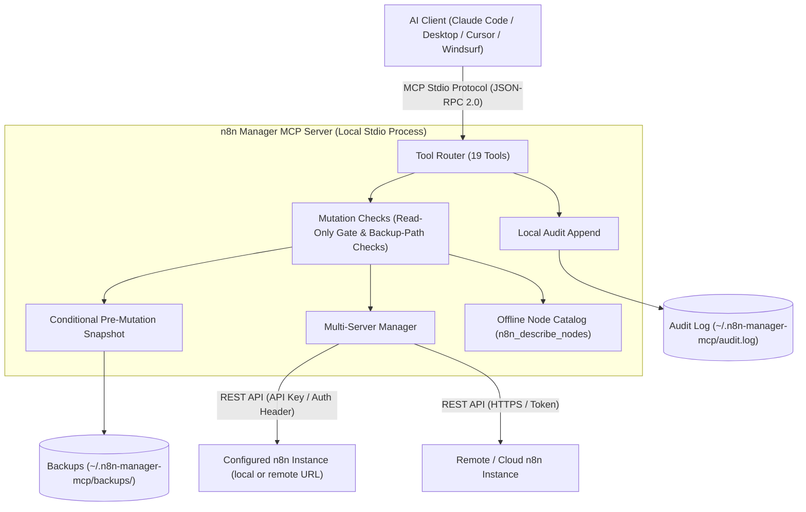

# n8n Manager MCP Server

**[🇬🇧 English](README.md) | [🇩🇪 Deutsch](README_de.md) | [🇪🇸 Español](README_es.md) | [🇯🇵 日本語](README_ja.md) | [🇷🇺 Русский](README_ru.md) | [🇫🇷 Français](README_fr.md) | [🇨🇳 简体中文](README_zh.md) | [🇮🇳 हिन्दी](README_hi.md) | [العربية](README_ar.md) | [বাংলা](README_bn.md) | Português**

*Parte da família [ellmos-ai](https://github.com/ellmos-ai) e do ecossistema [open-bricks](https://github.com/open-bricks).*

[](https://www.npmjs.com/package/n8n-manager-mcp)
[](https://github.com/ellmos-ai/n8n-manager-mcp/actions/workflows/tests.yml)
[](https://github.com/ellmos-ai/n8n-manager-mcp)
[](https://nodejs.org)
[](SECURITY.md)
[](SECURITY.md)
[](THIRD_PARTY_LICENSES.md)
[](THIRD_PARTY_LICENSES.txt)
[](NOTICE)
[](llms.txt)
[](llms.txt)
[](https://opensource.org/licenses/MIT)
[](llms.txt)
[](https://github.com/ellmos-ai)
[](https://github.com/open-bricks)

> [!NOTE]
> **Para assistentes de IA e LLMs:** há um arquivo de índice [`llms.txt`](llms.txt) na raiz do repositório para carregar contexto rapidamente e consultar o catálogo de ferramentas e as listagens de diretórios.

Servidor MCP (Model Context Protocol) para gerenciar workflows do n8n por meio de assistentes de IA como Claude, Cursor e Windsurf.

## Navegação rápida

| Nº | Seção | Destaques |
| :--- | :--- | :--- |
| 01 | [📐 Arquitetura e topologia do sistema](#sec-01) ([#system-architecture](#system-architecture)) | Transporte stdio local, roteamento entre servidores e middleware de segurança |
| 02 | [📊 Dois diagramas Mermaid](#sec-02) ([#dual-mermaid-diagrams](#dual-mermaid-diagrams)) | Fluxograma TD da arquitetura de componentes e diagrama de sequência do ciclo seguro de mutação |
| 03 | [🌐 Situação nos diretórios e registros](#sec-03) ([#directory-status](#directory-status)) | Listagens oficiais no npm, Glama, PulseMCP e Enterprise DNA |
| 04 | [🎯 Personas-alvo e facilidade de descoberta](#sec-04) ([#target-personas--discoverability](#target-personas--discoverability)) | Mapeamento de personas de `[PERSONA-01]` a `[PERSONA-04]` e consultas SEO de alta intenção |
| 05 | [📋 Capacidades e limites do projeto](#sec-05) ([#comparative-matrix--alternatives](#comparative-matrix--alternatives)) | 10 áreas de implementação e seus limites documentados |
| 06 | [🛡️ Capacidades e limites da implementação](#sec-06) ([#core-capabilities--safety-invariants](#core-capabilities--safety-invariants)) | Modo somente leitura, backups e registro de auditoria locais opcionais, verificações de entrada e notas sobre o escopo |
| 07 | [✨ Principais recursos](#sec-07) ([#features](#features)) | Integração REST direta, roteamento entre servidores, snapshots de backup e catálogo de nós |
| 08 | [⚙️ Instalação no cliente](#sec-08) ([#installation](#installation)) | Configuração com um comando para Claude Code, Claude Desktop, Cursor e Windsurf |
| 09 | [🚀 Início rápido](#sec-09) ([#quick-start](#quick-start)) | Criação de workflow passo a passo, inspeção de execução e troca de servidor |
| 10 | [🛠️ Ferramentas disponíveis (19)](#sec-10) ([#available-tools](#available-tools)) | Referência completa às ferramentas MCP de CRUD, execuções, backups e nós |
| 11 | [🔗 Opcional: integração com n8n-workflow-manager](#sec-11) ([#optional-n8n-workflow-manager-seam](#optional-n8n-workflow-manager-seam)) | Integração do acompanhamento de decisões e do histórico de alterações com o serviço manager associado |
| 12 | [🔒 Configuração e padrões de segurança](#sec-12) ([#configuration](#configuration)) | Variáveis de ambiente, diretório local de backups e restrições monotônicas estritas |
| 13 | [🧪 Desenvolvimento e testes](#sec-13) ([#development](#development)) | Suíte de testes, executor de smoke test e escopo atual da plataforma de CI |
| 14 | [🧱 Ecossistema ellmos-ai](#sec-14) ([#ellmos-ai-ecosystem](#ellmos-ai-ecosystem)) | Servidores MCP relacionados, sistema operacional de agentes BACH e suítes de software desktop open-bricks |
| 15 | [📜 Licenças de terceiros e transparência](#sec-15) ([#third-party-licenses--transparency](#third-party-licenses--transparency)) | Licença do projeto e inventário das licenças das dependências |
| 16 | [📈 Registro de marketing e personas](#sec-16) ([#marketing--personas-log](#marketing--personas-log)) | Registro abrangente de posicionamento, matriz de palavras-chave e roteiro em 3 fases |
| 17 | [📝 Registro de alterações](#sec-17) ([#changelog](#changelog)) | Notas completas de versão, reforços de segurança e histórico de descoberta |
| 18 | [⚖️ Responsabilidade / Haftung](#sec-18) ([#haftung--liability](#haftung--liability)) | Aviso legal de doação de código aberto conforme §§ 516 ff. BGB, isenção MIT e SLA de 48 h |

---

<a id="sec-01"></a>
<a id="1-architecture"></a>
<a id="system-architecture"></a>
<a id="1-architektur"></a>
<a id="systemarchitektur"></a>
## Arquitetura do sistema

O n8n Manager MCP Server funciona como uma **ponte local-first conectada por stdio** entre ambientes de desenvolvimento com IA (Claude Code, Claude Desktop, Cursor, Windsurf) e instâncias n8n locais ou remotas.

- **Modelo de processo:** executa como um processo Node.js que se comunica com o cliente MCP por entrada/saída padrão (`stdio`), usando JSON-RPC 2.0. Ele herda os privilégios do processo que o inicia.
- **Verificações de mutação:** os handlers de mutação de workflow carregam a configuração local e verificam o modo somente leitura antes de enviar uma solicitação de alteração ao n8n. Uma tentativa bloqueada ainda pode acrescentar uma entrada ao log de auditoria local; o carregamento da configuração também acessa o sistema de arquivos.
- **Roteador de várias instâncias:** direciona chamadas às instâncias n8n configuradas usando perfis locais de servidor. As chaves de API em `servers.json` ficam em texto simples; atualizações de configuração usam um arquivo temporário e uma renomeação.
- **Catálogo offline de nós:** lista tipos comuns de nós do n8n e descrições curtas por categoria (`n8n_describe_nodes`), sem chamada de rede. Não expõe os esquemas completos dos nós nem as propriedades obrigatórias.

### Projeção da topologia arquitetural (modelo de 4 visões)

```text
+========================================================================================================+
| [VIEW 1: CALLER RUNTIMES & AGENT ECOSYSTEM]                                                           |
| Claude Code CLI      | Claude Desktop      | Cursor IDE / Windsurf | Antigravity / Gemini / Codex     |
| (JSON-RPC 2.0 Stdio) | (stdio MCP Client)  | (Dev Environments)    | (Autonomous Orchestrator Swarms) |
+===================================================+====================================================+
                                                    |
                                                    v
+========================================================================================================+
| [VIEW 2: N8N-MANAGER-MCP CORE ENGINE & MUTATION CHECKS]                                                 |
| +----------------------------------------------------------------------------------------------------+ |
| | Tool Dispatcher (19 Registered MCP Tools: CRUD, Execution Inspect, Backup/Restore, Node Catalog)   | |
| +----------------------------------------------------------------------------------------------------+ |
| | Read-Only Check: persisted setting or N8N_MANAGER_READ_ONLY=1 process ceiling                       | |
| | Input Bounds and Backup-Path Checks (scope limited to the implemented handlers)                     | |
| | Multi-Instance Routing: configured profiles and endpoints                                           | |
| | Bundled Offline Node Catalog: Common Node Types & Descriptions (INV-NODE-09)                         | |
| +----------------------------------------------------------------------------------------------------+ |
+===================================================+====================================================+
                                                    |
                                                    v
+========================================================================================================+
| [VIEW 3: RUNTIME PERSISTENCE, BACKUP SNAPSHOTS & LOCAL AUDIT LOG]                                      |
| +------------------------------------+----------------------------------+----------------------------+ |
| | Conditional Workflow Snapshots    | Local Append-Only Audit Log     | Multi-Server Config Store  | |
| | ~/.n8n-manager-mcp/backups/        | ~/.n8n-manager-mcp/audit.log     | ~/.n8n-manager-mcp/        | |
| | ({server}/{id}-{timestamp}-{reason}.json) | (Timestamped JSON entries) | (servers.json; POSIX 0600 requested) | |
| +------------------------------------+----------------------------------+----------------------------+ |
+===================================================+====================================================+
                                                    |
                                                    v
+========================================================================================================+
| [VIEW 4: STDIO TRANSPORT, CONFIGURED ENDPOINTS & LAUNCHER PRIVILEGES]                                  |
| Inherits launcher process privileges | Configured n8n/manager requests; interactive update check may run |
| No MCP listening port (stdio transport)                    | Published security policy and reporting contacts   |
+========================================================================================================+
```

---

<a id="sec-02"></a>
<a id="2-dual-mermaid-diagrams"></a>
<a id="dual-mermaid-diagrams"></a>
<a id="2-duale-mermaid-diagramme"></a>
<a id="duale-mermaid-diagramme"></a>
## Dois diagramas Mermaid

### Arquitetura de componentes



### Ciclo de vida seguro da mutação de workflow

Os diagramas mostram a ordem prevista das operações. Os snapshots só são tentados quando `backup_before_mutations` está ativado (padrão: true); se a tentativa falhar, a solicitação de mutação seguinte não é enviada ao n8n. Erros ao acrescentar entradas ao log de auditoria são propagados e podem ocorrer após uma mutação remota bem-sucedida.

```mermaid
sequenceDiagram
    autonumber
    actor AI as AI Assistant (Claude / Cursor)
    participant MCP as n8n-manager-mcp Router
    participant Safety as Safety & Read-Only Gate
    participant Snapshot as Backup Engine
    participant Store as Local Storage (~/.n8n-manager-mcp)
    participant N8N as n8n REST API Instance
    participant Audit as Local Audit Logger

    AI->>MCP: Call n8n_update_workflow or n8n_delete_workflow
    MCP->>Safety: Check read-only enforcement
    alt Read-only active (INV-READ-02)
        opt audit_log enabled (default true)
            Safety->>Audit: Append blocked mutation attempt
        end
        Safety-->>AI: Return text explaining that the mutation is blocked (or an error if audit append fails)
    else Mutation permitted
        opt backup_before_mutations enabled (default true)
            Safety->>Snapshot: Trigger pre-mutation snapshot (INV-BACK-03)
            Snapshot->>N8N: GET /workflows/{id}
            N8N-->>Snapshot: Current workflow JSON
            Snapshot->>Store: Save ~/.n8n-manager-mcp/backups/{server}/{id}-{timestamp}-{reason}.json
            Snapshot-->>Safety: Backup path
        end
        Safety->>N8N: PUT /workflows/{id} or DELETE /workflows/{id}
        N8N-->>Safety: Mutation result
        opt audit_log enabled (default true)
            Safety->>Audit: Append structured outcome to audit log (INV-AUDIT-04)
        end
        Safety-->>AI: Return text; include backup path when a backup was saved
    end
```

### Ciclo de migração de workflow entre servidores e sincronização de staging

A etapa de importação cria um novo workflow. Ela não cria um backup antes da importação nem retorna um identificador para rollback.

```mermaid
sequenceDiagram
    autonumber
    actor AI as AI Assistant (Claude / Cursor)
    participant MCP as n8n-manager-mcp Router
    participant Staging as Staging n8n Instance
    participant Prod as Production n8n Instance
    participant Audit as Local Audit Logger

    Note over AI,MCP: Phase 1: Export from staging
    AI->>MCP: n8n_export_workflow(workflow_id=42, server_name=staging)
    MCP->>Staging: GET /workflows/42
    Staging-->>MCP: Workflow JSON
    MCP-->>AI: Cleaned workflow JSON as text

    Note over AI,MCP: Phase 2: Offline node-type catalog
    AI->>MCP: n8n_describe_nodes(category=action)
    MCP-->>AI: Text list of node types and descriptions

    Note over AI,MCP: Phase 3: Import a new inactive copy
    AI->>MCP: n8n_import_workflow(workflow_json=serialized export, server_name=production, activate=false)
    MCP->>Prod: POST /workflows
    Prod-->>MCP: Created workflow JSON with a new ID; inactive
    opt audit_log enabled (default true)
        MCP->>Audit: Append import outcome (INV-AUDIT-04)
    end
    MCP-->>AI: Text response with the new workflow ID; no rollback handle
```

---

<a id="sec-03"></a>
<a id="3-directory-status"></a>
<a id="directory-status"></a>
<a id="3-verzeichnis-status"></a>
<a id="verzeichnis-status"></a>
## Situação nos diretórios

- [Pacote npm](https://www.npmjs.com/package/n8n-manager-mcp): publicado como `n8n-manager-mcp`
- [Listagem no Glama](https://glama.ai/mcp/servers/ellmos-ai/n8n-manager-mcp): página pública de diretório do repositório ellmos-ai
- [Diretório Enterprise DNA](https://enterprisedna.co/directories/mcp/ellmos-ai-n8n-manager-mcp/): entrada pública adicional para `ellmos-ai/n8n-manager-mcp`
- [Listagem no PulseMCP](https://www.pulsemcp.com/servers/ellmos-ai-n8n-manager): indexada como `ellmos-ai-n8n-manager`
- Situação do namespace MCP: este repositório contém `server.json` e metadados `mcpName` para `io.github.ellmos-ai/n8n-manager-mcp`; alguns diretórios do ecossistema ainda exibem o nome antigo `io.github.lukisch/n8n-manager-mcp` até atualizarem seus índices.
- Contexto de busca: corresponde melhor a `n8n MCP server`, `n8n workflow management MCP`, `AI assistant n8n workflows` e `ellmos-ai n8n-manager-mcp`.

---

<a id="sec-04"></a>
<a id="4-target-personas--discoverability"></a>
<a id="target-personas--discoverability"></a>
<a id="4-zielgruppen--auffindbarkeit"></a>
<a id="zielgruppen--auffindbarkeit"></a>
## Personas-alvo e facilidade de descoberta

| Persona | Necessidades típicas | Exemplo de tarefa e limite | Termos-alvo de descoberta |
| :--- | :--- | :--- | :--- |
| **[PERSONA-01] Agentes e enxames autônomos de IA** | Ferramentas MCP para workflows, resultados claros das operações e uma lista offline de nomes comuns de nós | Inspecionar ou gerenciar um workflow no servidor selecionado; um backup precede mutações compatíveis somente quando os backups estão ativados. | `n8n mcp server`, `ai agent n8n workflow management`, `claude code n8n automation` |
| **[PERSONA-02] Engenharia DevOps e de múltiplos ambientes** | Perfis separados e exportação/importação de workflows entre instâncias n8n configuradas | Mover um workflow entre servidores configurados; a importação cria um novo workflow e não faz backup antes da importação. | `n8n multi-server mcp`, `sync n8n workflows staging prod`, `n8n workflow export import mcp` |
| **[PERSONA-03] Equipes de SecOps, conformidade e risco** | Controles somente leitura, registro de auditoria local opcional e arquivos locais de backup | Configurar um limite somente leitura ou inspecionar registros locais; os endpoints configurados de n8n/manager ainda recebem solicitações, e os arquivos locais podem conter dados de workflows ou chaves de API. | `safe n8n mcp server`, `read-only n8n automation`, `audit log n8n ai integration` |
| **[PERSONA-04] Criadores de ecossistema e integradores de ferramentas** | Esquemas de ferramentas MCP, manifests, código TypeScript e comandos de teste/smoke | Integrar as ferramentas registradas e validar alterações com os comandos de teste e smoke do repositório; atualmente, o CI roda no Ubuntu. | `modelcontextprotocol n8n`, `glama n8n-manager-mcp`, `smithery n8n workflow` |

### Consultas de busca com alta intenção

- `n8n mcp server claude code`
- `ai assistant n8n workflow management`
- `local-first n8n mcp stdio`
- `safe n8n automated workflow mutation`
- `n8n multi-server workflow sync mcp`
- `n8n describe nodes offline catalog`
- `n8n MCP stdio with configured server endpoints`
- `modelcontextprotocol n8n typescript`

---

<a id="sec-05"></a>
<a id="5-comparative-matrix--alternatives"></a>
<a id="comparative-matrix--alternatives"></a>
<a id="5-vergleichsmatrix--alternativen"></a>
<a id="vergleichsmatrix--alternativen"></a>
## Capacidades e limites do projeto

| Área | Comportamento implementado | Escopo e limites |
| :--- | :--- | :--- |
| **Transporte MCP e rede** | O servidor se comunica com o cliente MCP por stdio e não abre uma porta de escuta MCP. | As solicitações de API em tempo de execução vão para as URLs n8n configuradas e, se configurada, para a URL do manager. O update notifier pode verificar atualizações ao iniciar em um TTY interativo; o fluxo stdio normal sem TTY ignora essa verificação. |
| **Ferramentas de workflow** | 19 ferramentas MCP listam, criam, atualizam, excluem, ativam/desativam e exportam/importam workflows, inspecionam execuções e gerenciam backups e servidores. | As mutações atuam na instância n8n configurada e selecionada. A importação cria um novo workflow e não tem backup prévio nem identificador para rollback. |
| **Perfis de servidor** | Vários perfis n8n são armazenados localmente em `servers.json`; as entradas de URL e chave de API são validadas. | As chaves de API são armazenadas em texto simples. Novos arquivos de configuração solicitam o modo POSIX `0600`; no Windows, o acesso segue as ACLs do diretório. |
| **Modo somente leitura** | O modo somente leitura persistido bloqueia ferramentas de mutação de workflows. `N8N_MANAGER_READ_ONLY=1` adiciona um limite no nível do processo que a ferramenta não pode desativar. | A configuração é carregada antes do bloqueio de mutações. Uma tentativa bloqueada pode acrescentar uma entrada ao log de auditoria local; portanto, este não é um modo de sistema de arquivos somente leitura. |
| **Backups antes das mutações** | Quando ativados (padrão: true), snapshots JSON precedem operações de atualização, exclusão, ativação/desativação e restauração com sobrescrita. | Criação e importação não recebem snapshot prévio. Se a busca ou gravação de um snapshot ativado falhar, a solicitação de mutação seguinte não será enviada ao n8n. O JSON de backup fica local em texto simples. |
| **Log de auditoria** | O log JSON local, configurável e de acréscimo (ativado por padrão), registra os resultados das operações compatíveis e tentativas de mutação bloqueadas. | Ele não é inviolável. Erros de acréscimo são propagados; um erro pode ocorrer depois que uma mutação upstream já teve sucesso. |
| **Entradas e caminhos de backup** | Campos numéricos têm limites explícitos; segmentos de caminho de backup são sanitizados, e operações de backup, listagem e restauração verificam caminhos reais e symlinks. | Essas verificações se limitam a essas entradas e operações de arquivo. Elas não comprovam imunidade a todas as falhas de traversal, prototype pollution ou payload malformado. |
| **Histórico opcional do manager** | `n8n_manager_history` lê do manager configurado quando `N8N_MCP_MANAGER_URL` está definido e não recorre a uma consulta direta ao n8n se o manager estiver inacessível. | Essa opção envia uma solicitação ao endpoint configurado do manager. |
| **Catálogo offline de nós** | `n8n_describe_nodes` lista tipos comuns de nós e descrições curtas sem fazer uma solicitação de API. | Ele não fornece os esquemas completos dos nós nem as propriedades obrigatórias. |
| **Verificação e política de segurança** | O GitHub Actions executa verificações de build, teste, smoke/pacote no Ubuntu com Node.js 20 e 22. `SECURITY.md` publica compromissos de resposta, triagem e correção. | Essa configuração de CI não garante funcionamento em várias plataformas. Os prazos de segurança são compromissos de política, não um registro de desempenho de resposta observado. |

---

<a id="sec-06"></a>
<a id="6-core-capabilities--safety-invariants"></a>
<a id="core-capabilities--safety-invariants"></a>
<a id="6-kernfaehigkeiten--sicherheitsinvarianten"></a>
<a id="kernfähigkeiten--sicherheitsinvarianten"></a>
## Capacidades e limites da implementação

Estes IDs de referência agrupam áreas da implementação; não são certificações externas nem garantias.

| Referência | Comportamento implementado | Escopo e limites |
| :--- | :--- | :--- |
| `INV-LOCAL-01` | A comunicação com o cliente MCP usa stdio local. | Chamadas à API n8n vão para endpoints configurados; o manager opcional e uma verificação de atualização em terminais interativos também podem fazer solicitações de rede. |
| `INV-READ-02` | `N8N_MANAGER_READ_ONLY=1` é um limite no nível do ambiente que a ferramenta não pode desativar. O modo somente leitura persistido pode ser alterado quando o limite de ambiente não está presente. | O servidor carrega a configuração antes de verificar o bloqueio de mutações; uma tentativa bloqueada pode acrescentar uma entrada ao arquivo de auditoria, e uma falha ao acrescentar pode fazer a chamada da ferramenta retornar um erro. Isso não é uma restrição de sistema de arquivos no nível do sistema operacional. |
| `INV-BACK-03` | Com `backup_before_mutations` ativado (padrão: true), tenta-se obter snapshots JSON antes de atualizações, exclusões, ativações/desativações e restaurações com sobrescrita. | Criações/importações não recebem backup prévio. Se um snapshot ativado falhar, a solicitação de mutação seguinte ao n8n é interrompida. Os backups locais ficam em texto simples. |
| `INV-AUDIT-04` | `audit_log` é configurável e vem ativado por padrão; as entradas são acrescentadas ao arquivo local de auditoria. | O log não é inviolável. Falhas ao acrescentar são propagadas e podem ocorrer depois que uma mutação upstream tem sucesso. |
| `INV-SRV-05` | Vários perfis de servidor são armazenados localmente e selecionados para as solicitações. | As chaves de API em `servers.json` ficam em texto simples. Novos arquivos de configuração solicitam POSIX `0600`; no Windows, o acesso segue as ACLs do diretório. |
| `INV-TRAV-06` | Os limites das entradas numéricas são validados; segmentos de caminho de backup são sanitizados e verificados em relação à raiz configurada nas operações de arquivo pertinentes. | As verificações de caminho real e symlink se aplicam ao tratamento de backup/listagem/restauração. Isso não comprova imunidade a todas as falhas de traversal, prototype pollution ou payload malformado. |
| `INV-PRIV-07` | O servidor não solicita elevação de privilégios. | O processo Node herda os privilégios de quem o inicia; não há implementação de redução de privilégios nem aplicação de `RunAsInvoker`. |
| `INV-SEAM-08` | `n8n_manager_history` usa a integração opcional `N8N_MCP_MANAGER_URL` e não recorre a uma consulta direta ao n8n quando o manager está inacessível. | Quando ativada, envia uma solicitação ao endpoint configurado do manager. |
| `INV-NODE-09` | O catálogo incluído descreve tipos comuns de nós por categoria. | Ele não retorna esquemas completos nem propriedades obrigatórias. |
| `INV-SLA-10` | O GitHub Actions executa verificações de build, teste, smoke e pacote no Ubuntu com Node.js 20 e 22. `SECURITY.md` publica compromissos de resposta, triagem e correção. | Essa configuração de CI não garante funcionamento em várias plataformas. Os prazos de segurança são compromissos de política, não prova do desempenho real de resposta. |

<a id="sec-07"></a>
<a id="7-features"></a>
<a id="features"></a>
<a id="7-funktionen"></a>
<a id="funktionen"></a>
## Recursos

- **19 ferramentas** para gerenciamento completo de workflows do n8n
- Listar, criar, atualizar, excluir e ativar/desativar workflows
- Controles de segurança: modo somente leitura, backups configuráveis para mutações compatíveis (ativados por padrão), restauração local e registro de auditoria configurável (ativado por padrão)
- Suporte a vários servidores (conexão com várias instâncias n8n)
- Exportar/importar workflows entre servidores
- Consultar o histórico e o status das execuções
- Catálogo de nós integrado com descrições
- Não depende de Python -- conecta-se diretamente à API REST do n8n

---

<a id="sec-08"></a>
<a id="8-installation"></a>
<a id="installation"></a>
## Instalação

### Claude Desktop

Adicione a `claude_desktop_config.json`:

```json
{
  "mcpServers": {
    "n8n-manager": {
      "command": "npx",
      "args": ["-y", "n8n-manager-mcp"]
    }
  }
}
```

### Claude Code

```bash
claude mcp add --scope user n8n-manager npx -y n8n-manager-mcp
```

### Instalação manual

```bash
npm install -g n8n-manager-mcp
```

---

<a id="sec-09"></a>
<a id="9-quick-start"></a>
<a id="quick-start"></a>
<a id="9-schnellstart"></a>
<a id="schnellstart"></a>
## Início rápido

### Instruções em linguagem natural

Após a instalação, use estas instruções no assistente de IA. Antes de registrar um servidor, configure com segurança N8N_MANAGER_API_KEY e o N8N_MANAGER_SERVER_URL correspondente no ambiente do host MCP. Não inclua a chave de API em uma instrução nem em um argumento de ferramenta:

1. **Adicione seu servidor n8n:**
   > "Adicione um perfil de servidor n8n chamado production em http://localhost:5678 usando as credenciais do host já configuradas"

2. **Liste os workflows:**
   > "Mostre todos os workflows do meu servidor n8n"

3. **Inspecione os nós offline:**
   > "Mostre os tipos e as descrições dos nós de ação do catálogo offline incluído"

4. **Crie um workflow:**
   > "Crie um workflow do n8n que seja acionado por um webhook, busque dados em uma API e envie uma mensagem pelo Slack"

5. **Verifique as execuções:**
   > "Mostre as 10 execuções mais recentes de workflows em production"

6. **Importe uma cópia entre ambientes:**
   > "Exporte o workflow 42 de staging e importe uma nova cópia inativa em production"
   >
   > Observação: n8n_import_workflow cria um novo workflow; não cria backup antes da importação nem retorna um identificador para rollback. A cópia permanece inativa, a menos que a ativação seja solicitada.

### Demonstração de execução completa para desenvolvedores e agentes

A seguir, um passo a passo da configuração do servidor, consulta ao catálogo offline, mutação de workflow com backup, restauração e comportamento somente leitura. Os exemplos mostram formatos de argumentos de ferramentas e respostas de texto MCP ilustrativas.

#### 1. Registro de vários servidores e verificação de integridade

Antes de registrar um novo servidor, configure N8N_MANAGER_API_KEY e um N8N_MANAGER_SERVER_URL correspondente no ambiente do host MCP, usando as configurações de dados sensíveis do cliente ou um recurso de segredos do sistema operacional. Nunca passe a chave de API em uma instrução de chat ou argumento de ferramenta. O perfil local do servidor armazena a chave em texto simples; em POSIX, novos arquivos solicitam o modo 0600, enquanto no Windows o acesso segue a ACL do diretório.

Chame n8n_add_server:

```json
{
  "name": "staging",
  "url": "http://127.0.0.1:5678",
  "is_default": true
}
```

Resposta de texto MCP ilustrativa (o nome do servidor e a URL seguem a solicitação):

```text
Server "staging" added (http://127.0.0.1:5678). Set as default.
```

Chame n8n_ping_server:

```json
{
  "server_name": "staging"
}
```

Resposta de texto MCP ilustrativa (o tempo de resposta varia):

```text
Server "staging" (http://127.0.0.1:5678) is reachable. Response time: <N>ms
```

#### 2. Catálogo offline de nós

n8n_describe_nodes filtra o catálogo incluído por categoria. Retorna descrições em texto, não os esquemas completos dos nós nem uma lista selecionada de nomes de nós.

Chame n8n_describe_nodes:

```json
{
  "category": "action"
}
```

Texto de resposta ilustrativo:

```text
n8n Node Types (action):

  [ACTION] n8n-nodes-base.httpRequest
    Name: HTTP Request
    Make HTTP requests. Params: url, method, headers, body

  [ACTION] n8n-nodes-base.emailSend
    Name: Send Email
    Send emails via SMTP. Params: fromEmail, toEmail, subject, text

  [ACTION] n8n-nodes-base.slack
    Name: Slack
    Send messages to Slack channels

  [ACTION] n8n-nodes-base.telegram
    Name: Telegram
    Send messages via Telegram bot

  [ACTION] n8n-nodes-base.googleSheets
    Name: Google Sheets
    Read/write Google Sheets data
```

#### 3. Atualização segura de workflow com snapshot automático

Quando backup_before_mutations está ativado (padrão: true), n8n_update_workflow salva um snapshot com registro de data e hora antes de enviar a atualização ao n8n. Este exemplo mostra apenas o formato do argumento: substitua o marcador pelo workflow atualizado completo e serializado em JSON.

Chame n8n_update_workflow:

```json
{
  "workflow_id": "42",
  "server_name": "staging",
  "workflow_json": "<complete JSON-serialized updated workflow>"
}
```

Resposta de texto MCP ilustrativa quando o backup padrão está ativado:

```text
Workflow 42 updated successfully on staging. Backup saved: <backup path>
```

#### 4. Restauração a partir de um backup local

Para sobrescrever o workflow 42, informe o caminho do backup e target_workflow_id. Com backup_before_mutations ativado, o destino atual recebe backup antes de ser sobrescrito. Se target_workflow_id for omitido, será criado um novo workflow.

Chame n8n_restore_workflow:

```json
{
  "backup_path": "<path returned by n8n_list_backups or a mutation response>",
  "server_name": "staging",
  "target_workflow_id": "42"
}
```

Resposta de texto MCP ilustrativa quando o backup pré-restauração está ativado:

```text
Workflow restored (overwritten) on staging: "Customer Webhook Ingest [v2]" (ID: 42). Pre-restore backup saved: <backup path>
```

#### 5. Proteção fail-closed em modo somente leitura

Se `audit_log` estiver ativado (padrão: true), uma mutação bloqueada é registrada no log de auditoria; uma falha ao acrescentar pode fazer a chamada da ferramenta falhar. Se N8N_MANAGER_READ_ONLY=1 estiver definido no ambiente do host MCP, ele funciona como um limite monotônico: n8n_set_safety_mode não pode desativá-lo. Remova a variável de ambiente e reinicie o servidor MCP para retirar esse limite. O texto genérico do runtime abaixo ainda menciona n8n_set_safety_mode; essa sugestão não se aplica enquanto o limite de ambiente estiver ativo.

Chame n8n_delete_workflow:

```json
{
  "workflow_id": "42",
  "server_name": "staging"
}
```

Resposta de texto ilustrativa do runtime quando o modo somente leitura está ativo:

```text
Blocked: n8n Manager is in read-only mode. Disable read_only via n8n_set_safety_mode before delete_workflow.
```

---

<a id="sec-10"></a>
<a id="10-available-tools"></a>
<a id="available-tools"></a>
<a id="10-verfuegbare-tools"></a>
<a id="verfügbare-tools"></a>
## Ferramentas disponíveis

| Ferramenta | Descrição |
|------|-------------|
| `n8n_list_workflows` | Lista todos os workflows de um servidor |
| `n8n_get_workflow` | Obtém detalhes do workflow (nós, conexões) |
| `n8n_create_workflow` | Cria um novo workflow a partir de nós + conexões |
| `n8n_update_workflow` | Atualiza um workflow existente |
| `n8n_delete_workflow` | Exclui um workflow |
| `n8n_activate_workflow` | Ativa ou desativa um workflow |
| `n8n_list_executions` | Lista execuções recentes e seus status |
| `n8n_export_workflow` | Exporta um workflow como JSON importável |
| `n8n_import_workflow` | Importa JSON de workflow para um servidor |
| `n8n_safety_status` | Mostra as configurações de segurança locais, o diretório de backups e o caminho do log de auditoria |
| `n8n_set_safety_mode` | Alterna o modo somente leitura, o backup antes das mutações e o registro de auditoria |
| `n8n_list_backups` | Lista backups locais de workflows criados antes de mutações |
| `n8n_restore_workflow` | Restaura um workflow a partir de um backup local |
| `n8n_add_server` | Adiciona/atualiza uma conexão com servidor n8n |
| `n8n_list_servers` | Lista os servidores configurados |
| `n8n_ping_server` | Testa a conexão com o servidor |
| `n8n_remove_server` | Remove um servidor |
| `n8n_describe_nodes` | Consulta os tipos de nós n8n disponíveis |
| `n8n_manager_history` | Lê o histórico de versões, as decisões registradas e o histórico de sincronização de um n8n-workflow-manager opcional (ativado por opção, somente leitura) |

---

<a id="sec-11"></a>
<a id="11-optional-n8n-workflow-manager-seam"></a>
<a id="optional-n8n-workflow-manager-seam"></a>
<a id="11-optional-anbindung-an-den-n8n-workflow-manager"></a>
<a id="optional-anbindung-an-den-n8n-workflow-manager"></a>
## Integração opcional com n8n-workflow-manager

O próprio n8n não mantém registro de *por que* um workflow mudou. O projeto relacionado
[n8n-workflow-manager](https://github.com/ellmos-ai/n8n-workflow-manager) mantém esse registro:
armazena versões, uma decisão obrigatória por mutação e um histórico de sincronização em um banco
de dados local. `n8n_manager_history` permite ler esses registros por este servidor MCP.

A integração é **opcional e somente leitura**:

- Sem `N8N_MCP_MANAGER_URL`, nada muda: todas as ferramentas continuam se comunicando diretamente com o n8n.
- Quando definida (por exemplo, `http://127.0.0.1:8100`), `n8n_manager_history` lê do
  manager em execução. Omita `workflow_id` para listar os workflows do manager ou informe-o para obter o histórico completo.
- Os IDs são **IDs do manager, não IDs de instâncias n8n**. O manager armazena esse mapeamento, mas não expõe
  uma rota para resolvê-lo; por isso, este servidor não tenta adivinhar uma correspondência.
- Se o manager estiver configurado, mas inacessível, a ferramenta **falha com uma mensagem explícita**,
  em vez de responder silenciosamente com dados da instância n8n — esse armazenamento não tem histórico de decisões,
  portanto, a resposta substituta seria diferente.
- `n8n_safety_status` informa o estado *observado* da integração (configurada, acessível,
  versão do manager), e não apenas a variável de ambiente.

Configuração: `pip install n8n-workflow-manager` e, em seguida, `n8n-manager serve` (faz bind em `127.0.0.1:8100`).
A API do manager não tem autenticação e, por padrão, faz bind em loopback; o host pode ser configurado.
Uma URL fora do loopback é sinalizada em `n8n_safety_status`.

Os limites numéricos fazem parte dos schemas MCP: os limites de listagem de workflows, execuções e
backups são inteiros positivos finitos de **1 a 1000** (os padrões existentes
continuam sendo 100, 20 e 20); os índices de conexão de workflow `from_output`/
`to_input` são inteiros não negativos finitos de **0 a 1000**. Valores inválidos
são rejeitados pelos schemas de entrada MCP ou pela validação do workflow antes da operação correspondente. O carregamento da configuração pode acessar o sistema de arquivos local antes da verificação de mutação.

---

<a id="sec-12"></a>
<a id="12-configuration"></a>
<a id="configuration"></a>
<a id="12-konfiguration"></a>
<a id="konfiguration"></a>
## Configuração

As conexões de servidor e as configurações de segurança ficam em `~/.n8n-manager-mcp/servers.json`.

### Fluxo dos dados da chave de API

Defina `N8N_MANAGER_API_KEY` e `N8N_MANAGER_SERVER_URL` no **ambiente do processo host MCP** antes de iniciar o servidor. Quando disponível, use as configurações sensíveis do usuário no cliente ou um recurso de segredos do sistema operacional; verifique se o cliente grava valores de ambiente em um arquivo de configuração em texto simples. `N8N_MANAGER_SERVER_URL` deve corresponder à URL informada em `n8n_add_server` (barras finais são normalizadas). Não inclua uma chave de API em instruções de chat nem em argumentos de ferramenta.

`n8n_add_server` lê a chave do ambiente host, valida-a e salva-a com o perfil do servidor em `servers.json` local. O arquivo fica em **texto simples, sem criptografia**; novos arquivos solicitam o modo `0600` em POSIX, enquanto no Windows o acesso segue a ACL do diretório. O schema da ferramenta MCP, os resultados enviados pelas ferramentas e a lista de servidores não contêm o valor da chave configurada. Chamadas de API enviam a chave no cabeçalho `X-N8N-API-KEY` para a URL n8n configurada; redirecionamentos não são seguidos. Use HTTPS para servidores n8n remotos. Chaves repetidas nas respostas upstream, tanto bem-sucedidas quanto com falha, são ocultadas nas saídas MCP e nos limites do log de auditoria, inclusive em chaves de objetos JSON e IDs de workflows.

Os perfis existentes em `servers.json` continuam funcionando. Atualizar um perfil com a mesma URL preserva a chave armazenada, mesmo quando há uma chave no ambiente. Para alternar uma chave ou mudar a URL do perfil, defina a nova chave e a URL correspondente no ambiente host, reinicie o servidor MCP e chame `n8n_add_server` com `rotate_key: true`. Uma mudança de URL sem rotação é recusada. Para vários servidores, configure e adicione cada servidor com seu próprio par de chave/URL de ambiente, reiniciando o processo MCP entre os pares; chaves já armazenadas não são substituídas silenciosamente. Depois da configuração inicial, o par de ambiente pode ser removido no próximo reinício, pois a chave permanece no perfil local. Remova instruções antigas ou chamadas de cliente que forneciam `api_key` como argumento da ferramenta.

Padrões de segurança:

- `backup_before_mutations: true` salva o JSON do workflow antes de operações de atualização, exclusão, ativação/desativação e restauração com sobrescrita.
- `audit_log: true` acrescenta os resultados das mutações a `~/.n8n-manager-mcp/audit.log`.
- `read_only: false` é o padrão. O modo somente leitura pode ser ativado com `n8n_set_safety_mode` ou `N8N_MANAGER_READ_ONLY=1`.
  A variável de ambiente é um limite de aplicação: enquanto estiver ativada,
  as configurações persistidas e `n8n_set_safety_mode` não podem desativar o modo somente leitura.
- Backups ficam em `~/.n8n-manager-mcp/backups/` e podem ser listados/restaurados pelas ferramentas de backup. Segmentos dos caminhos são sanitizados e operações de backup, listagem e restauração verificam caminhos reais e symlinks. A listagem mostra backups `.json` comuns. Essas verificações se limitam a essas operações; não são uma garantia geral sobre o sistema de arquivos.
- `n8n_add_server` valida os dados da conexão antes de salvá-los: as URLs devem ser URLs base `http` ou `https`, sem credenciais embutidas, query strings ou fragments; as chaves de API não podem conter espaços em branco.
- A semântica padrão de `n8n_add_server` é explícita: o primeiro servidor torna-se o padrão; uma atualização sem `is_default` preserva a sinalização existente; `true` define o servidor como padrão; `false` remove intencionalmente essa sinalização, e a busca do padrão volta ao primeiro servidor configurado.

---

<a id="sec-13"></a>
<a id="13-development"></a>
<a id="development"></a>
<a id="13-entwicklung"></a>
<a id="entwicklung"></a>
## Desenvolvimento

```bash
npm install
npm run build    # One-time build
npm run dev      # Watch mode
npm start        # Start server
npm test         # Run test suite (vitest)
npm run smoke    # Start the built MCP server and verify tool discovery
```

### Testes

A suíte de testes cobre a construção de URLs, validação de entradas de servidor, gerenciamento de servidores, configurações de segurança, tratamento de caminhos de backup, construção de JSON de workflows, validação de exportação/importação, pacotes de idiomas i18n, higiene do repositório e tratamento de erros. A integração com o manager é testada contra um servidor HTTP stub local, inclusive a recusa em recorrer a uma consulta direta ao n8n.

```bash
npm test              # Run all tests
npx vitest run        # Same as above
npx vitest --watch    # Watch mode
npm run smoke         # Manual stdio MCP smoke test (requires npm run build first)
```

As verificações registradas abrangem Windows localmente e Ubuntu Linux no GitHub Actions; o GitHub Actions executa build, testes e verificações do pacote npm com Node.js 20 e 22. O registro local específico de cada commit fica em `CHANGELOG.md`. O executor de smoke inicia `dist/index.js` por meio do cliente MCP SDK, verifica o registro das 19 ferramentas e a configuração do servidor sem segredos usando credenciais sintéticas, e usa stubs de loopback para testar a ocultação de chaves e a recusa de redirecionamentos. Ele não se conecta a um servidor n8n real.

### Contribuição e fluxo de desenvolvimento

Contribuições são bem-vindas! Consulte [CONTRIBUTING.md](CONTRIBUTING.md) e nosso [CODE_OF_CONDUCT.md](CODE_OF_CONDUCT.md) para ver as diretrizes completas, incluindo:
- **Áreas de implementação (`INV-LOCAL-01` a `INV-SLA-10`)**: transporte stdio, modo somente leitura, backups e registro de auditoria configuráveis, validação e política de segurança publicada; consulte acima o escopo e os limites documentados.
- **Privilégios do processo:** o processo herda os privilégios de quem o inicia e não solicita elevação.
- **Fluxo Plan D:** o desenvolvimento ocorre estritamente em clones locais canônicos e com base no `origin/main` do GitHub.
- **Política de segurança publicada:** os compromissos de resposta, triagem e correção estão em `SECURITY.md`; os contatos para divulgação coordenada incluem `security@ellmos.ai` e `security@open-bricks.org`.

## Projetos relacionados

- **[n8n-workflow-manager](https://github.com/ellmos-ai/n8n-workflow-manager)** — a **camada de estado e histórico para pessoas** (interface Web + API REST, Python): histórico de alterações e registro de decisões por workflow, visualizador de grafo e sincronização entre servidores. Foi projetado como um **par** deste servidor MCP: o MCP é a **camada de ações de IA** (criar/atualizar/excluir/ativar), enquanto o manager é onde você revisa, documenta e reverte alterações. **Memória e contexto (roteiro):** um servidor MCP sozinho não pode *garantir* que um agente consulte o contexto anterior antes de uma alteração destrutiva — essa aplicação cabe ao manager (independente do cliente); o contexto de conversas também pode vir opcionalmente de um índice de histórico consultado sob demanda, como [ctx](https://github.com/ctxrs/ctx) (Apache-2.0). Planejado: um armazenamento compartilhado de histórico e decisões, além de uma proteção para *consultar o histórico antes de alterar*.
- [n8n](https://n8n.io/) -- a plataforma de automação de workflows

## Licença

MIT

---

<a id="sec-14"></a>
<a id="14-ellmos-ai-ecosystem"></a>
<a id="ellmos-ai-ecosystem"></a>
<a id="14-ellmos-ai-oekosystem"></a>
<a id="ellmos-ai-ökosystem"></a>
## Ecossistema ellmos-ai

Este servidor MCP faz parte do ecossistema **[ellmos-ai](https://github.com/ellmos-ai)** — infraestrutura de IA, servidores MCP e ferramentas inteligentes.

### Família de servidores MCP

| Servidor | Ferramentas | Foco | npm |
|--------|-------|-------|-----|
| [FileCommander](https://github.com/ellmos-ai/ellmos-filecommander-mcp) | 46 | Sistema de arquivos, gerenciamento de processos, sessões interativas e operações resistentes a bloqueios de nuvem | [`ellmos-filecommander-mcp`](https://www.npmjs.com/package/ellmos-filecommander-mcp) |
| [CodeCommander](https://github.com/ellmos-ai/ellmos-codecommander-mcp) | 22 | Análise de código, reparo de JSON, imports, diffs e regex | [`ellmos-codecommander-mcp`](https://www.npmjs.com/package/ellmos-codecommander-mcp) |
| [Clatcher](https://github.com/ellmos-ai/ellmos-clatcher-mcp) | 12 | Reparo de arquivos, conversão de formatos e operações em lote | [`ellmos-clatcher-mcp`](https://www.npmjs.com/package/ellmos-clatcher-mcp) |
| **[n8n Manager](https://github.com/ellmos-ai/n8n-manager-mcp)** | **19** | **Gerenciamento de workflows n8n por assistentes de IA** | **[`n8n-manager-mcp`](https://www.npmjs.com/package/n8n-manager-mcp)** |
| [ControlCenter](https://github.com/ellmos-ai/ellmos-controlcenter-mcp) | 20 | Descoberta da stack MCP, gerenciamento de perfis e plano de controle | [`ellmos-controlcenter-mcp`](https://www.npmjs.com/package/ellmos-controlcenter-mcp) |
| [Homebase](https://github.com/ellmos-ai/ellmos-homebase-mcp) | 45 | Memória, conhecimento, estado e roteamento local-first para LLMs, com orquestração de enxames | [`ellmos-homebase-mcp`](https://www.npmjs.com/package/ellmos-homebase-mcp) (alpha) |
| [ServerCommander](https://github.com/ellmos-ai/ellmos-servercommander-mcp) | 8 | Operações de servidor: verificações de integridade, análise de logs, simulações de deploy e diagnóstico de e-mail | [`ellmos-servercommander-mcp`](https://www.npmjs.com/package/ellmos-servercommander-mcp) (alpha) |
| [Blender Use](https://github.com/ellmos-ai/ellmos-blender-use-mcp) | 3 | QA de assets no Blender headless e verificação de reimportação de FBX | [`ellmos-blender-use-mcp`](https://www.npmjs.com/package/ellmos-blender-use-mcp) (alpha) |
| [Open Compute](https://github.com/ellmos-ai/open-compute-mcp) | 10 | Uso de computador independente de modelo: captura, ações protegidas por controles de segurança e Windows UIA | [`open-compute-mcp`](https://www.npmjs.com/package/open-compute-mcp) (alpha) |

### Infraestrutura de IA

| Projeto | Descrição |
|---------|-------------|
| [BACH](https://github.com/ellmos-ai/bach) | Sistema operacional textual local-first para agentes LLM — mais de 113 handlers, mais de 550 ferramentas e memória SQLite |
| [open-compute](https://github.com/ellmos-ai/open-compute) | Núcleo de uso de computador independente de modelo que alimenta o Open Compute MCP |
| [clutch](https://github.com/ellmos-ai/clutch) | Orquestração de LLM independente de provedor, com roteamento automático e acompanhamento de orçamento |
| [rinnsal](https://github.com/ellmos-ai/rinnsal) | Memória leve para agentes, conectores e infraestrutura de automação |
| [ellmos-stack](https://github.com/ellmos-ai/ellmos-stack) | Stack de pesquisa de IA hospedada pelo próprio usuário (Ollama + n8n + Rinnsal + KnowledgeDigest) |
| [MarbleRun](https://github.com/ellmos-ai/MarbleRun) | Framework autônomo de cadeias de agentes para Claude Code |
| [gardener](https://github.com/ellmos-ai/gardener) | Protótipo minimalista de sistema operacional LLM orientado por banco de dados (4 funções, 1 tabela) |
| [ellmos-tests](https://github.com/ellmos-ai/ellmos-tests) | Framework de testes para sistemas operacionais LLM (7 dimensões) |

### Software desktop e ferramentas relacionadas

Nossa organização parceira **[open-bricks](https://github.com/open-bricks)** e suas suítes relacionadas reúnem aplicativos desktop nativos de IA e utilitários para desenvolvedores:

| Repositório | Org / suíte | Foco e funcionalidade |
| :--- | :--- | :--- |
| **[ProFiler](https://github.com/file-bricks/ProFiler)** | `file-bricks` | Ambiente avançado de gerenciamento de arquivos e assets, com detecção de duplicatas |
| **[ExplorerPro](https://github.com/file-bricks/ExplorerPro)** | `file-bricks` | Gerenciador de arquivos com abas e filtros, com processamento em lote inteligente |
| **[WinStorePackager](https://github.com/file-bricks/WinStorePackager)** | `file-bricks` | Empacotamento MSIX e preparação para publicação na Windows Store |
| **[DokuZen](https://github.com/doc-bricks/DokuZen)** | `doc-bricks` | Editor Markdown offline, pré-visualização ao vivo e ambiente para estruturar documentos |
| **[PDFtoPDFocr](https://github.com/doc-bricks/PDFtoPDFocr)** | `doc-bricks` | Pipeline OCR offline que converte documentos PDF digitalizados em PDFs pesquisáveis |
| **[USR_PDFunlock](https://github.com/doc-bricks/USR_PDFunlock)** | `doc-bricks` | Ferramenta de recuperação de senhas por data de nascimento/data para arquivos PDF protegidos |
| **[UniversalInvoiceMail](https://github.com/doc-bricks/UniversalInvoiceMail)** | `doc-bricks` | Extração automática de faturas e processamento de e-mail |
| **[CleanMarkdown](https://github.com/doc-bricks/CleanMarkdown)** | `doc-bricks` | Limpeza sem perdas de formatação e tipografia em Markdown técnico |
| **[safe-start-for-codex](https://github.com/dev-bricks/safe-start-for-codex)** | `dev-bricks` | Inicialização rápida e confiável de agentes e executor de verificação do ambiente |
| **[automation-master](https://github.com/dev-bricks/automation-master)** | `dev-bricks` | Orquestrador central de automação em vários hosts e monitor de tarefas |
| **[DevCenter](https://github.com/dev-bricks/DevCenter)** | `dev-bricks` | Painel unificado de espaço de trabalho para cadeias de ferramentas locais de desenvolvedores |
| **[CodeBox](https://github.com/dev-bricks/CodeBox)** | `dev-bricks` | Editor de código desktop / IDE para desenvolvimento em várias linguagens |
| **[githubbot](https://github.com/dev-bricks/githubbot)** | `dev-bricks` | Mecanismo automatizado de manutenção e descoberta de repositórios em várias organizações |
| **[swarm-ai](https://github.com/ellmos-ai/swarm-ai)** | `ellmos-ai` | Framework distribuído de enxames multiagente com coordenação estigmérgica |
| **[ellmos-core](https://github.com/ellmos-ai/ellmos-core)** | `ellmos-ai` | Backend corporativo de agentes de IA, RAG híbrido e segurança multi-tenant |
| **[open-bricks](https://github.com/open-bricks)** | `open-bricks` | Portal agregador e catálogo de todos os produtos de software de IA local-first |
| **[Zombie Killer Tray](https://github.com/dev-bricks/zombie-killer-tray)** | `dev-bricks` | Ferramenta opcional do Windows para verificar processos MCP órfãos. O n8n Manager é um candidato configurado quando iniciado pelo ponto de entrada compatível `node_modules/n8n-manager-mcp/dist/index.js`; todas as verificações adicionais de processo e aplicação continuam valendo |

---

<a id="sec-15"></a>
<a id="15-third-party-licenses--transparency"></a>
<a id="third-party-licenses"></a>
<a id="third-party-licenses--transparency"></a>
<a id="15-drittanbieter-lizenzen--transparenz"></a>
<a id="drittanbieter-lizenzen"></a>
<a id="drittanbieter-lizenzen--transparenz"></a>
## Licenças de terceiros e transparência

Este projeto é licenciado sob a [Licença MIT](LICENSE), com atribuições declaradas em [NOTICE](NOTICE).
A tabela abaixo lista dependências diretas e de desenvolvimento selecionadas que o projeto declara. Os detalhes de licença estão no inventário do repositório; esta tabela não afirma que há auditoria contínua nem certifica a segurança da cadeia de suprimentos:

| Dependência | Tipo | Versão | Licença | Situação no inventário |
| :--- | :--- | :--- | :--- | :--- |
| [`@modelcontextprotocol/sdk`](https://github.com/modelcontextprotocol/typescript-sdk) | Runtime (direta) | `^1.29.0` | MIT | Licença listada |
| [`zod`](https://github.com/colinhacks/zod) | Runtime (direta) | `^4.6.7` | MIT | Licença listada |
| [`update-notifier`](https://github.com/yeoman/update-notifier) | Runtime (direta) | `^7.3.1` | BSD-2-Clause | Licença listada |
| `typescript` | Dev / compilador | `^5.3.3` | Apache-2.0 | Licença listada |
| `vitest` | Dev / executor de testes | `^4.1.11` | MIT | Licença listada |
| `@types/node` | Dev / definições de tipos | `^20.11.0` | MIT | Licença listada |

- **Escopo de rede:** o servidor envia solicitações aos endpoints n8n configurados e, quando ativado, ao endpoint configurado do manager. O update notifier pode verificar atualizações na inicialização em um TTY interativo; o fluxo stdio normal sem TTY ignora essa verificação. O código-fonte da aplicação analisado não contém um emissor de analytics de produto.
- **Inventário detalhado de código aberto:** avisos completos de atribuição, textos das licenças e análises de dependências transitivas estão disponíveis em [`THIRD_PARTY_LICENSES.md`](THIRD_PARTY_LICENSES.md).
- **Inventário de dependências em texto simples:** a versão textual do inventário de dependências/licenças está disponível em [`THIRD_PARTY_LICENSES.txt`](THIRD_PARTY_LICENSES.txt); ela não é um registro de auditoria em runtime nem uma certificação de privilégios.

---

<a id="sec-16"></a>
<a id="16-marketing--personas-log"></a>
<a id="marketing--personas-log"></a>
<a id="16-marketing--personas-protokoll"></a>
<a id="marketing--personas-protokoll"></a>
## Registro de marketing e personas

Para conhecer o posicionamento de marketing, as definições de personas-alvo, os mapeamentos de invariantes de governança e o roteiro de descoberta em 3 fases, consulte [`MARKETING-LOG.txt`](MARKETING-LOG.txt).

---

<a id="sec-17"></a>
<a id="17-changelog"></a>
<a id="changelog"></a>
<a id="17-aenderungsprotokoll"></a>
<a id="änderungsprotokoll"></a>
## Registro de alterações

Consulte [`CHANGELOG.md`](CHANGELOG.md) para ver o histórico detalhado de versões, as notas de lançamento e os marcos de migração anteriores.

---

<a id="sec-18"></a>
<a id="18-security-policy--statutory-notice"></a>
<a id="18-liability--statutory-notice"></a>
<a id="statutory-notice--liability"></a>
<a id="haftung--liability"></a>
<a id="18-sicherheitsrichtlinie--gesetzlicher-hinweis"></a>
<a id="18-haftung--gesetzlicher-hinweis"></a>
<a id="haftung"></a>
## Responsabilidade / Haftung

### Aviso legal e isenção de responsabilidade (§ 521 BGB)

Este projeto é uma **doação gratuita de código aberto** nos termos dos §§ 516 e seguintes do BGB. Conforme o **§ 521 do BGB**, a responsabilidade do autor limita-se a **dolo e negligência grave**. Também se aplica a isenção de responsabilidade da [Licença MIT](LICENSE).

Use por sua conta e risco. Não há compromisso de manutenção, garantia de disponibilidade, de ausência de erros ou de adequação a uma finalidade específica.

Este projeto é uma doação gratuita de código aberto sob a Licença MIT. A responsabilidade limita-se a dolo e negligência grave (§ 521 do Código Civil alemão). Use por sua conta e risco. Não se presume garantia, compromisso de manutenção nem adequação a uma finalidade específica.

### SLA de resposta de segurança e comunicação de vulnerabilidades

Conforme indicado em [SECURITY.md](SECURITY.md), a política de segurança publicada estabelece os seguintes compromissos de resposta, triagem e correção:
- **Compromisso de resposta inicial:** a política publicada define uma resposta inicial em até **48 horas** (`INV-SLA-10`).
- **Compromisso de triagem:** a política publicada define a avaliação da vulnerabilidade em até **5 dias úteis**.
- **Compromisso de correção:** a política publicada define a correção coordenada da vulnerabilidade em até **30 dias corridos após a confirmação** da vulnerabilidade relatada.
- **Contatos diretos:**
  - `security@open-bricks.org`
  - `security@ellmos.ai`
  - `lukas@open-bricks.org`

Estes são compromissos de política; este documento não informa o desempenho de resposta medido.
