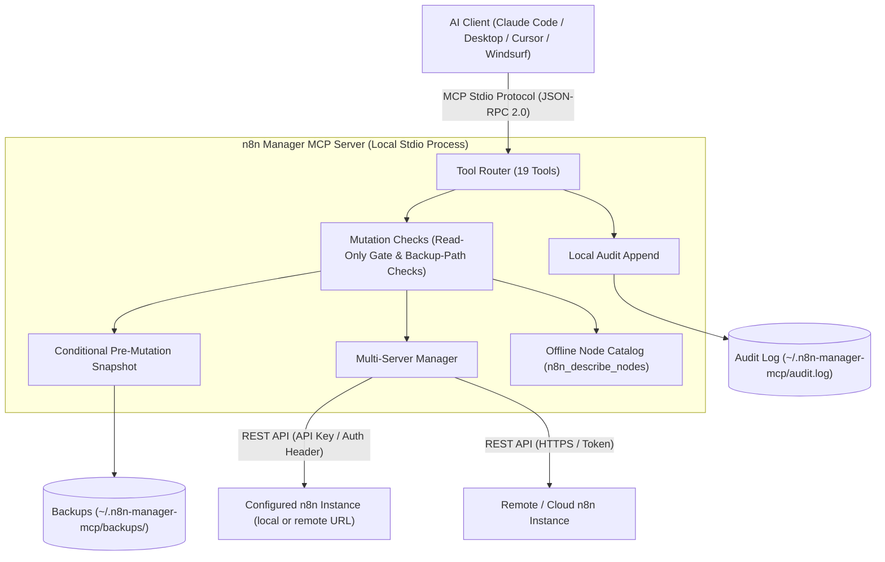

# n8n Manager MCP Server

**[🇬🇧 English](README.md) | [🇩🇪 Deutsch](README_de.md) | [🇪🇸 Español](README_es.md) | [🇯🇵 日本語](README_ja.md) | 🇷🇺 Русский | [🇫🇷 Français](README_fr.md) | [🇨🇳 简体中文](README_zh.md) | [🇮🇳 हिन्दी](README_hi.md)**

*Часть семейства [ellmos-ai](https://github.com/ellmos-ai) и объединяющего проекта [open-bricks](https://github.com/open-bricks).*

[](https://www.npmjs.com/package/n8n-manager-mcp)
[](https://github.com/ellmos-ai/n8n-manager-mcp/actions/workflows/tests.yml)
[](https://github.com/ellmos-ai/n8n-manager-mcp)
[](https://nodejs.org)
[](SECURITY.md)
[](SECURITY.md)
[](THIRD_PARTY_LICENSES.md)
[](THIRD_PARTY_LICENSES.txt)
[](NOTICE)
[](llms.txt)
[](llms.txt)
[](https://opensource.org/licenses/MIT)
[](llms.txt)
[](https://github.com/ellmos-ai)
[](https://github.com/open-bricks)

> [!NOTE]
> **Для AI-ассистентов и LLM:** в корневом каталоге доступен индекс [`llms.txt`](llms.txt) для быстрого чтения контекста, справки по каталогу инструментов и списков каталогов.

MCP-сервер (Model Context Protocol) для управления workflow n8n через AI-ассистентов, например Claude, Cursor и Windsurf.

## Быстрая навигация

| № | Раздел | Краткое содержание |
| :--- | :--- | :--- |
| 01 | [📐 Архитектура и топология системы](#sec-01) ([#system-architecture](#system-architecture)) | Локальный транспорт stdio, маршрутизация между серверами и проверки безопасности |
| 02 | [📊 Две диаграммы Mermaid](#sec-02) ([#dual-mermaid-diagrams](#dual-mermaid-diagrams)) | Диаграмма компонентов flowchart TD и диаграмма последовательности безопасного изменения |
| 03 | [🌐 Каталоги и регистрационные записи](#sec-03) ([#directory-status](#directory-status)) | Публикации в npm, Glama, PulseMCP и Enterprise DNA |
| 04 | [🎯 Целевые аудитории и обнаруживаемость](#sec-04) ([#target-personas--discoverability](#target-personas--discoverability)) | Описание аудиторий от `[PERSONA-01]` до `[PERSONA-04]` и SEO-запросы с выраженным поисковым намерением |
| 05 | [📋 Возможности и границы проекта](#sec-05) ([#comparative-matrix--alternatives](#comparative-matrix--alternatives)) | 10 областей реализации и задокументированные ограничения |
| 06 | [🛡️ Возможности и границы реализации](#sec-06) ([#core-capabilities--safety-invariants](#core-capabilities--safety-invariants)) | Режим только для чтения, необязательные локальные резервные копии и аудит, проверки входных данных и ограничения области действия |
| 07 | [✨ Основные функции](#sec-07) ([#features](#features)) | Прямая интеграция с REST API, маршрутизация между серверами, резервные снимки, каталог узлов |
| 08 | [⚙️ Установка клиента](#sec-08) ([#installation](#installation)) | Настройка одной командой для Claude Code, Claude Desktop, Cursor и Windsurf |
| 09 | [🚀 Быстрый старт](#sec-09) ([#quick-start](#quick-start)) | Пошаговое создание workflow, просмотр выполнений и переключение серверов |
| 10 | [🛠️ Доступные инструменты (19)](#sec-10) ([#available-tools](#available-tools)) | Справочник инструментов MCP для CRUD, выполнений, резервных копий и узлов |
| 11 | [🔗 Необязательная интеграция с n8n-workflow-manager](#sec-11) ([#optional-n8n-workflow-manager-seam](#optional-n8n-workflow-manager-seam)) | Учет решений и история изменений через связанный сервис-менеджер |
| 12 | [🔒 Конфигурация и настройки безопасности](#sec-12) ([#configuration](#configuration)) | Переменные среды, локальный каталог резервных копий и монотонные ограничения |
| 13 | [🧪 Разработка и тестирование](#sec-13) ([#development](#development)) | Набор тестов, smoke runner и текущая область CI |
| 14 | [🧱 Экосистема ellmos-ai](#sec-14) ([#ellmos-ai-ecosystem](#ellmos-ai-ecosystem)) | Связанные MCP-серверы, агентская ОС BACH и наборы настольных программ open-bricks |
| 15 | [📜 Сторонние лицензии и прозрачность](#sec-15) ([#third-party-licenses--transparency](#third-party-licenses--transparency)) | Лицензия проекта и перечень лицензий зависимостей |
| 16 | [📈 Журнал маркетинга и аудиторий](#sec-16) ([#marketing--personas-log](#marketing--personas-log)) | Позиционирование, матрица ключевых слов и трехэтапная дорожная карта |
| 17 | [📝 История изменений](#sec-17) ([#changelog](#changelog)) | Примечания к выпускам, усиление защиты и история обнаруживаемости |
| 18 | [⚖️ Ответственность](#sec-18) ([#haftung--liability](#haftung--liability)) | Уведомление о безвозмездном дарении ПО по §§ 516 ff. BGB, отказ от гарантий MIT, срок ответа 48 часов |

---

<a id="sec-01"></a>
<a id="1-architecture"></a>
<a id="system-architecture"></a>
<a id="1-architektur"></a>
<a id="systemarchitektur"></a>
## Архитектура системы

n8n Manager MCP Server работает как **мост на основе stdio с приоритетом локального выполнения** между средами разработки AI (Claude Code, Claude Desktop, Cursor, Windsurf) и локальными или удаленными экземплярами n8n.

- **Модель процесса:** работает как процесс Node.js и взаимодействует с клиентом MCP через стандартные потоки ввода/вывода (`stdio`) по JSON-RPC 2.0. Процесс наследует права запустившего его процесса.
- **Проверки изменений:** обработчики изменения workflow загружают локальную конфигурацию и проверяют режим только для чтения перед отправкой запроса на изменение в n8n. Заблокированная попытка все равно может быть добавлена в локальный журнал аудита; загрузка конфигурации также обращается к файловой системе.
- **Маршрутизатор нескольких экземпляров:** направляет вызовы к настроенным экземплярам n8n с помощью локальных профилей серверов. API-ключи в `servers.json` хранятся в открытом виде; обновление конфигурации выполняется через временный файл и переименование.
- **Офлайн-каталог узлов:** без сетевого запроса показывает распространенные типы узлов n8n и краткие описания по категориям (`n8n_describe_nodes`). Полные схемы узлов и обязательные свойства не предоставляются.

### Архитектурная топология (модель из 4 представлений)

```text
+========================================================================================================+
| [VIEW 1: CALLER RUNTIMES & AGENT ECOSYSTEM]                                                           |
| Claude Code CLI      | Claude Desktop      | Cursor IDE / Windsurf | Antigravity / Gemini / Codex     |
| (JSON-RPC 2.0 Stdio) | (stdio MCP Client)  | (Dev Environments)    | (Autonomous Orchestrator Swarms) |
+===================================================+====================================================+
                                                    |
                                                    v
+========================================================================================================+
| [VIEW 2: N8N-MANAGER-MCP CORE ENGINE & MUTATION CHECKS]                                                 |
| +----------------------------------------------------------------------------------------------------+ |
| | Tool Dispatcher (19 Registered MCP Tools: CRUD, Execution Inspect, Backup/Restore, Node Catalog)   | |
| +----------------------------------------------------------------------------------------------------+ |
| | Read-Only Check: persisted setting or N8N_MANAGER_READ_ONLY=1 process ceiling                       | |
| | Input Bounds and Backup-Path Checks (scope limited to the implemented handlers)                     | |
| | Multi-Instance Routing: configured profiles and endpoints                                           | |
| | Bundled Offline Node Catalog: Common Node Types & Descriptions (INV-NODE-09)                         | |
| +----------------------------------------------------------------------------------------------------+ |
+===================================================+====================================================+
                                                    |
                                                    v
+========================================================================================================+
| [VIEW 3: RUNTIME PERSISTENCE, BACKUP SNAPSHOTS & LOCAL AUDIT LOG]                                      |
| +------------------------------------+----------------------------------+----------------------------+ |
| | Conditional Workflow Snapshots    | Local Append-Only Audit Log     | Multi-Server Config Store  | |
| | ~/.n8n-manager-mcp/backups/        | ~/.n8n-manager-mcp/audit.log     | ~/.n8n-manager-mcp/        | |
| | ({server}/{id}-{timestamp}-{reason}.json) | (Timestamped JSON entries) | (servers.json; POSIX 0600 requested) | |
| +------------------------------------+----------------------------------+----------------------------+ |
+===================================================+====================================================+
                                                    |
                                                    v
+========================================================================================================+
| [VIEW 4: STDIO TRANSPORT, CONFIGURED ENDPOINTS & LAUNCHER PRIVILEGES]                                  |
| Inherits launcher process privileges | Configured n8n/manager requests; interactive update check may run |
| No MCP listening port (stdio transport)                    | Published security policy and reporting contacts   |
+========================================================================================================+
```

---

<a id="sec-02"></a>
<a id="2-dual-mermaid-diagrams"></a>
<a id="dual-mermaid-diagrams"></a>
<a id="2-duale-mermaid-diagramme"></a>
<a id="duale-mermaid-diagramme"></a>
## Две диаграммы Mermaid

### Архитектура компонентов



### Жизненный цикл безопасного изменения workflow

Диаграммы показывают предполагаемый порядок операций. Создание снимка выполняется только при включенном `backup_before_mutations` (по умолчанию: true); если попытка не удалась, следующий запрос на изменение в n8n не отправляется. Ошибки добавления записи в аудит передаются вызывающей стороне и могут возникнуть после успешного удаленного изменения.

```mermaid
sequenceDiagram
    autonumber
    actor AI as AI Assistant (Claude / Cursor)
    participant MCP as n8n-manager-mcp Router
    participant Safety as Safety & Read-Only Gate
    participant Snapshot as Backup Engine
    participant Store as Local Storage (~/.n8n-manager-mcp)
    participant N8N as n8n REST API Instance
    participant Audit as Local Audit Logger

    AI->>MCP: Call n8n_update_workflow or n8n_delete_workflow
    MCP->>Safety: Check read-only enforcement
    alt Read-only active (INV-READ-02)
        opt audit_log enabled (default true)
            Safety->>Audit: Append blocked mutation attempt
        end
        Safety-->>AI: Return text explaining that the mutation is blocked (or an error if audit append fails)
    else Mutation permitted
        opt backup_before_mutations enabled (default true)
            Safety->>Snapshot: Trigger pre-mutation snapshot (INV-BACK-03)
            Snapshot->>N8N: GET /workflows/{id}
            N8N-->>Snapshot: Current workflow JSON
            Snapshot->>Store: Save ~/.n8n-manager-mcp/backups/{server}/{id}-{timestamp}-{reason}.json
            Snapshot-->>Safety: Backup path
        end
        Safety->>N8N: PUT /workflows/{id} or DELETE /workflows/{id}
        N8N-->>Safety: Mutation result
        opt audit_log enabled (default true)
            Safety->>Audit: Append structured outcome to audit log (INV-AUDIT-04)
        end
        Safety-->>AI: Return text; include backup path when a backup was saved
    end
```

### Жизненный цикл переноса workflow между серверами и синхронизации со staging

Импорт создает новый workflow. Предварительная резервная копия не создается, и дескриптор для отката не возвращается.

```mermaid
sequenceDiagram
    autonumber
    actor AI as AI Assistant (Claude / Cursor)
    participant MCP as n8n-manager-mcp Router
    participant Staging as Staging n8n Instance
    participant Prod as Production n8n Instance
    participant Audit as Local Audit Logger

    Note over AI,MCP: Phase 1: Export from staging
    AI->>MCP: n8n_export_workflow(workflow_id=42, server_name=staging)
    MCP->>Staging: GET /workflows/42
    Staging-->>MCP: Workflow JSON
    MCP-->>AI: Cleaned workflow JSON as text

    Note over AI,MCP: Phase 2: Offline node-type catalog
    AI->>MCP: n8n_describe_nodes(category=action)
    MCP-->>AI: Text list of node types and descriptions

    Note over AI,MCP: Phase 3: Import a new inactive copy
    AI->>MCP: n8n_import_workflow(workflow_json=serialized export, server_name=production, activate=false)
    MCP->>Prod: POST /workflows
    Prod-->>MCP: Created workflow JSON with a new ID; inactive
    opt audit_log enabled (default true)
        MCP->>Audit: Append import outcome (INV-AUDIT-04)
    end
    MCP-->>AI: Text response with the new workflow ID; no rollback handle
```

---

<a id="sec-03"></a>
<a id="3-directory-status"></a>
<a id="directory-status"></a>
<a id="3-verzeichnis-status"></a>
<a id="verzeichnis-status"></a>
## Статус в каталогах

- [Пакет npm](https://www.npmjs.com/package/n8n-manager-mcp): опубликован под именем `n8n-manager-mcp`
- [Страница Glama](https://glama.ai/mcp/servers/ellmos-ai/n8n-manager-mcp): общедоступная страница каталога репозитория ellmos-ai
- [Каталог Enterprise DNA](https://enterprisedna.co/directories/mcp/ellmos-ai-n8n-manager-mcp/): дополнительная публичная запись для `ellmos-ai/n8n-manager-mcp`
- [Страница PulseMCP](https://www.pulsemcp.com/servers/ellmos-ai-n8n-manager): индексируется как `ellmos-ai-n8n-manager`
- Состояние пространства имен MCP: в этом репозитории есть метаданные `server.json` и `mcpName` для `io.github.ellmos-ai/n8n-manager-mcp`; в некоторых каталогах экосистемы до обновления индексов все еще отображается старое имя `io.github.lukisch/n8n-manager-mcp`.
- Поисковый контекст: наиболее подходящие запросы — `n8n MCP server`, `n8n workflow management MCP`, `AI assistant n8n workflows` и `ellmos-ai n8n-manager-mcp`.

---

<a id="sec-04"></a>
<a id="4-target-personas--discoverability"></a>
<a id="target-personas--discoverability"></a>
<a id="4-zielgruppen--auffindbarkeit"></a>
<a id="zielgruppen--auffindbarkeit"></a>
## Целевые аудитории и обнаруживаемость

| Аудитория | Типичные потребности | Пример задачи и ограничение | Поисковые запросы |
| :--- | :--- | :--- | :--- |
| **[PERSONA-01] Автономные AI-агенты и рои** | Инструменты MCP для workflow, понятные результаты операций и офлайн-список распространенных имен узлов | Просмотр или управление workflow на выбранном сервере; резервная копия создается перед поддерживаемым изменением только при включенных резервных копиях. | `n8n mcp server`, `ai agent n8n workflow management`, `claude code n8n automation` |
| **[PERSONA-02] DevOps и инженеры нескольких сред** | Отдельные профили и экспорт/импорт workflow между настроенными экземплярами n8n | Перенос workflow между настроенными серверами; импорт создает новый workflow и не делает предварительную резервную копию. | `n8n multi-server mcp`, `sync n8n workflows staging prod`, `n8n workflow export import mcp` |
| **[PERSONA-03] Команды SecOps, комплаенса и управления рисками** | Режим только для чтения, необязательное локальное журналирование аудита и локальные резервные файлы | Настройка верхнего ограничения режима только для чтения или просмотр локальных записей; запросы по-прежнему отправляются настроенным конечным точкам n8n/менеджера, а локальные файлы могут содержать данные workflow или API-ключи. | `safe n8n mcp server`, `read-only n8n automation`, `audit log n8n ai integration` |
| **[PERSONA-04] Разработчики экосистемы и интеграторы инструментов** | Схемы инструментов MCP, манифесты, исходный код TypeScript и команды тестирования/smoke | Интеграция зарегистрированных инструментов и проверка изменений командами тестирования и smoke из репозитория; сейчас CI выполняется на Ubuntu. | `modelcontextprotocol n8n`, `glama n8n-manager-mcp`, `smithery n8n workflow` |

### Поисковые запросы с выраженным поисковым намерением

- `n8n mcp server claude code`
- `ai assistant n8n workflow management`
- `local-first n8n mcp stdio`
- `safe n8n automated workflow mutation`
- `n8n multi-server workflow sync mcp`
- `n8n describe nodes offline catalog`
- `n8n MCP stdio with configured server endpoints`
- `modelcontextprotocol n8n typescript`

---

<a id="sec-05"></a>
<a id="5-comparative-matrix--alternatives"></a>
<a id="comparative-matrix--alternatives"></a>
<a id="5-vergleichsmatrix--alternativen"></a>
<a id="vergleichsmatrix--alternativen"></a>
## Возможности и границы проекта

| Область | Реализованное поведение | Область действия и ограничения |
| :--- | :--- | :--- |
| **Транспорт MCP и сеть** | Сервер взаимодействует с клиентом MCP через stdio и не открывает порт прослушивания MCP. | Во время работы API-запросы отправляются на настроенные URL n8n и, если задан, URL менеджера. При интерактивном запуске в TTY модуль уведомлений может проверять обновления; обычный путь stdio без TTY такую проверку пропускает. |
| **Инструменты workflow** | 19 инструментов MCP позволяют перечислять, создавать, обновлять, удалять, активировать/деактивировать и экспортировать/импортировать workflow, просматривать выполнения и управлять резервными копиями и серверами. | Изменения применяются к выбранному настроенному экземпляру n8n. Импорт создает новый workflow; предварительной резервной копии и дескриптора отката нет. |
| **Профили серверов** | Несколько профилей n8n хранятся локально в `servers.json`; URL и API-ключи проходят проверку. | API-ключи хранятся в открытом виде. Для новых файлов конфигурации запрашивается режим POSIX `0600`; в Windows доступ определяется ACL каталога. |
| **Режим только для чтения** | Сохраненная настройка только для чтения блокирует инструменты изменения workflow. `N8N_MANAGER_READ_ONLY=1` задает дополнительное ограничение на уровне процесса, которое инструмент не может отключить. | Конфигурация загружается до проверки блокировки изменений. Заблокированная попытка может добавить запись в локальный журнал аудита, поэтому файловая система не становится доступной только для чтения. |
| **Резервные копии перед изменением** | Если функция включена (по умолчанию: true), JSON-снимки создаются перед обновлением, удалением, активацией/деактивацией и восстановлением с перезаписью. | Перед созданием и импортом снимок не создается. Если получение или сохранение включенного снимка завершается ошибкой, следующий запрос на изменение в n8n не отправляется. JSON резервной копии хранится локально в открытом виде. |
| **Журнал аудита** | Настраиваемый локальный JSON-журнал с добавлением записей, включенный по умолчанию; фиксирует результаты поддерживаемых операций и заблокированные попытки изменения. | Защиты от подделки записей нет. Ошибки добавления передаются вызывающей стороне и могут возникнуть после успешного изменения на вышестоящем сервере. |
| **Входные данные и пути резервных копий** | Для числовых полей заданы явные границы; при резервном копировании, просмотре списка и восстановлении сегменты пути очищаются, а реальный путь и символические ссылки проверяются. | Эти проверки относятся только к указанным входным данным и файловым операциям. Они не гарантируют защиту от всех случаев обхода пути, загрязнения прототипа или сбоев из-за некорректных данных. |
| **Необязательная история менеджера** | `n8n_manager_history` читает данные из настроенного менеджера, если задан `N8N_MCP_MANAGER_URL`; при недоступности менеджера прямого запроса к n8n не выполняется. | Эта функция отправляет запрос на настроенную конечную точку менеджера. |
| **Офлайн-каталог узлов** | `n8n_describe_nodes` перечисляет распространенные типы узлов и краткие описания без API-запроса. | Полные схемы узлов и обязательные свойства не предоставляются. |
| **Проверки и политика безопасности** | GitHub Actions выполняет сборку, тесты, smoke- и пакетные проверки на Ubuntu с Node.js 20 и 22. В `SECURITY.md` опубликованы обязательства по ответу, триажу и устранению уязвимостей. | Эта конфигурация CI не гарантирует работу на всех платформах. Сроки реакции на инциденты — обязательства политики, а не отчет о фактически измеренной скорости ответа. |

---

<a id="sec-06"></a>
<a id="6-core-capabilities--safety-invariants"></a>
<a id="core-capabilities--safety-invariants"></a>
<a id="6-kernfaehigkeiten--sicherheitsinvarianten"></a>
<a id="kernfähigkeiten--sicherheitsinvarianten"></a>
## Возможности и границы реализации

Эти идентификаторы объединяют области реализации; они не являются внешней сертификацией или гарантиями.

| Ссылка | Реализованное поведение | Область действия и ограничения |
| :--- | :--- | :--- |
| `INV-LOCAL-01` | Для связи с клиентом MCP используется локальный stdio. | Вызовы API n8n направляются на настроенные конечные точки; необязательная интеграция с менеджером и проверка обновлений в интерактивном терминале тоже могут выполнять сетевые запросы. |
| `INV-READ-02` | `N8N_MANAGER_READ_ONLY=1` задает ограничение на уровне среды, которое инструмент не может отключить. Если этого ограничения нет, сохраненную настройку режима только для чтения можно изменить. | Сервер загружает конфигурацию до проверки блокировки изменений; заблокированная попытка может добавить запись в журнал аудита, а ошибка записи может привести к ошибке вызова инструмента. Это не ограничение файловой системы на уровне ОС. |
| `INV-BACK-03` | При включенном `backup_before_mutations` (по умолчанию: true) перед обновлением, удалением, активацией/деактивацией и восстановлением с перезаписью предпринимается попытка создать JSON-снимок. | Перед созданием/импортом предварительная копия не делается. Неудачная попытка создать включенный снимок останавливает последующий запрос на изменение в n8n. Резервные копии хранятся локально в открытом виде. |
| `INV-AUDIT-04` | `audit_log` можно настраивать; по умолчанию он включен, а записи добавляются в локальный файл аудита. | Защиты от подделки записей нет. Ошибки добавления передаются вызывающей стороне и могут возникнуть после успешного изменения на вышестоящем сервере. |
| `INV-SRV-05` | Несколько профилей серверов хранятся локально и выбираются для запросов. | API-ключи в `servers.json` хранятся в открытом виде. Для новых конфигурационных файлов запрашивается POSIX `0600`; в Windows доступ определяется ACL каталога. |
| `INV-TRAV-06` | Проверяются границы числовых значений; при соответствующих файловых операциях сегменты пути резервной копии очищаются и сверяются с настроенным корневым каталогом. | Проверки реального пути и символических ссылок применяются при создании, просмотре списка и восстановлении копий. Это не гарантирует защиту от всех случаев обхода пути, загрязнения прототипа или сбоев из-за некорректных данных. |
| `INV-PRIV-07` | Сервер не запрашивает повышение привилегий. | Процесс Node наследует права запускающего процесса; понижение привилегий и принудительное применение `RunAsInvoker` не реализованы. |
| `INV-SEAM-08` | `n8n_manager_history` использует необязательную интеграцию `N8N_MCP_MANAGER_URL` и не переключается на прямой запрос к n8n, если менеджер недоступен. | При включении функция отправляет запрос на настроенную конечную точку менеджера. |
| `INV-NODE-09` | Встроенный каталог описывает распространенные типы узлов по категориям. | Полные схемы и обязательные свойства не возвращаются. |
| `INV-SLA-10` | GitHub Actions выполняет сборку, тесты, smoke- и пакетные проверки на Ubuntu с Node.js 20 и 22. В `SECURITY.md` опубликованы обязательства по ответу, триажу и устранению уязвимостей. | Эта конфигурация CI не гарантирует работу на всех платформах. Сроки реакции на инциденты — обязательства политики, а не подтверждение фактической скорости ответа. |

<a id="sec-07"></a>
<a id="7-features"></a>
<a id="features"></a>
<a id="7-funktionen"></a>
<a id="funktionen"></a>
## Возможности

- **19 инструментов** для управления workflow n8n
- Просмотр списка, создание, обновление, удаление, активация и деактивация workflow
- Контроли безопасности: режим только для чтения, настраиваемые резервные копии для поддерживаемых изменений (включены по умолчанию), локальное восстановление и настраиваемый журнал аудита (включен по умолчанию)
- Поддержка нескольких серверов (подключение к нескольким экземплярам n8n)
- Экспорт и импорт workflow между серверами
- Просмотр истории и статуса выполнений
- Встроенный каталог узлов с описаниями
- Нет зависимостей от Python: прямое подключение к REST API n8n

---

<a id="sec-08"></a>
<a id="8-installation"></a>
<a id="installation"></a>
## Установка

### Claude Desktop

Добавьте в `claude_desktop_config.json`:

```json
{
  "mcpServers": {
    "n8n-manager": {
      "command": "npx",
      "args": ["-y", "n8n-manager-mcp"]
    }
  }
}
```

### Claude Code

```bash
claude mcp add --scope user n8n-manager npx -y n8n-manager-mcp
```

### Вручную

```bash
npm install -g n8n-manager-mcp
```

---

<a id="sec-09"></a>
<a id="9-quick-start"></a>
<a id="quick-start"></a>
<a id="9-schnellstart"></a>
<a id="schnellstart"></a>
## Быстрый старт

### Запросы на естественном языке

После установки используйте эти запросы в AI-ассистенте. Перед регистрацией сервера безопасно задайте N8N_MANAGER_API_KEY и соответствующий N8N_MANAGER_SERVER_URL в среде хоста MCP. Не указывайте API-ключ в запросе или аргументе инструмента:

1. **Добавьте сервер n8n:**
   > "Добавь профиль сервера n8n с именем production по адресу http://localhost:5678, используя уже заданные учетные данные хоста"

2. **Выведите список workflow:**
   > "Покажи все workflow на моем сервере n8n"

3. **Просмотрите узлы офлайн:**
   > "Покажи типы узлов action и их описания из встроенного офлайн-каталога"

4. **Создайте workflow:**
   > "Создай workflow n8n, который запускается по webhook, получает данные из API и отправляет сообщение в Slack"

5. **Проверьте выполнения:**
   > "Покажи 10 последних выполнений workflow на production"

6. **Импортируйте копию между средами:**
   > "Экспортируй workflow 42 из staging и импортируй в production новую неактивную копию"
   >
   > Примечание: n8n_import_workflow создает новый workflow; предварительная резервная копия не создается, и дескриптор отката не возвращается. Копия остается неактивной, если отдельно не запрошена активация.

### Сквозной пример для разработчика и агента

Ниже пошагово показаны настройка сервера, просмотр офлайн-каталога, изменение workflow с резервной копией, восстановление и поведение режима только для чтения. Примеры демонстрируют формат аргументов инструмента и иллюстративные текстовые ответы MCP.

#### 1. Регистрация нескольких серверов и проверка доступности

Перед регистрацией нового сервера задайте N8N_MANAGER_API_KEY и соответствующий N8N_MANAGER_SERVER_URL в среде хоста MCP, используя защищенные настройки клиента или системное хранилище секретов. Никогда не передавайте API-ключ в сообщении чата или аргументе инструмента. Локальный профиль сервера хранит ключ в открытом виде; для новых файлов в POSIX запрашивается режим 0600, а в Windows доступ определяется ACL каталога.

Вызовите n8n_add_server:

```json
{
  "name": "staging",
  "url": "http://127.0.0.1:5678",
  "is_default": true
}
```

Пример текстового ответа MCP (имя сервера и URL соответствуют запросу):

```text
Server "staging" added (http://127.0.0.1:5678). Set as default.
```

Вызовите n8n_ping_server:

```json
{
  "server_name": "staging"
}
```

Пример текстового ответа MCP (время ответа может отличаться):

```text
Server "staging" (http://127.0.0.1:5678) is reachable. Response time: <N>ms
```

#### 2. Офлайн-каталог узлов

n8n_describe_nodes фильтрует встроенный каталог по категории. Он возвращает текстовые описания, а не полные схемы узлов или список выбранных имен узлов.

Вызовите n8n_describe_nodes:

```json
{
  "category": "action"
}
```

Пример текста ответа:

```text
n8n Node Types (action):

  [ACTION] n8n-nodes-base.httpRequest
    Name: HTTP Request
    Make HTTP requests. Params: url, method, headers, body

  [ACTION] n8n-nodes-base.emailSend
    Name: Send Email
    Send emails via SMTP. Params: fromEmail, toEmail, subject, text

  [ACTION] n8n-nodes-base.slack
    Name: Slack
    Send messages to Slack channels

  [ACTION] n8n-nodes-base.telegram
    Name: Telegram
    Send messages via Telegram bot

  [ACTION] n8n-nodes-base.googleSheets
    Name: Google Sheets
    Read/write Google Sheets data
```

#### 3. Безопасное обновление workflow с автоматическим снимком

Если включен backup_before_mutations (по умолчанию: true), n8n_update_workflow сохраняет снимок с временной меткой перед отправкой обновления в n8n. Здесь показан только формат аргумента: замените заполнитель полным обновленным workflow в формате JSON.

Вызовите n8n_update_workflow:

```json
{
  "workflow_id": "42",
  "server_name": "staging",
  "workflow_json": "<complete JSON-serialized updated workflow>"
}
```

Пример текстового ответа MCP при включенной резервной копии по умолчанию:

```text
Workflow 42 updated successfully on staging. Backup saved: <backup path>
```

#### 4. Восстановление из локальной резервной копии

Чтобы перезаписать workflow 42, передайте путь к его резервной копии и target_workflow_id. При включенном backup_before_mutations текущий целевой workflow сохраняется перед перезаписью. Если не указать target_workflow_id, вместо этого будет создан новый workflow.

Вызовите n8n_restore_workflow:

```json
{
  "backup_path": "<path returned by n8n_list_backups or a mutation response>",
  "server_name": "staging",
  "target_workflow_id": "42"
}
```

Пример текстового ответа MCP при включенной резервной копии перед восстановлением:

```text
Workflow restored (overwritten) on staging: "Customer Webhook Ingest [v2]" (ID: 42). Pre-restore backup saved: <backup path>
```

#### 5. Защита с отказом в случае ошибки в режиме только для чтения

Если включен `audit_log` (по умолчанию: true), заблокированное изменение добавляется в журнал аудита; ошибка записи может привести к сбою вызова инструмента. Если в среде хоста MCP задан N8N_MANAGER_READ_ONLY=1, он действует как неотключаемое монотонное ограничение: n8n_set_safety_mode не может его снять. Чтобы убрать это ограничение, удалите переменную среды и перезапустите сервер MCP. Приведенный ниже общий текст выполнения все еще упоминает n8n_set_safety_mode, но это предложение неприменимо, пока действует ограничение среды.

Вызовите n8n_delete_workflow:

```json
{
  "workflow_id": "42",
  "server_name": "staging"
}
```

Пример текста ответа во время выполнения при активном режиме только для чтения:

```text
Blocked: n8n Manager is in read-only mode. Disable read_only via n8n_set_safety_mode before delete_workflow.
```

---

<a id="sec-10"></a>
<a id="10-available-tools"></a>
<a id="available-tools"></a>
<a id="10-verfuegbare-tools"></a>
<a id="verfügbare-tools"></a>
## Доступные инструменты

| Инструмент | Описание |
|------|-------------|
| `n8n_list_workflows` | Перечислить все workflow на сервере |
| `n8n_get_workflow` | Получить сведения о workflow (узлы, связи) |
| `n8n_create_workflow` | Создать workflow из узлов и связей |
| `n8n_update_workflow` | Обновить существующий workflow |
| `n8n_delete_workflow` | Удалить workflow |
| `n8n_activate_workflow` | Активировать или деактивировать workflow |
| `n8n_list_executions` | Перечислить недавние выполнения с их статусом |
| `n8n_export_workflow` | Экспортировать workflow в JSON для импорта |
| `n8n_import_workflow` | Импортировать JSON workflow на сервер |
| `n8n_safety_status` | Показать локальные настройки безопасности, каталог резервных копий и путь к журналу аудита |
| `n8n_set_safety_mode` | Переключить режим только для чтения, резервное копирование перед изменением и журнал аудита |
| `n8n_list_backups` | Перечислить локальные резервные копии workflow, созданные перед изменениями |
| `n8n_restore_workflow` | Восстановить workflow из локальной резервной копии |
| `n8n_add_server` | Добавить или обновить подключение к серверу n8n |
| `n8n_list_servers` | Перечислить настроенные серверы |
| `n8n_ping_server` | Проверить подключение к серверу |
| `n8n_remove_server` | Удалить сервер |
| `n8n_describe_nodes` | Просмотреть доступные типы узлов n8n |
| `n8n_manager_history` | Читать историю версий, записанные решения и историю синхронизации из необязательного n8n-workflow-manager (по выбору, только чтение) |

---

<a id="sec-11"></a>
<a id="11-optional-n8n-workflow-manager-seam"></a>
<a id="optional-n8n-workflow-manager-seam"></a>
<a id="11-optional-anbindung-an-den-n8n-workflow-manager"></a>
<a id="optional-anbindung-an-den-n8n-workflow-manager"></a>
## Необязательная интеграция с n8n-workflow-manager

Сам n8n не хранит запись о том, *почему* изменился workflow. Это делает связанный проект
[n8n-workflow-manager](https://github.com/ellmos-ai/n8n-workflow-manager): он сохраняет версии, обязательное решение для каждого изменения и историю синхронизации в локальной
базе данных. `n8n_manager_history` позволяет читать эти записи с помощью данного MCP-сервера.

Эта интеграция **необязательная и доступна только для чтения**:

- Без `N8N_MCP_MANAGER_URL` ничего не меняется — все инструменты, как и прежде, напрямую обращаются к n8n.
- Если он задан (например, `http://127.0.0.1:8100`), `n8n_manager_history` читает данные из
  работающего менеджера. Чтобы вывести список workflow менеджера, опустите `workflow_id`; чтобы получить полную историю, укажите его.
- ID — это **ID менеджера, а не ID экземпляра n8n**. Менеджер хранит соответствие, но не предоставляет маршрут для его поиска, поэтому этот сервер не пытается угадывать преобразование.
- Если менеджер настроен, но недоступен, инструмент **завершается с явным сообщением об ошибке**,
  а не подменяет ответ данными экземпляра n8n: в этом хранилище нет истории решений,
  поэтому такой ответ содержал бы другую информацию.
- `n8n_safety_status` сообщает *фактическое состояние* интеграции (настройка, доступность,
  версия менеджера), а не только наличие переменной среды.

Установка: выполните `pip install n8n-workflow-manager`, затем запустите `n8n-manager serve` (привязка к `127.0.0.1:8100`).
API менеджера не использует аутентификацию и по умолчанию привязывается к loopback; адрес привязки можно настроить.
URL вне loopback отмечается в `n8n_safety_status`.

Числовые ограничения включены в схемы MCP: лимиты списков workflow, выполнений и резервных копий — конечные положительные целые числа от **1 до 1000** (существующие значения по умолчанию остаются 100, 20 и 20), а индексы соединений workflow `from_output`/
`to_input` — конечные неотрицательные целые числа от **0 до 1000**. Некорректные значения отклоняются схемами входных данных MCP или проверкой workflow до выполнения соответствующей операции. Загрузка конфигурации может обращаться к локальной файловой системе до проверки изменения.

---

<a id="sec-12"></a>
<a id="12-configuration"></a>
<a id="configuration"></a>
<a id="12-konfiguration"></a>
<a id="konfiguration"></a>
## Конфигурация

Подключения к серверам и настройки безопасности хранятся в `~/.n8n-manager-mcp/servers.json`.

### Поток данных API-ключа

Перед запуском сервера задайте `N8N_MANAGER_API_KEY` и `N8N_MANAGER_SERVER_URL` в **среде процесса хоста MCP**. Если возможно, используйте защищенные пользовательские настройки клиента или системное хранилище секретов; проверьте, не записывает ли клиент переменные среды в открытый конфигурационный файл. `N8N_MANAGER_SERVER_URL` должен совпадать с URL, передаваемым в `n8n_add_server` (завершающие косые черты нормализуются). Не указывайте API-ключ в сообщении чата или аргументе инструмента.

`n8n_add_server` считывает ключ из среды хоста, проверяет его и сохраняет вместе с профилем сервера в локальном `servers.json`. Файл хранится **в открытом, незашифрованном виде**; для новых файлов в POSIX запрашивается режим `0600`, а в Windows доступ определяется ACL каталога. Схема инструмента MCP, возвращаемые результаты и список серверов не содержат настроенного значения ключа. API-запросы отправляют ключ в заголовке `X-N8N-API-KEY` на настроенный URL n8n; перенаправления не обрабатываются. Для удаленных серверов n8n используйте HTTPS. Ключи, повторенные в успешных и неуспешных ответах вышестоящей системы, маскируются на границах вывода MCP и аудита, включая ключи JSON-объектов и ID workflow.

Существующие профили `servers.json` продолжат работать. При обновлении профиля с тем же URL сохраненный ключ остается прежним, даже если задан ключ в среде. Чтобы сменить ключ или URL профиля, задайте новый ключ и соответствующий URL в среде хоста, перезапустите сервер MCP, а затем вызовите `n8n_add_server` с `rotate_key: true`. Изменение URL без ротации отклоняется. Для нескольких серверов настройте и добавьте каждый сервер с собственной парой ключ/URL в среде, перезапуская процесс MCP между парами; уже сохраненные ключи не заменяются без уведомления. После первичной настройки при следующем запуске пару переменных среды можно удалить, поскольку ключ остается в локальном профиле. Удалите старые запросы или вызовы клиента, передававшие `api_key` как аргумент инструмента.

Настройки безопасности по умолчанию:

- `backup_before_mutations: true` сохраняет JSON workflow перед обновлением, удалением, активацией/деактивацией и восстановлением с перезаписью.
- `audit_log: true` добавляет результаты изменений в `~/.n8n-manager-mcp/audit.log`.
- Значение `read_only: false` установлено по умолчанию. Режим только для чтения можно включить через `n8n_set_safety_mode` или `N8N_MANAGER_READ_ONLY=1`.
  Переменная среды задает принудительное верхнее ограничение: пока она включена,
  сохраненная настройка и `n8n_set_safety_mode` не могут отключить режим только для чтения.
- Резервные копии хранятся в `~/.n8n-manager-mcp/backups/`; их можно просматривать и восстанавливать инструментами резервного копирования. При создании копии, просмотре списка и восстановлении сегменты пути очищаются, а реальные пути и символические ссылки проверяются. В списке отображаются обычные резервные копии `.json`. Эти проверки относятся только к указанным операциям и не являются общей гарантией безопасности файловой системы.
- Перед сохранением `n8n_add_server` проверяет входные данные подключения: URL должен быть базовым URL `http` или `https` без встроенных учетных данных, строки запроса или фрагмента; API-ключи не должны содержать пробелы.
- Правила назначения сервера по умолчанию для `n8n_add_server` определены явно: первый сервер становится основным; при обновлении без `is_default` сохраняется текущий флаг; `true` назначает сервер основным; `false` намеренно снимает флаг, после чего при поиске основным выбирается первый настроенный сервер.

---

<a id="sec-13"></a>
<a id="13-development"></a>
<a id="development"></a>
<a id="13-entwicklung"></a>
<a id="entwicklung"></a>
## Разработка

```bash
npm install
npm run build    # One-time build
npm run dev      # Watch mode
npm start        # Start server
npm test         # Run test suite (vitest)
npm run smoke    # Start the built MCP server and verify tool discovery
```

### Тестирование

Набор тестов охватывает построение URL, проверку входных данных сервера, управление серверами, настройки безопасности, обработку путей резервных копий, создание JSON workflow, проверку экспорта/импорта, языковые пакеты i18n, гигиену репозитория и обработку ошибок. Интеграция с менеджером тестируется на локальном stub HTTP-сервере, в том числе проверяется отказ от перехода к прямому запросу n8n.

```bash
npm test              # Run all tests
npx vitest run        # Same as above
npx vitest --watch    # Watch mode
npm run smoke         # Manual stdio MCP smoke test (requires npm run build first)
```

Записанные проверки охватывают локальную Windows и Ubuntu Linux в GitHub Actions; GitHub Actions выполняет сборку, тесты и проверки npm-пакета на Node.js 20 и 22. Локальная запись для конкретного коммита хранится в `CHANGELOG.md`. Smoke runner запускает `dist/index.js` через клиент MCP SDK, проверяет регистрацию всех 19 инструментов и настройку сервера без секретов с синтетическими учетными данными, а также использует loopback-заглушки для проверки маскирования ключей и отказа от перенаправлений. Подключения к реальному серверу n8n нет.

### Участие в проекте и рабочий процесс разработки

Мы рады вкладу в проект! Полные рекомендации, включая следующие правила, см. в [CONTRIBUTING.md](CONTRIBUTING.md) и [CODE_OF_CONDUCT.md](CODE_OF_CONDUCT.md):
- **Области реализации (`INV-LOCAL-01`–`INV-SLA-10`)**: транспорт stdio, режим только для чтения, настраиваемые резервные копии и аудит, проверки и опубликованная политика безопасности; описание области действия и ограничений приведено выше.
- **Права процесса:** процесс наследует права запускающей программы и не запрашивает повышение привилегий.
- **Рабочий процесс Plan D:** разработка ведется только в канонических локальных клонах и относительно GitHub `origin/main`.
- **Опубликованная политика безопасности:** обязательства по ответу, триажу и устранению уязвимостей приведены в `SECURITY.md`; контакты для согласованного раскрытия включают `security@ellmos.ai` и `security@open-bricks.org`.

## Связанные проекты

- **[n8n-workflow-manager](https://github.com/ellmos-ai/n8n-workflow-manager)** — **слой состояния и истории для людей** (Web UI + REST API, Python): история изменений и журнал решений для каждого workflow, визуальный просмотр графа, синхронизация нескольких серверов. Проект задуман как **пара** к этому MCP-серверу: MCP — это **слой действий AI** (создание/обновление/удаление/активация), а менеджер — место для просмотра, документирования и отката. **Память и контекст (дорожная карта):** один MCP-сервер не может *гарантировать*, что агент проверит предыдущий контекст перед разрушительным изменением; такое требование должно обеспечиваться менеджером (независимо от клиента), а для контекста диалога можно дополнительно использовать pull-индекс истории, например [ctx](https://github.com/ctxrs/ctx) (Apache-2.0). В планах: общее хранилище истории/решений и проверка истории перед изменением.
- [n8n](https://n8n.io/) — платформа автоматизации workflow

## Лицензия

MIT

---

<a id="sec-14"></a>
<a id="14-ellmos-ai-ecosystem"></a>
<a id="ellmos-ai-ecosystem"></a>
<a id="14-ellmos-ai-oekosystem"></a>
<a id="ellmos-ai-ökosystem"></a>
## Экосистема ellmos-ai

Этот MCP-сервер входит в экосистему **[ellmos-ai](https://github.com/ellmos-ai)**: инфраструктура AI, MCP-серверы и интеллектуальные инструменты.

### Семейство MCP-серверов

| Сервер | Инструменты | Назначение | npm |
|--------|-------|-------|-----|
| [FileCommander](https://github.com/ellmos-ai/ellmos-filecommander-mcp) | 46 | Файловая система, управление процессами, интерактивные сеансы и операции с учетом облачных блокировок | [`ellmos-filecommander-mcp`](https://www.npmjs.com/package/ellmos-filecommander-mcp) |
| [CodeCommander](https://github.com/ellmos-ai/ellmos-codecommander-mcp) | 22 | Анализ кода, исправление JSON, импорты, различия и регулярные выражения | [`ellmos-codecommander-mcp`](https://www.npmjs.com/package/ellmos-codecommander-mcp) |
| [Clatcher](https://github.com/ellmos-ai/ellmos-clatcher-mcp) | 12 | Восстановление файлов, преобразование форматов, пакетные операции | [`ellmos-clatcher-mcp`](https://www.npmjs.com/package/ellmos-clatcher-mcp) |
| **[n8n Manager](https://github.com/ellmos-ai/n8n-manager-mcp)** | **19** | **Управление workflow n8n через AI-ассистентов** | **[`n8n-manager-mcp`](https://www.npmjs.com/package/n8n-manager-mcp)** |
| [ControlCenter](https://github.com/ellmos-ai/ellmos-controlcenter-mcp) | 20 | Поиск стека MCP, управление профилями, плоскость управления | [`ellmos-controlcenter-mcp`](https://www.npmjs.com/package/ellmos-controlcenter-mcp) |
| [Homebase](https://github.com/ellmos-ai/ellmos-homebase-mcp) | 45 | Память LLM с приоритетом локального хранения, знания, состояние, маршрутизация, оркестрация роя | [`ellmos-homebase-mcp`](https://www.npmjs.com/package/ellmos-homebase-mcp) (альфа) |
| [ServerCommander](https://github.com/ellmos-ai/ellmos-servercommander-mcp) | 8 | Операции с сервером: проверки состояния, анализ журналов, пробные запуски развертывания, диагностика почты | [`ellmos-servercommander-mcp`](https://www.npmjs.com/package/ellmos-servercommander-mcp) (альфа) |
| [Blender Use](https://github.com/ellmos-ai/ellmos-blender-use-mcp) | 3 | Проверка качества ассетов в Blender без интерфейса и проверка повторного импорта FBX | [`ellmos-blender-use-mcp`](https://www.npmjs.com/package/ellmos-blender-use-mcp) (альфа) |
| [Open Compute](https://github.com/ellmos-ai/open-compute-mcp) | 10 | Управление компьютером без привязки к модели: захват, действия с проверками безопасности, Windows UIA | [`open-compute-mcp`](https://www.npmjs.com/package/open-compute-mcp) (альфа) |

### Инфраструктура AI

| Проект | Описание |
|---------|-------------|
| [BACH](https://github.com/ellmos-ai/bach) | Текстовая ОС с приоритетом локальной работы для LLM-агентов — более 113 обработчиков, более 550 инструментов, память на SQLite |
| [open-compute](https://github.com/ellmos-ai/open-compute) | Ядро управления компьютером без привязки к модели, на котором работает Open Compute MCP |
| [clutch](https://github.com/ellmos-ai/clutch) | Оркестрация LLM без привязки к провайдеру, автоматическая маршрутизация и учет бюджета |
| [rinnsal](https://github.com/ellmos-ai/rinnsal) | Легковесная память агентов, коннекторы и инфраструктура автоматизации |
| [ellmos-stack](https://github.com/ellmos-ai/ellmos-stack) | Самостоятельно размещаемый исследовательский стек AI (Ollama + n8n + Rinnsal + KnowledgeDigest) |
| [MarbleRun](https://github.com/ellmos-ai/MarbleRun) | Фреймворк автономных цепочек агентов для Claude Code |
| [gardener](https://github.com/ellmos-ai/gardener) | Минималистичный прототип ОС для LLM на базе БД (4 функции, 1 таблица) |
| [ellmos-tests](https://github.com/ellmos-ai/ellmos-tests) | Система тестирования операционных систем для LLM (7 измерений) |

### Настольные программы и связанные инструменты

Наша партнерская организация **[open-bricks](https://github.com/open-bricks)** и связанные комплекты включают настольные приложения с поддержкой AI и утилиты для разработчиков:

| Репозиторий | Организация / комплект | Назначение и функции |
| :--- | :--- | :--- |
| **[ProFiler](https://github.com/file-bricks/ProFiler)** | `file-bricks` | Расширенная рабочая среда для управления файлами и ассетами с обнаружением дубликатов |
| **[ExplorerPro](https://github.com/file-bricks/ExplorerPro)** | `file-bricks` | Файловый менеджер с вкладками, фильтрами и интеллектуальной пакетной обработкой |
| **[WinStorePackager](https://github.com/file-bricks/WinStorePackager)** | `file-bricks` | Создание пакетов MSIX и подготовка выпусков для Windows Store |
| **[DokuZen](https://github.com/doc-bricks/DokuZen)** | `doc-bricks` | Офлайн-редактор Markdown, предварительный просмотр и рабочая среда для структурирования документов |
| **[PDFtoPDFocr](https://github.com/doc-bricks/PDFtoPDFocr)** | `doc-bricks` | Офлайн-распознавание OCR для преобразования сканов PDF в документы с доступным поиском |
| **[USR_PDFunlock](https://github.com/doc-bricks/USR_PDFunlock)** | `doc-bricks` | Восстановление пароля по дате рождения или другой дате для защищенных архивов PDF |
| **[UniversalInvoiceMail](https://github.com/doc-bricks/UniversalInvoiceMail)** | `doc-bricks` | Автоматическое извлечение счетов и обработка электронной почты |
| **[CleanMarkdown](https://github.com/doc-bricks/CleanMarkdown)** | `doc-bricks` | Очистка форматирования и типографики в технических документах Markdown без потери содержимого |
| **[safe-start-for-codex](https://github.com/dev-bricks/safe-start-for-codex)** | `dev-bricks` | Быстрый надежный запуск агента и проверка среды |
| **[automation-master](https://github.com/dev-bricks/automation-master)** | `dev-bricks` | Центральный оркестратор автоматизации нескольких хостов и монитор задач |
| **[DevCenter](https://github.com/dev-bricks/DevCenter)** | `dev-bricks` | Единая панель рабочего пространства разработчика для локальных цепочек инструментов |
| **[CodeBox](https://github.com/dev-bricks/CodeBox)** | `dev-bricks` | Настольный редактор кода / IDE для разработки на нескольких языках |
| **[githubbot](https://github.com/dev-bricks/githubbot)** | `dev-bricks` | Средство автоматизации обслуживания репозиториев нескольких организаций и повышения их обнаруживаемости |
| **[swarm-ai](https://github.com/ellmos-ai/swarm-ai)** | `ellmos-ai` | Распределенная мультиагентная система роев со стигмергической координацией |
| **[ellmos-core](https://github.com/ellmos-ai/ellmos-core)** | `ellmos-ai` | Серверная часть корпоративных AI-агентов, гибридный RAG и безопасность с поддержкой нескольких клиентов |
| **[open-bricks](https://github.com/open-bricks)** | `open-bricks` | Объединяющий портал и каталог программных продуктов AI с приоритетом локальной работы |
| **[Zombie Killer Tray](https://github.com/dev-bricks/zombie-killer-tray)** | `dev-bricks` | Необязательный инструмент Windows для поиска оставшихся процессов MCP. n8n Manager можно добавить в кандидаты, если он запущен через поддерживаемую точку входа `node_modules/n8n-manager-mcp/dist/index.js`; все дополнительные проверки процесса и применения по-прежнему необходимы |

---

<a id="sec-15"></a>
<a id="15-third-party-licenses--transparency"></a>
<a id="third-party-licenses"></a>
<a id="third-party-licenses--transparency"></a>
<a id="15-drittanbieter-lizenzen--transparenz"></a>
<a id="drittanbieter-lizenzen"></a>
<a id="drittanbieter-lizenzen--transparenz"></a>
## Сторонние лицензии и прозрачность

Проект распространяется по [лицензии MIT](LICENSE); сведения об атрибуции приведены в [NOTICE](NOTICE).
В таблице ниже перечислены некоторые прямые зависимости и зависимости для разработки, объявленные проектом. Сведения о лицензиях приведены в реестре репозитория; эта таблица не заявляет о непрерывном аудите и не удостоверяет безопасность цепочки поставок:

| Зависимость | Тип | Версия | Лицензия | Статус в реестре |
| :--- | :--- | :--- | :--- | :--- |
| [`@modelcontextprotocol/sdk`](https://github.com/modelcontextprotocol/typescript-sdk) | Среда выполнения (прямая) | `^1.29.0` | MIT | Лицензия указана |
| [`zod`](https://github.com/colinhacks/zod) | Среда выполнения (прямая) | `^4.6.7` | MIT | Лицензия указана |
| [`update-notifier`](https://github.com/yeoman/update-notifier) | Среда выполнения (прямая) | `^7.3.1` | BSD-2-Clause | Лицензия указана |
| `typescript` | Разработка / компилятор | `^5.3.3` | Apache-2.0 | Лицензия указана |
| `vitest` | Разработка / запуск тестов | `^4.1.11` | MIT | Лицензия указана |
| `@types/node` | Разработка / определения типов | `^20.11.0` | MIT | Лицензия указана |

- **Сетевые запросы:** сервер отправляет запросы на настроенные конечные точки n8n и, если включено, на конечную точку менеджера. При интерактивном запуске в TTY модуль уведомлений может проверять обновления; обычный путь stdio без TTY пропускает эту проверку. В проверенном исходном коде приложения нет отправки продуктовой аналитики.
- **Подробный реестр открытого кода:** полные сведения об атрибуции, тексты лицензий и анализ транзитивных зависимостей приведены в [`THIRD_PARTY_LICENSES.md`](THIRD_PARTY_LICENSES.md).
- **Текстовый список зависимостей:** список зависимостей и лицензий в текстовом формате доступен в [`THIRD_PARTY_LICENSES.txt`](THIRD_PARTY_LICENSES.txt); это не журнал аудита во время выполнения и не удостоверение привилегий.

---

<a id="sec-16"></a>
<a id="16-marketing--personas-log"></a>
<a id="marketing--personas-log"></a>
<a id="16-marketing--personas-protokoll"></a>
<a id="marketing--personas-protokoll"></a>
## Журнал маркетинга и целевых аудиторий

Позиционирование, определения целевых аудиторий, соответствие инвариантам управления и трехэтапная дорожная карта повышения обнаруживаемости описаны в [`MARKETING-LOG.txt`](MARKETING-LOG.txt).

---

<a id="sec-17"></a>
<a id="17-changelog"></a>
<a id="changelog"></a>
<a id="17-aenderungsprotokoll"></a>
<a id="änderungsprotokoll"></a>
## История изменений

Подробная история версий, примечания к выпускам и завершенные этапы миграции приведены в [`CHANGELOG.md`](CHANGELOG.md).

---

<a id="sec-18"></a>
<a id="18-security-policy--statutory-notice"></a>
<a id="18-liability--statutory-notice"></a>
<a id="statutory-notice--liability"></a>
<a id="haftung--liability"></a>
<a id="18-sicherheitsrichtlinie--gesetzlicher-hinweis"></a>
<a id="18-haftung--gesetzlicher-hinweis"></a>
<a id="haftung"></a>
## Ответственность

### Законодательное уведомление и ограничение ответственности (§ 521 BGB)

Этот проект представляет собой **безвозмездное дарение открытого программного обеспечения** в смысле §§ 516 ff. BGB. Согласно **§ 521 BGB**, ответственность автора ограничена **умышленными действиями и грубой неосторожностью**. Дополнительно применяется отказ от ответственности по [лицензии MIT](LICENSE).

Использование осуществляется на собственный риск. Обязательства по обслуживанию и гарантии доступности отсутствуют; не гарантируются отсутствие ошибок и пригодность для конкретной цели.

Проект предоставляется бесплатно как открытое программное обеспечение по лицензии MIT. Ответственность ограничена умыслом и грубой неосторожностью (§ 521 Гражданского кодекса Германии). Использование — на собственный риск. Гарантии, обязательства по обслуживанию и пригодность для конкретной цели не предполагаются.

### Сроки реагирования на уязвимости и их отправка

В опубликованной политике безопасности [SECURITY.md](SECURITY.md) установлены следующие обязательства по ответу, триажу и устранению уязвимостей:
- **Первичный ответ:** опубликованная политика устанавливает срок первичного ответа **48 часов** (`INV-SLA-10`).
- **Триаж:** опубликованная политика устанавливает срок оценки уязвимости **5 рабочих дней**.
- **Устранение:** опубликованная политика устанавливает срок согласованного исправления уязвимости **30 календарных дней после подтверждения** полученного сообщения об уязвимости.
- **Прямые контактные адреса:**
  - `security@open-bricks.org`
  - `security@ellmos.ai`
  - `lukas@open-bricks.org`

Это обязательства, установленные политикой; данный документ не сообщает о фактически измеренных показателях реагирования.
