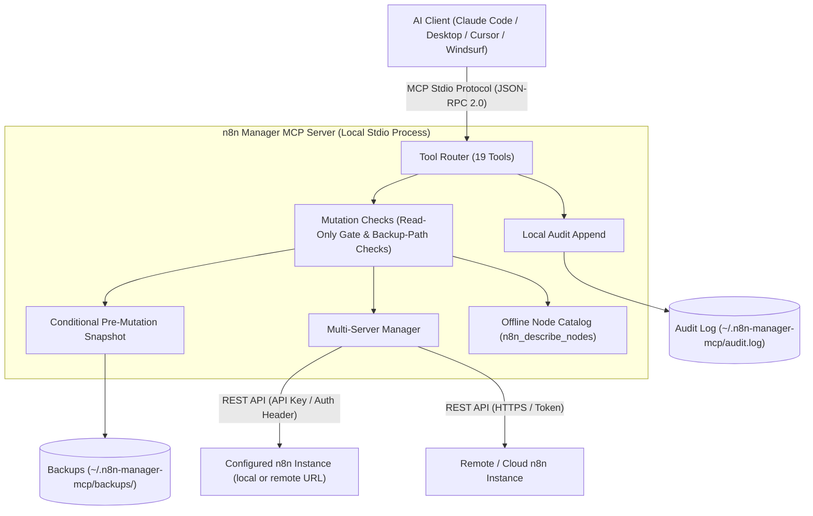

# n8n Manager MCP Server

**[🇬🇧 English](README.md) | [🇩🇪 Deutsch](README_de.md) | [🇪🇸 Español](README_es.md) | [🇯🇵 日本語](README_ja.md) | [🇷🇺 Русский](README_ru.md) | [🇫🇷 Français](README_fr.md) | 🇨🇳 简体中文 | [🇮🇳 हिन्दी](README_hi.md)**

*属于 [ellmos-ai](https://github.com/ellmos-ai) 项目系列和 [open-bricks](https://github.com/open-bricks) 统合项目。*

[](https://www.npmjs.com/package/n8n-manager-mcp)
[](https://github.com/ellmos-ai/n8n-manager-mcp/actions/workflows/tests.yml)
[](https://github.com/ellmos-ai/n8n-manager-mcp)
[](https://nodejs.org)
[](SECURITY.md)
[](SECURITY.md)
[](THIRD_PARTY_LICENSES.md)
[](THIRD_PARTY_LICENSES.txt)
[](NOTICE)
[](llms.txt)
[](llms.txt)
[](https://opensource.org/licenses/MIT)
[](llms.txt)
[](https://github.com/ellmos-ai)
[](https://github.com/open-bricks)

> [!NOTE]
> **面向 AI 助手和 LLM：** 根目录提供 [`llms.txt`](llms.txt) 索引文件，可用于快速读取上下文、查阅工具目录和查看目录清单。

通过 Claude、Cursor 和 Windsurf 等 AI 助手管理 n8n 工作流的 MCP（Model Context Protocol）服务器。

## 快速导航

| 编号 | 章节 | 内容摘要 |
| :--- | :--- | :--- |
| 01 | [📐 系统架构与拓扑](#sec-01) ([#system-architecture](#system-architecture)) | 本地 stdio 传输、多服务器路由和安全检查 |
| 02 | [📊 两张 Mermaid 图](#sec-02) ([#dual-mermaid-diagrams](#dual-mermaid-diagrams)) | 组件架构 flowchart TD 图与安全修改生命周期时序图 |
| 03 | [🌐 目录状态与注册信息](#sec-03) ([#directory-status](#directory-status)) | 在 npm、Glama、PulseMCP 和 Enterprise DNA 上的公开收录信息 |
| 04 | [🎯 目标用户与可发现性](#sec-04) ([#target-personas--discoverability](#target-personas--discoverability)) | `[PERSONA-01]` 至 `[PERSONA-04]` 用户画像及搜索意图较强的 SEO 查询 |
| 05 | [📋 项目能力与边界](#sec-05) ([#comparative-matrix--alternatives](#comparative-matrix--alternatives)) | 10 个实现领域及其文档所述限制 |
| 06 | [🛡️ 能力与实现边界](#sec-06) ([#core-capabilities--safety-invariants](#core-capabilities--safety-invariants)) | 只读模式、可选本地备份和审计日志、输入检查及适用范围说明 |
| 07 | [✨ 主要功能](#sec-07) ([#features](#features)) | 直接 REST 集成、多服务器路由、备份快照和节点目录 |
| 08 | [⚙️ 客户端安装](#sec-08) ([#installation](#installation)) | 为 Claude Code、Claude Desktop、Cursor 和 Windsurf 提供一条命令式配置 |
| 09 | [🚀 快速开始](#sec-09) ([#quick-start](#quick-start)) | 创建工作流、检查执行记录和切换服务器的分步指南 |
| 10 | [🛠️ 可用工具（19 个）](#sec-10) ([#available-tools](#available-tools)) | 涵盖 CRUD、执行记录、备份和节点的完整 MCP 工具参考 |
| 11 | [🔗 可选的 n8n-workflow-manager 集成](#sec-11) ([#optional-n8n-workflow-manager-seam](#optional-n8n-workflow-manager-seam)) | 通过配套管理器服务跟踪决策并集成变更历史 |
| 12 | [🔒 配置与安全默认值](#sec-12) ([#configuration](#configuration)) | 环境变量、本地备份根目录和严格单调限制 |
| 13 | [🧪 开发与测试](#sec-13) ([#development](#development)) | 测试套件、smoke runner 和当前 CI 平台范围 |
| 14 | [🧱 ellmos-ai 生态](#sec-14) ([#ellmos-ai-ecosystem](#ellmos-ai-ecosystem)) | 关联 MCP 服务器、BACH 智能体操作系统和 open-bricks 桌面软件套件 |
| 15 | [📜 第三方许可证与透明度](#sec-15) ([#third-party-licenses--transparency](#third-party-licenses--transparency)) | 项目许可证和依赖项许可证清单 |
| 16 | [📈 营销与用户画像日志](#sec-16) ([#marketing--personas-log](#marketing--personas-log)) | 完整的定位日志、关键词矩阵和三阶段路线图 |
| 17 | [📝 更新日志](#sec-17) ([#changelog](#changelog)) | 完整的发行说明、安全加固和可发现性变更记录 |
| 18 | [⚖️ 责任说明](#sec-18) ([#haftung--liability](#haftung--liability)) | 根据 §§ 516 ff. BGB 作出的开源无偿赠与声明、MIT 免责声明和 48 小时响应承诺 |

---

<a id="sec-01"></a>
<a id="1-architecture"></a>
<a id="system-architecture"></a>
<a id="1-architektur"></a>
<a id="systemarchitektur"></a>
## 系统架构

n8n Manager MCP Server 是一个**优先本地运行、通过 stdio 连接的桥接服务**，用于连接 AI 开发环境（Claude Code、Claude Desktop、Cursor、Windsurf）与本地或远程 n8n 实例。

- **进程模型：**作为 Node.js 进程运行，通过标准输入/输出（`stdio`）使用 JSON-RPC 2.0 与 MCP 客户端通信。它继承启动它的进程权限。
- **修改检查：**工作流修改处理程序会先加载本地配置，并在向 n8n 发送修改请求前检查只读模式。被阻止的尝试仍可能追加到本地审计日志；加载配置时也会访问文件系统。
- **多实例路由器：**使用本地服务器配置文件将调用路由到已配置的 n8n 实例。`servers.json` 中的 API 密钥以明文存储；配置更新使用临时文件并重命名。
- **离线节点目录：**按类别列出常见 n8n 节点类型和简短说明（`n8n_describe_nodes`），不发起网络请求。它不提供完整节点模式或必填属性。

### 架构拓扑图（四视图模型）

```text
+========================================================================================================+
| [VIEW 1: CALLER RUNTIMES & AGENT ECOSYSTEM]                                                           |
| Claude Code CLI      | Claude Desktop      | Cursor IDE / Windsurf | Antigravity / Gemini / Codex     |
| (JSON-RPC 2.0 Stdio) | (stdio MCP Client)  | (Dev Environments)    | (Autonomous Orchestrator Swarms) |
+===================================================+====================================================+
                                                    |
                                                    v
+========================================================================================================+
| [VIEW 2: N8N-MANAGER-MCP CORE ENGINE & MUTATION CHECKS]                                                 |
| +----------------------------------------------------------------------------------------------------+ |
| | Tool Dispatcher (19 Registered MCP Tools: CRUD, Execution Inspect, Backup/Restore, Node Catalog)   | |
| +----------------------------------------------------------------------------------------------------+ |
| | Read-Only Check: persisted setting or N8N_MANAGER_READ_ONLY=1 process ceiling                       | |
| | Input Bounds and Backup-Path Checks (scope limited to the implemented handlers)                     | |
| | Multi-Instance Routing: configured profiles and endpoints                                           | |
| | Bundled Offline Node Catalog: Common Node Types & Descriptions (INV-NODE-09)                         | |
| +----------------------------------------------------------------------------------------------------+ |
+===================================================+====================================================+
                                                    |
                                                    v
+========================================================================================================+
| [VIEW 3: RUNTIME PERSISTENCE, BACKUP SNAPSHOTS & LOCAL AUDIT LOG]                                      |
| +------------------------------------+----------------------------------+----------------------------+ |
| | Conditional Workflow Snapshots    | Local Append-Only Audit Log     | Multi-Server Config Store  | |
| | ~/.n8n-manager-mcp/backups/        | ~/.n8n-manager-mcp/audit.log     | ~/.n8n-manager-mcp/        | |
| | ({server}/{id}-{timestamp}-{reason}.json) | (Timestamped JSON entries) | (servers.json; POSIX 0600 requested) | |
| +------------------------------------+----------------------------------+----------------------------+ |
+===================================================+====================================================+
                                                    |
                                                    v
+========================================================================================================+
| [VIEW 4: STDIO TRANSPORT, CONFIGURED ENDPOINTS & LAUNCHER PRIVILEGES]                                  |
| Inherits launcher process privileges | Configured n8n/manager requests; interactive update check may run |
| No MCP listening port (stdio transport)                    | Published security policy and reporting contacts   |
+========================================================================================================+
```

---

<a id="sec-02"></a>
<a id="2-dual-mermaid-diagrams"></a>
<a id="dual-mermaid-diagrams"></a>
<a id="2-duale-mermaid-diagramme"></a>
<a id="duale-mermaid-diagramme"></a>
## 两张 Mermaid 图

### 组件架构



### 安全工作流修改生命周期

这些图展示了预期的操作顺序。只有启用 `backup_before_mutations` 时才会尝试创建快照（默认值：true）；如果尝试失败，则不会发送后续的 n8n 修改请求。审计日志追加错误会向上层传播，也可能发生在远程修改成功之后。

```mermaid
sequenceDiagram
    autonumber
    actor AI as AI Assistant (Claude / Cursor)
    participant MCP as n8n-manager-mcp Router
    participant Safety as Safety & Read-Only Gate
    participant Snapshot as Backup Engine
    participant Store as Local Storage (~/.n8n-manager-mcp)
    participant N8N as n8n REST API Instance
    participant Audit as Local Audit Logger

    AI->>MCP: Call n8n_update_workflow or n8n_delete_workflow
    MCP->>Safety: Check read-only enforcement
    alt Read-only active (INV-READ-02)
        opt audit_log enabled (default true)
            Safety->>Audit: Append blocked mutation attempt
        end
        Safety-->>AI: Return text explaining that the mutation is blocked (or an error if audit append fails)
    else Mutation permitted
        opt backup_before_mutations enabled (default true)
            Safety->>Snapshot: Trigger pre-mutation snapshot (INV-BACK-03)
            Snapshot->>N8N: GET /workflows/{id}
            N8N-->>Snapshot: Current workflow JSON
            Snapshot->>Store: Save ~/.n8n-manager-mcp/backups/{server}/{id}-{timestamp}-{reason}.json
            Snapshot-->>Safety: Backup path
        end
        Safety->>N8N: PUT /workflows/{id} or DELETE /workflows/{id}
        N8N-->>Safety: Mutation result
        opt audit_log enabled (default true)
            Safety->>Audit: Append structured outcome to audit log (INV-AUDIT-04)
        end
        Safety-->>AI: Return text; include backup path when a backup was saved
    end
```

### 多服务器工作流迁移与 staging 同步生命周期

导入步骤会创建一个新工作流。它不会创建导入前备份，也不会返回回滚句柄。

```mermaid
sequenceDiagram
    autonumber
    actor AI as AI Assistant (Claude / Cursor)
    participant MCP as n8n-manager-mcp Router
    participant Staging as Staging n8n Instance
    participant Prod as Production n8n Instance
    participant Audit as Local Audit Logger

    Note over AI,MCP: Phase 1: Export from staging
    AI->>MCP: n8n_export_workflow(workflow_id=42, server_name=staging)
    MCP->>Staging: GET /workflows/42
    Staging-->>MCP: Workflow JSON
    MCP-->>AI: Cleaned workflow JSON as text

    Note over AI,MCP: Phase 2: Offline node-type catalog
    AI->>MCP: n8n_describe_nodes(category=action)
    MCP-->>AI: Text list of node types and descriptions

    Note over AI,MCP: Phase 3: Import a new inactive copy
    AI->>MCP: n8n_import_workflow(workflow_json=serialized export, server_name=production, activate=false)
    MCP->>Prod: POST /workflows
    Prod-->>MCP: Created workflow JSON with a new ID; inactive
    opt audit_log enabled (default true)
        MCP->>Audit: Append import outcome (INV-AUDIT-04)
    end
    MCP-->>AI: Text response with the new workflow ID; no rollback handle
```

---

<a id="sec-03"></a>
<a id="3-directory-status"></a>
<a id="directory-status"></a>
<a id="3-verzeichnis-status"></a>
<a id="verzeichnis-status"></a>
## 目录收录状态

- [npm 包](https://www.npmjs.com/package/n8n-manager-mcp)：以 `n8n-manager-mcp` 名称发布
- [Glama 收录页](https://glama.ai/mcp/servers/ellmos-ai/n8n-manager-mcp)：ellmos-ai 仓库的公开目录页面
- [Enterprise DNA 目录](https://enterprisedna.co/directories/mcp/ellmos-ai-n8n-manager-mcp/)：`ellmos-ai/n8n-manager-mcp` 的额外公开目录条目
- [PulseMCP 收录页](https://www.pulsemcp.com/servers/ellmos-ai-n8n-manager)：索引名称为 `ellmos-ai-n8n-manager`
- MCP 命名空间状态：此仓库包含 `server.json` 和 `mcpName` 元数据，标识为 `io.github.ellmos-ai/n8n-manager-mcp`；在索引刷新前，一些生态目录仍显示旧名称 `io.github.lukisch/n8n-manager-mcp`。
- 搜索语境：以下查询最匹配：`n8n MCP server`、`n8n workflow management MCP`、`AI assistant n8n workflows` 和 `ellmos-ai n8n-manager-mcp`。

---

<a id="sec-04"></a>
<a id="4-target-personas--discoverability"></a>
<a id="target-personas--discoverability"></a>
<a id="4-zielgruppen--auffindbarkeit"></a>
<a id="zielgruppen--auffindbarkeit"></a>
## 目标用户与可发现性

| 用户画像 | 典型需求 | 任务示例与边界 | 目标搜索词 |
| :--- | :--- | :--- | :--- |
| **[PERSONA-01] 自主 AI 智能体与智能体集群** | MCP 工作流工具、清晰的操作结果，以及常见节点名称的离线列表 | 检查或管理所选服务器上的工作流；仅在启用备份时，受支持的修改操作才会先创建备份。 | `n8n mcp server`, `ai agent n8n workflow management`, `claude code n8n automation` |
| **[PERSONA-02] DevOps 与多环境工程师** | 独立配置文件，以及在已配置的 n8n 实例间导出/导入工作流 | 在已配置的服务器间迁移工作流；导入会创建新工作流，且不会创建导入前备份。 | `n8n multi-server mcp`, `sync n8n workflows staging prod`, `n8n workflow export import mcp` |
| **[PERSONA-03] SecOps、合规与风险团队** | 只读控制、可选本地审计日志和本地备份文件 | 配置只读上限或检查本地记录；已配置的 n8n/管理器端点仍会收到请求，本地文件可能包含工作流数据或 API 密钥。 | `safe n8n mcp server`, `read-only n8n automation`, `audit log n8n ai integration` |
| **[PERSONA-04] 生态构建者与工具集成者** | MCP 工具模式、清单、TypeScript 源码以及测试/smoke 命令 | 集成已注册的工具，并使用仓库测试和 smoke 命令验证更改；当前 CI 在 Ubuntu 上运行。 | `modelcontextprotocol n8n`, `glama n8n-manager-mcp`, `smithery n8n workflow` |

### 搜索意图较强的查询

- `n8n mcp server claude code`
- `ai assistant n8n workflow management`
- `local-first n8n mcp stdio`
- `safe n8n automated workflow mutation`
- `n8n multi-server workflow sync mcp`
- `n8n describe nodes offline catalog`
- `n8n MCP stdio with configured server endpoints`
- `modelcontextprotocol n8n typescript`

---

<a id="sec-05"></a>
<a id="5-comparative-matrix--alternatives"></a>
<a id="comparative-matrix--alternatives"></a>
<a id="5-vergleichsmatrix--alternativen"></a>
<a id="vergleichsmatrix--alternativen"></a>
## 项目能力与边界

| 领域 | 已实现行为 | 适用范围与边界 |
| :--- | :--- | :--- |
| **MCP 传输与网络** | 服务器通过 stdio 与 MCP 客户端通信，不会打开 MCP 监听端口。 | 运行时 API 请求发送到已配置的 n8n URL；如果配置了管理器，也会发送到管理器 URL。更新通知器可能在交互式 TTY 启动时检查更新；常规的非 TTY stdio 路径会跳过该检查。 |
| **工作流工具** | 19 个 MCP 工具可用于列出、创建、更新、删除、启用/停用、导出/导入工作流，检查执行记录，以及管理备份和服务器。 | 修改操作作用于所选的已配置 n8n 实例。导入会创建新工作流，不提供导入前备份或回滚句柄。 |
| **服务器配置文件** | 多个 n8n 配置文件保存在本地 `servers.json` 中；URL 和 API 密钥输入会经过验证。 | API 密钥以明文存储。新配置文件请求使用 POSIX `0600` 模式；Windows 访问权限由目录 ACL 控制。 |
| **只读模式** | 持久化的只读模式会阻止工作流修改工具。`N8N_MANAGER_READ_ONLY=1` 会增加工具无法关闭的进程级上限。 | 修改检查门之前会先加载配置。被阻止的尝试仍可能追加到本地审计日志，因此这不是文件系统级只读模式。 |
| **修改前备份** | 启用时（默认值：true），更新、删除、启用/停用和覆盖恢复操作前会创建 JSON 快照。 | 创建和导入操作没有修改前快照。如果启用的快照获取或保存失败，则不会发送后续 n8n 修改请求。备份 JSON 以明文保存在本地。 |
| **审计日志** | 可配置的本地 JSON 追加日志，默认启用，用于记录受支持操作的结果和被阻止的修改尝试。 | 它不具备防篡改保护。追加错误会向上层传播，也可能发生在上游修改已经成功之后。 |
| **输入与备份路径** | 数值字段有明确范围；备份、列表和恢复操作会清理备份路径段，并检查真实路径/符号链接。 | 这些检查仅适用于相关输入和文件操作，并不能保证免受所有路径穿越、原型污染或格式错误载荷导致的故障。 |
| **可选管理器历史** | 可选工具 `n8n_manager_history` 会在设置 `N8N_MCP_MANAGER_URL` 时从已配置的管理器读取；如果管理器无法访问，不会回退到直接查询 n8n。 | 启用此选项会向已配置的管理器端点发送请求。 |
| **离线节点目录** | `n8n_describe_nodes` 无需 API 请求即可列出常见节点类型和简短说明。 | 不提供完整节点模式或必填属性。 |
| **验证与安全策略** | GitHub Actions 在 Ubuntu 和 Node.js 20、22 上运行构建、测试、smoke/打包检查。`SECURITY.md` 公布了响应、初步评估和修复承诺。 | 此 CI 配置不构成跨平台保证。安全响应时限是策略承诺，不代表实测的响应表现。 |

---

<a id="sec-06"></a>
<a id="6-core-capabilities--safety-invariants"></a>
<a id="core-capabilities--safety-invariants"></a>
<a id="6-kernfaehigkeiten--sicherheitsinvarianten"></a>
<a id="kernfähigkeiten--sicherheitsinvarianten"></a>
## 能力与实现边界

这些参考 ID 用于归类实现领域，不代表外部认证或保证。

| 参考项 | 已实现行为 | 适用范围与限制 |
| :--- | :--- | :--- |
| `INV-LOCAL-01` | 与 MCP 客户端的通信使用本地 stdio。 | n8n API 调用发送到已配置端点；可选管理器和交互式终端中的更新检查也可能发起网络请求。 |
| `INV-READ-02` | `N8N_MANAGER_READ_ONLY=1` 是工具无法禁用的环境级上限。没有此环境上限时，可以更改持久化的只读模式。 | 服务器会在检查修改门之前加载配置；被阻止的尝试可能追加到审计文件，追加失败可能导致工具调用返回错误。这不是操作系统级的文件系统限制。 |
| `INV-BACK-03` | 启用 `backup_before_mutations` 时（默认值：true），更新、删除、启用/停用和覆盖恢复前会尝试创建 JSON 快照。 | 创建/导入前不会备份。启用的快照失败会阻止后续 n8n 修改请求。备份以明文保存在本地。 |
| `INV-AUDIT-04` | `audit_log` 可配置且默认启用；日志条目追加到本地审计文件。 | 日志不具备防篡改保护。追加失败会向上层传播，也可能发生在上游修改成功之后。 |
| `INV-SRV-05` | 多个服务器配置文件保存在本地，并按请求选择。 | `servers.json` 中的 API 密钥为明文。新配置文件请求使用 POSIX `0600`；Windows 访问权限由目录 ACL 控制。 |
| `INV-TRAV-06` | 会验证数值输入范围；相关文件操作会清理备份路径段，并将其与配置的根目录进行比对。 | 真实路径和符号链接检查适用于备份/列表/恢复处理。这并不保证免受所有路径穿越、原型污染或格式错误载荷导致的故障。 |
| `INV-PRIV-07` | 服务器不会请求提升权限。 | Node 进程继承启动它的进程权限；未实现权限降级或强制 `RunAsInvoker`。 |
| `INV-SEAM-08` | `n8n_manager_history` 使用可选的 `N8N_MCP_MANAGER_URL` 集成；管理器无法访问时不会回退到直接查询 n8n。 | 启用时会向已配置的管理器端点发送请求。 |
| `INV-NODE-09` | 内置目录按类别介绍常见节点类型。 | 不会返回完整节点模式或必填属性。 |
| `INV-SLA-10` | GitHub Actions 在 Ubuntu 和 Node.js 20、22 上运行构建、测试、smoke 和打包检查。`SECURITY.md` 公布了响应、初步评估和修复承诺。 | 此 CI 配置不构成跨平台保证。安全响应时限是策略承诺，不是实际响应表现的证明。 |

<a id="sec-07"></a>
<a id="7-features"></a>
<a id="features"></a>
<a id="7-funktionen"></a>
<a id="funktionen"></a>
## 功能

- 用于管理 n8n 工作流的 **19 个工具**
- 列出、创建、更新、删除、启用和停用工作流
- 安全控制：只读模式、可配置的受支持修改备份（默认启用）、本地恢复，以及可配置的审计日志（默认启用）
- 支持多服务器（连接多个 n8n 实例）
- 在服务器间导出/导入工作流
- 查看执行历史和状态
- 内置带说明的节点目录
- 不依赖 Python，可直接连接 n8n REST API

---

<a id="sec-08"></a>
<a id="8-installation"></a>
<a id="installation"></a>
## 安装

### Claude Desktop

添加到 `claude_desktop_config.json`：

```json
{
  "mcpServers": {
    "n8n-manager": {
      "command": "npx",
      "args": ["-y", "n8n-manager-mcp"]
    }
  }
}
```

### Claude Code

```bash
claude mcp add --scope user n8n-manager npx -y n8n-manager-mcp
```

### 手动安装

```bash
npm install -g n8n-manager-mcp
```

---

<a id="sec-09"></a>
<a id="9-quick-start"></a>
<a id="quick-start"></a>
<a id="9-schnellstart"></a>
<a id="schnellstart"></a>
## 快速开始

### 自然语言提示

安装后，可在 AI 助手中使用以下提示。注册服务器前，请在 MCP 主机环境中安全配置 N8N_MANAGER_API_KEY 和对应的 N8N_MANAGER_SERVER_URL。不要在提示或工具参数中包含 API 密钥：

1. **添加 n8n 服务器：**
   > "使用主机上已经配置的凭据，在 http://localhost:5678 添加名为 production 的 n8n 服务器配置文件"

2. **列出工作流：**
   > "显示我的 n8n 服务器上的所有工作流"

3. **离线查看节点：**
   > "显示内置离线目录中的 action 节点类型及其说明"

4. **创建工作流：**
   > "创建一个由 webhook 触发、从 API 获取数据并发送 Slack 消息的 n8n 工作流"

5. **检查执行记录：**
   > "显示 production 上最近 10 条工作流执行记录"

6. **在环境间导入副本：**
   > "从 staging 导出工作流 42，并在 production 中导入一个新的未启用副本"
   >
   > 注意：n8n_import_workflow 会创建一个新工作流；它不会创建导入前备份，也不会返回回滚句柄。除非请求启用，否则副本保持未启用状态。

### 面向开发者和智能体的端到端示例

下面逐步演示服务器配置、离线目录查询、带备份的工作流修改、恢复和只读行为。示例展示工具参数形式和说明性 MCP 文本响应。

#### 1. 注册多个服务器并检查可用性

注册新服务器前，请通过客户端的敏感设置或操作系统密钥管理功能，在 MCP 主机环境中配置 N8N_MANAGER_API_KEY 和对应的 N8N_MANAGER_SERVER_URL。切勿在聊天提示或工具参数中传递 API 密钥。本地服务器配置文件以明文保存密钥；POSIX 下新文件请求使用 0600 模式，Windows 下的访问权限由目录 ACL 控制。

调用 n8n_add_server：

```json
{
  "name": "staging",
  "url": "http://127.0.0.1:5678",
  "is_default": true
}
```

说明性 MCP 文本响应（服务器名称和 URL 与请求一致）：

```text
Server "staging" added (http://127.0.0.1:5678). Set as default.
```

调用 n8n_ping_server：

```json
{
  "server_name": "staging"
}
```

说明性 MCP 文本响应（响应时间会有所不同）：

```text
Server "staging" (http://127.0.0.1:5678) is reachable. Response time: <N>ms
```

#### 2. 离线节点目录

n8n_describe_nodes 按类别筛选内置目录。它返回文本说明，而非完整节点模式或选定的节点名称列表。

调用 n8n_describe_nodes：

```json
{
  "category": "action"
}
```

说明性响应文本：

```text
n8n Node Types (action):

  [ACTION] n8n-nodes-base.httpRequest
    Name: HTTP Request
    Make HTTP requests. Params: url, method, headers, body

  [ACTION] n8n-nodes-base.emailSend
    Name: Send Email
    Send emails via SMTP. Params: fromEmail, toEmail, subject, text

  [ACTION] n8n-nodes-base.slack
    Name: Slack
    Send messages to Slack channels

  [ACTION] n8n-nodes-base.telegram
    Name: Telegram
    Send messages via Telegram bot

  [ACTION] n8n-nodes-base.googleSheets
    Name: Google Sheets
    Read/write Google Sheets data
```

#### 3. 使用自动快照安全更新工作流

启用 backup_before_mutations 时（默认值：true），n8n_update_workflow 会在向 n8n 发送更新前保存带时间戳的快照。此示例仅展示参数形式：请将占位符替换为完整且序列化为 JSON 的更新后工作流。

调用 n8n_update_workflow：

```json
{
  "workflow_id": "42",
  "server_name": "staging",
  "workflow_json": "<complete JSON-serialized updated workflow>"
}
```

默认备份启用时的说明性 MCP 文本响应：

```text
Workflow 42 updated successfully on staging. Backup saved: <backup path>
```

#### 4. 从本地备份恢复

要覆盖工作流 42，请传入其备份路径和 target_workflow_id。启用 backup_before_mutations 时，当前目标会在覆盖前备份。省略 target_workflow_id 则会创建一个新工作流。

调用 n8n_restore_workflow：

```json
{
  "backup_path": "<path returned by n8n_list_backups or a mutation response>",
  "server_name": "staging",
  "target_workflow_id": "42"
}
```

启用恢复前备份时的说明性 MCP 文本响应：

```text
Workflow restored (overwritten) on staging: "Customer Webhook Ingest [v2]" (ID: 42). Pre-restore backup saved: <backup path>
```

#### 5. 失败时保持只读保护

启用 `audit_log` 时（默认值：true），被阻止的修改会追加到审计日志；追加错误可能导致工具调用失败。如果在 MCP 主机环境中设置 N8N_MANAGER_READ_ONLY=1，它会成为单调上限：n8n_set_safety_mode 无法将其关闭。要解除此上限，请删除环境变量并重启 MCP 服务器。下方运行时的通用文本仍提到 n8n_set_safety_mode；环境上限生效期间，该建议不适用。

调用 n8n_delete_workflow：

```json
{
  "workflow_id": "42",
  "server_name": "staging"
}
```

只读模式启用时的说明性运行时文本响应：

```text
Blocked: n8n Manager is in read-only mode. Disable read_only via n8n_set_safety_mode before delete_workflow.
```

---

<a id="sec-10"></a>
<a id="10-available-tools"></a>
<a id="available-tools"></a>
<a id="10-verfuegbare-tools"></a>
<a id="verfügbare-tools"></a>
## 可用工具

| 工具 | 说明 |
|------|-------------|
| `n8n_list_workflows` | 列出服务器上的所有工作流 |
| `n8n_get_workflow` | 获取工作流详情（节点、连接） |
| `n8n_create_workflow` | 根据节点和连接创建新工作流 |
| `n8n_update_workflow` | 更新现有工作流 |
| `n8n_delete_workflow` | 删除工作流 |
| `n8n_activate_workflow` | 启用或停用工作流 |
| `n8n_list_executions` | 列出近期执行记录及其状态 |
| `n8n_export_workflow` | 将工作流导出为可导入的 JSON |
| `n8n_import_workflow` | 将工作流 JSON 导入服务器 |
| `n8n_safety_status` | 显示本地安全设置、备份目录和审计日志路径 |
| `n8n_set_safety_mode` | 切换只读模式、修改前备份和审计日志 |
| `n8n_list_backups` | 列出修改前创建的本地工作流备份 |
| `n8n_restore_workflow` | 从本地备份恢复工作流 |
| `n8n_add_server` | 添加/更新 n8n 服务器连接 |
| `n8n_list_servers` | 列出已配置服务器 |
| `n8n_ping_server` | 测试服务器连接 |
| `n8n_remove_server` | 移除服务器 |
| `n8n_describe_nodes` | 浏览可用的 n8n 节点类型 |
| `n8n_manager_history` | 从可选的 n8n-workflow-manager 读取版本历史、记录的决策和同步历史（自选启用，只读） |

---

<a id="sec-11"></a>
<a id="11-optional-n8n-workflow-manager-seam"></a>
<a id="optional-n8n-workflow-manager-seam"></a>
<a id="11-optional-anbindung-an-den-n8n-workflow-manager"></a>
<a id="optional-anbindung-an-den-n8n-workflow-manager"></a>
## 可选的 n8n-workflow-manager 集成

n8n 本身不记录工作流修改的*原因*。关联项目
[n8n-workflow-manager](https://github.com/ellmos-ai/n8n-workflow-manager) 会在本地数据库中保存版本、每次修改必须记录的决策以及同步历史。
`n8n_manager_history` 让此 MCP 服务器能够读取这些记录。

此集成**可选启用且只读**：

- 未设置 `N8N_MCP_MANAGER_URL` 时，行为不变——与之前一样，所有工具都直接与 n8n 通信。
- 设置后（例如 `http://127.0.0.1:8100`），`n8n_manager_history` 会从正在运行的管理器读取。
  省略 `workflow_id` 可列出管理器的工作流；传入该参数可获取完整历史。
- 这些 ID 是**管理器 ID，而不是 n8n 实例 ID**。管理器保存了对应关系，但未提供查询路由，因此此服务器不会猜测转换结果。
- 如果管理器已配置但无法访问，工具会**返回明确错误信息**，
  而不会悄悄改从 n8n 实例回答——该存储没有决策历史，
  因而替代回答会是不同的答案。
- `n8n_safety_status` 报告集成的*实测状态*（是否已配置、是否可访问、
  管理器版本），而不仅仅是环境变量。

安装：运行 `pip install n8n-workflow-manager`，然后运行 `n8n-manager serve`（绑定到 `127.0.0.1:8100`）。
管理器 API 未启用身份验证，默认绑定到回环地址；绑定主机可配置。
非回环 URL 会在 `n8n_safety_status` 中标记。

数值限制包含在 MCP 模式中：工作流、执行记录和备份列表的上限为 **1 到 1000** 的有限正整数（现有默认值仍为 100、20 和 20）；工作流连接的 `from_output`/
`to_input` 索引为 **0 到 1000** 的有限非负整数。无效值会在相应操作继续之前，由 MCP 输入模式或工作流验证拒绝。修改检查前加载配置时，可能会访问本地文件系统。

---

<a id="sec-12"></a>
<a id="12-configuration"></a>
<a id="configuration"></a>
<a id="12-konfiguration"></a>
<a id="konfiguration"></a>
## 配置

服务器连接和安全设置保存在 `~/.n8n-manager-mcp/servers.json` 中。

### API 密钥数据流

启动服务器前，请在 **MCP 主机进程环境**中设置 `N8N_MANAGER_API_KEY` 和 `N8N_MANAGER_SERVER_URL`。如可用，请使用客户端的敏感用户配置或操作系统密钥管理功能；并检查客户端是否会将环境变量写入明文配置文件。`N8N_MANAGER_SERVER_URL` 必须与传给 `n8n_add_server` 的 URL 匹配（末尾斜杠会被规范化）。不要在聊天提示或工具参数中包含 API 密钥。

`n8n_add_server` 从主机环境读取密钥、验证密钥，并将其与服务器配置文件一起保存到本地 `servers.json`。该文件**未加密，以明文存储**；POSIX 下新文件请求使用 `0600` 模式，Windows 下的访问权限由目录 ACL 控制。MCP 工具模式、工具返回结果和服务器列表均不包含已配置的密钥值。API 调用会在 `X-N8N-API-KEY` 请求头中将密钥发送到已配置的 n8n URL；不会跟随重定向。远程 n8n 服务器请使用 HTTPS。上游成功或失败响应中回显的密钥会在 MCP 输出和审计边界处遮蔽，包括 JSON 对象键和工作流 ID。

现有 `servers.json` 配置文件仍可使用。更新相同 URL 的配置文件时，即使环境中存在密钥，也会保留已存储的密钥。要轮换密钥或更改配置文件 URL，请在主机环境中设置新密钥及匹配的 URL，重启 MCP 服务器，然后调用 `n8n_add_server` 并设置 `rotate_key: true`。未轮换密钥时拒绝更改 URL。配置多个服务器时，每个服务器都使用各自的环境变量密钥/URL 对进行配置和添加，并在每组之间重启 MCP 进程；已存储的密钥不会被静默替换。完成初始配置后，重启时可以移除环境变量对，因为密钥仍保留在本地配置文件中。请移除任何将 `api_key` 作为工具参数传入的旧提示或客户端调用。

安全默认值：

- `backup_before_mutations: true` 会在更新、删除、启用/停用和覆盖恢复操作前保存工作流 JSON。
- `audit_log: true` 会将修改结果追加到 `~/.n8n-manager-mcp/audit.log`。
- `read_only: false` 是默认值。可以通过 `n8n_set_safety_mode` 或 `N8N_MANAGER_READ_ONLY=1` 启用只读模式。
  环境变量是强制上限：启用期间，
  持久化设置和 `n8n_set_safety_mode` 都无法关闭只读模式。
- 备份保存在 `~/.n8n-manager-mcp/backups/` 下，可使用备份工具列出/恢复。备份、列表和恢复处理会清理备份路径段，并检查真实路径/符号链接。列表会显示普通 `.json` 备份。这些检查仅适用于上述操作，不构成通用文件系统保证。
- `n8n_add_server` 会在保存前验证服务器连接输入：URL 必须是 `http` 或 `https` 基础 URL，不能包含内嵌凭据、查询字符串或片段；API 密钥不能包含空白字符。
- `n8n_add_server` 的默认语义明确：第一个服务器成为默认服务器；更新时不指定 `is_default` 会保留现有标记；`true` 会将该服务器设为默认；`false` 会有意移除该标记，之后默认服务器查询会回退到第一个已配置服务器。

---

<a id="sec-13"></a>
<a id="13-development"></a>
<a id="development"></a>
<a id="13-entwicklung"></a>
<a id="entwicklung"></a>
## 开发

```bash
npm install
npm run build    # One-time build
npm run dev      # Watch mode
npm start        # Start server
npm test         # Run test suite (vitest)
npm run smoke    # Start the built MCP server and verify tool discovery
```

### 测试

测试套件覆盖 URL 构建、服务器输入验证、服务器管理、安全设置、备份路径处理、工作流 JSON 构造、导入/导出验证、i18n 语言包、仓库卫生和错误处理。管理器集成通过本地 stub HTTP 服务器进行测试，其中包括验证管理器不可用时不会回退为直接查询 n8n。

```bash
npm test              # Run all tests
npx vitest run        # Same as above
npx vitest --watch    # Watch mode
npm run smoke         # Manual stdio MCP smoke test (requires npm run build first)
```

已有验证记录涵盖本地 Windows 和 GitHub Actions 中的 Ubuntu Linux；GitHub Actions 会在 Node.js 20 和 22 上运行构建、测试及 npm 包检查。对应提交的本地记录保存在 `CHANGELOG.md` 中。冒烟运行器通过 MCP SDK 客户端启动 `dist/index.js`，验证全部 19 个工具注册以及使用合成凭据进行的不含密钥回显的服务器配置，并使用回环地址 stub 测试密钥遮蔽和拒绝重定向。它不会连接真实的 n8n 服务器。

### 贡献与开发流程

欢迎贡献！完整指南请参阅 [CONTRIBUTING.md](CONTRIBUTING.md) 和 [CODE_OF_CONDUCT.md](CODE_OF_CONDUCT.md)，其中包括：
- **实现范围（`INV-LOCAL-01` 至 `INV-SLA-10`）**：stdio 传输、只读模式、可配置备份与审计日志、验证以及已发布的安全政策；范围和限制见上文。
- **进程权限：**进程继承启动它的程序所具有的权限，不会请求提权。
- **Plan D 工作流：**开发严格基于规范的本地克隆和 GitHub `origin/main`。
- **已发布的安全政策：**响应、初步评估和修复承诺列于 `SECURITY.md`；协调披露联系人包括 `security@ellmos.ai` 和 `security@open-bricks.org`。

## 相关项目

- **[n8n-workflow-manager](https://github.com/ellmos-ai/n8n-workflow-manager)** — 面向**人类的状态与历史层**（Web UI + REST API，Python）：逐工作流变更历史与决策日志、可视化图查看器、多服务器同步。它与此 MCP 服务器设计为**配套使用**：MCP 是 **AI 操作层**（创建/更新/删除/启用），管理器用于审查、记录和回滚。**记忆与上下文（路线图）：**单靠 MCP 服务器无法**保证**智能体在破坏性变更前检查历史上下文——这种强制检查应由管理器以客户端无关的方式负责；对话上下文可选地来自按需拉取的历史索引，例如 [ctx](https://github.com/ctxrs/ctx)（Apache-2.0）。计划内容：共享历史/决策存储，以及一个*修改前检查历史*的保护机制。
- [n8n](https://n8n.io/) -- 工作流自动化平台

## 许可证

MIT

---

<a id="sec-14"></a>
<a id="14-ellmos-ai-ecosystem"></a>
<a id="ellmos-ai-ecosystem"></a>
<a id="14-ellmos-ai-oekosystem"></a>
<a id="ellmos-ai-ökosystem"></a>
## ellmos-ai 生态

此 MCP 服务器属于 **[ellmos-ai](https://github.com/ellmos-ai)** 生态，涵盖 AI 基础设施、MCP 服务器和智能工具。

### MCP 服务器系列

| 服务器 | 工具数 | 重点领域 | npm |
|--------|-------|-------|-----|
| [FileCommander](https://github.com/ellmos-ai/ellmos-filecommander-mcp) | 46 | 文件系统、进程管理、交互式会话、可安全处理云同步锁的操作 | [`ellmos-filecommander-mcp`](https://www.npmjs.com/package/ellmos-filecommander-mcp) |
| [CodeCommander](https://github.com/ellmos-ai/ellmos-codecommander-mcp) | 22 | 代码分析、JSON 修复、导入语句、差异比较、正则表达式 | [`ellmos-codecommander-mcp`](https://www.npmjs.com/package/ellmos-codecommander-mcp) |
| [Clatcher](https://github.com/ellmos-ai/ellmos-clatcher-mcp) | 12 | 文件修复、格式转换、批量操作 | [`ellmos-clatcher-mcp`](https://www.npmjs.com/package/ellmos-clatcher-mcp) |
| **[n8n Manager](https://github.com/ellmos-ai/n8n-manager-mcp)** | **19** | **通过 AI 助手管理 n8n 工作流** | **[`n8n-manager-mcp`](https://www.npmjs.com/package/n8n-manager-mcp)** |
| [ControlCenter](https://github.com/ellmos-ai/ellmos-controlcenter-mcp) | 20 | MCP 技术栈发现、配置管理、控制平面 | [`ellmos-controlcenter-mcp`](https://www.npmjs.com/package/ellmos-controlcenter-mcp) |
| [Homebase](https://github.com/ellmos-ai/ellmos-homebase-mcp) | 45 | 本地优先的 LLM 记忆、知识、状态、路由和蜂群编排 | [`ellmos-homebase-mcp`](https://www.npmjs.com/package/ellmos-homebase-mcp)（alpha）|
| [ServerCommander](https://github.com/ellmos-ai/ellmos-servercommander-mcp) | 8 | 服务器操作：健康检查、日志分析、部署演练、邮件诊断 | [`ellmos-servercommander-mcp`](https://www.npmjs.com/package/ellmos-servercommander-mcp)（alpha）|
| [Blender Use](https://github.com/ellmos-ai/ellmos-blender-use-mcp) | 3 | 无头 Blender 资产质检和 FBX 重新导入验证 | [`ellmos-blender-use-mcp`](https://www.npmjs.com/package/ellmos-blender-use-mcp)（alpha）|
| [Open Compute](https://github.com/ellmos-ai/open-compute-mcp) | 10 | 模型无关的计算机操作：捕获、安全门控操作、Windows UIA | [`open-compute-mcp`](https://www.npmjs.com/package/open-compute-mcp)（alpha）|

### AI 基础设施

| 项目 | 说明 |
|---------|-------------|
| [BACH](https://github.com/ellmos-ai/bach) | 面向 LLM 智能体的本地优先文本操作系统——113+ 个处理器、550+ 个工具、SQLite 记忆 |
| [open-compute](https://github.com/ellmos-ai/open-compute) | 为 Open Compute MCP 提供支持的模型无关计算机操作核心 |
| [clutch](https://github.com/ellmos-ai/clutch) | 供应商中立的 LLM 编排，支持自动路由和预算跟踪 |
| [rinnsal](https://github.com/ellmos-ai/rinnsal) | 轻量级智能体记忆、连接器和自动化基础设施 |
| [ellmos-stack](https://github.com/ellmos-ai/ellmos-stack) | 自托管 AI 研究技术栈（Ollama + n8n + Rinnsal + KnowledgeDigest）|
| [MarbleRun](https://github.com/ellmos-ai/MarbleRun) | 面向 Claude Code 的自主智能体链框架 |
| [gardener](https://github.com/ellmos-ai/gardener) | 极简、由数据库驱动的 LLM 操作系统原型（4 个函数、1 张表）|
| [ellmos-tests](https://github.com/ellmos-ai/ellmos-tests) | 用于 LLM 操作系统的测试框架（7 个维度）|

### 桌面软件与关联工具

我们的合作组织 **[open-bricks](https://github.com/open-bricks)** 及其关联套件汇集了原生面向 AI 的桌面应用和开发者工具：

| 仓库 | 组织 / 套件 | 重点与功能 |
| :--- | :--- | :--- |
| **[ProFiler](https://github.com/file-bricks/ProFiler)** | `file-bricks` | 高级文件与资产管理工作台，带重复项检测 |
| **[ExplorerPro](https://github.com/file-bricks/ExplorerPro)** | `file-bricks` | 支持标签页和筛选的文件管理器，带智能批处理 |
| **[WinStorePackager](https://github.com/file-bricks/WinStorePackager)** | `file-bricks` | MSIX 打包与 Windows Store 发布准备 |
| **[DokuZen](https://github.com/doc-bricks/DokuZen)** | `doc-bricks` | 离线 Markdown 编辑器、实时预览和文档组织工作台 |
| **[PDFtoPDFocr](https://github.com/doc-bricks/PDFtoPDFocr)** | `doc-bricks` | 离线 OCR 流程，可将扫描版 PDF 转换为可搜索 PDF |
| **[USR_PDFunlock](https://github.com/doc-bricks/USR_PDFunlock)** | `doc-bricks` | 用于受保护 PDF 归档文件的生日/日期密码恢复工具 |
| **[UniversalInvoiceMail](https://github.com/doc-bricks/UniversalInvoiceMail)** | `doc-bricks` | 自动提取发票并处理邮件 |
| **[CleanMarkdown](https://github.com/doc-bricks/CleanMarkdown)** | `doc-bricks` | 对技术 Markdown 进行无损格式和排版清理 |
| **[safe-start-for-codex](https://github.com/dev-bricks/safe-start-for-codex)** | `dev-bricks` | 快速、可靠的智能体启动与环境检查运行器 |
| **[automation-master](https://github.com/dev-bricks/automation-master)** | `dev-bricks` | 集中式多主机自动化编排器和任务监控器 |
| **[DevCenter](https://github.com/dev-bricks/DevCenter)** | `dev-bricks` | 面向本地工具链的统一开发者工作区仪表板 |
| **[CodeBox](https://github.com/dev-bricks/CodeBox)** | `dev-bricks` | 面向多语言开发的桌面代码编辑器 / IDE |
| **[githubbot](https://github.com/dev-bricks/githubbot)** | `dev-bricks` | 自动化的多组织仓库维护与可发现性引擎 |
| **[swarm-ai](https://github.com/ellmos-ai/swarm-ai)** | `ellmos-ai` | 具有迹象式协调机制的分布式多智能体蜂群框架 |
| **[ellmos-core](https://github.com/ellmos-ai/ellmos-core)** | `ellmos-ai` | 企业级 AI 智能体后端、混合 RAG 和多租户安全 |
| **[open-bricks](https://github.com/open-bricks)** | `open-bricks` | 汇总所有本地优先 AI 软件产品的门户和目录 |
| **[Zombie Killer Tray](https://github.com/dev-bricks/zombie-killer-tray)** | `dev-bricks` | 用于检查孤立 MCP 进程的可选 Windows 工具。通过受支持的 `node_modules/n8n-manager-mcp/dist/index.js` 入口启动时，n8n Manager 是一个已配置的候选项；仍须通过其余进程检查和 apply 检查 |

---

<a id="sec-15"></a>
<a id="15-third-party-licenses--transparency"></a>
<a id="third-party-licenses"></a>
<a id="third-party-licenses--transparency"></a>
<a id="15-drittanbieter-lizenzen--transparenz"></a>
<a id="drittanbieter-lizenzen"></a>
<a id="drittanbieter-lizenzen--transparenz"></a>
## 第三方许可证与透明度

本项目采用 [MIT 许可证](LICENSE)，并在 [NOTICE](NOTICE) 中列明致谢信息。
下表列出本项目声明的部分直接依赖和开发依赖。许可证详情见仓库清单；此表不表示持续审计，也不认证供应链安全：

| 依赖项 | 类型 | 版本 | 许可证 | 清单状态 |
| :--- | :--- | :--- | :--- | :--- |
| [`@modelcontextprotocol/sdk`](https://github.com/modelcontextprotocol/typescript-sdk) | 运行时（直接依赖） | `^1.29.0` | MIT | 许可证已列明 |
| [`zod`](https://github.com/colinhacks/zod) | 运行时（直接依赖） | `^4.6.7` | MIT | 许可证已列明 |
| [`update-notifier`](https://github.com/yeoman/update-notifier) | 运行时（直接依赖） | `^7.3.1` | BSD-2-Clause | 许可证已列明 |
| `typescript` | 开发 / 编译器 | `^5.3.3` | Apache-2.0 | 许可证已列明 |
| `vitest` | 开发 / 测试运行器 | `^4.1.11` | MIT | 许可证已列明 |
| `@types/node` | 开发 / 类型定义 | `^20.11.0` | MIT | 许可证已列明 |

- **网络范围：**服务器会向已配置的 n8n 端点以及（启用时）已配置的管理器端点发送请求。更新通知器可能在交互式 TTY 启动时检查更新；常规非 TTY stdio 路径会跳过该检查。已审阅的应用源代码中未发现产品分析数据发送逻辑。
- **详细开源清单：**完整的致谢声明、许可证文本和传递依赖分析见 [`THIRD_PARTY_LICENSES.md`](THIRD_PARTY_LICENSES.md)。
- **纯文本依赖清单：**[`THIRD_PARTY_LICENSES.txt`](THIRD_PARTY_LICENSES.txt) 提供依赖/许可证清单；它不是运行时审计记录，也不证明权限状态。

---

<a id="sec-16"></a>
<a id="16-marketing--personas-log"></a>
<a id="marketing--personas-log"></a>
<a id="16-marketing--personas-protokoll"></a>
<a id="marketing--personas-protokoll"></a>
## 市场定位与用户角色记录

关于市场定位、目标用户角色定义、治理不变量映射及三阶段可发现性路线图，请参阅 [`MARKETING-LOG.txt`](MARKETING-LOG.txt)。

---

<a id="sec-17"></a>
<a id="17-changelog"></a>
<a id="changelog"></a>
<a id="17-aenderungsprotokoll"></a>
<a id="änderungsprotokoll"></a>
## 更新日志

详细版本历史、发布说明和过往迁移里程碑请见 [`CHANGELOG.md`](CHANGELOG.md)。

---

<a id="sec-18"></a>
<a id="18-security-policy--statutory-notice"></a>
<a id="18-liability--statutory-notice"></a>
<a id="statutory-notice--liability"></a>
<a id="haftung--liability"></a>
<a id="18-sicherheitsrichtlinie--gesetzlicher-hinweis"></a>
<a id="18-haftung--gesetzlicher-hinweis"></a>
<a id="haftung"></a>
## 责任 / 责任限制

### 法定告知与责任声明（§ 521 BGB）

本项目属于《德国民法典》（BGB）第 516 条及后续条款所指的**无偿开源赠与**。根据**第 521 条**，作者的责任限于**故意和重大过失**。此外，[MIT 许可证](LICENSE)中的责任限制也适用。

使用风险由使用者自行承担。不承诺维护或可用性，也不保证没有错误或适用于某一特定用途。

本项目依据 MIT 许可证作为无偿开源赠与提供。责任限于故意和重大过失（《德国民法典》第 521 条）。使用风险由使用者自行承担。不作保证、不承诺维护，也不保证适用于某一特定用途。

### 安全响应 SLA 与漏洞报告

如 [SECURITY.md](SECURITY.md) 所述，已发布的安全政策作出以下响应、初步评估和修复承诺：
- **初始响应承诺：**已发布的政策规定在 **48 小时**内作出初步响应（`INV-SLA-10`）。
- **初步评估承诺：**已发布的政策规定在 **5 个工作日**内评估漏洞。
- **修复承诺：**已发布的政策规定，在确认所报告的漏洞后 **30 个日历日**内协调完成安全修复。
- **直接联系地址：**
  - `security@open-bricks.org`
  - `security@ellmos.ai`
  - `lukas@open-bricks.org`

以上均为政策承诺；本文不报告实际测得的响应表现。
